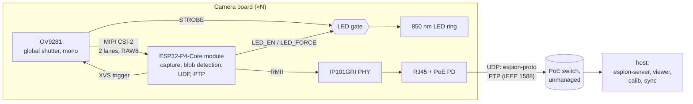
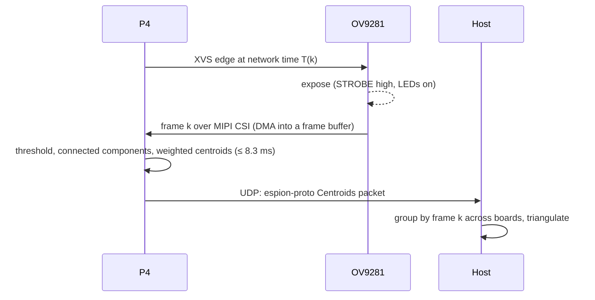

# Architecture

espion tracks IR-reflective or IR-emitting markers with several camera boards. Each board
exposes all cameras at the same instant, finds the bright blobs in every frame, and
streams their subpixel centroids to the host over Ethernet. The host triangulates 3D marker
positions.

## Camera board

A baseboard for a Waveshare ESP32-P4-Core module.

| Part | Role |
|---|---|
| [Waveshare ESP32-P4-Core](https://docs.waveshare.com/ESP32-P4-Core), 16 MB flash (SKU 36096) | ESP32-P4NRW32X (silicon **rev v3.x**: esp-hal does not support older revisions), 32 MB in-package PSRAM, 16 MB NOR flash, 40 MHz and 32.768 kHz crystals, VDD_HP DC-DC on the module. Sensor control, MIPI CSI capture, blob detection, XVS trigger, LED gating, Ethernet MAC with IEEE 1588 clock |
| OV9281 | 1 MP monochrome global-shutter sensor, MIPI CSI-2 2-lane. Mode: 640×400 2×2 binned, RAW8, 120 fps, external trigger on XVS, STROBE output |
| IP101GRI | 10/100 Ethernet PHY on RMII, 25 MHz crystal. Drives the 50 MHz RMII reference clock into the P4. The PHY of Espressif's and Waveshare's P4 Ethernet boards |
| RJ45 MagJack | Integrated magnetics with PoE-rated centre taps |
| IEEE 802.3af PoE PD | Isolated 5 V from the Ethernet cable |
| 5 V OR-ing | PoE 5 V and USB-C VBUS, either one powers the board, no back-feed into USB |
| 850 nm LED ring + driver | Lights passive retroreflective markers at 2–5 m (room scale). On only while `(STROBE ∧ LED_EN) ∨ LED_FORCE` |
| USB-C | 5 V on the bench; flashing, logs and JTAG through the P4's USB Serial/JTAG (no hub) |

### Board signals

| Signal | Direction | Purpose |
|---|---|---|
| MIPI CSI-2 (CLK + 2 data lanes) | OV9281 → P4 | Pixel data |
| SCCB (I2C) | P4 → OV9281 | Sensor registers |
| XVS | P4 → OV9281 | Frame trigger, one edge per frame at a scheduled network time |
| STROBE | OV9281 → LED gate | High during exposure |
| LED_EN, LED_FORCE | P4 → LED gate | Enable strobed LEDs / force them on (bring-up, focus) |
| RMII (REF_CLK, CRS_DV, RXD0–1, TX_EN, TXD0–1) | P4 ↔ IP101GRI | Ethernet frames |
| MDC, MDIO | P4 → IP101GRI | PHY management |
| PHY_RST | P4 → IP101GRI | PHY reset, active low |
| PPS | P4 (EMAC) → test point, and ETM capture in the P4 | Pulses from the PTP clock ([timing.md](timing.md)) |
| USB D+/D− | USB-C → P4 (USB1P1, GPIO24/25) | Flashing, logs, JTAG |

### Ethernet pin map

Uses the EMAC's IO MUX functions, as esp-hal's P4 Ethernet example and Espressif's and
Waveshare's P4 boards do. All of these pins are in 3.3 V I/O domains on the module.

| Signal | GPIO | Module pin | Notes |
|---|---|---|---|
| REF_CLK (in, from PHY) | 50 | 68 | Also possible: GPIO32 |
| CRS_DV | 28 | 40 | |
| RXD0 | 29 | 41 | |
| RXD1 | 30 | 42 | |
| TX_EN | 49 | 67 | |
| TXD0 | 34 | 46 | |
| TXD1 | 35 | 47 | Shared with the BOOT strap and button, as on Espressif's board. The PHY's TXD1 is an input, so it doesn't fight the strap |
| MDC | 31 | 43 | GPIO matrix |
| MDIO | 52 | 70 | GPIO matrix |
| PHY_RST | 51 | 69 | |

### ESP32-P4-Core baseboard notes

From the module's documentation and its schematic (16 MB version):
- GPIO0–13, GPIO20–23 and GPIO26–54 are on stamp holes; GPIO24/25 are the USB full-speed
  pair (USB Serial/JTAG). GPIO14–19 are not brought out. GPIO0/1 carry the 32.768 kHz
  crystal.
- Strapping: GPIO35 low with GPIO36 high at reset enters download mode (GPIO36 has a 10 kΩ
  pull-up on the module). GPIO37/38 also take part in boot configuration. The baseboard
  has BOOT (GPIO35) and reset (ESP_EN, RC delay) buttons.
- **GPIO39–48 sit in the `VDDPST_5` domain, fed by `ESP_LDO_VO4`**, which firmware
  configures. Keep board signals off these pins unless the firmware sets VO4 to 3.3 V. The
  other exposed GPIOs are on ESP_3V3.
- `ESP_LDO_VO1`–`VO4` (pins 51–54) are decoupled on the module (VO1 feeds the flash). The
  baseboard leaves them unloaded.
- Power: 3.3 V on ESP_3V3 (pins 75/76). VBAT (pin 74) ties to 3.3 V (no RTC battery).

Hardware tasks for the KiCad project:
- Measure the castellated pads on a real module and confirm the provisional land pattern of
  `Module_Waveshare:Waveshare_ESP32-P4-Core` (`hardware/lib/README.md`).
- PoE PD: an integrated module (Ag9905M class) or a discrete controller with a flyback.
  Keep the 1500 V isolation between the cable side and the board.
- Power budget against 802.3af (12.95 W at the PD), including the LED ring's peak current.
- IP101GRI straps (PHY address, REF_CLK output mode). Keep RMII traces short; REF_CLK is
  50 MHz.
- LED gate circuit, plus the LED driver sized for 2–5 m with passive markers.
- Eye-safety check of the 850 nm ring (IEC 62471) at that range, 500 µs exposure, 6 %
  duty cycle, and the worst case with `LED_FORCE` on continuously.

## Data flow per frame

- **Frame numbers agree across boards by construction**: frame `k` is the frame triggered
  at network time `T(k) = T0 + ⌊k · 10⁹ / 120⌋ ns`. Each packet carries `k` and the capture
  time ([timing.md](timing.md)).
- **Vision budget**: 1/120 s = 8.3 ms per frame, end to end on the P4 (capture DMA runs in
  parallel with processing of the previous frame).
- **Network load**: a few hundred bytes per frame at 120 fps, well under 1 Mbit/s per board
  on a 100 Mbit/s link.

### Memory

The P4 has 768 KB of internal L2 memory, minus the L2 cache for flash and PSRAM
(128/256/512 KB, carved out of it). That is too small for full frames: one is
640 × 400 × 1 byte = 250 KiB. No heap on the P4; every buffer is static.

| Data | Where | Why |
|---|---|---|
| Frame buffers, 2–3 × 250 KiB (CSI DMA writes one while the CPU processes another) | PSRAM | ~61 MB/s of traffic at 120 fps (DMA write + one CPU read), under 10 % of the PSRAM's 800 MB/s peak (16-bit DDR, 200 MHz). Espressif's camera driver keeps P4 frame buffers in PSRAM too |
| Ambient mask from dark frames, 1 bit per pixel (32 KB) | Internal | Read for every pixel, every frame |
| Blob and label state, network and PTP buffers, stacks, hot code | Internal | Latency-sensitive. Ethernet DMA stays off the PSRAM bus |
| Debug frame captures, calibration snapshots | PSRAM | Not per-frame |

- **Cache coherency**: CSI DMA writes PSRAM behind the CPU caches. Frame buffers are
  aligned and sized to whole cache lines, and the CPU invalidates a buffer's lines before it
  reads a new frame from it.
- **To measure first**: the CPU's sequential read rate from PSRAM. Reported figures are
  around 200 MB/s for one core (unverified), so one pass over a frame costs about 1.3 ms of
  the 8.3 ms budget, against about 0.3 ms from internal memory.
- **Fallback if the pass is memory-bound**: CSI DMA into a ring of line strips in internal
  memory (e.g. 64 lines, 40 KiB), processed strip by strip while the rest of the frame
  arrives, which also lowers latency. Needs a per-block interrupt from the CSI DMA (to check
  against the TRM).

## Firmware

| Crate | Chip / target | Runs |
|---|---|---|
| `firmware/cam-p4` | ESP32-P4, `riscv32imafc-unknown-none-elf` | One core runs the vision loop. The other runs embassy tasks: sensor control over SCCB, the XVS edge schedule (RMT), the PPS servo (ETM capture), Ethernet and embassy-net (DHCP, UDP), PTP (statime) and the LED gate |
| `firmware/esp32p4-csi` | ESP32-P4 (no_std library) | MIPI CSI-2 receiver driver on the `esp32p4` PAC, in esp-hal style. Used by `cam-p4` |

`cam-p4` is built with `esp-hal` + `esp-rtos` (embassy executor). The XVS edge schedule
reuses the RMT technique from the private
[esp-wifi-sync](https://github.com/azais-corentin/esp-wifi-sync) experiments (`wave.rs`).

### Network

- **Addressing**: DHCP only. The rig network needs a DHCP server (the host or the router).
- **Host discovery**: the host is the sender of the last Config or FrameEpoch. Until a host
  is known, Status goes out as broadcast ([protocol.md](protocol.md)).
- **PTP**: statime as an ordinary clock, UDP/IPv4 multicast, hardware timestamps from the
  EMAC ([timing.md](timing.md)). The board joins the PTP multicast group through IGMP
  (embassy-net `multicast`).

## Host

| App | Role |
|---|---|
| `espion-server` | CLI. Receives UDP packets, groups centroids by frame number, triangulates with the current calibration |
| `espion-viewer` | egui live view: per-camera blobs, 3D markers, sync health |
| `espion-calib` | Per-camera intrinsics (lens model) and rig extrinsics |
| `espion-sync` | Time-sync observer and coordinator. The network clock is PTP; the boards elect the grandmaster among themselves. espion-sync sets the frame epoch `T0`, maps network time to host time and reports the current grandmaster and per-board sync health. It never becomes grandmaster |

`crates/espion-proto` is the single source of truth for the UDP wire format
([protocol.md](protocol.md)).

## Pinned versions

Checked on 2026-10-28. The firmware crates commit their `Cargo.lock`.

| Component | Version | Notes |
|---|---|---|
| Rust | 1.99.1 (stable) | `rust-toolchain.toml`; esp-hal MSRV is 1.95 |
| esp-hal | ~1.2.2 | `unstable` feature needed for RMT, DMA, PSRAM and Ethernet |
| esp-rtos | 0.4.0 | embassy integration (replaces esp-hal-embassy) |
| esp-bootloader-esp-idf | 0.6.0 | App descriptor for the ESP-IDF 2nd-stage bootloader |
| esp-println / esp-backtrace | 0.18.0 / 0.20.0 | |
| esp32p4 (PAC) | 0.3.x | Same major as esp-hal 1.2.2, for the in-repo CSI driver, ETM and the EMAC PTP clock |
| embassy-executor / embassy-time / embassy-net | 0.10.0 / 0.5.1 / 0.9.1 | embassy-net with `dhcpv4`, `udp`, `multicast`, `medium-ethernet` |
| statime | 0.4.0 | `default-features = false`: no_std, no `alloc`. Builds for `riscv32imafc-unknown-none-elf` |
| serde / postcard | 1.0.229 / 1.1.3 | `default-features = false` on firmware |
| espflash / probe-rs | 4.6.0 / 0.32.0 | From nixpkgs (flake.lock) |

## esp-hal support and gaps

Status from the esp-hal 1.2.2 support table and `esp-metadata` (✔ supported, ⚒ partial,
❌ not supported). Only peripherals espion needs are listed.

| Need | esp-hal 1.2.2 | Plan |
|---|---|---|
| MIPI CSI-2 receiver | ❌ | `firmware/esp32p4-csi`: driver on the `esp32p4` PAC. Write it like an esp-hal driver (`Config`, typed pins, DMA buffers, blocking and async APIs, HIL-testable) without planning to upstream it |
| ISP | ❌ | Bypass: RAW8 goes straight to memory. Blob detection does not need demosaicing (mono sensor). Check the CSI → memory path that skips the ISP against the TRM |
| DMA for CSI | ⚒ (DMA partial) | Confirm which DMA engine the CSI bridge uses on the P4 and whether esp-hal drives it; otherwise part of the CSI driver. It writes frames into PSRAM; the driver does the cache invalidation (esp-hal has no cache maintenance for this path). Also check whether it can interrupt per block of lines (strip fallback, see [Memory](#memory)) |
| I2C master (SCCB) | ✔ | — |
| Ethernet (EMAC, RMII) | ⚒ `unstable` ([esp-hal#5556](https://github.com/esp-rs/esp-hal/pull/5556), "basic") | `esp_hal::ethernet::Ethernet` with an `RmiiPinBundle`, `ExternalRefClock` on GPIO50 and the generic PHY driver; embassy-net driver included. New in 1.2: review flagged P4 RX-buffer cache maintenance as unverified, so soak-test RX on hardware |
| EMAC IEEE 1588 (PTP clock, timestamps, PPS) | ❌ | The clock (sub-second increment, addend, time update) and PPS are registers in the EMAC MAC block: PAC-level code in `cam-p4`. The per-frame RX/TX timestamps live in the DMA descriptors that esp-hal's driver owns (it leaves descriptor words 4–7 unread), so they need a change to esp-hal: carry it as a `[patch.crates-io]` fork and upstream it |
| Per-packet timestamps to statime | n/a | embassy-net sockets carry no per-packet metadata. The driver pairs PTP event frames (UDP 319) with their descriptor timestamps by message type and `sequenceId` and hands them to statime |
| RMT | ⚒ | XVS edge schedule, as in esp-wifi-sync `wave.rs` |
| ETM | ❌ | Needed from the start: the PPS edge (GPIO event) triggers a timer capture task. PAC-level code in `cam-p4`. Which timer has the capture task is still to confirm against the TRM, and so is whether a GPIO event fires on a pad that the EMAC PPS drives as an output |
| MCPWM / PCNT / LEDC | ❌ | Not needed: STROBE gates the LEDs |
| SYSTIMER, TIMG | ⚒ | Local timebase, embassy time driver |
| PSRAM | ⚒ | Frame buffers (CSI DMA target) and non-per-frame data; see [Memory](#memory) |
| USB Serial/JTAG | ⚒ | Flashing and logs |
| Chip revision | v3.0+ only | The ESP32-P4-Core carries ESP32-P4NRW32X (rev v3.x) |

Tooling: esp-generate 1.4.0 has no ESP32-P4 template. `cam-p4` was adapted from the C5
template and the esp-hal 1.2.2 examples.
