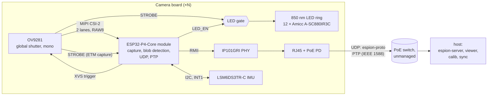
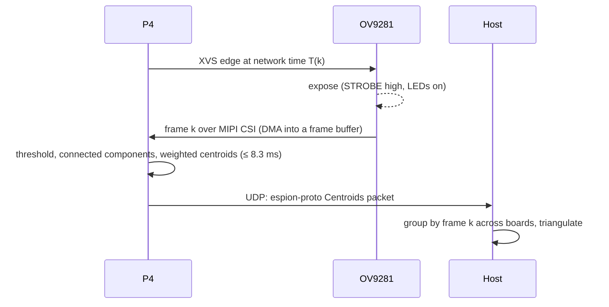

# Architecture

espion tracks IR-reflective or IR-emitting markers with several camera boards. Each board
exposes all cameras at the same instant, finds the bright blobs in every frame, and
streams their subpixel centroids to the host over Ethernet. The host triangulates 3D marker
positions.

## Camera board

A baseboard for a Waveshare ESP32-P4-Core module.

| Part | Role |
|---|---|
| [Waveshare ESP32-P4-Core](https://docs.waveshare.com/ESP32-P4-Core), 16 MB flash (SKU 36096) | ESP32-P4NRW32X (silicon **rev v3.x**: esp-hal does not support older revisions), 32 MB in-package PSRAM, 16 MB NOR flash, 40 MHz and 32.768 kHz crystals, VDD_HP DC-DC on the module. Sensor control, MIPI CSI capture, blob detection, XVS trigger, LED gating, Ethernet MAC with IEEE 1588 clock |
| OV9281 camera module ([AliExpress](https://fr.aliexpress.com/item/1005012566040263.html)) | 1 MP monochrome global-shutter sensor, MIPI CSI-2 2-lane. Mode: 640×400 2×2 binned, RAW8, 120 fps, external trigger on XVS, STROBE output. 15-pin 1.0 mm Raspberry Pi camera FPC to the board; XVS and STROBE come from pads on the module's back over a JST-SH 4-pin pigtail |
| IP101GRI | 10/100 Ethernet PHY on RMII, 25 MHz crystal. Drives the 50 MHz RMII reference clock into the P4. The PHY of Espressif's and Waveshare's P4 Ethernet boards |
| RJ45 MagJack (HanRun HR871150C) | Integrated magnetics and Bob-Smith termination. Brings out both centre taps and the spare pairs (4/5, 7/8) for the PoE PD. Its LEDs are driven by the PHY: green = link/activity, yellow = 100 Mb/s |
| [SDAPO DP1435-5V](https://www.lcsc.com/product-detail/C5380097.html) (LCSC C5380097) | IEEE 802.3af PoE PD module: bridge rectifiers, isolated flyback (1.5 kV), 5.15 V out. Class 0 (no class pin brought out). Through-hole SIP-6 |
| 5 V OR-ing (TI TPS2121) | PoE 5 V and USB-C VBUS, either one powers the board, PoE has priority, no back-feed into USB. Current-limited switchover and soft start |
| 3.3 V buck (TI TLV62569) | 5 V → ESP_3V3 for the module, the PHY and the camera module |
| 850 nm LED ring: 12 × Amicc A-SC880IR3C-P03-1T (LCSC C5355470), plus driver (TI TPS22918 load switch, TPS61170 boost to 32 V, 1 A op-amp current sink) | Lights passive retroreflective markers at 2–5 m (room scale): 4.6 W/sr on axis, 90° beam. On only while `STROBE ∧ LED_EN`, for at most ≈ 1 ms per pulse. See [LED ring](#led-ring) |
| USB-C | 5 V on the bench, through a TI TSD05DYFR VBUS TVS into the TPS2121; flashing, logs and JTAG through the P4's USB Serial/JTAG (no hub). VBUS is also sensed on GPIO20 (`VBUS_SENSE`) |
| WS2812B-2020-V6 RGB LED | Status, on +3V3, driven by an RMT channel |
| ST LSM6DS3TR-C 6-axis IMU (LCSC C967633) | On its own I2C bus. Wake-on-motion on INT1 tells firmware the camera was bumped, so the host can flag the rig extrinsics as stale; the accelerometer gives the gravity vector (camera tilt, floor plane) for calibration. The gyroscope is spare |

The schematic's sheets, nets, pin-level connections and component values are in
[`hardware/espion-cam/SCHEMATIC.md`](../hardware/espion-cam/SCHEMATIC.md).

### Board signals

| Signal | Direction | Purpose |
|---|---|---|
| MIPI CSI-2 (CLK + 2 data lanes) | OV9281 → P4 | Pixel data |
| SCCB (I2C) | P4 → OV9281 | Sensor registers |
| XVS | P4 → OV9281 | Frame trigger, one edge per frame at a scheduled network time. 1.8 V at the sensor (resistor divider) |
| STROBE | OV9281 → LED gate, P4 | High during exposure. 1.8 V at the sensor, buffered to 3.3 V (SN74LV1T34). The P4 timestamps it with ETM |
| LED_EN | P4 → LED gate | Enables the strobed LEDs; low for dark frames |
| LED_PWR_EN | P4 → TPS22918 ON | Connects +5V to the LED boost through a ≈ 27 ms ramp. Pulled low |
| BST_EN | P4 → TPS61170 CTRL | Starts the 32 V LED boost after the load switch has ramped. Pulled low: the rail stays off until firmware enables it |
| CAM_EN | P4 → OV9281 module | Enables the module's regulators (FPC pin 11). Pulled low |
| PWR_SRC | TPS2121 ST → P4 | High when PoE powers the board; firmware keeps the LED rail off on USB |
| VBUS_SENSE | USB-C VBUS → P4 GPIO20 (ADC1_CH4) | VBUS through a 47 kΩ / 75 kΩ divider (100 nF filter). Reads high as a digital input from VBUS ≈ 4.4 V; ADC1 (ATTEN3) reads VBUS up to ≈ 5.3 V. Firmware turns the USB Serial/JTAG D+ pull-up off while VBUS is absent (USB 2.0 §7.1.5.1), since the board also runs on PoE alone. PWR_SRC can't replace it: with PoE present it says nothing about USB |
| VLED_SENSE, NTC_SENSE | LED driver → P4 ADC1 | +32V rail and sink-MOSFET temperature |
| STATUS_LED | P4 → RGB LED | One-wire status LED data (RMT) |
| IMU_SDA, IMU_SCL | P4 ↔ IMU | I2C (GPIO3/4, ≤ 400 kHz), 10 kΩ pull-ups. Address 0x6A |
| IMU_INT1 | IMU → P4 GPIO54 | Wake-on-motion interrupt; push-pull, low at power-up |
| RMII (REF_CLK, CRS_DV, RXD0–1, TX_EN, TXD0–1) | P4 ↔ IP101GRI | Ethernet frames |
| MDC, MDIO | P4 → IP101GRI | PHY management |
| PHY_RST | P4 → IP101GRI | PHY reset, active low |
| PPS | P4 (EMAC) → test point, and through a 0 Ω loop-back into a second GPIO for ETM capture | Pulses from the PTP clock ([timing.md](timing.md)) |
| USB D+/D− | USB-C → P4 (USB1P1, GPIO24/25) | Flashing, logs, JTAG |

### LED ring

Twelve Amicc A-SC880IR3C-P03-1T around the lens, in one series string on a boosted rail,
driven at a fixed 1 A while `STROBE ∧ LED_EN`. The lens gets an 850 nm bandpass filter,
wide enough for the LED's 25 nm band plus its drift with temperature.

| Parameter (datasheet, 25 °C) | Value |
|---|---|
| Wavelength | 850 nm centroid, 855 nm peak, 25 nm FWHM |
| Beam | 90° (2θ½) |
| Radiant intensity at 1 A | 380 mW/sr typ, 285 mW/sr min |
| V_F at 1 A | 1.95 V typ, 2.3 V max |
| Current | 1 A continuous; 1.2 A pulsed (≤ 100 µs, ≤ 1 % duty) |
| Thermal resistance, junction to case | 18 K/W |
| Package | SMD, 3.85 × 3.85 × 2.3 mm, 35 mil chip |
| Moisture | 168 h floor life after opening the bag, else bake 60 °C / 24 h |

Sizing:
- **Target ≥ 2.3 W/sr on axis.** At that level a 14 mm sphere at 5 m, in the image corner
  of the 79° lens, gives about 1 ke⁻ per pixel in a 500 µs exposure. The estimate assumes
  OV9281 QE 25 % at 850 nm (OmniVision publishes no figure), an f/2.0 lens, sphere
  retroreflection of 150 cd/(lx·m²) (about half of flat 3M 7610), and 17 % of the on-axis
  signal left in the corner (LED beam, lens falloff, observation angle, marker wear).
- **12 LEDs give 4.6 W/sr** typ, 3.4 W/sr with minimum-bin parts: about 2× margin over
  the target. To measure on the first boards.
- **Beam:** the image corner is 40–44° off axis, which a 90° beam covers at about half
  intensity. 120° parts waste light outside the image; 60° parts leave the corners dark.
- **Thermal:** 1 A pulsed at 6 % duty stays within the 1 A continuous rating. The average
  is 60 mA, about 0.12 W per LED, so FR4 without a metal core is enough.
- **Placement:** close around the lens holder and evenly spaced. Retroreflectors send
  the light back in a narrow cone around its source.

Driver (parts, values and part notes: the LED driver section and "Bill of materials" in
[`hardware/espion-cam/SCHEMATIC.md`](../hardware/espion-cam/SCHEMATIC.md)):
- **Rail.** One string: 23 V typ, 27.6 V max at 1 A. A TI TPS61170 boost (40 V switch,
  0.96 A minimum current limit, 10 µH) takes 5 V to 32 V and charges 2 × 220 µF/50 V
  electrolytics. 32 V covers the max-V_F string plus 0.1 V on the shunt, ≈ 1 V for the
  MOSFET and ≈ 3 V of droop. One pulse takes 0.5 mC (1 A × 500 µs): ≈ 1.1 V of droop on
  440 µF, plus ESR. Two capacitors also share the ≈ 0.24 A RMS ripple current (each is
  rated 230 mA at 120 Hz).
- **Boost limits.** Worst case (minimum current limit, 85 %) the boost delivers ≈ 100 mA
  at 32 V. 500 µs pulses at 120 fps average 60 mA, so it can sustain ≈ 0.8 ms of light per
  frame. Refilling the capacitors at power-up takes ≈ 70 ms (0.23 J).
- **Enable.** A TPS22918 load switch on `LED_PWR_EN` feeds the boost input with a ≈ 27 ms
  ramp (≈ 70 mA inrush); without it, the boost's inductor and diode would charge the
  440 µF storage from +5V at every power-up (≈ 1.6 A inrush, over the USB limit).
  `BST_EN` then drives the TPS61170's CTRL pin. Both have pull-downs: the rail is off
  through PoE start-up and boot, and firmware can drop it on a fault.
- **Current sink.** A TLV9061 op-amp on 5 V drives an IRLR024N MOSFET (55 V, planar, for
  its linear-mode SOA) so that 1 A flows through a 0.1 Ω shunt. Its 100 mV reference is a
  divider from the gate output, so the gate turns the sink on and off. The MOSFET drops
  32 V − V_F, ≈ 9 V typ (up to ≈ 13 V with low-V_F parts): 9–13 W during a pulse,
  ≤ 0.8 W average at 6 % duty, so it needs DPAK copper.
- **Gate and timeout.** An SN74LVC1G97 is wired as a 2-input AND with Schmitt inputs (A
  tied low, Y = B·C). B is `LED_EN`. C is STROBE through an RC high-pass and a 10 kΩ
  series resistor: C falls below the threshold ≈ 1 ms after STROBE rises (τ ≈ 0.9 ms), so
  the LEDs are on for min(STROBE, ≈ 1 ms). The series resistor limits the input clamp
  current when STROBE falls, and the node recovers well within the 8.3 ms frame. A STROBE
  stuck high lights one ≈ 1 ms pulse and then nothing.
- **Power.** 60 mA from the 32 V rail is 1.9 W, ≈ 2.3 W at the boost input; the PoE PD
  supplies only this average. The 23 W pulses come from the capacitors.
- Fixed current. Near markers (≈ 40× brighter at 2 m than at 5 m) are handled by the
  exposure time, which Config already sets. Exposures over ≈ 1 ms are lit only for their
  first ≈ 1 ms.
- No continuous mode: bring-up and focusing use the strobed light too, so the LEDs always
  run at the exposure's duty cycle.

### Ethernet pin map

Uses the EMAC's IO MUX functions, as esp-hal's P4 Ethernet example and Espressif's and
Waveshare's P4 boards do. All of these pins are in 3.3 V I/O domains on the module.

| Signal | GPIO | Module pin | Notes |
|---|---|---|---|
| REF_CLK (in, from PHY) | 50 | 68 | Also possible: GPIO32 |
| CRS_DV | 28 | 40 | |
| RXD0 | 29 | 41 | |
| RXD1 | 30 | 42 | |
| TX_EN | 49 | 67 | |
| TXD0 | 34 | 46 | |
| TXD1 | 35 | 47 | Shared with the BOOT strap and button, as on Espressif's board. The PHY's TXD1 is an input, so it doesn't fight the strap |
| MDC | 31 | 43 | GPIO matrix |
| MDIO | 52 | 70 | GPIO matrix |
| PHY_RST | 51 | 69 | |

### ESP32-P4-Core baseboard notes

From the module's documentation and its schematic (16 MB version):
- GPIO0–13, GPIO20–23 and GPIO26–54 are on stamp holes; GPIO24/25 are the USB full-speed
  pair (USB Serial/JTAG). GPIO14–19 are not brought out. GPIO0/1 carry the 32.768 kHz
  crystal.
- Strapping: GPIO35 low with GPIO36 high at reset enters download mode (GPIO36 has a 10 kΩ
  pull-up on the module). GPIO37/38 also take part in boot configuration. The baseboard
  has BOOT (GPIO35) and reset (ESP_EN, RC delay) buttons.
- **GPIO39–48 sit in the `VDDPST_5` domain, fed by `ESP_LDO_VO4`**, which firmware
  configures. Keep board signals off these pins unless the firmware sets VO4 to 3.3 V. The
  other exposed GPIOs are on ESP_3V3.
- `ESP_LDO_VO1`–`VO4` (pins 51–54) are decoupled on the module (VO1 feeds the flash). The
  baseboard leaves them unloaded.
- Power: 3.3 V on ESP_3V3 (pins 75/76). VBAT (pin 74) ties to 3.3 V (no RTC battery).

Hardware tasks for the KiCad project:
- Measure the castellated pads on a real module and confirm the provisional land pattern of
  `Module_Waveshare:Waveshare_ESP32-P4-Core` (`hardware/lib/README.md`).
- PoE PD: SDAPO DP1435-5V ([datasheet](https://www.lcsc.com/datasheet/C5380097.pdf)). Pins:
  1 VA1 and 2 VA2 (centre taps of RJ45 pairs 1/2 and 3/6), 3 VB1 and 4 VB2 (spare pairs
  4/5 and 7/8), 5 GND, 6 VOUT. The inputs are not polarity sensitive. 2.54 mm pitch, pin 5
  sits 22.86 mm after pin 4. The module stands vertically: 35.6 × 16.2 mm on the board,
  14 mm tall. Keep the 1.5 kV isolation between the cable side and the board. Stock KiCad
  has no symbol or footprint for it.
- LC filter on the PoE 5 V before the OR-ing, per the datasheet: 0.33–3.3 µH, then
  330 µF/16 V and 10 µF/16 V. The module alone has 200 mVp-p ripple.
- MagJack: HR871150C brings out both centre taps (P7/P8 → VA1/VA2) and pins 4/5 and 7/8
  (P9/P10 → VB1/VB2), so the PD takes power from Alternative A and B PSEs. The Bob-Smith
  termination is inside the jack.
- Power budget against 802.3af: 12.95 W at the PD × 84 % peak efficiency gives at most
  ≈ 10.9 W out. Budget ≈ 10.5 W (≈ 2 A at 5.15 V). The LED ring takes ≈ 2.3 W of it on
  average; its 23 W pulses come from the driver's storage capacitors. The datasheet's
  12.4 W rating is more than 802.3af delivers.
- IP101GRI straps (PHY address 1, RMII with the PHY driving REF_CLK, LED mode 2) and the
  RMII series resistors: chosen in `hardware/espion-cam/SCHEMATIC.md`. Keep RMII traces
  short; REF_CLK is 50 MHz.
- LED driver: boost divider and compensation, op-amp loop compensation and the timeout RC
  are derived in `hardware/espion-cam/SCHEMATIC.md` from models. On the first boards, check
  the boost loop (440 µF is outside the TPS61170's tested range), the current pulse at the
  `ISNS` test point, and τ against the '1G97's Schmitt thresholds (interpolated at 3.3 V).
- Eye-safety check of the ring (IEC 62471) at 500 µs exposure and 6 % duty cycle. Rough
  estimate: exempt group (average IR irradiance ≈ 7 W/m² at 20 cm, limit 100 W/m²).
- OV9281 module: the listing's reviews report an interface that doesn't match the
  Raspberry Pi pinout. Check the FPC pinout on a real module before powering it from the
  board (the camera's 3.3 V goes through a 0 Ω link for that first check), and confirm
  that XVS and STROBE are 1.8 V, as the schematic assumes.

## Data flow per frame

- **Frame numbers agree across boards by construction**: frame `k` is the frame triggered
  at network time `T(k) = T0 + ⌊k · 10⁹ / 120⌋ ns`. Each packet carries `k` and the capture
  time ([timing.md](timing.md)).
- **Vision budget**: 1/120 s = 8.3 ms per frame, end to end on the P4 (capture DMA runs in
  parallel with processing of the previous frame).
- **Network load**: a few hundred bytes per frame at 120 fps, well under 1 Mbit/s per board
  on a 100 Mbit/s link.

### Memory

The P4 has 768 KB of internal L2 memory, minus the L2 cache for flash and PSRAM
(128/256/512 KB, carved out of it). That is too small for full frames: one is
640 × 400 × 1 byte = 250 KiB. No heap on the P4; every buffer is static.

| Data | Where | Why |
|---|---|---|
| Frame buffers, 2–3 × 250 KiB (CSI DMA writes one while the CPU processes another) | PSRAM | ~61 MB/s of traffic at 120 fps (DMA write + one CPU read), under 10 % of the PSRAM's 800 MB/s peak (16-bit DDR, 200 MHz). Espressif's camera driver keeps P4 frame buffers in PSRAM too |
| Ambient mask from dark frames, 1 bit per pixel (32 KB) | Internal | Read for every pixel, every frame |
| Blob and label state, network and PTP buffers, stacks, hot code | Internal | Latency-sensitive. Ethernet DMA stays off the PSRAM bus |
| Debug frame captures, calibration snapshots | PSRAM | Not per-frame |

- **Cache coherency**: CSI DMA writes PSRAM behind the CPU caches. Frame buffers are
  aligned and sized to whole cache lines, and the CPU invalidates a buffer's lines before it
  reads a new frame from it.
- **To measure first**: the CPU's sequential read rate from PSRAM. Reported figures are
  around 200 MB/s for one core (unverified), so one pass over a frame costs about 1.3 ms of
  the 8.3 ms budget, against about 0.3 ms from internal memory.
- **Fallback if the pass is memory-bound**: CSI DMA into a ring of line strips in internal
  memory (e.g. 64 lines, 40 KiB), processed strip by strip while the rest of the frame
  arrives, which also lowers latency. Needs a per-block interrupt from the CSI DMA (to check
  against the TRM).

## Firmware

| Crate | Chip / target | Runs |
|---|---|---|
| `firmware/cam-p4` | ESP32-P4, `riscv32imafc-unknown-none-elf` | One core runs the vision loop. The other runs embassy tasks: sensor control over SCCB, the XVS edge schedule (RMT), the PPS servo (ETM capture), Ethernet and embassy-net (DHCP, UDP), PTP (statime), the LED gate and the IMU (bump detection, gravity) on a second I2C bus |
| `firmware/esp32p4-csi` | ESP32-P4 (no_std library) | MIPI CSI-2 receiver driver on the `esp32p4` PAC, in esp-hal style. Used by `cam-p4` |

`cam-p4` is built with `esp-hal` + `esp-rtos` (embassy executor). The XVS edge schedule
reuses the RMT technique from the private
[esp-wifi-sync](https://github.com/azais-corentin/esp-wifi-sync) experiments (`wave.rs`).

### Network

- **Addressing**: DHCP only. The rig network needs a DHCP server (the host or the router).
- **Host discovery**: the host is the sender of the last Config or FrameEpoch. Until a host
  is known, Status goes out as broadcast ([protocol.md](protocol.md)).
- **PTP**: statime as an ordinary clock, UDP/IPv4 multicast, hardware timestamps from the
  EMAC ([timing.md](timing.md)). The board joins the PTP multicast group through IGMP
  (embassy-net `multicast`).

## Host

| App | Role |
|---|---|
| `espion-server` | CLI. Receives UDP packets, groups centroids by frame number, triangulates with the current calibration |
| `espion-viewer` | egui live view: per-camera blobs, 3D markers, sync health |
| `espion-calib` | Per-camera intrinsics (lens model) and rig extrinsics |
| `espion-sync` | Time-sync observer and coordinator. The network clock is PTP; the boards elect the grandmaster among themselves. espion-sync sets the frame epoch `T0`, maps network time to host time and reports the current grandmaster and per-board sync health. It never becomes grandmaster |

`crates/espion-proto` is the single source of truth for the UDP wire format
([protocol.md](protocol.md)).

## Pinned versions

Checked on 2026-10-28. The firmware crates commit their `Cargo.lock`.

| Component | Version | Notes |
|---|---|---|
| Rust | 1.99.1 (stable) | `rust-toolchain.toml`; esp-hal MSRV is 1.95 |
| esp-hal | ~1.2.2 | `unstable` feature needed for RMT, DMA, PSRAM and Ethernet |
| esp-rtos | 0.4.0 | embassy integration (replaces esp-hal-embassy) |
| esp-bootloader-esp-idf | 0.6.0 | App descriptor for the ESP-IDF 2nd-stage bootloader |
| esp-println / esp-backtrace | 0.18.0 / 0.20.0 | |
| esp32p4 (PAC) | 0.3.x | Same major as esp-hal 1.2.2, for the in-repo CSI driver, ETM and the EMAC PTP clock |
| embassy-executor / embassy-time / embassy-net | 0.10.0 / 0.5.1 / 0.9.1 | embassy-net with `dhcpv4`, `udp`, `multicast`, `medium-ethernet` |
| statime | 0.4.0 | `default-features = false`: no_std, no `alloc`. Builds for `riscv32imafc-unknown-none-elf` |
| serde / postcard | 1.0.229 / 1.1.3 | `default-features = false` on firmware |
| espflash / probe-rs | 4.6.0 / 0.32.0 | From nixpkgs (flake.lock) |

## esp-hal support and gaps

Status from the esp-hal 1.2.2 support table and `esp-metadata` (✔ supported, ⚒ partial,
❌ not supported). Only peripherals espion needs are listed.

| Need | esp-hal 1.2.2 | Plan |
|---|---|---|
| MIPI CSI-2 receiver | ❌ | `firmware/esp32p4-csi`: driver on the `esp32p4` PAC. Write it like an esp-hal driver (`Config`, typed pins, DMA buffers, blocking and async APIs, HIL-testable) without planning to upstream it. On the ESP32-P4-Core the MIPI PHY is powered from `ESP_LDO_VO3` (0 V by default): the driver sets it to 2.5 V before starting the CSI host |
| ISP | ❌ | Bypass: RAW8 goes straight to memory. Blob detection does not need demosaicing (mono sensor). Check the CSI → memory path that skips the ISP against the TRM |
| DMA for CSI | ⚒ (DMA partial) | Confirm which DMA engine the CSI bridge uses on the P4 and whether esp-hal drives it; otherwise part of the CSI driver. It writes frames into PSRAM; the driver does the cache invalidation (esp-hal has no cache maintenance for this path). Also check whether it can interrupt per block of lines (strip fallback, see [Memory](#memory)) |
| I2C master (SCCB, IMU) | ✔ | Two buses: SCCB to the camera, and the IMU on its own pins |
| Ethernet (EMAC, RMII) | ⚒ `unstable` ([esp-hal#5556](https://github.com/esp-rs/esp-hal/pull/5556), "basic") | `esp_hal::ethernet::Ethernet` with an `RmiiPinBundle`, `ExternalRefClock` on GPIO50 and the generic PHY driver; embassy-net driver included. New in 1.2: review flagged P4 RX-buffer cache maintenance as unverified, so soak-test RX on hardware |
| EMAC IEEE 1588 (PTP clock, timestamps, PPS) | ❌ | The clock (sub-second increment, addend, time update) and PPS are registers in the EMAC MAC block: PAC-level code in `cam-p4`. The per-frame RX/TX timestamps live in the DMA descriptors that esp-hal's driver owns (it leaves descriptor words 4–7 unread), so they need a change to esp-hal: carry it as a `[patch.crates-io]` fork and upstream it |
| Per-packet timestamps to statime | n/a | embassy-net sockets carry no per-packet metadata. The driver pairs PTP event frames (UDP 319) with their descriptor timestamps by message type and `sequenceId` and hands them to statime |
| RMT | ⚒ | XVS edge schedule, as in esp-wifi-sync `wave.rs` (TX channel 0), and the WS2812 status LED (channel 2 or 3) |
| ETM | ❌ | Needed from the start: the PPS edge and the STROBE edge (GPIO events) trigger timer capture tasks. PAC-level code in `cam-p4`. Which timer has the capture task is still to confirm against the TRM, and so is whether a GPIO event fires on a pad that the EMAC PPS drives as an output (the board loops PPS into a second GPIO through a 0 Ω resistor, so either way works) |
| MCPWM / PCNT / LEDC | ❌ | Not needed: STROBE gates the LEDs |
| SYSTIMER, TIMG | ⚒ | Local timebase, embassy time driver |
| PSRAM | ⚒ | Frame buffers (CSI DMA target) and non-per-frame data; see [Memory](#memory) |
| USB Serial/JTAG | ⚒ | Flashing and logs. Firmware also turns the D+ pull-up off while `VBUS_SENSE` is low (see [Board signals](#board-signals)); check whether esp-hal exposes the pull-up or it needs a PAC write |
| Chip revision | v3.0+ only | The ESP32-P4-Core carries ESP32-P4NRW32X (rev v3.x) |

Tooling: esp-generate 1.4.0 has no ESP32-P4 template. `cam-p4` was adapted from the C5
template and the esp-hal 1.2.2 examples.
