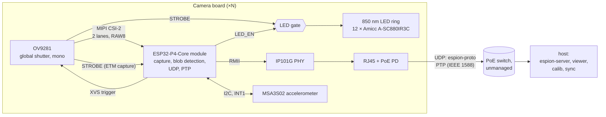
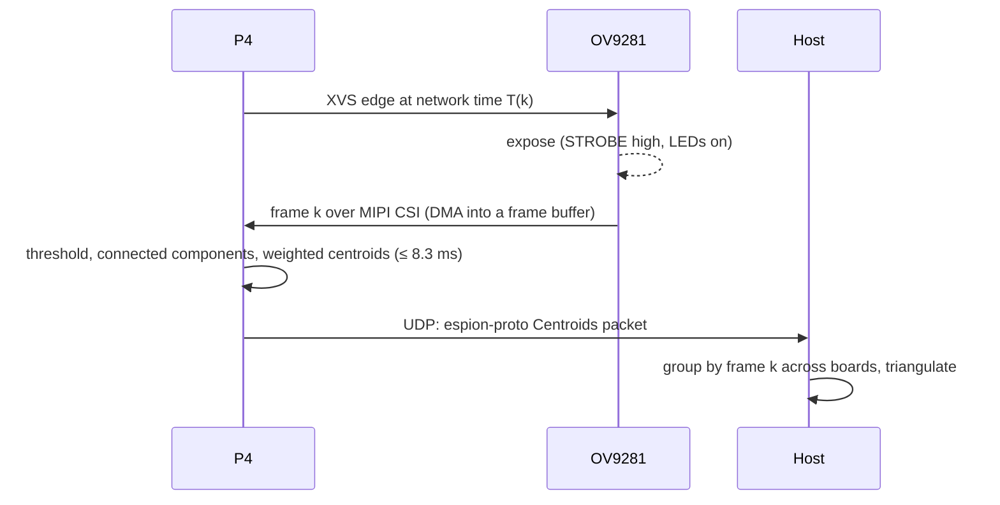

# Architecture

espion tracks markers that reflect or emit infrared light, using several camera boards. Every
board exposes its camera at the same instant, finds the bright blobs in each frame and sends
their subpixel centroids to the host over Ethernet. The host triangulates the markers in 3D.

## Camera board

A baseboard for a Waveshare ESP32-P4-Core module.

| Part | Role |
|---|---|
| [Waveshare ESP32-P4-Core](https://docs.waveshare.com/ESP32-P4-Core), 16 MB flash (SKU 36096) | ESP32-P4 (rev v3.x) with 32 MB PSRAM: camera control, capture, blob detection, trigger, LED gating, Ethernet MAC with PTP clock |
| OV9281 camera module ([AliExpress](https://fr.aliexpress.com/item/1005012566040263.html)) | 1 MP mono global-shutter sensor, run at 640×400 (2×2 binned), RAW8, 120 fps, triggered on XVS |
| IP101G | 10/100 Ethernet PHY on RMII; supplies the 50 MHz RMII clock |
| HanRun HR871150C RJ45 MagJack | Ethernet jack with magnetics; passes both PoE pair sets to the PD |
| SDAPO DP1435-5V | 802.3af PoE PD module, isolated |
| TI TPS2121 | Picks PoE 5 V or USB-C VBUS, PoE first, no back-feed into USB |
| TI TLV62569 | 3.3 V buck for the module, the PHY and the camera |
| 850 nm LED ring and driver | 12 LEDs in series at a fixed sink current ([hardware/led.md](hardware/led.md)), lit only while `STROBE ∧ LED_EN`, ≤ 0.5 ms per frame at ≤ 120 fps; a hardware timeout cuts a pulse as a backstop |
| USB-C | Bench power, flashing, logs and JTAG (P4 USB Serial/JTAG, no hub) |
| Yongyu YY-0807BRGK26 RGB LED | Status LED (WS2812-type protocol), driven by RMT |
| MEMSensing MSA3S02 accelerometer | 3-axis, no gyroscope. Detects bumps (rig calibration may be stale) and gives the gravity vector |

Board design: [hardware/README.md](hardware/README.md)

## Data flow per frame

- **Frame numbers match across boards by design.** Frame `k` is the one triggered at network
  time `T(k) = T0 + ⌊k · 10⁹ / 120⌋ ns`. Each packet carries `k` and the capture time
  ([timing.md](timing.md)).
- **Vision budget:** 8.3 ms per frame (1/120 s), end to end on the P4. Capture DMA of the next
  frame runs while the CPU processes the current one.
- **Network load:** a few hundred bytes per frame at 120 fps, well under 1 Mbit/s per board on
  a 100 Mbit/s link.

### Memory

The P4 has 768 KB of internal L2 memory, and the flash/PSRAM cache (128, 256 or 512 KB) is
carved out of it. A full frame is 640 × 400 × 1 byte = 250 KiB, so frames don't fit. There is
no heap on the P4: every buffer is static.

| Data | Where | Why |
|---|---|---|
| Frame buffers, 2–3 × 250 KiB (DMA fills one while the CPU reads another) | PSRAM | ≈ 61 MB/s at 120 fps (DMA write + one CPU read), under 10 % of the PSRAM's 800 MB/s peak (16-bit DDR, 200 MHz). Espressif's camera driver also keeps P4 frame buffers in PSRAM |
| Ambient mask from dark frames, 1 bit per pixel (32 KB) | Internal | Read for every pixel of every frame |
| Blob and label state, network and PTP buffers, stacks, hot code | Internal | Latency matters. Keeps Ethernet DMA off the PSRAM bus |
| Debug frame captures, calibration snapshots | PSRAM | Not used every frame |

- **Cache coherency:** CSI DMA writes PSRAM behind the CPU caches. Frame buffers are aligned
  and sized to whole cache lines, and the CPU invalidates a buffer's lines before reading a
  new frame from it.
- **Measure first:** how fast one core reads PSRAM sequentially. Reported figures are about
  200 MB/s (unverified), so one pass over a frame costs ≈ 1.3 ms of the 8.3 ms budget,
  against ≈ 0.3 ms from internal memory.
- **Fallback if that pass is too slow:** CSI DMA into a ring of line strips in internal memory
  (e.g. 64 lines, 40 KiB), processed strip by strip as the frame arrives. This also cuts
  latency. It needs a per-block interrupt from the CSI DMA (check the TRM).

## Firmware

| Crate | Chip / target | Runs |
|---|---|---|
| `firmware/cam-p4` | ESP32-P4, `riscv32imafc-unknown-none-elf` | One core runs the vision loop. The other runs embassy tasks: sensor control over SCCB, the XVS edge schedule (RMT), the PPS servo (ETM capture), Ethernet and embassy-net (DHCP, UDP), PTP (statime), the LED gate, and the accelerometer (bump detection, gravity) on a second I2C bus |
| `firmware/esp32p4-csi` | ESP32-P4 (no_std library) | MIPI CSI-2 receiver driver on the `esp32p4` PAC, written in esp-hal style. Used by `cam-p4` |
| `firmware/esp32p4-jpeg` | ESP32-P4 (no_std library) | Hardware JPEG encoder driver (greyscale, baseline) and the 2D-DMA registers it needs, on the `esp32p4` PAC, in esp-hal style. Tested and measured in `poc-p4-eth` (`JPEG_PLAN`); for streaming frames to the host |
| `firmware/ov9281` | no_std library, host-testable | OV9281 sensor driver: the mode solver (format, size, crop or binning, frame rate → clock, HTS, VTS and registers, refusing what the measured limits do not allow) and SCCB control over `embedded-hal-async` I2C. For `poc-p4-eth` and `cam-p4` |

`cam-p4` uses `esp-hal` and `esp-rtos` (embassy executor). The XVS edge schedule reuses the
RMT technique from the private
[esp-wifi-sync](https://github.com/azais-corentin/esp-wifi-sync) experiments (`wave.rs`).

### Network

- **Addressing:** DHCP only. The rig network needs a DHCP server (the host or the router).
- **Finding the host:** the host is whoever sent the last Config or FrameEpoch. Until a host
  is known, Status is broadcast ([protocol.md](protocol.md)).
- **PTP:** statime as an ordinary clock over UDP/IPv4 multicast, with hardware timestamps from
  the EMAC ([timing.md](timing.md)). The board joins the PTP multicast group with IGMP
  (embassy-net `multicast`).

## Host

| App | Role |
|---|---|
| `espion-server` | CLI. Receives UDP packets, groups centroids by frame number, triangulates with the current calibration |
| `espion-viewer` | egui live view: blobs per camera, 3D markers, sync health |
| `espion-calib` | Lens model per camera (intrinsics) and rig extrinsics |
| `espion-sync` | Watches and coordinates time sync. The network clock is PTP, and the boards elect the grandmaster among themselves. espion-sync sets the frame epoch `T0`, maps network time to host time, and reports the grandmaster and each board's sync health. It never becomes grandmaster |

`crates/espion-proto` is the single source of truth for the UDP wire format
([protocol.md](protocol.md)).

## Pinned versions

Checked on 2026-10-28. The firmware crates commit their `Cargo.lock`.

| Component | Version | Notes |
|---|---|---|
| Rust | 1.99.1 (stable) | `rust-toolchain.toml`; esp-hal needs ≥ 1.95 |
| esp-hal | ~1.2.2 | `unstable` feature needed for RMT, DMA, PSRAM and Ethernet |
| esp-rtos | 0.4.0 | embassy integration (replaces esp-hal-embassy) |
| esp-bootloader-esp-idf | 0.6.0 | App descriptor for the ESP-IDF second-stage bootloader |
| esp-println / esp-backtrace | 0.18.0 / 0.20.0 | |
| esp32p4 (PAC) | 0.3.x | Same major as esp-hal 1.2.2; used by the CSI driver, ETM and the EMAC PTP clock |
| embassy-executor / embassy-time / embassy-net | 0.10.0 / 0.5.1 / 0.9.1 | embassy-net with `dhcpv4`, `udp`, `multicast`, `medium-ethernet` |
| statime | 0.4.0 | `default-features = false`: no_std, no `alloc`. Builds for `riscv32imafc-unknown-none-elf` |
| serde / postcard | 1.0.229 / 1.1.3 | `default-features = false` on firmware |
| espflash / probe-rs | 4.6.0 / 0.32.0 | From nixpkgs (flake.lock) |
| embedded-hal-async | 1.0.0 | I2C and delay traits of `firmware/ov9281`; the version esp-hal 1.2.2 implements |

## esp-hal support and gaps

Status from the esp-hal 1.2.2 support table and `esp-metadata` (✔ supported, ⚒ partial,
❌ not supported). Only what espion needs is listed.

| Need | esp-hal 1.2.2 | Plan |
|---|---|---|
| MIPI CSI-2 receiver | ❌ | Own driver in `firmware/esp32p4-csi` on the `esp32p4` PAC. Written like an esp-hal driver (`Config`, typed pins, DMA buffers, blocking and async APIs, HIL-testable), but not meant for upstream. On the ESP32-P4-Core the MIPI PHY runs from `ESP_LDO_VO3`, which is 0 V by default: the driver sets it to 2.5 V before starting the CSI host |
| ISP | ❌ | Bypassed: RAW8 goes straight to memory. Blob detection needs no demosaicing (mono sensor). Check in the TRM that the CSI → memory path can skip the ISP |
| DMA for CSI | ⚒ (DMA partial) | Find out which DMA engine the CSI bridge uses and whether esp-hal drives it; if not, it goes in the CSI driver. It writes frames into PSRAM, and the driver does the cache invalidation (esp-hal has none for this path). Also check for a per-block-of-lines interrupt (strip fallback, see [Memory](#memory)) |
| I2C master (SCCB, accelerometer) | ✔ | Two buses: SCCB to the camera, and the accelerometer on its own pins |
| Ethernet (EMAC, RMII) | ⚒ `unstable` ([esp-hal#5556](https://github.com/esp-rs/esp-hal/pull/5556), "basic") | `esp_hal::ethernet::Ethernet` with an `RmiiPinBundle`, `ExternalRefClock` on GPIO50 and its embassy-net driver. **Verified on the ESP32-P4-ETH** (`firmware/poc-p4-stream`, IP101GRI PHY, 100 Mbit/s full duplex, IPv6 only): board to host at the wire limit (11.80 MB/s of 1452-byte UDP datagrams, from internal RAM and from cold PSRAM, none lost or wrong); host to board at the wire limit for 60 s with every byte checked (RX-buffer cache maintenance works) and 100 small datagrams/s beside full-rate TX, none lost. Needs three workarounds in the firmware, each a defect to take upstream: (1) TX store-and-forward, which the driver turns on, breaks frames above a few hundred bytes on the P4 (lost, wrong checksums): switch the DMA to threshold mode, as ESP-IDF does; (2) then the EMAC inserts no checksums (the driver sets CIC 3 and tells smoltcp to skip them), so smoltcp computes the UDP and ICMPv6 checksums (`Checksum::Tx`); (3) the driver's DMA-buffer check takes esp-metadata's DRAM range, which assumes a 256 KiB L2 cache: with the 128 KiB the bootloader sets, statics below 0x4FF40000 panic, so the DMA storage goes in a linker section at or above it. `GenericPhy` wakes the runner on every poll and reads three MDIO registers each time: use a PHY driver that polls the link on a timer. smoltcp 0.13 (embassy-net 0.9) can panic in `send_to_with` when a socket's TX metadata ring is the limit: size it above the payload ring. Not verified: 10 Mbit/s and half duplex, link loss and re-negotiation, multicast, PTP |
| EMAC IEEE 1588 (PTP clock, timestamps, PPS) | ❌ | The clock (sub-second increment, addend, time update) and PPS are EMAC MAC registers: PAC-level code in `cam-p4`. The RX/TX timestamps sit in the DMA descriptors that esp-hal's driver owns, and it ignores descriptor words 4–7. That needs an esp-hal change: carry it as a `[patch.crates-io]` fork and upstream it |
| Per-packet timestamps to statime | n/a | embassy-net sockets carry no per-packet metadata. The driver matches PTP event frames (UDP 319) to their descriptor timestamps by message type and `sequenceId` and hands them to statime |
| RMT | ⚒ | XVS edge schedule, as in esp-wifi-sync `wave.rs` (TX channel 0), the status LED (WS2812-type protocol, channel 2 or 3) and the 50 kHz `BST_EN` PWM that sets the LED boost's output (a third TX channel in loop mode, [hardware/firmware-rules.md](hardware/firmware-rules.md) FW-8) |
| ETM | ❌ | Needed from day one: the PPS edge and the STROBE edge (GPIO events) trigger timer capture tasks. PAC-level code in `cam-p4`. Still to confirm in the TRM: which timer has the capture task, and whether a GPIO event fires on a pad the EMAC drives as PPS output (the board also loops PPS into a second GPIO through R34, so either way works) |
| MCPWM / PCNT / LEDC | ❌ (no LEDC or MCPWM driver for the P4) | Not needed: STROBE gates the LEDs, and the `BST_EN` PWM runs on RMT |
| ADC (one-shot) | ⚒ `unstable` | ADC1 channels 5 (`VLED_SENSE`) and 7 (`LED_K_SENSE`). `LED_K_SENSE` is read late in each LED pulse for the boost headroom loop (FW-22), so the conversion is timed from the STROBE capture; check the one-shot conversion time against that window |
| SYSTIMER, TIMG | ⚒ | Local timebase, embassy time driver |
| PSRAM | ⚒ | Frame buffers (CSI DMA target) and data not used every frame; see [Memory](#memory) |
| USB Serial/JTAG | ⚒ | Flashing and logs. Firmware also turns the D+ pull-up off while `VBUS_SENSE` is low ([hardware/firmware-rules.md](hardware/firmware-rules.md)); check whether esp-hal exposes the pull-up or it needs a PAC write |
| Chip revision | v3.0+ only | The ESP32-P4-Core carries an ESP32-P4NRW32X, rev v3.x |
| JPEG codec (hardware encoder) | ❌ (the PAC has the `JPEG` block, but marks the quantisation-table registers `T0QNR`..`T3QNR` read-only, which the TRM and ESP-IDF write) | Own driver in `firmware/esp32p4-jpeg` on the PAC: greyscale baseline JPEG from a frame in PSRAM or internal RAM, header and IJG quality tables built by the CPU, async wait on the `JPEG` interrupt, cache maintenance and error recovery in the driver. Colour formats, decoding and restart markers are not covered |
| 2D-DMA | ❌ (no driver; no register block in the `esp32p4` 0.3 PAC; its interrupt sources 104..=108, 133, 134 are missing from the PAC's `Interrupt` enum, so esp-hal cannot bind them) | Register offsets from ESP-IDF `hw_ver3/soc/dma2d_reg.h` (TRM chapter 8) in `esp32p4-jpeg` (`dma2d` module): TX channel 0 (2D, macroblock reordering) and RX channel 1 (1D) connected to the JPEG codec, nothing else. Its own interrupts are not used: the driver polls their raw bits after the codec's interrupt. PPA and memory-to-memory transfers are not covered |

Tooling: esp-generate 1.4.0 has no ESP32-P4 template. `cam-p4` was adapted from the C9 template
and the esp-hal 1.2.2 examples.
