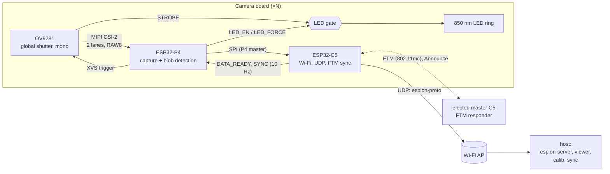
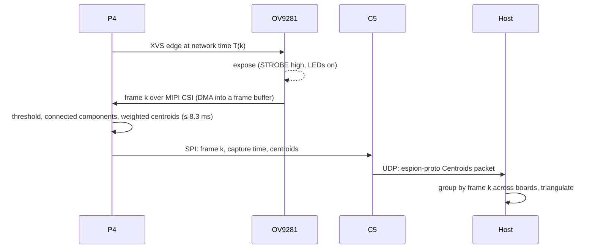

# Architecture

espion tracks IR-reflective or IR-emitting markers with several camera boards. Each board
exposes all cameras at the same instant, finds the bright blobs in every frame, and
streams their subpixel centroids to the host over Wi-Fi. The host triangulates 3D marker
positions.

## Camera board

| Part | Role |
|---|---|
| ESP32-P4 with in-package PSRAM (silicon **rev v3.0 or later**: esp-hal does not support older revisions) | Sensor control, MIPI CSI capture, blob detection, XVS trigger, LED gating, SPI master |
| OV9281 | 1 MP monochrome global-shutter sensor, MIPI CSI-2 2-lane. Mode: 640×400 2×2 binned, RAW8, 120 fps, external trigger on XVS, STROBE output |
| ESP32-C5 module (WROOM/MINI class, certified, integrated antenna) | Wi-Fi co-processor (Wi-Fi 6, used on 5 GHz): UDP to the host, FTM clock sync and master election, SYNC to the P4, SPI slave |
| 850 nm LED ring + driver | Lights passive retroreflective markers at 2–5 m (room scale). On only while `(STROBE ∧ LED_EN) ∨ LED_FORCE` |
| USB 2.0 hub IC | Exposes both chips' USB Serial/JTAG on the single USB-C port, so each chip can be flashed and debugged independently (espflash / probe-rs) |
| USB-C | 5 V power, flashing and logs |

### Board signals

| Signal | Direction | Purpose |
|---|---|---|
| MIPI CSI-2 (CLK + 2 data lanes) | OV9281 → P4 | Pixel data |
| SCCB (I2C) | P4 → OV9281 | Sensor registers |
| XVS | P4 → OV9281 | Frame trigger, one edge per frame at a scheduled network time |
| STROBE | OV9281 → LED gate | High during exposure |
| LED_EN, LED_FORCE | P4 → LED gate | Enable strobed LEDs / force them on (bring-up, focus) |
| SPI (SCLK, MOSI, MISO, CS) | P4 (master) ↔ C5 (slave) | `p4-c5-link` messages |
| DATA_READY | C5 → P4 | C5 has a message queued for the P4 |
| SYNC | C5 → P4 | 10 Hz pulse, edges at network-time multiples of 100 ms ([timing.md](timing.md)) |
| USB D+/D− | USB-C → hub → P4, C5 | Flashing, logs, JTAG for both chips |

Hardware tasks for the KiCad project:
- LED gate circuit, plus the LED driver sized for 2–5 m with passive markers.
- Eye-safety check of the 850 nm ring (IEC 62471) at that range, 500 µs exposure, 6 %
  duty cycle, and the worst case with `LED_FORCE` on continuously.

## Data flow per frame

- **Frame numbers agree across boards by construction**: frame `k` is the frame triggered
  at network time `T(k) = T0 + ⌊k · 10⁹ / 120⌋ ns`. Each packet carries `k` and the capture
  time ([timing.md](timing.md)).
- **Vision budget**: 1/120 s = 8.3 ms per frame, end to end on the P4 (capture DMA runs in
  parallel with processing of the previous frame).
- **Frame buffers**: 640 × 400 × 1 byte = 250 KiB per frame. Two buffers plus the ambient
  mask from dark frames live in the P4's internal L2 memory. The in-package PSRAM holds
  everything that isn't per-frame (debug frame captures, calibration snapshots). No heap on
  the P4.

## Firmware

| Crate | Chip / target | Runs |
|---|---|---|
| `firmware/cam-p4` | ESP32-P4, `riscv32imafc-unknown-none-elf` | One core runs the vision loop. The other runs embassy tasks: sensor control over SCCB, the XVS edge schedule (RMT), the SYNC servo (ETM capture), the SPI link and the LED gate |
| `firmware/esp32p4-csi` | ESP32-P4 (no_std library) | MIPI CSI-2 receiver driver on the `esp32p4` PAC, in esp-hal style. Used by `cam-p4` |
| `firmware/radio-c5` | ESP32-C5, `riscv32imac-unknown-none-elf` | Embassy tasks: Wi-Fi station and UDP (embassy-net), master election, FTM sync (initiator, or responder on the master), SYNC output (RMT edge schedule), SPI slave. Heap only for the Wi-Fi stack |
| `firmware/p4-c5-link` | both (no_std) | SPI message types and framing. Reuses `espion-proto` types |

Both firmware crates are built with `esp-hal` + `esp-rtos` (embassy executor). Time sync
reuses the approach and code from the private
[esp-wifi-sync](https://github.com/azais-corentin/esp-wifi-sync) experiments
([timing.md](timing.md)).

## Host

| App | Role |
|---|---|
| `espion-server` | CLI. Receives UDP packets, groups centroids by frame number, triangulates with the current calibration |
| `espion-viewer` | egui live view: per-camera blobs, 3D markers, sync health |
| `espion-calib` | Per-camera intrinsics (lens model) and rig extrinsics |
| `espion-sync` | Time-sync observer and coordinator. The network clock lives on the master C5, which the boards elect themselves. espion-sync sets the frame epoch `T0`, maps network time to host time and reports the current master, timescale and per-board sync health |

`crates/espion-proto` is the single source of truth for the UDP wire format
([protocol.md](protocol.md)).

## Pinned versions

Checked on 2026-10-27. The firmware crates commit their `Cargo.lock`.

| Component | Version | Notes |
|---|---|---|
| Rust | 1.99.1 (stable) | `rust-toolchain.toml`; esp-hal MSRV is 1.95 |
| esp-hal | ~1.2.2 | `unstable` feature needed for RMT, SPI slave, DMA, PSRAM |
| esp-rtos | 0.4.0 | embassy integration (replaces esp-hal-embassy) |
| esp-radio | =1.0.0-beta.1 | C5 Wi-Fi. 1.0.0-beta.2 is yanked on crates.io |
| esp-wifi-sys-esp32c5 | 0.3.0, vendored | Wi-Fi libraries replaced with esp32-wifi-lib `9e91edc` (FTM fix), see `firmware/vendor/esp-wifi-sys-esp32c5/VENDORED.md` |
| esp-bootloader-esp-idf | 0.6.0 | App descriptor for the ESP-IDF 2nd-stage bootloader |
| esp-println / esp-backtrace / esp-alloc | 0.18.0 / 0.20.0 / 0.11.0 | |
| esp32p4 (PAC) | 0.3.x | Same major as esp-hal 1.2.2, for the in-repo CSI driver |
| embassy-executor / embassy-time / embassy-net | 0.10.0 / 0.5.1 / 0.9.1 | |
| serde / postcard | 1.0.229 / 1.1.3 | `default-features = false` on firmware |
| espflash / probe-rs | 4.6.0 / 0.32.0 | From nixpkgs (flake.lock) |

## esp-hal support and gaps

Status from the esp-hal 1.2.2 support table and `esp-metadata` (✔ supported, ⚒ partial,
❌ not supported). Only peripherals espion needs are listed.

### ESP32-P4

| Need | esp-hal 1.2.2 | Plan |
|---|---|---|
| MIPI CSI-2 receiver | ❌ | `firmware/esp32p4-csi`: driver on the `esp32p4` PAC. Write it like an esp-hal driver (`Config`, typed pins, DMA buffers, blocking and async APIs, HIL-testable) without planning to upstream it |
| ISP | ❌ | Bypass: RAW8 goes straight to memory. Blob detection does not need demosaicing (mono sensor). Check the CSI → memory path that skips the ISP against the TRM |
| DMA for CSI | ⚒ (DMA partial) | Confirm which DMA engine the CSI bridge uses on the P4 and whether esp-hal drives it; otherwise part of the CSI driver |
| I2C master (SCCB) | ✔ | — |
| SPI master | ✔ | P4 side of the link |
| RMT | ⚒ | XVS edge schedule, as in esp-wifi-sync `wave.rs` |
| ETM | ❌ | Needed from the start: the SYNC edge (GPIO event) triggers a timer capture task. PAC-level code in `cam-p4`. Which timer has the capture task is still to confirm against the TRM |
| MCPWM / PCNT / LEDC | ❌ | Not needed: STROBE gates the LEDs |
| SYSTIMER, TIMG | ⚒ | Local timebase, embassy time driver |
| PSRAM | ⚒ | In-package PSRAM for non-per-frame data |
| USB Serial/JTAG | ⚒ | Flashing and logs |
| Chip revision | v3.0+ only | The PCB must use rev v3.x silicon |

Tooling: esp-generate 1.4.0 has no ESP32-P4 template. `cam-p4` was adapted from the C5
template and the esp-hal 1.2.2 examples.

### ESP32-C5

| Need | esp-hal / esp-radio | Plan |
|---|---|---|
| Wi-Fi station, 5 GHz | ⚒ (esp-radio 1.0.0-beta.1) | Non-DFS channels preferred (SoftAP restrictions, [timing.md](timing.md#band)) |
| SoftAP FTM responder | Not exposed: esp-radio hard-codes `ftm_responder = false` and leaves FTM out of `g_wifi_feature_caps` | Set both through `esp-wifi-sys-esp32c5` bindings, as esp-wifi-sync does |
| FTM initiator | Libraries on crates.io (esp32-wifi-lib `7cd4d7b`) lack the t2/t3 validation fix that made C3↔C3 FTM work | Vendored `9e91edc` libraries |
| FTM timestamps vs SYSTIMER | On the C3 the MAC clock is SYSTIMER µs. **Unverified on the C5** | Measure before relying on it |
| SPI slave | ⚒ (SPI2 only) | C5 side of the link |
| RMT | ⚒ | SYNC edge schedule |
| ETM / MCPWM / LEDC | ❌ | Not needed |
| UDP (embassy-net / smoltcp) | ✔ (crate level) | — |
