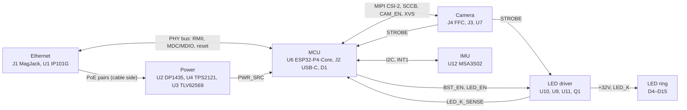

# espion-cam board design

espion-cam is the camera board of [espion](../architecture.md): a 64 × 64 mm, 4-layer baseboard for
a Waveshare ESP32-P4-Core module with an OV9281 global-shutter camera behind a lens cutout, a ring
of twelve 850 nm LEDs around the lens, 10/100 Ethernet with an 802.3af PoE powered device, and
USB-C for bench power, flashing and logs. The KiCad project is
[hardware/espion-cam](../../hardware/espion-cam/README.md). It is designed for 15–30 °C, indoor
(user decision 2026-10-31).

Board coordinates in these documents are KiCad board millimetres: the board spans x 100–164,
y 100–164, y pointing down (the top edge is y 100).

## Blocks

`+5V`, `+3V3` and `+32V` are global nets; the root sheet holds only the mounting holes H1–H4.

| Block | Sheet | Document |
|---|---|---|
| PoE PD, power mux, 3.3 V buck, USB VBUS | Power (`power.kicad_sch`) | [power.md](power.md) |
| ESP32-P4-Core module, USB-C, reset/boot, status LED, test points | MCU (`mcu.kicad_sch`) | [mcu.md](mcu.md) |
| OV9281 module FFC, CSI-2 lanes, SCCB, XVS/STROBE | Camera (`camera.kicad_sch`) | [camera.md](camera.md) |
| IP101G PHY (IP101GRI, industrial grade), HR871150C MagJack, RMII | Ethernet (`ethernet.kicad_sch`) | [ethernet.md](ethernet.md) |
| MSA3S02 accelerometer | IMU (`imu.kicad_sch`) | [imu.md](imu.md) |
| LED supply straight from `+5V`, boost, current sink, STROBE gate | LED driver (`led_driver.kicad_sch`) | [led.md](led.md) |
| 12 × Amicc A-SC880IR3C | LED ring (`led_ring.kicad_sch`) | [led.md](led.md#led-ring) |
| Mounting holes H1–H4 | root (`espion-cam.kicad_sch`) | [Board](#board) |
| Board, stack-up, rules, routing | — | [layout.md](layout.md) |
| GPIO map and firmware rules | — | [firmware-rules.md](firmware-rules.md) |

## Rails

The required range is the requirement on the rail and where it comes from (a standard, a
datasheet regulation limit, the ±5 % envelope). Calculated minimum and maximum values, currents
and margins are worked out from the schematic by the formulas in the block documents.

| Rail | Source | Required range (basis) | Loads |
|---|---|---|---|
| `POE_VA1`, `POE_VA2`, `POE_VB1`, `POE_VB2` (cable side, isolated) | J1.7–J1.10 centre taps (both pair sets) | 37–57 V at the PD input (IEEE 802.3af; DP1435 p.5). Current per pair at most J1's rating, 350 mA per centre tap (HR871150C p.1); input power at most the 802.3af PD limit, 12.95 W | U2.1–U2.4 only, no capacitors |
| `+5V_POE` | U2 DP1435-5V output | Within the DP1435's ±5 % regulation term (p.5); the datasheet gives no set-point accuracy. At most 5.5 V, the input limit of U3 and U11 (datasheets) | C11, C13, C15, U4 IN1, R18/R19 |
| `VBUS` | J2 USB-C | 4.40–5.5 V (USB 2.0 Table 7-7 p.178, §7.2.1.3 p.173: low-power port 4.40 V minimum, a conservative floor for this high-power function, which the spec requires to run fully from 4.75 V, §7.2.1.4 p.174; USB Type-C R2.0 §4.4.2 p.141: up to 5.5 V at light load). Port current at most 500 mA | U4 IN2, C16, D2, R24 |
| `+5V` | U4 TPS2121 OUT (PoE first) | Within the input range of every load (TLV62569, TLV9061, TPS61170 datasheets); steady value is the selected input minus I × RON(U4) (TPS2121 datasheet). During a PoE → USB switchover it dips by I × tSW / C(`+5V`) (TPS2121 internal-reference mode, 100 µs) | U3, U10 VIN, L3, C36, U11, R63, C10, C20, C22, C44, TP5 |
| `+3V3` | U3 TLV62569 | DC set point VOUT = VFB × (1 + R16/R17) (SLVSDG1C Eq. 2 p.9), VFB 0.588–0.612 V (p.4), resistors ±1 %; every calculation uses this set point. Logic-level checks use the generic 3.3 V ± 5 % envelope and name it as such. With the LEDs off, stays above every load's minimum supply during a PoE → USB switchover ([power](power.md#priority-and-hysteresis)); with the ceramics derated for DC bias the IP101G's minimum may be missed, an accepted risk ([power](power.md#accepted-risks)) | U6, U1, U12, U7, U9, D1, U5.5, J1 LEDs, J4.15 (camera module straight on the rail, no link; its load is an estimate, no module datasheet) with C32, pull-ups, TP4 |
| `+32V` | U10 TPS61170 boost (BST_EN) | Full scale (`BST_EN` steady high): VOUT = VREF × (1 + R65/R66) (TPS61170 SLVS789D p.5), VREF 1.204–1.254 V. In operation the headroom loop sets it by `BST_EN` PWM duty, V_FB = duty × 1.229 V ([led](led.md#headroom-control)). Droop over a pulse follows from the pulse charge and the storage capacitors (formula in led.md). With the boost off it idles at `+5V` minus D3's drop ([led](led.md#led-supply)) | LED string D4–D15, C43, C45, C46, C47, R65/R66, TP13; R70/R76 through the string |

Formulas: [power.md](power.md) for the first five rows, [led.md](led.md#boost-converter)
for `+32V`. Current budgets: [power.md](power.md), [led.md](led.md).

## Board

- **Outline:** 64 × 64 mm, 1 mm corner radius. An FFC notch 18 × 3 mm in the top edge (x 120.7–138.7) lets the
  camera FFC wrap round the edge to J4. The lens cutout is Ø16 mm at (129.7, 130.3); the camera
  module sits behind the board with its lens in the cutout and the LED ring around it on the top
  side. J1's RJ45 opening is on the right edge, the PoE module along the left edge (user decision
  2026-10-31, "Mirror: J1 right, DP1435 left").
- **Holes:** 4 × M3 (H1–H4, plated, GND) 3.5 mm in from each corner (user decision 2026-10-31,
  "4 × M3 corners"); three JLCPCB tooling holes TOOL1–TOOL3.
- **Stack-up:** JLCPCB JLC04161H-7628, 4 layers, 1.6 mm, ENIG, green mask, no impedance control
  (user decision 2026-11-01, "No impedance control"). F.Cu: parts, signals, power. In1.Cu: GND
  plane, cut only for the PoE lane. In2.Cu: GND plane, unbroken, no tracks. B.Cu: signals,
  power, U6/U2/J1. Details, rules and net classes: [layout](layout.md#board-and-stack-up).
- **Assembly:** JLCPCB Economic PCBA, single-sided: every machine-placed part is on the top. The
  hand-assembly list (user decision 2026-10-31; the top-side GND wire loops TP2, TP3 and TP7 left
  it with their removal, user decision 2026-11-11) and its sides (user decision 2026-10-31, "Hand
  parts on the bottom"):

  | Part | Side | Notes |
  |---|---|---|
  | U6 ESP32-P4-Core | bottom | Hand-soldering footprint without paste; iron only, pad by pad, no hot air (user decision 2026-11-01) — [mcu](mcu.md#module) |
  | U2 DP1435-5V | bottom | Through-hole, soldered from the top; conical tip ≤ 1 mm, Kapton over C11 and C16, inspect them after — [layout](layout.md#assembly) |
  | J1 HR871150C | bottom | Through-hole, soldered from the top; conical tip ≤ 1 mm, Kapton over C3 — [layout](layout.md#assembly) |

  J2 (USB-C) is machine-placed with its shell overhanging the top edge by HRO's recommended
  amount (user decision 2026-11-04); the RESET and BOOT buttons sit on the bottom edge (user
  decision 2026-11-01).

## Accepted risks

Power:
- PoE lane: the layout is meant to give some isolation only (rule 'PoE isolation', the In1 lane,
  F.Cu copper ≥ 1.0 mm sideways from the lane, the pour "R41/R42 +3V3" the closest); no isolation level is
  rated or tested (user decision 2026-11-02) — [power](power.md#poe-input),
  [layout](layout.md#ethernet-and-poe-isolation).
- DP1435 output set-point tolerance and maximum capacitive load not specified — [power](power.md#poe-input).
- Mux in internal-reference mode (user decision 2026-11-11): the PoE → USB switchover takes 100 µs; with the LEDs off `+3V3` sags below its set point and, with the ceramics derated, below the IP101G's minimum; with the LEDs running the board may reset — [power](power.md#accepted-risks).
- No input filter on `+5V_POE` (user decision 2026-11-11): the DP1435's ripple reaches `+5V` — [power](power.md#accepted-risks).
- No VBUS sense (user decision 2026-11-11): the USB D+ pull-up stays on without VBUS; USB is a bench port only — [power](power.md#usb-vbus).
- USB current limited by a firmware rule only (user decision 2026-10-31); the USB-alone estimate sits against the 500 mA port limit — [power](power.md#usb-vbus).
- PoE loss with USB attached loads the host port up to the mux limit until firmware drops LED_EN and BST_EN; with no switch on the boost input the port also carries the boost for that latency plus the TPS61170's t_REF filter, until its t_off shutdown — [power](power.md#accepted-risks).
- PoE budget at the `+5V` peak: input power and pair current come from the peak load and the DP1435's 84 % maximum efficiency (p.5); a lower efficiency would reach the 12.95 W 802.3af limit and J1's 350 mA per centre tap (user decision 2026-11-02, "Accept, measure on first boards"; a firmware LED limit on PoE follows if a limit is exceeded) — [power](power.md#poe-input).
- C15 closer to U4 than JLCPCB's 1.0 mm QFN spacing (`kicad_query distance`) — [power](power.md#accepted-risks).
- `+3V3` capacitance outside TI's tested cells — [power](power.md#33-v-buck).
- Parts whose datasheets state no rating for JLCPCB's 255 ± 5 °C reflow, or a lower one, are kept: C13, C22 (not stated), C46, C47 (255 °C peak for 5 s, GVZ datasheet p.2), J3 JST SH (250 + 5 °C) (user decision 2026-10-31, "Ignore reflow times and temperatures. Assume it will all work out.") — [power](power.md#accepted-risks), [layout](layout.md#assembly).
- VBUS, the connector-side USB pair, CAM_EN, SCCB and a short stretch of XVS run on B.Cu right under U2's flyback magnetics; XVS's long run stays west of them (user decision 2026-11-04, "Partial + document"). The +3V3 west-edge loop joined them (design review 2026-11-09) — [layout](layout.md#bcu-under-u2).

Camera:
- Camera module I/O level unknown, no sample (user decision 2026-10-31); assembly options kept — [camera](camera.md#xvs-level-options).
- Module SCCB pull-ups must be weak: with the fee-free R41/R42 (user decision 2026-11-09) a module pull-up in parallel must keep the pair at or above the I²C sink limit's R_min — [camera](camera.md#accepted-risks).
- SCCB pull-ups R41/R42 feed the module's I/O clamps through reset and boot if pin 11 low turns the module off (Raspberry Pi precedent; firmware holds GPIO8/9 low once it runs, FW-17; design review 2026-11-09) — [camera](camera.md#accepted-risks).
- FFC pin mapping read from a vendor photo; insertion depth, stiffener and bend radius unknown — [camera](camera.md#ffc-orientation).
- No impedance control: MIPI pair impedance follows JLCPCB's ±20 % width tolerance (user decision 2026-11-01) — [layout](layout.md#impedance).
- MIPI clock pairs at 2W without a GND guard (user decision 2026-11-01, "Accept 2W, no guard") — [camera](camera.md#csi-2-link).
- In2 reference neck for the CSI bus narrower than TI's 6.83 mm, crossed at 45° (user decision 2026-11-01, "Use 45°, accept 71.7 mil") — [layout](layout.md#camera-and-csi-2).
- CSI pairs close to the plane edge at the FFC notch (user decision 2026-11-01, "Pull planes to 0.3 mm") — [layout](layout.md#camera-and-csi-2).
- GND planes solid under J4's MIPI pads except where the MIPI via antipads reach under them (design review 2026-11-01) — [layout](layout.md#camera-and-csi-2).
- CSI_CLK_P/N uncoupled between J4 and their vias, where P takes up its length match (user decision 2026-11-04, "Accept + record") — [layout](layout.md#lengths-and-skew).
- No series-resistor positions on the MIPI CSI lanes, which Espressif's HDG §1.3.15 recommends reserving (user decision 2026-11-11): CSI errors on the first boards can only be met by the lane rate or a new board — [camera](camera.md#no-series-resistor-positions).
- No camera supply link (user decision 2026-11-11): the module's current is measured as a difference at the board input, and the module can't be powered separately — [camera](camera.md#camera-supply).

LED:
- Q1 close to LEDs D15/D4, the crystal Y1 (rated to 85 °C) and C46; their temperature rise with the headroom loop (and in the full-scale start-up burst) is unknown (user decision 2026-11-01, "Measure first boards") — [led](led.md#thermal), [layout](layout.md#thermal).
- LED boost output set by a firmware headroom loop (PWM on `BST_EN`, `LED_K_SENSE` on GPIO23), now a requirement: if it fails at full boost output with the LEDs pulsing, Q1's junction reaches or exceeds its 150 °C maximum; FW-22 falls back to LEDs off, and its power rule (from the fine steps on, after the start-up burst) trips a loop stuck at full scale on most units, well before Q1 overheats (user decision 2026-11-03, design option 1b; user decision 2026-11-09) — [led](led.md#headroom-control), [led](led.md#q1-protection).
- No temperature sensor: the NTC was dropped for `LED_K_SENSE` (user decision 2026-11-03); C48 is smaller than HDG's 0.1 µF at that ADC pin — [led](led.md#led_k-sense).
- STROBE hardware timeout window set by U9's threshold spread and C33's X7R tolerance (user decision 2026-11-09, widening the window accepted on 2026-11-02) — [led](led.md#strobe-gating-and-timeout).
- A firmware failure that leaves +32V at full scale and lets STROBE run to the timeout would take Q1's junction above its 150 °C limit; only firmware prevents it (FW-9 pulse-width fault, FW-22 power rule; design review 2026-11-03) — [led](led.md#q1-protection).
- R69's temperature coefficient takes from the thin LED-current margin, and the V(R69) reading at first-board check 10's run gives the current only through R69's resistance at its temperature (user decision 2026-11-09) — [led](led.md#led-current).
- Boost output capacitance outside the TPS61170's recommended 1–10 µF output capacitance range — [led](led.md#boost-converter).
- PHY_RST_N and LED_K_SENSE run inside the LED ring, close to the pulsed ring copper (PHY_RST_N is static, driven push-pull once the firmware runs and held only by the PHY's internal pull-up before that, with the LEDs off; the LED_K_SENSE divider node is read late in each pulse) — [layout](layout.md#led-driver-and-ring), [ethernet](ethernet.md#reset).
- Small parts beside big ones: R5/C8 beside C46, U12 beside L2 (courtyards touching or nearly so): possible reflow shadowing, inspected on the first boards — [led](led.md#accepted-risks), [layout](layout.md#assembly).
- No hardware switch on the LED supply (user decision 2026-11-11): +32V idles at `+5V` minus D3's drop; the LED side is off by `BST_EN` (U10's internal pull-down) and `LED_EN` (R56) only — [led](led.md#led-supply).
- No independent +32V reading (user decision 2026-11-11): a dead boost and an open LED string both read as `LED_K_SENSE` at zero — [led](led.md#accepted-risks).

MCU:
- Status LED D1 on `+3V3`: green/blue VF up to 3.2 V at 5 mA (datasheet) against the lowest `+3V3` set point (user decision 2026-11-02, "Accept, check on first boards", taken on the lower minimum of the ± 5 % envelope) — [mcu](mcu.md#status-led).
- USB-C shell overhangs the top edge, nearer the routed edge than JLCPCB's part-to-edge limit: order note, no tab or rail at J2 (user decision 2026-11-04) — [layout](layout.md#assembly).
- RESET/BOOT buttons on the bottom edge; the enclosure must reach them (user decision 2026-11-01) — [mcu](mcu.md#reset-and-boot).
- BOOT button SW2 without a clamp: a discharge reaches GPIO35 through R39 only (user decision 2026-11-09, D16 removed) — [mcu](mcu.md#reset-and-boot).
- U6 lies under C47, C50 and U12: iron only (user decision 2026-11-01) — [mcu](mcu.md#module).
- USB connector-side lines: one via without a GND return via, a short stretch over the In1 PoE gap (USB full speed) — [mcu](mcu.md#usb-c).

Ethernet:
- IP101G has no maker MSL/reflow statement (user decision 2026-10-31, "Keep IP101GRI, accept risk") — [ethernet](ethernet.md#phy).
- MDI pairs swapped at J1: link relies on the PHY's auto-MDIX (design review 2026-11-01) — [ethernet](ethernet.md#magjack-and-mdi).
- MDI pairs P/N-inverted between U1 and J1 (no swap vias): link relies on the IP101G's polarity handling, at both ends of the cable (user decision 2026-11-04: "This obviously means that polarity reversion is supported.") — [ethernet](ethernet.md#mdi-pairs-crossed-at-j1).
- MDI spacing below 3× inside U1's escape — [ethernet](ethernet.md#magjack-and-mdi).
- ISET resistor R6's ±1 % band ends slightly above the IP101G's 6.19 kΩ ±1 % (user decision 2026-11-09, fee-free value) — [ethernet](ethernet.md#regout-and-iset).
- ESP32-P4 RMII output timing unpublished; some RMII/strobe layer changes have no GND return via within 1.6 mm — [ethernet](ethernet.md#rmii).
- No series terminations on the RMII data lines (user decision 2026-11-11; R13 on REF_CLK stays): the drivers' edges reach the receivers unterminated, overshoot checked on the first boards — [ethernet](ethernet.md#rmii-drive-and-termination).
- P4 → PHY logic high (TXD, TX_EN, MDC, MDIO) at zero datasheet margin, VOH and VIH both 0.8 × the shared `+3V3`; relies on the PHY's µA CMOS load (design review 2026-11-09) — [ethernet](ethernet.md#mdc-and-mdio).
- No GND guard between the crystal and the LED supply copper (IP101G asks for one "if possible") — [ethernet](ethernet.md#phy).
- REGOUT reaches C6 through a long track, two vias and a short pour, because pin 28 lies between the MDI pairs — [layout](layout.md#phy-side-decoupling).
- J1's lands close to reflowed C3 — [layout](layout.md#assembly).
- J1's shield tied straight to board GND, without the RC network: cable-shield and ESD currents return through board GND, and a cable whose far end grounds its shield closes a ground loop (user decision 2026-11-09, "replace R2, R3 and C1 by a wire") — [ethernet](ethernet.md#j1).
- C4 (0805 MLCC) close to the east edge: ordered without mouse bites there (user decision 2026-11-04, "Note only") — [layout](layout.md#assembly).

IMU and board:
- C50's GND via, R74 and IMU_SDA near U12 and L2 (distances and courtyard margins: `kicad_query distance`) — [imu](imu.md#accepted-risks).
- Stock footprint silk kept closer to pads than rule 'Board silk to pads' allows (JLCPCB's pad-to-silkscreen limit); JLCPCB clips it (user decision 2026-11-02, "Keep stock silk, JLC clips it") — [layout](layout.md#accepted-deviations).

## First-board checks

Power ([power](power.md#first-board-checks)):
1. `+5V_POE` at no load and full load with a 44 V and a 57 V PSE: ≤ 5.5 V, the input limit of U3 and U11.
2. PoE cold start: monotonic, no hiccup; stays up through 0.5 ms / 120 fps LED pulses; the module's ripple on `+5V_POE` and `+5V` (no input filter).
3. Mux thresholds with a bench supply on `+5V_POE`: to USB and back to PoE inside the bands from the R18/R19/R75 formulas in power.md, worked out from the schematic.
4. PoE pull with USB attached: with the LEDs off no reset, the Ethernet link and USB stay up, the `+5V` dip and the `+3V3` minimum; during LED pulses whether the board resets, and the firmware latency `PWR_SRC` → LED_EN, BST_EN low.
5. PD input power and pair current at peak load (LEDs 0.5 ms / 120 fps, camera streaming, Ethernet up) on a 44 V PSE: ≤ 12.95 W (802.3af) and ≤ 350 mA per pair (J1), else a firmware LED limit on PoE; scope whether the boost recharges at its switch limit every frame.
6. USB-alone current while streaming with Ethernet linked: ≤ 0.5 A (USB port limit); camera share as the drop in VBUS current with the FFC unplugged, referred to `+3V3` through the buck's efficiency (no shunt position); the VBUS current at attach (soft-start inrush SR × C(`+5V`), the LED bank included, plus the pre-boot load) against the port's 0.5 A.
7. `+3V3` load step from light load to the estimated maximum load (power.md budget): overshoot ≤ 5 %.
8. Thermal camera on U4 and its vias, U3, U2 at the LED design point and during `+32V` start-up.
9. XVS and SCCB edges at J4 and USB enumeration and transfer at the PoE peak load, against USB power alone (B.Cu under U2's magnetics) — [layout](layout.md#bcu-under-u2).

LED ([led](led.md#first-board-checks)):
10. Thermocouples on D15, D4, C46, Y1's case and Q1's drain lead at 0.5 ms / 120 fps for 30 min, with the headroom loop running (no long run at full boost output: Q1's junction limit); if an LED is above the derating curve, lower R61; Y1 must stay ≤ 80 °C, else lower the LED current or duty, or pull the B.Cu zone's east edge back; read V(R69) early in the run, as R69's temperature coefficient shifts it — [led](led.md#thermal), [layout](layout.md#thermal).
11. `+32V` droop and recovery and the LED current at the end of a pulse (TP13, TP14), in the full-scale start-up burst and down to the loop's lowest set point; V(`LED_K`) = `LED_K_SENSE` × (R70 + R76)/R76 against Q1's drain, the drain voltage where the current starts to sag, the in-pulse vs between-pulse `LED_K_SENSE` difference with Q1 conducting and off on a low-VF and a high-VF unit (sets FW-22's sink-off threshold), the start-up coarse step, the ADC conversion time and FW-22's power rule tripping at full scale — [led](led.md#boost-converter), [led](led.md#first-board-checks).
12. Boost start-up waveform and a 0 → full-current pulse load step (output capacitance outside TI's range) — [led](led.md#boost-converter).
13. STROBE timeout: a pulse of the exposure cap passes whole, longer ones are cut by the timeout (window in led.md); STROBE's width matches the set exposure within 50 µs, and an over-long STROBE trips FW-9's pulse-width fault — [led](led.md#strobe-gating-and-timeout), [led](led.md#first-board-checks).

Camera ([camera](camera.md#first-board-checks)):
14. CSI-2 at full rate (2 lanes, 800 Mbit/s per lane) with a frame-error count (impedance, no CLK guard, planes under the pads) — [camera](camera.md#csi-2-link).
15. Camera I/O level, CAM_EN polarity, DOVDD and SDA/SCL with pin 11 low against the board's pull-ups, and the XVS divider option on the first module — [camera](camera.md#xvs-level-options), [camera](camera.md#sccb-and-control).
16. FFC with the supplied cable: pin 1 mapping, insertion depth, loop and stiffener clear of the board edge — [camera](camera.md#ffc-orientation).

MCU ([mcu](mcu.md#first-board-checks)):
17. D1: each colour's brightness at 3.3 V and the colour byte order — [mcu](mcu.md#status-led).
18. USB-C: the cables in use (charger, flashing cable) latch and enumerate — [mcu](mcu.md#usb-c).
19. U6 soldered with an iron only, pad by pad — [mcu](mcu.md#module).

Ethernet ([ethernet](ethernet.md#first-board-checks)):
20. J1 iron trial with a ≤ 1 mm conical tip and Kapton over C3; inspect it after — [layout](layout.md#assembly).
21. Link at 10 and 100 Mbit/s with a straight and a crossover cable (auto-MDIX), auto-negotiated at full duplex at both speeds (half duplex means the reversed link pulses weren't recognised); page 16 register 18 bit 8 POLARITY must read 1 on the 10 Mbit/s links and is recorded at 100 Mbit/s (receive pair inverted on purpose); an RMII soak test (P4 timing unpublished); overshoot and ringing at the RMII data receivers (no series terminations; remedies: the IP101G's RXD/RXDV drive registers, the P4's pad drive strength) — [ethernet](ethernet.md#first-board-checks), [ethernet](ethernet.md#rmii).
22. REGOUT ripple at C6 with the link at 100 Mbit/s: inside the IP101G's REGOUT range, 1.07–1.18 V (the REGOUT path to C6 has vias) — [ethernet](ethernet.md#regout-and-iset).

IMU ([imu](imu.md#first-board-checks)):
23. Accelerometer I²C and INT1 next to the running buck — [imu](imu.md#i2c-bus).

## Documents

- [Architecture](../architecture.md): what the product does, firmware and host overview.
- [Power](power.md): PoE PD, power mux, 3.3 V buck, USB VBUS.
- [MCU](mcu.md): ESP32-P4-Core module, USB-C, reset and boot, status LED, test points.
- [Camera](camera.md): OV9281 module, FFC, CSI-2, SCCB, XVS and STROBE.
- [Ethernet](ethernet.md): IP101G PHY, MagJack, RMII, straps.
- [IMU](imu.md): MSA3S02 accelerometer and its I²C bus.
- [LED](led.md): LED supply straight from `+5V`, boost, current sink, STROBE gating, LED ring, thermal.
- [Layout](layout.md): stack-up, fabrication rules, net classes, custom rules, routing, assembly.
- [Firmware rules](firmware-rules.md): GPIO map, straps, rules the firmware must follow.
- [KiCad project](../../hardware/espion-cam/README.md): project files and BOM preset.
- [Project library](../../hardware/lib/README.md): symbols, footprints and 3D models made for this board.
