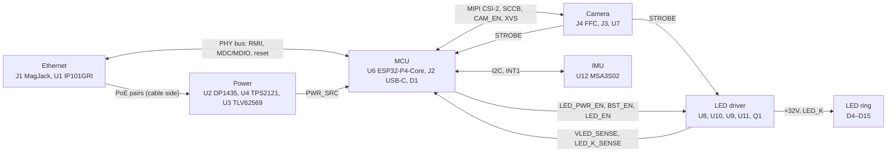

# espion-cam board design

espion-cam is the camera board of [espion](../architecture.md): a 64 × 64 mm, 4-layer baseboard for
a Waveshare ESP32-P4-Core module with an OV9281 global-shutter camera behind a lens cutout, a ring
of twelve 850 nm LEDs around the lens, 10/100 Ethernet with an 802.3af PoE powered device, and
USB-C for bench power, flashing and logs. The KiCad project is
[hardware/espion-cam](../../hardware/espion-cam/README.md). It is designed for 15–30 °C, indoor
(user decision 2026-10-31).

Board coordinates in these documents are KiCad board millimetres: the board spans x 100–164,
y 100–164, y pointing down (the top edge is y 100).

## Blocks

`+5V`, `+3V3` and `+32V` are global nets; the root sheet holds only the mounting holes H1–H4.

| Block | Sheet | Document |
|---|---|---|
| PoE PD, power mux, 3.3 V buck, USB VBUS | Power (`power.kicad_sch`) | [power.md](power.md) |
| ESP32-P4-Core module, USB-C, reset/boot, status LED, test points | MCU (`mcu.kicad_sch`) | [mcu.md](mcu.md) |
| OV9281 module FFC, CSI-2 links, SCCB, XVS/STROBE | Camera (`camera.kicad_sch`) | [camera.md](camera.md) |
| IP101GRI PHY, HR871150C MagJack, RMII | Ethernet (`ethernet.kicad_sch`) | [ethernet.md](ethernet.md) |
| MSA3S02 accelerometer | IMU (`imu.kicad_sch`) | [imu.md](imu.md) |
| LED power switch, boost, current sink, STROBE gate | LED driver (`led_driver.kicad_sch`) | [led.md](led.md) |
| 12 × Amicc A-SC880IR3C | LED ring (`led_ring.kicad_sch`) | [led.md](led.md#led-ring) |
| Mounting holes H1–H4 | root (`espion-cam.kicad_sch`) | [Board](#board) |
| Board, stack-up, rules, routing | — | [layout.md](layout.md) |
| GPIO map and firmware rules | — | [firmware-rules.md](firmware-rules.md) |

## Rails

| Rail | Source | Nominal | Min–max (basis) | Loads | Max current |
|---|---|---|---|---|---|
| `POE_VA1`, `POE_VA2`, `POE_VB1`, `POE_VB2` (cable side, isolated) | J1.7–J1.10 centre taps (both pair sets) | 802.3af | 37–57 V (802.3af PD input; DP1435 p.5) | U2.1–U2.4 only, no capacitors | ≥ 0.32 A per pair at 37 V at the 1.96 A `+5V` peak (lower bound: 84 % is the DP1435's maximum efficiency, p.5 item 7); J1 rated 350 mA per centre tap (HR871150C p.1) |
| `+5V_POE` | U2 DP1435-5V output | 5.15 V | 4.89–5.41 V (one ±5 % regulation term, DP1435 p.5; no set-point accuracy given) | C11, L1 | Module 2.4 A nominal, 2.6 A max; board peak 1.96 A |
| `+5V_POE_F` | L1 (π filter) | 5.15 V | 4.85–5.41 V (`+5V_POE` minus ≤ 0.04 V across L1 at 2.6 A) | U4 IN1, C13, C14, C15, R18/R19 | as `+5V` on PoE |
| `VBUS` | J2 USB-C | 5.0 V | 4.40–5.5 V (USB 2.0 Table 7-7 p.178, §7.2.1.3 p.173: low-power port 4.40 V minimum, a conservative floor for this high-power function, which the spec requires to run fully from 4.75 V, §7.2.1.4 p.174; USB Type-C R2.0 §4.4.2 p.141: up to 5.5 V at light load) | U4 IN2, C16, D2, R24, R27/R28 | ≈ 0.49 A on USB alone (estimate; LEDs off by firmware rule) |
| `+5V` | U4 TPS2121 OUT (PoE first) | 5.15 V on PoE | 4.35–5.41 V steady (input range minus RON ≤ 85 mΩ); ≥ 3.26 V at U4 OUT and ≥ 3.23 V at U3.4 (≈ 27 mV copper drop at the 1.96 A peak) during a PoE → USB switchover | U3, U8, U11, R63, C10, C12, C20, C22, C23, C34, C44, TP5 | ≈ 0.87 A average nominal, ≤ 1.01 A worst case at the LED design point (boost at full scale); 1.96 A peak (U3 0.52 A + boost 1.44 A) while the boost recharges `+32V` at its switch limit (start-up, and 2.4–6.0 ms of every frame); U4 limit ≈ 2.5–3.5 A |
| `+3V3` | U3 TLV62569 | 3.318 V | 3.199–3.440 V DC set point (VFB 0.588–0.612 V, SLVSDG1C p.4; R16 453k / R17 100k ±1 %), used by every calculation; ≥ 3.16 V during a PoE → USB switchover. Logic-level checks that use the generic 3.3 V ± 5 % envelope (3.135–3.465 V) name it as such | U6, U1, U12, U7, U9, D1, U5.5, J1 LEDs, R53 → `CAM_3V3`, pull-ups, CP2 divider, TP4 | ≈ 0.65 A (estimate); U3 rated 2 A |
| `CAM_3V3` | `+3V3` through R53 0 Ω (0805) | 3.318 V | as `+3V3` | J4.15 (camera module), C30, C32, TP10 | ≤ 100 mA (estimate, no module datasheet) |
| `+5V_BST` | U8 TPS22918 load switch (LED_PWR_EN) | `+5V` | `+5V` minus ≤ 0.11 V (RON ≤ 79 mΩ, TPS22918 p.5, at 1.44 A); switched on only on PoE (firmware rule) | U10 VIN, L3, C36, C38 | ≈ 0.38 A frame average nominal, ≤ 0.52 A worst case at the design point (boost at full scale); 1.26 A average, 1.44 A peak while the boost is at its switch current limit (TPS61170 p.5) |
| `+32V` | U10 TPS61170 boost (BST_EN) | 32.57 V at full scale; ≈ 25 V in operation for a typical string (firmware set point) | Full scale (`BST_EN` steady high): 31.30–33.93 V (VREF 1.204–1.254 V, R65 255k / R66 10k, TPS61170 SLVS789D p.5). In operation the headroom loop sets ≈ 21.8–31.0 V by PWM duty ≈ 0.67–0.95 nominal (clamped to 0.62–1, [led](led.md#headroom-control)); ≤ 0.92 V droop at the end of a 0.5 ms pulse | LED string D4–D15, C43, C45, C46, C47, R65/R66, R71/R72, TP13; R70/R76 through the string | Pulses 0.831 A nominal (0.759–0.915 A), ≤ 0.5 ms at ≤ 120 fps; 50 mA average nominal, 55.5 mA worst case (pulse × 0.5 ms × 120 Hz + 0.25 mA dividers + ≤ 0.31 mA `LED_K_SENSE` divider) against ≥ 77 mA the boost delivers at full scale (77–81 mA) |

Derivations: [power.md](power.md) for the first seven rows, [led.md](led.md#boost-converter) for
`+5V_BST` and `+32V`.

## Board

- **Outline:** 64 × 64 mm, 1 mm corner radius, 3840 mm². An FFC notch 18 × 3 mm in the top edge
  (x 120.7–138.7, 0.5 mm radii) lets the camera FFC wrap round the edge to J4. The lens cutout is
  Ø16 mm at (129.7, 130.3); the camera module sits behind the board with its lens in the cutout and
  the LED ring around it on the top side. J1's RJ45 opening is on the right edge, the PoE module
  along the left edge (user decision 2026-10-31, "Mirror: J1 right, DP1435 left").
- **Holes:** 4 × M3 (H1–H4, plated, GND) 3.5 mm in from each corner (user decision 2026-10-31,
  "4 × M3 corners"); three JLCPCB tooling holes TOOL1–TOOL3 (Ø1.152 mm).
- **Stack-up:** JLCPCB JLC04161H-7628, 4 layers, 1.6 mm, ENIG, green mask, no impedance control
  (user decision 2026-11-01, "No impedance control"):

  | Layer | Material | Thickness | Use |
  |---|---|---|---|
  | F.Cu | copper | 35 µm | parts, signals, power |
  | | 7628 prepreg, εr 4.4 | 0.2104 mm | |
  | In1.Cu | copper | 15.2 µm | GND plane, cut only for the PoE lane |
  | | core, εr 4.6 | 1.065 mm | |
  | In2.Cu | copper | 15.2 µm | GND plane, unbroken, no tracks |
  | | 7628 prepreg, εr 4.4 | 0.2104 mm | |
  | B.Cu | copper | 35 µm | signals, power, U6/U2/J1 |

  Details, rules and net classes: [layout](layout.md#board-and-stack-up).
- **Assembly:** JLCPCB Economic PCBA, single-sided: every machine-placed part is on the top
  (185 footprints on top, 3 on the bottom). The hand-assembly list (user decision 2026-10-31) and
  its sides (user decision 2026-10-31, "Hand parts on the bottom"):

  | Part | Side | Notes |
  |---|---|---|
  | U6 ESP32-P4-Core | bottom | Hand-soldering footprint without paste; iron only, pad by pad, no hot air (user decision 2026-11-01) — [mcu](mcu.md#module) |
  | U2 DP1435-5V | bottom | Through-hole, soldered from the top — [power](power.md#poe-input) |
  | J1 HR871150C | bottom | Through-hole, soldered from the top; conical tip ≤ 1 mm, Kapton over R46, C3, R8, C1 — [layout](layout.md#assembly) |
  | TP2, TP3, TP7 | top | Through-hole GND wire loops (RH-5002) — [mcu](mcu.md#test-points) |

  J2 (USB-C) is machine-placed with its shell 0.3 mm inside the top edge (user decision
  2026-11-01); the RESET and BOOT buttons sit on the bottom edge (user decision 2026-11-01).
- **Revision:** 0.1 (schematic title block, dated 2026-10-29).

## Accepted risks

Power:
- PoE lane: the layout is meant to give some isolation only (2 mm same-layer rule, In1 lane, F.Cu copper ≥ 1.0 mm
  sideways, TP10.1 at exactly 1.000 mm); no isolation level is rated or tested (user decision 2026-11-02) —
  [power](power.md#poe-input), [layout](layout.md#ethernet-and-poe-isolation).
- DP1435 output set-point tolerance and maximum capacitive load not specified — [power](power.md#poe-input).
- Mux reference CP2 taken from `+3V3`, not a precision reference — [power](power.md#power-mux).
- USB current limited by a firmware rule only (user decision 2026-10-31); USB-alone estimate ≈ 0.49 A at the 500 mA port limit — [power](power.md#usb-vbus).
- PoE loss with USB attached loads the host port up to the mux limit until firmware drops LED_EN, BST_EN and LED_PWR_EN — [power](power.md#power-mux).
- PoE budget at the 1.96 A `+5V` peak: ≥ 12.0 W in and ≥ 0.32 A per pair at 37 V with the DP1435's 84 % maximum efficiency; at 78 % it would reach the 12.95 W 802.3af limit and J1's 350 mA (user decision 2026-11-02, "Accept, measure on first boards"; a firmware LED limit on PoE follows if a limit is exceeded) — [power](power.md#poe-input).
- C15/C23 0.55–0.59 mm from U4, closer than JLCPCB's 1.0 mm QFN spacing — [power](power.md#accepted-risks).
- C12 outboard of C10 at the buck input; `+3V3` capacitance outside TI's tested cells — [power](power.md#33-v-buck).
- Parts whose datasheets state no rating for JLCPCB's 255 ± 5 °C reflow, or a lower one, are kept: C13, C14, C22 (not stated), D3 SS16 (250 °C, 10 s), J3 JST SH (250 + 5 °C) (user decision 2026-10-31, "Ignore reflow times and temperatures. Assume it will all work out.") — [layout](layout.md#assembly).

Camera:
- Camera module I/O level unknown, no sample (user decision 2026-10-31); assembly options kept — [camera](camera.md#xvs-level-options).
- FFC pin mapping read from a vendor photo; insertion depth, stiffener and bend radius unknown — [camera](camera.md#ffc-orientation).
- No impedance control: MIPI pairs 88–114 Ω at JLCPCB's ±20 % width tolerance (user decision 2026-11-01) — [layout](layout.md#impedance).
- MIPI clock pairs at 2W without a GND guard (user decision 2026-11-01, "Accept 2W, no guard") — [camera](camera.md#csi-2-link).
- In2 reference neck for the CSI bus 6.19 mm against TI's 6.83 mm, crossed at 45° with 72.5 mil a side (user decision 2026-11-01, "Use 45°, accept 71.7 mil") — [layout](layout.md#camera-and-csi-2).
- CAM pairs 54–89 mil from the plane edge at the FFC notch (user decision 2026-11-01, "Pull planes to 0.3 mm") — [layout](layout.md#camera-and-csi-2).
- GND planes solid under the 0 Ω link pads and J4's MIPI pads except where the MIPI via antipads reach under them (design review 2026-11-01) — [layout](layout.md#camera-and-csi-2).

LED:
- Q1 1.7–1.8 mm from LEDs D15/D4, 2.35 mm from the crystal Y1 (rated to 85 °C) and near C46; their temperature rise at full boost output (up to 0.73 W in Q1; ≤ 0.083 W with the headroom loop) is unknown (user decision 2026-11-01, "Measure first boards") — [led](led.md#thermal), [layout](layout.md#thermal).
- LED boost output set by a firmware headroom loop (PWM on `BST_EN`, `LED_K_SENSE` on GPIO23); without it the boost runs at full scale and Q1 dissipates as before (user decision 2026-11-03, design option 1b) — [led](led.md#headroom-control).
- No temperature sensor: the NTC was dropped for `LED_K_SENSE` (user decision 2026-11-03); C48 is 1 nF instead of HDG's 0.1 µF at that ADC pin — [led](led.md#led_k-sense).
- STROBE hardware timeout window 0.525–1.026 ms, set by U9's threshold spread (user decision 2026-11-02, "Accept 0.525–1.026 ms") — [led](led.md#strobe-gating-and-timeout).
- A firmware failure that leaves +32V at full scale and lets STROBE run to the timeout would put ≈ 1.40 W into Q1 (TJ ≈ 184 °C > 175 °C); only firmware prevents it (FW-9 pulse-width fault, FW-22 power rule; design review 2026-11-03) — [led](led.md#q1-protection).
- Boost output capacitance (662 µF) outside the TPS61170's 1–10 µF recommended range — [led](led.md#boost-converter).
- PHY_RST_N and LED_K_SENSE run inside the LED ring, 0.5–1.1 mm from the pulsed ring copper (static line; 9.09 kΩ node read late in each pulse) — [layout](layout.md#led-driver-and-ring).

MCU:
- Status LED D1 on `+3V3`: green/blue VF up to 3.2 V at 5 mA against the `+3V3` set point of 3.199–3.440 V (user decision 2026-11-02, "Accept, check on first boards", taken on the 3.135 V minimum of the ± 5 % envelope, which is lower still) — [mcu](mcu.md#status-led).
- USB-C shell 0.3 mm inside the edge: a plug overmold may stop ≈ 0.25 mm short of full insertion (user decision 2026-11-01) — [mcu](mcu.md#usb-c).
- RESET/BOOT buttons on the bottom edge; the enclosure must reach them (user decision 2026-11-01) — [mcu](mcu.md#reset-and-boot).
- U6 lies under C47, C50, U12 and R37: iron only (user decision 2026-11-01) — [mcu](mcu.md#module).
- USB connector-side lines: one via without a GND return via, a short stretch over the In1 PoE gap (USB full speed) — [mcu](mcu.md#usb-c).

Ethernet:
- IP101GRI has no maker MSL/reflow statement (user decision 2026-10-31, "Keep IP101GRI, accept risk") — [ethernet](ethernet.md#phy).
- MDI pairs swapped at J1: link relies on the PHY's auto-MDIX (design review 2026-11-01) — [ethernet](ethernet.md#magjack-and-mdi).
- MDI spacing below 3× inside U1's escape and the P/N swap vias without return vias — [ethernet](ethernet.md#magjack-and-mdi).
- ESP32-P4 RMII output timing unpublished; some RMII/strobe layer changes have no GND return via within 1.6 mm — [ethernet](ethernet.md#rmii).
- No GND guard between the crystal and the LED supply copper (IP101G asks for one "if possible") — [ethernet](ethernet.md#phy).
- REGOUT reaches C6 through 4.59 mm of track, two vias and a short pour, because pin 28 lies between the MDI pairs — [layout](layout.md#phy-side-decoupling).
- J1's lands 0.57–0.72 mm from reflowed parts R46, C3, R8, C1 — [layout](layout.md#assembly).

IMU and board:
- C50's GND via 2.1 mm away, R74 0.64 mm from U12, IMU_SDA crossing L2's courtyard margin — [imu](imu.md#accepted-risks).
- Stock footprint silk kept closer than 0.15 mm to pads; JLCPCB clips it (user decision 2026-11-02, "Keep stock silk, JLC clips it") — [layout](layout.md#accepted-deviations).

## First-board checks

Power ([power](power.md#first-board-checks)):
1. `+5V_POE` at no load and full load with a 44 V and a 57 V PSE: ≤ 5.5 V.
2. PoE cold start into the π filter: monotonic, no hiccup; stays up through 0.5 ms / 120 fps LED pulses.
3. Mux thresholds with a bench supply on `+5V_POE_F`: to USB at 3.49–4.08 V, back at 3.80–4.42 V.
4. PoE pull with USB attached, idle and during LED pulses: no reset, USB stays enumerated; firmware latency `PWR_SRC` → LED_EN, BST_EN, LED_PWR_EN low.
5. PD input power and pair current at peak load (LEDs 0.5 ms / 120 fps, camera streaming, Ethernet up) on a 44 V PSE: ≤ 12.95 W and ≤ 350 mA per pair, else a firmware LED limit on PoE; scope whether the boost recharges at its switch limit every frame.
6. USB-alone current while streaming with Ethernet linked: ≤ 0.5 A; camera share through a shunt in place of R53.
7. `+3V3` load step 0.1 → 0.6 A: overshoot ≤ 5 %.
8. Thermal camera on U4 and its vias, the U8 neck, U3, L1, U2 at the LED design point and during `+32V` start-up.
9. RH-5002 loop fit in the 1.0 mm hole of TP2/TP3/TP7.

LED ([led](led.md#first-board-checks)):
10. Thermocouples on D15, D4, C46 and Y1's case at 0.5 ms / 120 fps for 30 min, with the headroom loop and at full boost output; if an LED is above the derating curve, lower R61; Y1 must stay ≤ 80 °C, else lower the LED current or duty, or pull the B.Cu zone's east edge back from x 151.0 — [led](led.md#thermal), [layout](layout.md#thermal).
11. `+32V` droop and recovery and the LED current at the end of a pulse (TP13, TP14), at full scale and down to the loop's lowest set point; `LED_K_SENSE` × 11 against Q1's drain, the drain voltage where the current starts to sag, the in-pulse vs between-pulse `LED_K_SENSE` difference with Q1 conducting and off on a low-VF and a high-VF unit (sets FW-22's sink-off threshold), the start-up coarse step and the ADC conversion time — [led](led.md#boost-converter), [led](led.md#first-board-checks).
12. Boost start-up waveform and a 0 → 0.9 A pulse load step (output capacitance outside TI's range) — [led](led.md#boost-converter).
13. STROBE timeout: a 0.5 ms pulse passes whole, longer ones are cut by ≈ 1.03 ms; STROBE's width matches the set exposure within 50 µs, and a 0.6 ms STROBE trips FW-9's pulse-width fault — [led](led.md#strobe-gating-and-timeout), [led](led.md#first-board-checks).

Camera ([camera](camera.md#first-board-checks)):
14. CSI-2 at full rate (2 lanes, 800 Mbit/s per lane) with a frame-error count (impedance, no CLK guard, planes under the pads) — [camera](camera.md#csi-2-link).
15. Camera I/O level, CAM_EN polarity and the XVS divider option on the first module — [camera](camera.md#xvs-level-options), [camera](camera.md#sccb-and-control).
16. FFC with the supplied cable: pin 1 mapping, insertion depth, loop and stiffener clear of the board edge — [camera](camera.md#ffc-orientation).

MCU ([mcu](mcu.md#first-board-checks)):
17. D1: each colour's brightness at 3.3 V and the colour byte order — [mcu](mcu.md#status-led).
18. USB-C: the cables in use (charger, flashing cable) latch and enumerate — [mcu](mcu.md#usb-c).
19. U6 soldered with an iron only, pad by pad — [mcu](mcu.md#module).

Ethernet ([ethernet](ethernet.md#first-board-checks)):
20. J1 iron trial with a ≤ 1 mm conical tip and Kapton over R46, C3, R8, C1; inspect them after — [layout](layout.md#assembly).
21. 100 Mbit/s link through auto-MDIX and an RMII soak test (P4 timing unpublished) — [ethernet](ethernet.md#magjack-and-mdi), [ethernet](ethernet.md#rmii).
22. REGOUT ripple at C6 with the link at 100 Mbit/s: inside 1.07–1.18 V (the REGOUT path to C6 has two vias) — [ethernet](ethernet.md#regout-and-iset).

IMU ([imu](imu.md#first-board-checks)):
23. Accelerometer I²C and INT1 next to the running buck — [imu](imu.md#i2c-bus).

## Documents

- [Architecture](../architecture.md): what the product does, firmware and host overview.
- [Power](power.md): PoE PD, power mux, 3.3 V buck, USB VBUS.
- [MCU](mcu.md): ESP32-P4-Core module, USB-C, reset and boot, status LED, test points.
- [Camera](camera.md): OV9281 module, FFC, CSI-2, SCCB, XVS and STROBE.
- [Ethernet](ethernet.md): IP101GRI PHY, MagJack, RMII, straps.
- [IMU](imu.md): MSA3S02 accelerometer and its I²C bus.
- [LED](led.md): LED power switch, boost, current sink, STROBE gating, LED ring, thermal.
- [Layout](layout.md): stack-up, fabrication rules, net classes, custom rules, routing, assembly.
- [Firmware rules](firmware-rules.md): GPIO map, straps, rules the firmware must follow.
- [KiCad project](../../hardware/espion-cam/README.md): project files and parts list.
- [Project library](../../hardware/lib/README.md): symbols, footprints and 3D models made for this board.
