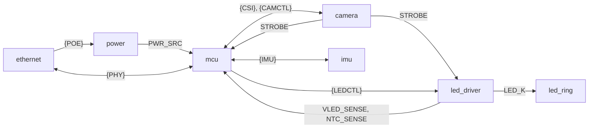

# espion-cam board

The camera board of espion. An ESP32-P4 module exposes a global-shutter IR camera at
120 fps, finds the bright marker blobs in each frame and streams their centres to the host
over Ethernet, on PTP time. A ring of 12 IR LEDs flashes with every exposure. The board runs
from PoE, or from USB-C on the bench. System view: [architecture.md](../architecture.md).

The KiCad schematic (`hardware/espion-cam/`) is the source of truth for parts and wiring.
These docs hold what it can't: why, derived values, accepted risks, layout and firmware rules.

## Key decisions

- One sheet per block. Signals cross sheets only through hierarchical pins and buses, so ERC checks every crossing; rails use global power symbols.
- Every part on the top side. The camera module sits in the enclosure 10 mm behind the board, looking through a Ø16 mm cutout, its FFC wrapped round the bottom edge into J4; the 12 LEDs ring the cutout. One PCB, no ring connector ([layout.md](layout.md)).
- 4 × M3 plated holes, on GND, kept ≥ 2 mm from PoE cable copper ([layout.md](layout.md)).
- PoE first, USB-C as fallback, through a priority mux that tells firmware which one is live; no LED rail on USB alone ([power.md](power.md)).
- VBUS is sensed on its own pin, so firmware can drop the USB D+ pull-up while VBUS is absent; the mux flag can't tell ([mcu.md](mcu.md)).
- The LED boost sits behind a slow load switch: charging its 440 µF at power-up would otherwise pull ≈ 1.6 A, over the USB limit ([led.md](led.md)).
- The camera's XVS/STROBE level is unknown (1.8, 2.8 or 3.3 V): a buffer reads STROBE at any of them, a divider option sets XVS, fitted for 1.8 V ([camera.md](camera.md)).
- Camera enable is pulled down: the sensor stays off until firmware turns it on, and can be power-cycled ([camera.md](camera.md)).
- Single-sided FPC connector: a cable inserted face-flipped makes no contact instead of putting 3.3 V on the camera's GND ([camera.md](camera.md)).
- STROBE also goes to the P4, which timestamps every exposure ([camera.md](camera.md)).
- PTP PPS leaves on a GPIO with a test point and loops back through a 0 Ω (R34) for capture; remove R34 if capture sees the output pad directly ([mcu.md](mcu.md)).
- PHY crystal with ESR ≤ 40 Ω, as the IP101G needs ([ethernet.md](ethernet.md)).
- RJ45 shield to GND through 1 nF / 2 kV in parallel with 1 MΩ ([ethernet.md](ethernet.md)).
- One RGB status LED; the jack LEDs show link/activity (green) and 100 Mb/s (yellow) ([mcu.md](mcu.md), [ethernet.md](ethernet.md)).
- Test points on the rails and the timing and LED signals; ADC sense of +32V and of the sink MOSFET's temperature. No UART header, no JTAG pads: USB does both.
- IMU on its own I2C bus: wake-on-motion flags a bumped camera, gravity helps rig calibration ([imu.md](imu.md)).
- Ethernet GPIOs are fixed; the rest are picked at placement within fixed groups ([firmware-rules.md](firmware-rules.md)).
- Clocks: the PHY's 25 MHz crystal makes the 50 MHz RMII clock; PTP and the system timer share the P4's 40 MHz crystal ([firmware-rules.md](firmware-rules.md)).

## Block diagram

- **root**: the sheet blocks wired as above, and the mounting holes.
- **power**: PoE module (802.3af, isolated, 5.15 V), LC filter, PoE/USB mux, 3.3 V buck.
- **mcu**: P4 module, reset and BOOT, USB-C with ESD and VBUS clamp, VBUS sense, status LED, PPS loop-back.
- **ethernet**: 10/100 PHY, its crystal, MagJack with PoE taps, shield RC, jack LEDs.
- **camera**: FPC and aux connectors, I2C pull-ups, camera enable, XVS divider, STROBE buffer.
- **led_driver**: load switch, 5 V → 32 V boost, storage caps, gate and timeout, 1 A current sink, NTC, +32V sense.
- **led_ring**: 12 IR LEDs (850 nm) in series from +32V to the sink.
- **imu**: 6-axis IMU with its decoupling and pull-ups.

## Rails

These are the worst-case ranges the block docs derive; reviews use this table.

| Rail | Source | Range | Main loads |
|---|---|---|---|
| `VBUS` | USB-C | 4.4–5.5 V (USB 2.0 low-power port minimum to Type-C maximum) | Mux USB input, VBUS sense divider, 100 kΩ bleeder |
| `+5V_POE` | PoE module U2 | 4.64–5.67 V, 5.15 V typ (both 5 % bands stacked; 4.89–5.41 V with one) | LC filter, then the mux PoE input |
| `+5V` | Mux U4 | On PoE: `+5V_POE_F` (4.41–5.67 V; low end after a 0.2 V load-step dip and 0.03 V in L1) less the mux drop (≤ 90 mΩ × load, ≤ 0.18 V at 2 A). On USB: VBUS less the same drop | 3.3 V buck, LED load switch, sink op-amp |
| `+3V3` | Buck U3 | 3.20–3.44 V, 3.32 V typ (≈ 3.19–3.45 V with drift over temperature and input) | P4 module, PHY, camera, logic, status LED, IMU |
| `CAM_3V3` | `+3V3` through 0 Ω R53 (lift it to measure the camera's current) | as `+3V3` | Camera module |
| `+5V_BST` | Load switch U8 | as `+5V`, only while firmware enables it | Boost |
| `+32V` | Boost U10 through D3 | 31.30–33.88 V, 32.57 V typ | LED ring, feedback and sense dividers |

`+5V` above 5.5 V (the stacked-band PoE corner) is over the recommended input of the buck,
load switch and op-amp but under their 6 V maximum; accepted ([power.md](power.md), [led.md](led.md)).
`+32V` uses the stock `power:+36V` symbol with Value `+32V`; the net takes its name from the Value
(`.omp/kicad.json` `powerSymbols` maps it for `add_power`).

## Parts not from LCSC

| Part | Order from | Notes |
|---|---|---|
| Waveshare ESP32-P4-Core, 16 MB flash (SKU 36096) | Waveshare | On the schematic as U6, without an LCSC number. Needs chip revision v3.x: esp-hal supports no older one |
| OV9281 camera module (SZYTF; 79°, 110° or 160° lens) | [AliExpress 1005012566040263](https://fr.aliexpress.com/item/1005012566040263.html) | No symbol; plugs into J4 (FPC) and J3 (aux) |
| Aux pigtail, JST-SH 4-pin, 200 mm, one end tinned: DEALON LNN100-157128-200-4P | LCSC C2999003 | Mates with J3; the tinned ends are soldered to the camera's XVS, STROBE and GND pads |
| 850 nm bandpass filter for the lens | not chosen yet | Not a PCB part |

## BOM

Generate it from the schematic's `Order` preset with `kicad_query` `bom` (preset `Order`), or in
`hardware/espion-cam`: `kicad-cli sch export bom --preset Order -o espion-cam-bom.csv espion-cam.kicad_sch`.
Never commit the output. Every sourced symbol carries Manufacturer, MPN and LCSC fields. DNP parts,
holes, the net tie and pad test points are left out; the loop GND test points TP3, TP2 and TP7 stay in.

## Before ordering

- Measure the castellated pads of a real P4-Core and confirm the provisional land patterns
  `Module_Waveshare:Waveshare_ESP32-P4-Core` and `_HandSolder`
  ([hardware/lib/README.md](../../hardware/lib/README.md)).
- Before routing J4: ohm the camera's GND pad to the cable's edge conductor to confirm which
  edge is pin 1 ([camera.md](camera.md), FPC connector).
- Before buying J4: check the cable type and the module connector's contact side; together
  they pick J4's MPN ([camera.md](camera.md)).

## First boards

1. Unpowered, measure each rail to GND (TP3/TP2/TP7): `VBUS` (no test point: probe C16 at U4), `+5V` (TP5), `+3V3` (TP4), `+32V` (TP13). Nothing near 0 Ω. `VBUS` ≈ 55 kΩ and `+32V` ≈ 130 kΩ, creeping up as the meter charges the caps (estimates). Compare boards for the rest.
2. Power from USB first: a 5 V bench supply limited to ≈ 0.6 A into the USB-C port (breakout board), or a USB meter. Expect ≈ 0.25 A with firmware running and the camera on (estimate; design ceiling 0.57 A). No measured figure yet: a board well above the others has a fault.
3. After a minute, touch or IR-check. Warm is fine for the buck U3, the P4 module and the PHY U1. Everything else should stay near room temperature on USB, including the mux U4, U8, U10, Q1 and the LEDs.
4. Measure `+5V`, `+3V3` and `CAM_3V3` (TP10) against the Rails table.
5. Unplug USB and power from an 802.3af PoE switch. Measure `+5V` again; the PoE module U2 may run warm (estimate).
6. On PoE, have firmware enable the LED rail (sequence in [led.md](led.md)) and measure `+32V` at TP13: 31.3–33.9 V. The boost draws 0.8–1.3 A from `+5V` for 50–120 ms while it charges, then ≈ 0.46 A average with the LEDs pulsing. Q1 and the LEDs then get warm (Q1 junction ≈ ambient + 49 °C at its 0.8 W average).
7. `+32V` stays charged for minutes after the boost stops (τ ≈ 58 s: still ≈ 12 V after one minute); discharge it before touching the LED side.

## Docs

- [power.md](power.md): PoE module, LC filter, PoE/USB mux, 3.3 V buck.
- [mcu.md](mcu.md): P4 module, reset/BOOT, USB-C, VBUS sense, status LED, PPS loop-back.
- [ethernet.md](ethernet.md): PHY, crystal, MagJack, shield, jack LEDs.
- [camera.md](camera.md): camera module and cables, FPC connector, levels, XVS divider, STROBE buffer.
- [led.md](led.md): LED ring sizing, load switch, boost, gate and timeout, current sink, NTC, rail sense, the ring.
- [imu.md](imu.md): IMU.
- [layout.md](layout.md): stack-up, impedance, net classes, rules, mounting holes, placement and routing.
- [firmware-rules.md](firmware-rules.md): GPIO map, straps, clocks, the numbered firmware rules.
