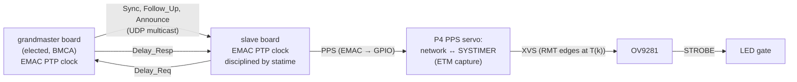

# Timing

Goal: every camera starts its exposure at the same instant (target ≤ 1 µs between boards), and every packet
carries a frame number and a capture time that mean the same on every board.

The grandmaster also drives its own XVS through its own PPS servo, like every other board.

## 1. Network time (PTP over Ethernet)

- **Protocol**: IEEE 1588-2019 (PTPv2.1), run by [statime](https://github.com/pendulum-project/statime) as an
  ordinary clock. End-to-end delay mechanism, UDP/IPv4 multicast (224.0.1.129, event port 319, general port 320). Domain
  0 by default; configurable so the rig can share a LAN with other PTP gear.
- **Clock**: each board's PTP clock is the EMAC system time. It advances by a sub-second increment on every
  tick of its reference clock (40 MHz crystal: 25 ns, the ESP-IDF default; other sources: check the TRM).
  statime steers its rate through the addend register and steps it when the offset is large.
- **Timestamps**: the EMAC stamps Sync and Delay_Req in hardware at the MII, on send and receive, so software
  latency never enters the offset.
- **Network time** is the current grandmaster's PTP time; on the wire, `u64` ns ([protocol.md](protocol.md)).
- **Rates** (start values, tune on hardware): Announce 1 Hz, Sync 8 Hz (two-step), Delay_Req 8 Hz.

### Grandmaster election (BMCA, with failover)

No host is involved: the boards elect a grandmaster with PTP's Best Master Clock Algorithm. To validate:

1. Every board advertises the same dataset (priority1 128, clockClass 248, clockAccuracy unknown, priority2
   128), so BMCA picks the **lowest clockIdentity** (derived from the EMAC MAC).
2. **Joining doesn't disrupt**: a booting board advertises clockClass 255 (slave-only) until it has locked to
   a grandmaster, or has heard no Announce for the receipt timeout (3 intervals, 3 s). Then it becomes
   eligible (248). A board with an unsynced clock never takes over a running timescale.
3. **No preemption**: the grandmaster advertises priority2 127, so a board with a lower clockIdentity that joins
   later doesn't take over.
4. **The timescale continues**: when the grandmaster disappears, BMCA picks a new one among the eligible
   boards. Its clock keeps its last corrected rate (holdover), so frame numbers and capture times
   continue without a jump; the error grows only with that rate's drift until the others lock to it. On a cold
   start (no eligible board was locked), the winner's free-running clock starts a new timescale.
5. A slave whose grandmaster changes keeps its clock and re-locks. A large offset makes statime step the
   clock; the PPS servo sees the step and restarts (section 2).

espion-sync only listens, as a slave-only clock (clockClass 255), and reports the current grandmaster and each
board's state. To check in statime: changing clockClass and priority2 at runtime (rules 2, 3).

### Network

- An unmanaged switch doesn't correct for the time frames spend inside it. Sync and Delay_Req are small, and
  the boards' ports carry only PTP and broadcast traffic (the centroid streams converge on the host's port),
  so PTP frames rarely wait behind full-size frames. statime's filter drops the outliers that do.
- If queuing shows in the offsets: send Delay_Req as unicast, use a lower-latency switch (1 Gbit/s uplinks),
  or a switch with a PTP transparent clock.

## 2. PTP clock → P4 local time (PPS)

- The EMAC drives a **PPS** output from its PTP clock onto a GPIO with a test point. Edges fall on whole
  network-time periods. Rate still to choose: 1 Hz with digital rollover (nanosecond sub-seconds, like the
  wire format), or a 2ⁿ Hz square wave (up to 16 384 Hz), which needs binary rollover.
- **The P4 captures PPS edges in hardware through ETM**: the GPIO edge event triggers a timer capture, so
  interrupt latency doesn't matter. esp-hal 1.2.2 has no ETM driver on the P4, so `cam-p4` drives ETM at the
  PAC level. To confirm in the TRM: which timer has the capture task (TIMG/GPTimer or SYSTIMER), and whether
  the event fires on a pad the EMAC drives as an output. The board loops PPS back into GPIO33 through R27,
  so either way works ([hardware/mcu.md](hardware/mcu.md)).
- The P4 fits `network ↔ SYSTIMER` (offset + rate) over a sliding window of edges. Both clocks share the 40 MHz
  crystal, so their ratio changes only when statime steers the PTP clock. A PTP step shows as a PPS phase
  jump: the servo drops its window and re-acquires.

## 3. Frame trigger (P4 → OV9281 XVS)

- Frame `k` fires at network time `T(k) = T0 + ⌊k · 10⁹ / 120⌋ ns = T0 + ⌊k · 25 000 000 / 3⌋ ns`. Computing
  from `k`, rather than adding a rounded period, avoids drift. `T0` (the frame epoch) comes from espion-sync
  in a **FrameEpoch** message; default network time 0.
- The P4 converts `T(k)` to local time with the PPS fit and schedules XVS edges with its RMT (a linear edge
  schedule in SYSTIMER time, refreshed on every fit update, as in esp-wifi-sync's `wave.rs`).
- The OV9281 runs in external trigger mode: each XVS edge starts one exposure, after a latency `L` that is
  constant per sensor setup. The P4 measures `L` by ETM-timestamping STROBE's rising edge (also flags XVS edges
  with no exposure); a scope on XVS and STROBE cross-checks it.
- **Capture time** in each packet is the network time of mid-exposure: `T(k) + L + exposure / 2`.
- Until both the PTP clock and the PPS servo are locked, packets carry `SyncState::Acquiring` and the host
  doesn't use them for triangulation.

## 4. LED strobe and exposure

- Markers are passive retroreflectors, lit by the LED ring around the lens. Working range: a room (2–5 m).
- The ring is on only while `STROBE ∧ LED_EN`:
  - **STROBE** (OV9281 output) is high during exposure, so light matches exposure exactly on every board with
    no firmware timing.
  - **LED_EN** (P4) goes low for one **dark frame every N frames** (N from Config). Dark frames show ambient
    IR (sun, lamps, reflections); the P4 builds a mask from them, and their packets carry a `dark` flag.
- No continuous-on mode: bring-up and focusing use the strobed light. Default exposure **500 µs** = 6 % LED
  duty at 120 Hz.
- Firmware caps exposure at **0.75 ms**. A hardware timeout in the gate ends each pulse 0.78–1.32 ms after
  STROBE rises, whatever STROBE does; it only acts if firmware fails. Exposures longer than the timeout are lit
  only for their first 0.78–1.32 ms. The boost can sustain only ≈ 0.8 ms of light per frame at 120 fps
  ([hardware/led.md](hardware/led.md)).

## 5. Startup sequence

1. Link up, then IPv4 by DHCP. The board joins the PTP multicast group as slave-only.
2. If it hears a grandmaster, it locks and becomes eligible. If it hears none for 3 s, it becomes eligible at
   once; BMCA elects the lowest clockIdentity, which starts the timescale.
3. The EMAC starts PPS; the P4 locks its PPS servo.
4. XVS starts at the next `T(k)` after the frame epoch.
5. espion-sync watches PTP and Status from every board and reports which are locked and their errors.

## Error budget (board to board)

| Source | Expected | Status |
|---|---|---|
| PTP offset (board ↔ grandmaster, hardware timestamps, unmanaged switch) | ≤ 0.5 µs; 25 ns timestamp step at 40 MHz | **To measure** |
| P4 PPS capture (ETM → timer capture) | ~1 timer tick | To measure |
| P4 XVS edge placement (RMT) | ~1 RMT tick | To measure |
| OV9281 trigger latency jitter | Datasheet / scope | **To measure** |
| Grandmaster failover (holdover) | Grows with drift until slaves re-lock | To measure |

To validate: probe the PPS test points of two boards at once (PTP alone), then XVS or STROBE (whole chain).
