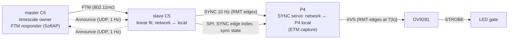

# Timing

Goal: every camera exposes at the same instant (target ≤ 1 µs between boards), and every
packet carries a frame number and a capture time that mean the same thing on every board.

The master C5 also drives its own P4 through SYNC, like any slave, with an exact fit.

## 1. Network time (C5 ↔ C5, Wi-Fi FTM)

This reuses the method and code proven in the private
[esp-wifi-sync](https://github.com/azais-corentin/esp-wifi-sync) experiments
(`firmware/src/bin/ftm_sync.rs`, ESP32-C3). There, two boards' 50 Hz edges stayed within
0.5 µs of each other on a scope.

- **Network time** is a timescale identified by a random `timescale` id. Its owner, the
  master C5, serves it from its SYSTIMER (plus a fixed offset when it took over the
  timescale from an earlier master, see election below).
- **Master**: station on the shared AP (for IP), plus a hidden SoftAP on the same channel that
  answers FTM requests (HT20, as Espressif recommends for FTM).
- **Slaves**: every 2 s, an FTM session against the master's SoftAP (16 frames, 2 bursts).
  Each exchange gives four hardware timestamps t1–t4 (ps). The master time at t2 is
  `(t1 + t4 + t2 − t3) / 2`. Exchanges whose RTT is far from the session median
  (multipath, retries) are rejected. A least-squares fit of `master − local` against
  local time over the last 128 exchanges (~18 s) gives offset and rate.
- Internal unit: `i64` picoseconds. On the wire: `u64` nanoseconds.

### Band

- 5 GHz. The master's SoftAP must share the station's channel, so the AP's 5 GHz channel
  sets the FTM channel.
- Prefer non-DFS channels (36–48). ESP SoftAP support on DFS channels is restricted (to
  verify for the C5).

### Master election (automatic, with failover)

No host is involved: the boards elect a master among themselves. Draft rules, to
validate on hardware:

1. Every C5 broadcasts **Announce** at 1 Hz ([protocol.md](protocol.md)) with its role
   (master / slave / candidate), `timescale` id, SoftAP MAC (master only) and current
   network time estimate.
2. **No preemption**: while a master is heard, it stays master, even if a board with a
   lower MAC boots.
3. If no master Announce is heard for 3 s, every C5 that is locked or free-running becomes
   a candidate. The candidate with the **lowest station MAC** wins after a 1 s quiet period.
4. **Timescale continuity**: if the winner was locked to the old master, it keeps serving
   the old timescale: it freezes its fit (offset + rate against its own SYSTIMER) and
   keeps the `timescale` id. Frame numbers and capture times continue without a jump; the
   error grows only with the frozen rate's drift. If no candidate was locked (cold start),
   the winner starts a new timescale at its own SYSTIMER with a fresh random id.
5. A slave that sees the `timescale` id change, or several sessions of outliers, restarts
   its fit (as esp-wifi-sync does on a master reboot).

espion-sync only observes: it reports the current master, timescale and per-board state.

ESP32-C5 specifics still to verify (see [architecture.md](architecture.md#esp32-c5)):
- The FTM timestamps' clock against SYSTIMER (on the C3 the MAC clock is SYSTIMER µs, and
  t1/t4 are truncated to 48 bits).
- FTM between two C5s with the vendored `9e91edc` Wi-Fi libraries.

## 2. C5 → P4 (SYNC, 10 Hz)

- The C5 drives **SYNC** with its RMT from the network-time fit. Rising edges fall at
  network-time multiples of 100 ms (the `wave.rs` approach: a linear edge schedule in local
  SYSTIMER time, refreshed on every fit update, so no software timing is critical).
- Over SPI the C5 tells the P4 the index `n` of the SYNC edges (edge `n` is at network time
  `n · 100 ms`), the sync state (acquiring / locked, estimated error) and the `timescale`
  id. `DATA_READY` signals a pending message. The P4 needs this once on lock and again
  whenever the timescale changes.
- **The P4 captures SYNC edges in hardware through ETM**: the GPIO edge event triggers a
  timer capture task, so interrupt latency doesn't matter. esp-hal 1.2.2 has no ETM driver
  on the P4, so `cam-p4` drives ETM at the PAC level. Which timer offers the capture task
  (TIMG/GPTimer or SYSTIMER) is still to confirm against the TRM.
- The P4 fits `network ↔ P4 local` (offset + rate) over a sliding window of captured
  edges. At 10 Hz the fit follows crystal drift (temperature) closely between edges.

## 3. Frame trigger (P4 → OV9281 XVS)

- Frame `k` is triggered at network time
  `T(k) = T0 + ⌊k · 10⁹ / 120⌋ ns = T0 + ⌊k · 25 000 000 / 3⌋ ns`.
  Computing it from `k` (not by adding a rounded period) avoids drift. `T0` (the frame
  epoch) comes from espion-sync in a **FrameEpoch** message. By default it is network time 0.
- The P4 turns `T(k)` into local time with the SYNC fit and schedules XVS edges with its RMT
  (same edge-schedule technique as the C5's SYNC).
- The OV9281 runs in external trigger mode: each XVS edge starts one exposure. The sensor's
  trigger-to-exposure latency `L` is constant and gets measured once per sensor
  configuration (scope on XVS and STROBE).
- **Capture time** in each packet is the network time of the middle of the exposure:
  `T(k) + L + exposure / 2`.
- Until the P4 is locked to SYNC (and the C5 to the master), packets carry
  `SyncState::Acquiring` and the host does not use them for triangulation.

## 4. LED strobe and exposure

- Markers are passive retroreflectors, lit by the ring around the lens. The working range
  is a room (2–5 m).
- The LED ring is on only while `(STROBE ∧ LED_EN) ∨ LED_FORCE`:
  - **STROBE** (OV9281 output) is high during exposure, so light matches exposure exactly
    on every board without firmware timing.
  - **LED_EN** (P4) is low for one **dark frame every N frames** (N from Config). Dark
    frames show ambient IR sources (sun, lamps, reflections); the P4 builds a mask from
    them, and their packets carry a `dark` flag.
  - **LED_FORCE** (P4) forces the LEDs on for bring-up and focusing. Never in normal
    operation.
- Default exposure: **500 µs**, a 6 % LED duty cycle at 120 Hz.

## 5. Startup sequence

1. C5s join the AP and broadcast Announce. With no master heard, they elect one
   (lowest MAC, new timescale). It starts its SoftAP responder.
2. Slaves run FTM sessions until the fit has enough samples (8 exchanges minimum), then
   report `Locked`.
3. Each C5 starts SYNC and tells its P4 the edge index and timescale.
4. The P4 locks its SYNC servo, then starts XVS at the next `T(k)` after the frame epoch.
5. espion-sync watches Announce and Status from every board and reports which ones are
   locked and their estimated errors.

## Error budget (board to board)

| Source | Expected | Status |
|---|---|---|
| FTM network time (C5 ↔ master) | ≤ 0.5 µs | Measured on C3 (esp-wifi-sync); **C5 to measure** |
| C5 SYNC edge placement (RMT) | ~1 RMT tick | To measure |
| P4 SYNC capture (ETM → timer capture) | ~1 timer tick | To measure |
| P4 XVS edge placement (RMT) | ~1 RMT tick | To measure |
| OV9281 trigger latency jitter | Datasheet / scope | **To measure** |
| Master failover (frozen rate) | Grows with drift until slaves re-lock | To measure |

Validation: probe XVS (or STROBE) on two boards at once and compare edges, as
esp-wifi-sync's `scope-sync` does with its 50 Hz test wave.
