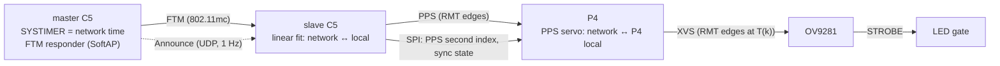

# Timing

Goal: every camera exposes at the same instant (target ≤ 1 µs between boards), and every
packet carries a frame number and a capture time that mean the same thing on every board.

The master C5 also drives its own P4 through PPS, like any slave, with an exact fit.

## 1. Network time (C5 ↔ C5, Wi-Fi FTM)

This reuses the method and code proven in the private
[esp-wifi-sync](https://github.com/azais-corentin/esp-wifi-sync) experiments
(`firmware/src/bin/ftm_sync.rs`, ESP32-C3). There, two boards' 50 Hz edges stayed within
0.5 µs of each other on a scope.

- **Master election**: one camera board's C5 is the master, selected by its station MAC
  (`FTM_MASTER_MAC`, build time for now). espion-sync takes over the selection later. The
  master's SYSTIMER is network time.
- **Master**: station on the shared AP (for IP), plus a hidden SoftAP on the same channel that
  answers FTM requests (HT20, as Espressif recommends for FTM). Once a second it
  broadcasts **Announce** ([protocol.md](protocol.md)) with its boot nonce, SoftAP MAC
  and coarse time.
- **Slaves**: every 2 s, an FTM session against the master's SoftAP (16 frames, 2 bursts).
  Each exchange gives four hardware timestamps t1–t4 (ps). The master time at t2 is
  `(t1 + t4 + t2 − t3) / 2`. Exchanges whose RTT is far from the session median
  (multipath, retries) are rejected. A least-squares fit of `master − local` against
  local time over the last 128 exchanges (~18 s) gives offset and rate.
- **Master reboot**: a new boot nonce, or several sessions of outliers, restarts the fit.
- Internal unit: `i64` picoseconds. On the wire: `u64` nanoseconds.

ESP32-C5 specifics still to verify (see [architecture.md](architecture.md#esp32-c5)):
- The FTM timestamps' clock against SYSTIMER (on the C3 the MAC clock is SYSTIMER µs, and
  t1/t4 are truncated to 48 bits).
- FTM between two C5s with the vendored `9e91edc` Wi-Fi libraries.
- FTM on 5 GHz channels against the AP's channel plan. The SoftAP must share the station's
  channel.

## 2. C5 → P4 (PPS)

- The C5 drives **PPS** with its RMT from the network-time fit. Edges fall at whole seconds
  of network time (the `wave.rs` approach: a linear edge schedule in local SYSTIMER time,
  refreshed on every fit update, so no software timing is critical).
- Over SPI the C5 tells the P4 which network second the next PPS edges belong to, and the
  sync state (acquiring / locked, estimated error, master boot nonce). The P4 resends
  nothing; `DATA_READY` signals a pending message.
- The P4 timestamps each PPS edge in its local timer and fits `network ↔ P4 local` (offset +
  rate) over a sliding window. esp-hal 1.2.2 has no ETM on the P4, so the first version
  timestamps edges from a high-priority GPIO interrupt. That interrupt latency jitter is
  in the error budget. A PAC-level ETM capture (GPIO event → timer capture) is the
  fallback.

## 3. Frame trigger (P4 → OV9281 XVS)

- Frame `k` is triggered at network time
  `T(k) = T0 + ⌊k · 10⁹ / 120⌋ ns = T0 + ⌊k · 25 000 000 / 3⌋ ns`.
  Computing it from `k` (not by adding a rounded period) avoids drift. `T0` (the frame
  epoch) comes from espion-sync in a **FrameEpoch** message. By default it is network time 0.
- The P4 turns `T(k)` into local time with the PPS fit and schedules XVS edges with its RMT
  (same edge-schedule technique as the C5's PPS).
- The OV9281 runs in external trigger mode: each XVS edge starts one exposure. The sensor's
  trigger-to-exposure latency `L` is constant and gets measured once per sensor
  configuration (scope on XVS and STROBE).
- **Capture time** in each packet is the network time of the middle of the exposure:
  `T(k) + L + exposure / 2`.
- Until the P4 is locked to PPS (and the C5 to the master), packets carry
  `SyncState::Acquiring` and the host does not use them for triangulation.

## 4. LED strobe

- The LED ring is on only while `(STROBE ∧ LED_EN) ∨ LED_FORCE`:
  - **STROBE** (OV9281 output) is high during exposure, so light matches exposure exactly
    on every board without firmware timing.
  - **LED_EN** (P4) lets the firmware disable the LEDs, e.g. on alternate frames for
    ambient-light subtraction, or when not locked.
  - **LED_FORCE** (P4) forces the LEDs on for bring-up and focusing. Never in normal
    operation.
- Short exposures limit both motion blur and LED duty cycle. 500 µs at 120 Hz is a 6 % duty
  cycle.

## 5. Startup sequence

1. C5s join the AP. The master starts its SoftAP responder and Announce.
2. Slaves run FTM sessions until the fit has enough samples (8 exchanges minimum), then
   report `Locked`.
3. Each C5 starts PPS and tells its P4 the second index.
4. The P4 locks its PPS servo, then starts XVS at the next `T(k)` after the frame epoch.
5. espion-sync watches Status from every board and reports which ones are locked and
   their estimated errors.

## Error budget (board to board)

| Source | Expected | Status |
|---|---|---|
| FTM network time (C5 ↔ master) | ≤ 0.5 µs | Measured on C3 (esp-wifi-sync); **C5 to measure** |
| C5 PPS edge placement (RMT) | ~1 RMT tick | To measure |
| P4 PPS capture (GPIO interrupt) | Interrupt latency jitter | **To measure**; ETM capture if too large |
| P4 XVS edge placement (RMT) | ~1 RMT tick | To measure |
| OV9281 trigger latency jitter | Datasheet / scope | **To measure** |

Validation: probe XVS (or STROBE) on two boards at once and compare edges, as
esp-wifi-sync's `scope-sync` does with its 50 Hz test wave.
