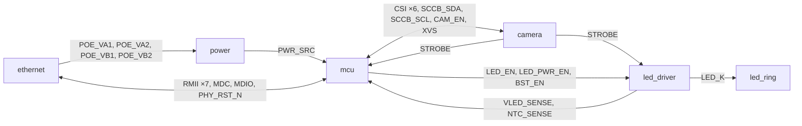

# espion-cam schematic architecture

How the espion-cam schematic is organised: the sheets, the nets that cross them, and each
block's circuit with its component values and where they come from. The system view
(what the board does and why) is in [`../../docs/architecture.md`](../../docs/architecture.md);
the selected parts are in [`BOM.md`](BOM.md). This document is the plan for capturing the
schematic in KiCad. Edit the schematic only in KiCad.

Values come from datasheets and reference designs (cited in each section) or from the
derivations shown next to them. `[INFERENCE]` marks a figure that rests on a model or an
assumption rather than a document. Each sheet ends with a **To verify** list: open checks
for the first boards and facts not yet confirmed. Reference designators (R1, D1, …) are
local to each section; KiCad's annotation assigns the board-wide ones.

## Design decisions

| Topic | Decision |
|---|---|
| Sheets | Hierarchical, one sheet per block. Signals cross sheets only through hierarchical pins, so ERC checks every crossing; rails use global power symbols |
| Mechanics | OV9281 module on the back of the board, lens through a cutout. The 12 LEDs sit on the front, close around the cutout. One PCB, no ring connector |
| Camera logic levels | XVS and STROBE on the OV9281 module are 1.8 V. STROBE goes up through an SN74LV1T34 on +3V3; XVS goes down through a 1.5 kΩ / 1.8 kΩ divider |
| STROBE to the P4 | Yes, on a GPIO with ETM capture: firmware timestamps every exposure (trigger latency L, missed triggers) |
| Camera enable | FPC CAM_IO0 (the module's regulator enable) from a P4 GPIO, pulled down: the sensor stays off until firmware enables it and can be power-cycled |
| Camera FPC connector | Single-contact, so an FFC inserted face-flipped makes no contact (a mirrored cable would put +3V3 on the module's GND). See [Camera FPC connector](#camera-fpc-connector) |
| PPS | EMAC PTP PPS through the GPIO matrix (signal `EMAC_PTP_PPS_PAD_OUT_IDX` = 243) on one GPIO with a test point, looped back through a 0 Ω resistor into a second GPIO for ETM capture. Remove the resistor if ETM sees the output pad directly |
| PHY crystal | Epson X1E0000210139 (TSX-3225, 25 MHz, ESR ≤ 40 Ω, as the IP101G requires; the earlier C9006 is 50 Ω). See [PHY crystal](#phy-crystal) |
| Power source | TPS2116 ST to a P4 GPIO (`PWR_SRC`, high = PoE). Firmware keeps the LED rail off on USB-only power |
| LED boost input | A TPS22918 load switch with a ≈ 27 ms ramp, on `LED_PWR_EN`, feeds the boost. Without it, the boost's inductor-diode path charges the 440 µF storage at every power-up (≈ 1.6 A inrush, over the USB limit). The boost has its own enable, `BST_EN`, which firmware raises only after the switch has ramped |
| RJ45 shield | To GND through 1 nF/2 kV ∥ 1 MΩ |
| Indicators | One addressable RGB status LED (WS2812B-2020-V6 on +3V3) on a P4 GPIO. The MagJack's LEDs are not used; the PHY's LED pins are straps only |
| Debug and sense | Test points on XVS, STROBE, gate output, LED_EN, PPS, the LED current shunt (`ISNS`), +5V, +3V3, +32V and GND. +32V sense divider and an NTC at the sink MOSFET, both into ADC1 pins. No UART header, no JTAG pads |
| GPIO numbers | Fixed for Ethernet ([Ethernet pin map](../../docs/architecture.md#ethernet-pin-map)). The rest are assigned during PCB placement, within the groups in [GPIO groups](#gpio-groups) |

## Sheets

| Sheet file | Content |
|---|---|
| `espion-cam.kicad_sch` (root) | Block diagram, sheet symbols, mounting holes |
| `power.kicad_sch` | DP1435-5V PoE PD, LC filter, TPS2116 OR-ing, TLV62569 3.3 V buck, VBUS TVS |
| `mcu.kicad_sch` | ESP32-P4-Core module, EN/RESET, BOOT, USB-C (ESD, CC), RGB status LED, PPS loop-back and test point |
| `ethernet.kicad_sch` | IP101GRI PHY, 25 MHz crystal, HR871150C MagJack, shield RC |
| `camera.kicad_sch` | 15-pin FPC, JST-SH aux (XVS/STROBE), SCCB pull-ups, CAM_EN, XVS divider, STROBE buffer |
| `led_driver.kicad_sch` | TPS22918 load switch, TPS61170 boost, storage caps, '1G97 gate and timeout RC, TLV9061/IRLR024N sink, NTC, +32V sense |
| `led_ring.kicad_sch` | 12 × A-SC880IR3C in series between +32V and `LED_K` |

### Power nets

Global power symbols carry the rails; local nets stay on one sheet.

| Net | Kind | Source | Loads |
|---|---|---|---|
| `GND` | global | — | everything. Isolated from the cable side by the DP1435 |
| `VBUS` | global | USB-C (mcu) | TPS2116 VIN2, SMBJ5.0A, 100 kΩ bleeder |
| `+5V` | global | TPS2116 (power) | TLV62569, TPS22918 (led_driver), TLV9061 |
| `+3V3` | global | TLV62569 (power) | P4 module, PHY (via `PHY_3V3`), camera (via `CAM_3V3`), logic, RGB LED, pull-ups, NTC divider |
| `+32V` | global | TPS61170 (led_driver) | LED ring, sense divider. Stock `power:+36V` symbol with Value `+32V` (stock KiCad has no `+32V`; the net name follows the Value) |
| `+5V_POE`, `+5V_POE_F` | local, power | DP1435 VOUT; after the LC filter | LC filter; TPS2116 VIN1 |
| `+5V_BST` | local, led_driver | TPS22918 VOUT | TPS61170 VIN, boost inductor |
| `PHY_3V3` | local, ethernet | 0 Ω from `+3V3` | IP101GRI supplies, straps, MDIO pull-up |
| `CAM_3V3` | local, camera | 0 Ω from `+3V3` | FPC camera pin 15 (connector pad 1) |
| `POE_VA1`, `POE_VA2`, `POE_VB1`, `POE_VB2` | hierarchical, ethernet → power | MagJack centre taps and spare pairs | DP1435 inputs. Cable side: ≤ 57 V, isolated, net class `POE_CABLE` |

`PWR_FLAG`: one per net that has no `power_out` driver, on the sheet that creates the net.
The power sheet carries `GND`, `VBUS`, `+5V_POE_F`, `+3V3` and the four `POE_*` nets; the
led_driver sheet `+32V`; the ethernet sheet `PHY_3V3`. No other sheet adds flags on those
nets.

### Hierarchical pins

3.3 V logic unless stated. Directions are from the source sheet.

| Pin | From → to | Level / type | Notes |
|---|---|---|---|
| `RMII_REF_CLK` | ethernet → mcu | 50 MHz | PHY pin 14 → GPIO50; also looped to PHY pin 10 on the ethernet sheet |
| `RMII_CRS_DV`, `RMII_RXD0`, `RMII_RXD1` | ethernet → mcu | | GPIO28, 29, 30. 22 Ω at the PHY |
| `RMII_TX_EN`, `RMII_TXD0`, `RMII_TXD1` | mcu → ethernet | | GPIO49, 34, 35. TXD1 is the BOOT strap |
| `MDC` | mcu → ethernet | | GPIO31 |
| `MDIO` | bidirectional | open/tri-state | GPIO52. 1.5 kΩ pull-up on the ethernet sheet |
| `PHY_RST_N` | mcu → ethernet | active low | GPIO51. 10 kΩ pull-down on the ethernet sheet |
| `CSI_D0_P/N`, `CSI_D1_P/N`, `CSI_CLK_P/N` | camera ↔ mcu | MIPI D-PHY | Module pins 28–33. 100 Ω differential |
| `SCCB_SDA`, `SCCB_SCL` | mcu ↔ camera | open drain | 1.8 kΩ pull-ups on the camera sheet |
| `CAM_EN` | mcu → camera | | 47 kΩ pull-down on the camera sheet |
| `XVS` | mcu → camera | 3.3 V before the divider | RMT output |
| `STROBE` | camera → mcu, led_driver | 3.3 V (SN74LV1T34 output) | ETM capture on the P4; gate and timeout on the led_driver sheet |
| `LED_EN` | mcu → led_driver | | Gate enable. 100 kΩ pull-down |
| `LED_PWR_EN` | mcu → led_driver | | TPS22918 ON. 100 kΩ pull-down |
| `BST_EN` | mcu → led_driver | | TPS61170 CTRL. 100 kΩ pull-down |
| `VLED_SENSE` | led_driver → mcu | analog 0–1.51 V | +32V × 10/265, ADC1 |
| `NTC_SENSE` | led_driver → mcu | analog | NTC divider, ADC1 |
| `PWR_SRC` | power → mcu | open drain | TPS2116 ST; 10 kΩ pull-up on the mcu sheet. High = PoE |
| `LED_K` | led_driver ↔ led_ring | 8–32 V, 1 A pulsed | String cathode → MOSFET drain |

### GPIO groups

Pins are fixed at placement within these groups (details and reset states:
[MCU](#mcu-mcukicad_sch)). Exposed 3.3 V GPIOs: GPIO2–13, 20–23, 26, 27, 32, 33, 53, 54.
GPIO39–48 are not used (their I/O domain is fed by ESP_LDO_VO4, 0 V until firmware sets
it).

| Group | Signals | Constraints | Suggested |
|---|---|---|---|
| CAM | `SCCB_SDA`, `SCCB_SCL`, `CAM_EN`, `XVS`, `STROBE` | Not GPIO2 (pull-up after reset) | GPIO8–12 |
| LED | `LED_EN`, `LED_PWR_EN`, `BST_EN` | Not GPIO2, not GPIO34–38 (straps) | GPIO7, GPIO6, GPIO53 |
| ADC | `VLED_SENSE`, `NTC_SENSE` | ADC1: GPIO20–23 | GPIO22, GPIO23 |
| STAT | `PWR_SRC`, `STATUS_LED` | `STATUS_LED` on GPIO6–13 (no reset pull-up) | GPIO2, GPIO13 |
| PPS | `PPS`, `PPS_IN` | Adjacent pins for a short 0 Ω loop | GPIO32, GPIO33 |
| Spare | — | GPIO26/27 carry USB by default; measure before use | GPIO3, 4, 5, 20, 21, 26, 27, 54 |

### Firmware rules from the schematic

The hardware relies on these; `cam-p4` must follow them.

1. **Camera:** keep `XVS` low whenever `CAM_EN` is low (XVS high would back-feed the
   unpowered sensor through its I/O clamp). Drive XVS low before CAM_EN falls; start XVS
   edges only after the sensor's power-up sequence. XVS high pulses ≥ 10 µs.
2. **MIPI supply:** the module powers the MIPI PHY from ESP_LDO_VO3, which is 0 V by
   default. `esp32p4-csi` sets VO3 to 2.5 V before starting the CSI host.
3. **PHY reset:** hold `PHY_RST_N` low ≥ 11 ms after power-up, release it, wait ≥ 12.5 ms
   for the 50 MHz REF_CLK, then initialise the EMAC. The first MDIO frame carries
   ≥ 32 preamble bits.
4. **LED power:** only on PoE (`PWR_SRC` high). On: `LED_PWR_EN` high, wait ≥ 50 ms,
   then `BST_EN` high (the rail takes 50–120 ms to charge). Off: `BST_EN` low, then
   `LED_PWR_EN` low. Never PWM `BST_EN` (TPS61170 CTRL decodes PWM/EasyScale). +32V
   stays charged for tens of seconds after the boost stops; `LED_EN` low is what turns
   the light off.
5. **LED thermal:** cap the exposure at ≈ 0.8 ms (the boost's sustained output, and the
   sink MOSFET's average power). Derate or stop on `NTC_SENSE`; treat an open (≈ 3.3 V)
   or shorted (0 V) NTC as a fault and drop `BST_EN`/`LED_PWR_EN`.
6. **LED rail check:** read `VLED_SENSE` just after an enabled pulse (no droop = open
   string or no current) and before the next XVS (recovered rail).
7. **RMT:** one `Rmt` instance. XVS on TX channel 0, the status LED on channel 2 or 3
   (XVS may take more than one memory block).
8. **eFuses:** never burn `EFUSE_JTAG_SEL_ENABLE`: GPIO34 (RMII TXD0) floats at reset
   and would pick the JTAG source at random.
9. **Outputs at boot:** write each output's level before enabling its driver. Every
   board output has an external default (pull-down or divider) for the time the P4 pins
   float.

### Clocks

- RMII: the IP101GRI's 25 MHz crystal → 50 MHz REF_CLK into GPIO50 (esp-hal
  `ExternalRefClock`).
- PTP: the EMAC PTP clock source is `XTAL` (default) or `PLL_F80M` (ESP-IDF
  `components/soc/esp32p4/include/soc/clk_tree_defs.h`, `soc_periph_emac_ptp_clk_src_t`).
  Both come from the P4's 40 MHz crystal, so the PTP clock and SYSTIMER share it, as
  [`docs/timing.md`](../../docs/timing.md) assumes. The PHY crystal only clocks RMII.

## Power (`power.kicad_sch`)

Takes PoE from the MagJack's centre taps and spare pairs through the isolated DP1435-5V PD module (5.15 V), filters it with a damped LC, and ORs it with USB-C VBUS in a TPS2116 power mux. PoE (VIN1) has priority; USB (VIN2) takes over only when PoE is below the PR1 threshold. Neither source can back-feed the other. The mux output is the global `+5V` rail, which feeds the LED boost (led_driver sheet) and a TLV62569 buck that makes `+3V3`. The TPS2116 ST output leaves as `PWR_SRC`. The sheet also holds the `+5V`/`+3V3`/`GND` test points and the ERC power flags.

### Hierarchical pins

| Name | Direction (from this sheet) | Level | Goes to |
|---|---|---|---|
| `POE_VA1` | input (power) | 0–57 V, cable side, isolated from GND | ethernet: HR871150C centre tap of pair 1/2 (DP1435 p.2: VA1 = CT of RJ45 1&2) |
| `POE_VA2` | input (power) | same | ethernet: centre tap of pair 3/6 |
| `POE_VB1` | input (power) | same | ethernet: spare pair 4/5 |
| `POE_VB2` | input (power) | same | ethernet: spare pair 7/8 |
| `PWR_SRC` | output, open drain | 3.3 V (pull-up on the mcu sheet) | mcu: P4 GPIO. **High = VIN1 (PoE) powers +5V; low = VIN2 (USB), both channels off, or thermal shutdown** (TPS2116 SLVSFG1A §7.3.3) |

Global power symbols used: `GND`, `VBUS` (in, from mcu sheet), `+5V` (out), `+3V3` (out). Local nets: `+5V_POE` (DP1435 VOUT), `+5V_POE_F` (after the LC filter, TPS2116 VIN1), `PR1` (divider node), `SW_3V3` (buck switch node), `FB_3V3`.

### Parts

| Ref | Function | Value / MPN | LCSC (stock, lowest-break price, date) | KiCad symbol | KiCad footprint |
|---|---|---|---|---|---|
| U | PoE PD module, isolated flyback, 5.15 V | DP1435-5V (SDAPO) | C5380097 (365, $3.64, BOM.md 2026-10-28) | `Converter_DCDC_SDAPO:DP1435-5V` | `Converter_DCDC_SDAPO:Converter_DCDC_SDAPO_DP1435_THT` |
| C | Module-side HF cap at DP1435 VOUT (input cap of the datasheet's C-L-C filter) | 10 µF 25 V X5R 0805, CL21A106KAYNNNE | C15850 (1,903,000, $0.0256, 2026-10-28) | `Device:C` | `Capacitor_SMD:C_0805_2012Metric` |
| L | PoE LC filter | 2.2 µH, FXL0630-2R2-M (cjiang) | C167218 (70,485, $0.0827, 2026-10-28) | `Device:L` | `Inductor_SMD:L_Changjiang_FXL0630` (stock) |
| C | LC filter output, low ESR | 330 µF 16 V polymer, SVZ1CM331E09E00RAXXX (AISHI) | C3291468 (3,055, $0.093, BOM.md) | `Device:C_Polarized` | `Capacitor_SMD_AISHI:CP_Elec_6.3x9` |
| C | LC filter damping (ESR = damping R) | 330 µF 16 V electrolytic, JVE16V330M8X10 (JIERR) | C48615108 (1,935, $0.057, BOM.md) | `Device:C_Polarized` | `Capacitor_SMD_JIERR:CP_Elec_8x10.5` (use the library prefix: the stock part has the same name and a different land) |
| C | LC filter output HF cap at TPS2116 VIN1 (= VIN1 input cap) | 10 µF 25 V X5R 0805, CL21A106KAYNNNE | C15850 | `Device:C` | `Capacitor_SMD:C_0805_2012Metric` |
| R | PR1 divider, top (VIN1 → PR1) | 100 kΩ 1 % 0402, 0402WGF1003TCE | C25741 | `Device:R` | `Resistor_SMD:R_0402_1005Metric` |
| R | PR1 divider, bottom (PR1 → GND) | 36 kΩ 1 % 0402, HWA CHN HRC0402F3602DNTO | C54920666 | `Device:R` | `Resistor_SMD:R_0402_1005Metric` |
| U | 5 V power mux, priority mode | TPS2116DRLR (TI) | C3235557 (54,819, $0.19, BOM.md) | `Power_Management:TPS2116DRL` (stock) | `Package_TO_SOT_SMD:SOT-583-8` (stock, the symbol's default) |
| D | VBUS TVS (the USBLC6 on the mcu sheet no longer clamps VBUS) | SMBJ5.0A (R+O), unidirectional, VRWM 5 V, VBR 7 V, VC 9.2 V, 600 W 10/1000 µs | C19077558 (67,830, $0.023, 2026-10-28) | `Device:D_Zener` (K = pin 1; stock KiCad has no generic unidirectional TVS symbol) | `Diode_SMD:D_SMB` |
| C | VBUS input cap at TPS2116 VIN2 | 4.7 µF 25 V X5R 0805, CL21A475KAQNNNE (Samsung) | C1779 | `Device:C` | `Capacitor_SMD:C_0805_2012Metric` |
| C | `+5V` bulk at TPS2116 VOUT ×2 | 47 µF 10 V X5R 1206, CL31A476MPHNNNE (Samsung) | C96123 (176,750, $0.0853, 2026-10-28) | `Device:C` | `Capacitor_SMD:C_1206_3216Metric` |
| C | `+5V` HF decoupling at VOUT | 100 nF 50 V X7R 0402, CL05B104KB54PNC (Samsung) | C307331 | `Device:C` | `Capacitor_SMD:C_0402_1005Metric` |
| U | 3.3 V buck, 2 A | TLV62569DBVR (TI) | C141836 (16,700, $0.038, BOM.md) | `Regulator_Switching:TLV62569DBV` (stock; extends TLV62568DBV) | `Package_TO_SOT_SMD:SOT-23-5` (stock) |
| L | Buck inductor (same part as the LC filter inductor) | 2.2 µH, FXL0630-2R2-M (cjiang) | C167218 (70,485, $0.0827, 2026-10-28) | `Device:L` | `Inductor_SMD:L_Changjiang_FXL0630` (stock) |
| C | Buck input | 10 µF 25 V X5R 0805 (CL21A106KAYNNNE) + 100 nF 50 V X7R 0402 (CL05B104KB54PNC) | C15850 / C307331 | `Device:C` | `C_0805_2012Metric` / `C_0402_1005Metric` |
| C | Buck output | 10 µF 25 V X5R 0805 (CL21A106KAYNNNE) + 100 nF 50 V X7R 0402 (CL05B104KB54PNC) | C15850 / C307331 | `Device:C` | `C_0805_2012Metric` / `C_0402_1005Metric` |
| R | FB divider, top (+3V3 → FB) | 453 kΩ 1 % 0402, GiantOhm GR0402F453KTAG00 | C49653416 | `Device:R` | `Resistor_SMD:R_0402_1005Metric` |
| R | FB divider, bottom (FB → GND) | 100 kΩ 1 % 0402, 0402WGF1003TCE | C25741 | `Device:R` | `Resistor_SMD:R_0402_1005Metric` |
| C | Feed-forward across the top FB resistor | 6.8 pF C0G 0402, 0402CG6R8C500NT | C1576 | `Device:C` | `Capacitor_SMD:C_0402_1005Metric` |
| TP | Test points `+5V`, `+3V3` (bare pads), `GND` ×2 (ronghe RH-5002 loop, Keystone 5002 clone, 1.0 mm hole) | — / RH-5002 | — / C5199802 | `Connector:TestPoint` | `TestPoint:TestPoint_Pad_D1.5mm` (rails), `TestPoint:TestPoint_Loop_D2.50mm_Drill1.0mm` (GND) |
| #FLG | ERC power flags | — | — | `power:PWR_FLAG` | — |

Stock libraries checked: KiCad 10.0.7 dev shell (`kicad-symbols-1b2b42d49b`, `kicad-footprints-25a0b01dd7`). Every symbol and footprint above exists there or in `hardware/lib`; none is missing.

### Connections

**DP1435-5V (U, SIP-6)**: pins from the project symbol, which matches the datasheet p.2 pin table.
| Pin | Name | Net | Note |
|---|---|---|---|
| 1 | VA1 | `POE_VA1` | Not polarity sensitive (DS p.2). Bridge rectifiers are inside, so no external diode or input cap. The DS p.4 typical application has nothing on VA/VB except the Bob-Smith network, which is inside the HR871150C (BOM.md notes) |
| 2 | VA2 | `POE_VA2` | " |
| 3 | VB1 | `POE_VB1` | " |
| 4 | VB2 | `POE_VB2` | " |
| 5 | GND | `GND` | Output return = board GND (isolated from the cable side by the module's flyback) |
| 6 | VOUT | `+5V_POE` | 10 µF X5R right at pins 6/5 |

**LC filter**: `+5V_POE` → L (FXL0630-2R2-M) → `+5V_POE_F`. On `+5V_POE_F`, to GND: 330 µF polymer (+ = pad 1), 330 µF electrolytic (+ = pad 1), and 10 µF X5R placed at TPS2116 pin 3.

**TPS2116DRL (U, SOT-583-8)**: stock symbol pins, checked against SLVSFG1A Table 5-1.
| Pin | Name | Net | Note |
|---|---|---|---|
| 1 | GND | `GND` | |
| 2 | VOUT | `+5V` | Tied to pin 7. 2 × 47 µF + 100 nF close to pins 2/7 |
| 3 | VIN1 | `+5V_POE_F` | Priority input. 10 µF filter cap at the pin |
| 4 | PR1 | `PR1` | 100 kΩ from `+5V_POE_F`, 36 kΩ to `GND` |
| 5 | MODE | `+5V_POE_F` | Tied directly to VIN1: priority mode (§7.6.1, Fig. 8-1) |
| 6 | VIN2 | `VBUS` | SMBJ5.0A (K → VBUS, A → GND) and 4.7 µF at the pin |
| 7 | VOUT | `+5V` | |
| 8 | ST | `PWR_SRC` | Open drain. The 10 kΩ pull-up to `+3V3` is on the mcu sheet; don't add one here. Pulled up to +3V3, not to VIN1 as in TI's Fig. 8-1: VIN1 would drive 5 V into a P4 GPIO |

**TLV62569DBV (U, SOT-23-5)**: stock symbol pins, checked against SLVSDG1C §5 (DBV column).
| Pin | Name | Net | Note |
|---|---|---|---|
| 1 | EN | `+5V` | Tied to VIN as in TI's Fig. 5. It must not float (§7.4.1), abs max 6 V (§6.1), so +5V ≤ 5.5 V is safe. No RC needed: the chip soft-starts (t_SS 0.8 ms, DBV) and the P4 has its own EN RC on the mcu sheet |
| 2 | GND | `GND` | |
| 3 | SW | `SW_3V3` → L (FXL0630-2R2-M) → `+3V3` | |
| 4 | VIN | `+5V` | 10 µF + 100 nF between pins 4 and 2, as close as possible |
| 5 | FB | `FB_3V3` | 453 kΩ to `+3V3` (6.8 pF across it), 100 kΩ to `GND` |
| — | PG | — | There is no PG on the DBV package (PG only on TLV62569P DDC/DRL, SLVSDG1C §5). No power-good signal reaches the P4 |

`+3V3` output: 10 µF + 100 nF at the inductor/IC side; the loads' local decoupling is on their own sheets.

**Test points**: TP on `+5V` (at TPS2116 VOUT), on `+3V3` (at buck Cout), and 2 × `GND` (one near the buck, one near the PD output).

**PWR_FLAG placement** (all on this sheet, one per net, nowhere else):
- `GND`: every GND pin here is `power_in`, including DP1435 pin 5 (lib README: "GND is power_in, so the output GND net needs a PWR_FLAG").
- `+5V_POE_F`: driven only through the passive inductor.
- `+3V3`: the buck's output node sits after the passive inductor; SW is the only `power_out`.
- `VBUS`: the USB-C symbol's VBUS pins are passive.
- `POE_VA1`, `POE_VA2`, `POE_VB1`, `POE_VB2`: the DP1435 inputs are `power_in` and the HR871150C pins are all `passive` (checked in `Connector_HanRun.kicad_sym`).
- `+5V_POE` (DP1435 VOUT) and `+5V` (TPS2116 VOUT) have `power_out` drivers and need no flag.

### Values and derivations

**Sources**
- DP1435: SDAPO DP1435 datasheet (LCSC PDF 7fde6577…): p.1 features, p.2 pins, p.4 typical application, p.5 LC filter and electrical specifications, p.6 module photo.
- TPS2116: TI SLVSFG1A (May 2021).
- TLV62569: TI SLVSDG1C (Oct 2017).
- FXL0630: cjiang catalog (LCSC PDF 40dfb6cb…), FXL0630 table. Used for both the LC filter and the buck inductor.
- FNR3015S: cjiang FNR catalog (LCSC PDF a0b12ba9…), p.5 FNR3015S table (the buck's earlier inductor, quoted below for comparison).
- AISHI VZ ratings table (LCSC PDF aabe05a1…), JIERR JVE table (LCSC PDF 3ad662ff…).
- ESP32-P4 datasheet v0.7: Tables 5-2 and 5-7.
- IP101G datasheet IP101G-DS-R01: Table 1, Table 11.
- OV9281 product brief v1.4.
- TPS61170: SLVS789D, Electrical Characteristics.

**DP1435 output**
- 5.15 V typ, 2 A typ / 2.6 A max (DS p.5 items 2–3).
- Line and load regulation 5 % each (items 4–5), so 4.64–5.67 V if both stack worst case, 4.89–5.41 V with one 5 % band.
- Ripple 200 mVpp max at 250 kHz (items 6, 8). Isolation 1.5 kV (item 9; p.1: "1.5KVrms").

**LC filter**
- DS p.5 "optional external LC filter": 0.33–3.3 µH, with 330 µF/16 V at the module side and 10 µF/16 V at the output.
- This design follows BOM.md instead: 2.2 µH, then 330 µF polymer ∥ 330 µF electrolytic ∥ 10 µF on the output, plus a 10 µF ceramic at the module side (the datasheet's input-cap position). The module carries its own ≈ 220 µF output can (DS p.6 photo, marking "220 16H") [INFERENCE from the photo].
- **Inductor**: FXL0630-2R2-M has DCR 15 mΩ max, I_sat 10.5 A, I_rms 8.5 A (catalog table). Peak load is ≈ 2.0 A (budget below): about 5× margin to saturation, 30 mV / 60 mW of DCR loss.
- **Resonance (BOM note check)**:
  - 2.2 µH with 330 µF alone: f₀ = 1/(2π√(LC)) = 5.91 kHz and Z₀ = √(L/C) = 81.6 mΩ. The BOM's "≈ 5.9 kHz" is correct.
  - Polymer alone: ESR 25 mΩ max (VZ table, 100 kHz) plus 15 mΩ DCR gives Q ≈ 2.
  - Modelled output-impedance peak, with the +5V caps behind the TPS2116's 60 mΩ R_ON: **175 mΩ without the electrolytic**. "Barely damps" is confirmed.
- **Electrolytic**: JVE16V330M8X10 has impedance 0.3 Ω max at 100 kHz/20 °C (JVE table), which is ≈ ESR there because X_C = 4.8 mΩ. At 120 Hz, ESR = tan δ/(2πfC) = 0.16/(2π·120·330 µF) = 0.64 Ω.
- With the electrolytic, modelled across ESR 0.1–0.64 Ω: **peak 96–138 mΩ at 4.3–5.4 kHz**. A Middlebrook parallel R-C damper with n = C_d/C ≈ 1 has its optimum at R_d ≈ 1.45 Z₀ ≈ 0.12 Ω, with peak ≈ √6 Z₀. The JVE's ESR is near that optimum, so the BOM choice is sound. Larger C_d would be needed for more damping.
- **Stability against the negative input resistance of the downstream converters**: worst-case load power is ≈ 10 W (buck 2.8 W + boost 1.44 A × 5 V). R_in = −V²/P ≈ −2.5 Ω, ≥ 18× above the 138 mΩ peak, which meets Middlebrook's ‖Z_out‖ ≪ ‖Z_in‖ (Erickson & Maksimović, *Fundamentals of Power Electronics*, input-filter chapter).
- **Load step**: the boost starting at I_LIM max of 1.44 A (SLVS789D EC table) × 0.14 Ω gives ≈ 0.2 V of dip on `+5V_POE_F`, plus the DP1435's own transient, which is unspecified.
- **250 kHz ripple**: modelled attenuation 46 dB (ideal C, no ESL), so 200 mVpp falls to ≈ 1 mVpp. With real ESL, assume ≥ 30 dB (≤ 6 mVpp) [INFERENCE].
- **Topology alternative**: putting the polymer before L as DS p.5 draws it gives a 106–209 mΩ peak (less output C). That is worse for load steps, so the BOM order is kept.

**TPS2116 PR1 (priority threshold)**
- VIN1 is selected while V_PR1 > V_REF. V_REF = 0.92 / 1.00 / 1.08 V min/typ/max (EC table), and PR1 leakage is ≤ 0.1 µA, i.e. 2.6 mV error through 26 kΩ.
- Threshold V_th = V_REF·(1 + R_top/R_bot), with 100 k / 36 k (1 %):
  - typ 3.78 V
  - min 0.92 × (1 + 99/36.36) = **3.43 V**
  - max 1.08 × (1 + 101/35.64) = **4.14 V**
- **Upper bound** (PoE must never be rejected): worst DP1435 output 4.64 V (both 5 % bands), minus 0.2 V step dip and 0.03 V DCR, leaves 4.41 V. That is 0.27 V above 4.14 V.
  - This matters: in priority mode with VIN1 below threshold and no VBUS, the output turns off (truth table §7.3.1 selects VIN2) [INFERENCE that it then has no supply].
- **Lower bound**: the buck must still regulate when VIN1 sags to the threshold. V_IN(min) = V_OUT + I·(R_DS(on),HS + DCR) = 3.3 + 0.77 × (0.100 + 0.015) = 3.39 V (SLVSDG1C §7.3.2 Eq. 1; R_DS(on) EC table; DCR 15 mΩ from the FXL0630 table).
  - The 3.43 V threshold minimum is above that, so +3V3 stays in regulation down to the threshold. (With the earlier FNR3015S, DCR 78 mΩ, V_IN(min) was 3.44 V and +3V3 sagged to ≈ 3.29 V at the 3.43 V extreme, still ≥ the IP101G minimum of 3.135 V, Table 11.)
- The divider also acts as a PoE UVLO: +5V stays off until VIN1 > V_th. Divider current: 5.15 V / 136 kΩ = 38 µA.
- **MODE = VIN1** (§7.6.1). On USB-only power, VIN1 = 0 V so MODE ≤ 0.35 V and PR1 is low, and the truth table passes the higher supply, VIN2. ST is low.
- **Both sources present**: VIN1 is used regardless of VIN2 (truth table). Switchover is break-before-make, t_SW = 8 µs at 5 V (§6.6). If VOUT > the new VIN, the channel waits until VOUT drops to VIN + V_RCB (§7.6.1).
  - **PoE unplugged with USB present**: worst case 2 A drains ≈ 680 µF at 2.9 V/ms, so VIN1 reaches V_th in ≈ 0.5 ms, then VBUS takes over.
  - 2.9 V/ms is far below the 1 V/10 µs collapse rate of §7.4, and VBUS ≥ 2.5 V anyway.
- **No back-feed**: reverse current blocking turns a channel off when VOUT > VIN + 42 mV (§7.3.4). Leakage out of the unused VINx is ≤ 0.15 µA (EC I_REV).

**TPS2116 ratings vs the budget**
- Recommended VIN1/VIN2 ≤ 5.5 V, abs max 6 V (§6.3, §6.1).
  - VBUS: USB 2.0 4.75–5.25 V; Type-C vSafe5V ≤ 5.5 V [INFERENCE, USB Type-C spec not read here] ✓.
  - DP1435: 5.15 V typ, 5.41 V with one 5 % band ✓; **5.67 V if both bands stack** → To verify.
- There is no programmable current limit. I_MAX = 2.5 A continuous and 4 A pulsed (1 ms, 2 % duty) (§6.1), against a 2.0 A worst-case peak and ≈ 1.0 A average.
- Dissipation: 2 A² × 60 mΩ (R_ON max at 105 °C) = 0.24 W × R_θJA 111.5 °C/W = +27 °C.
- No hysteresis on PR1 is specified. Near the threshold under PoE overload the mux could chatter → To verify.

**TPS2116 caps**
- **Input**: 1 µF per input is "sufficient" (§9). VIN1 gets the filter's 10 µF; VIN2 gets 4.7 µF, keeping VBUS ≤ 10 µF (USB 2.0 §7.2.4.1, 10 µF ∥ 44 Ω at attach [clause from memory, not re-read]).
- **Output**: ≥ 0.1 µF for linear soft start (§7.3.2), and "about 100 µF" when reverse current blocking is expected (§7.3.4). It is expected here: VIN1 can dip below VOUT during LC ringing and on PoE loss.
  - 2 × 47 µF/10 V 1206 is 94 µF nominal, ≈ 45–50 µF at 5 V bias [INFERENCE, typical X5R 1206 DC-bias loss].
- **Inrush through soft start**: I = C·V/t_SS with t_SS = 1.7 ms at 5 V (§8.2.2 Eq. 1, §6.6). This sheet's +5V caps (≈ 50 µF + buck 10 µF effective) draw ≈ 0.18 A.
  - The LED boost's DC path (+5V → 10 µH → SS16 → 2 × 220 µF) would add ≈ 440 µF (≈ 1.6 A on VBUS). The TPS22918 load switch on the led_driver sheet keeps that path open until firmware sets `LED_PWR_EN`, so it adds nothing at plug-in.

**TLV62569 output voltage**
- V_OUT = V_FB (1 + R1/R2) with V_FB = 0.588 / 0.600 / 0.612 V (EC) and R2 ≤ 200 kΩ (§8.2.2.2).
- R1 = 453 k, R2 = 100 k gives 3.318 V typ. Worst case with V_FB ±2 % and R ±1 %: **3.20–3.44 V**.
  - Inside IP101G VDDIO/AVDD33 3.135–3.465 V (Table 11) ✓.
  - Inside ESP32-P4 VDD 3.0–3.6 V (Table 5-2) ✓.
- C_FF = 6.8 pF, as recommended for R2 = 100 kΩ (§8.2.2.2).

**TLV62569 L / C_OUT**
- Table 4: for V_OUT ≥ 1.8 V with L = 2.2 µH, C_OUT = 10 µF is the standard ("++") combination; 22 µF and 2 × 22 µF are also checked. The table's note (2) anticipates +20 %/−50 % for tolerance and bias derating, and §8.2.2.5 gives 10–47 µF.
  - 10 µF/25 V X5R 0805 (CL21A106KAYNNNE) is ≈ 7–8 µF at 3.3 V [INFERENCE, interpolated from ≈ 6 µF at 5 V below], above the 5 µF the −50 % note allows.
  - Ripple: ΔI_L/(8·f_SW·C) = 0.36 A/(8 × 1.5 MHz × 7.5 µF) ≈ **4 mV**. The loads keep their own local 10 µF (P4, PHY, camera).
- C_IN: 4.7 µF "sufficient" (§8.2.2.5); 10 µF/25 V is used, ≈ 6 µF at 5 V.

**Inductor current**
- ΔI_L = V_OUT(1 − V_OUT/V_IN)/(L f_SW) = 3.3 × (1 − 3.3/5.15)/(2.2 µH × 1.5 MHz) = 0.36 A (0.45 A at L − 20 %).
- At the 0.77 A budget, I_L,max = 0.77 + 0.22 = 0.99 A (§8.2.2.4 Eq. 3).
- FXL0630-2R2-M: DCR 15 mΩ max, I_sat 10.5 A, I_rms 8.5 A (catalog table; LCSC lists 9.5 A). 10.5/0.99 ≈ 10×, far above TI's recommended 1.2–1.3×.
- The inductor no longer limits the buck: the usable output is the IC's 2 A. (The earlier FNR3015S, I_sat 1.60 A, capped it at ≈ 1.05 A.)
- I_LIM (DBV) = 3 A min (EC), well below I_sat: under a +3V3 short the current limit trips before the inductor saturates.
- DCR loss at 0.77 A: 0.77² × 0.015 Ω ≈ 9 mW.

**`+3V3` load budget** (design allowances):
| Load | Allowance | Source |
|---|---|---|
| ESP32-P4-Core module | 500 mA | ESP32-P4 DS v0.7 Table 5-2: I_VDD "Current supplied to core", **min 0.5 A** (supply capability Espressif requires). Measured active typ: 150 mA max at 400 MHz, dual core, all peripheral clocks on (Table 5-7, 3.3 V supply), "might be higher when accessing flash/PSRAM". **Waveshare publishes no current figure** (docs.waveshare.com/ESP32-P4-Core: "Operating voltage is 3.3 V" only) |
| IP101GRI | 45 mA | "~150 mW" (IP101G DS Table 1) / 3.3 V |
| OV9281 module | 150 mA | Sensor 156 mW active (OV9281 PB v1.4). From 3.3 V through the module's LDOs: worst case all at the 1.2 V rail is 130 mA; 150 mA allowance [INFERENCE] |
| RGB status LED (WS2812B-2020-V6) | 60 mA | Allowance; 37 mA at full white ([RGB status LED](#rgb-status-led)) |
| SN74LV1T34, '1G97, pull-ups, dividers, ADC dividers | 10 mA | [INFERENCE] |
| **Total** | **≈ 0.77 A** | 38 % of the TLV62569's 2 A (the FXL0630 does not limit it) |

Buck loss at ≈ 90 % efficiency [INFERENCE, not on a TI curve for 3.3 V out] is ≈ 0.28 W × R_θJA 188.2 °C/W (DBV, §6.4) = +53 °C worst case. Give it copper (Layout).

**`+5V` budget**
- Buck: 3.3 × 0.77 / 0.9 / 5.0 = 0.56 A.
- LED boost: 2.3 W average = 0.46 A (architecture.md "Power"); peak input = TPS61170 I_LIM max 1.44 A (SLVS789D) while recharging the +32V caps for 70–120 ms.
- **Average ≈ 1.0 A (5.3 W), peak ≈ 2.0 A (10.3 W).** Within the DP1435's 2 A typ / 2.6 A max, the TPS2116's 2.5 A, and 802.3af's ≈ 10.9 W usable (architecture.md).
- USB-only: firmware keeps LED_PWR_EN low, so only the buck draws: ≤ 0.56 A budget, ≈ 0.25 A realistic (Table 5-7 + PHY + camera + LED). Compare with 500 mA from a USB 2.0 default port → To verify.

**VBUS TVS**
- SMBJ5.0A: VRWM 5 V, VBR 7 V, V_C 9.2 V (LCSC attributes).
- At 5.25–5.5 V VBUS it is below VBR min, so leakage is small [INFERENCE, datasheet I_R not read].
- Its clamp is above the TPS2116's 6 V abs max: it limits ESD/hot-plug energy but doesn't guarantee 6 V. TPS2116 HBM is ±2 kV (§6.2).

**PWR_SRC**
- ST is open drain, V_OL ≤ 0.1 V at 1 mA, response 5 µs with R_ST = 10 kΩ (EC). The 10 kΩ pull-up to +3V3 on the mcu sheet gives 0.33 mA.
- Polarity: **high = PoE**.
- ST is also low in thermal shutdown (§7.3.3). Firmware treats low as "not PoE": LED_PWR_EN stays low.

**Isolation**
- IEEE 802.3 Clause 33.4.1: the PD must isolate all MDI/PI leads from accessible conductors, frame ground included. It must withstand one of:
  - 1500 V rms, 50–60 Hz, 60 s
  - 2250 V dc, 60 s
  - 10 × 2400 V impulses
- [Clause content via IEEE 802.3 interpretation/summary documents; the standard itself not read here.]
- The DP1435 rates 1.5 kV rms input-to-output (p.1, p.5 item 9).
- Board spacing → Layout.

### Layout constraints the schematic must carry

- **Net class `POE_CABLE`**:
  - Members: `POE_VA1`, `POE_VA2`, `POE_VB1`, `POE_VB2`, the MagJack line-side pins, and the RJ45 shield before its 1 nF/2 kV ∥ 1 MΩ.
  - **Clearance ≥ 2.0 mm** to every board-side net, on all layers. ≥ 1.5 mm is the IEC 60664-1/62368-1 basic-insulation clearance for a 2.4–2.5 kV impulse [via TI SLUP421 summary, not read]; 2.0 mm adds margin and covers creepage on uncoated FR-4.
  - Spacing is bare copper to bare copper (solder mask doesn't count).
  - No pour, plane or via of GND/+5V inside the zone under DP1435 pins 1–4. The module's own pin 4 → 5 gap is 22.86 mm (DS p.2).
  - Track width ≥ 0.4 mm (802.3af ≤ 350 mA).
- **Net class `PWR_5V`** (`+5V_POE`, `+5V_POE_F`, `+5V`, `VBUS`): ≥ 1.0 mm or pours for 2 A peak [INFERENCE, IPC-2152 1 oz external ≈ 10 °C rise].
- **Net class `PWR_3V3`**: ≥ 0.5 mm.
- **TLV62569** (SLVSDG1C §10):
  - C_IN at pins 4/2 on the same layer, then L; the SW node as small as possible. The FXL0630 (6.45 × 6.6 × 2.8 mm) has larger pads than a 3 × 3 mm part, so keep the `SW_3V3` copper to the pad itself.
  - The FB divider and C_FF next to pin 5, away from SW.
  - C_OUT ground returns to the C_IN ground.
  - Copper on GND/pin 2 for heat.
- **TPS2116** (§10.1): C_IN/C_OUT right at the pins, wide VIN1/VIN2/VOUT/GND.
- **LC filter**:
  - The 10 µF module-side cap sits at DP1435 pins 6/5.
  - The output 10 µF sits at TPS2116 pin 3.
  - Polymer and electrolytic between them, low-impedance GND return to the DP1435 pin 5.
- **PR1 divider**: next to pin 4, away from L and SW.
- Keep the DP1435's 14 mm-tall body and the 8 mm electrolytic clear of the front-side LED ring and the lens cutout (mechanical decision: module on the back) [INFERENCE].

### To verify

1. **+5V inrush at USB attach**: with the boost behind the TPS22918, this sheet's ≈ 60 µF effective on `+5V` charges through the TPS2116 soft start (≈ 0.18 A for 1.7 ms, ≈ 0.3 mC). Measure the attach charge against the USB-IF inrush test on the first boards.
2. **DP1435 output range**: line and load regulation are 5 % each (p.5). If they stack, 5.67 V exceeds the TPS2116's recommended 5.5 V (abs max 6 V). Measure VOUT at no load and 56 V input on the first boards.
3. **DP1435 maximum capacitive load** isn't specified. Total on VOUT: 10 + 330 + 330 + 10 µF directly, plus +5V via soft start. Check it starts reliably (no OCP hiccup) at 37 V and 57 V input.
4. **DP1435 load-step response** (unspecified) on top of the ≈ 0.2 V filter dip. The PR1 threshold max of 4.14 V keeps ≈ 0.27 V margin against the worst stacked 4.64 V output. Measure the dip at boost start.
5. **TPS2116 PR1 has no specified hysteresis**. Check for chatter with PoE overloaded near threshold. If seen, add a resistor from PR1 to ST (positive feedback).
6. **Buck inductor FXL0630-2R2-M** (shared with the LC filter): the catalog gives no core loss at the buck's 1.5 MHz. Check its temperature at full `+3V3` load on the first boards. Saturation is no longer a concern: I_sat 10.5 A is far above I_LIM 3 A min.
7. **ESP32-P4-Core real draw** (camera + Ethernet + PSRAM traffic). The 0.5 A allowance is Espressif's supply-capability spec, not a measurement. It also sets the USB-only budget vs a 500 mA USB 2.0 port.
8. **OV9281 module 3V3 current**: the module's regulators are unknown (LDO assumed).
9. **TPS2116 pins 2 and 7** are both `power_out` on `+5V`. Check that KiCad ERC doesn't flag power_out↔power_out; if it does, use an ERC exclusion.
10. **Single PWR_FLAG on GND/VBUS**: other sheets must not add PWR_FLAGs on GND, VBUS, +3V3 or the POE nets.
11. **Citations not read directly**:
    - IEEE 802.3 §33.4.1 test levels and IEC 60664-1 clearance (from summaries).
    - USB 2.0 §7.2.4.1 wording.
    - Middlebrook/Erickson damping formulas (standard results).
    - SMBJ5.0A leakage at 5.5 V.

## MCU (`mcu.kicad_sch`)

This sheet holds the Waveshare ESP32-P4-Core module (U1) and everything local to it: the ESP_EN reset RC with its RESET button, the BOOT button on the GPIO35 strap (which is shared with RMII TXD1), the USB-C bench port (CC pull-downs, USBLC6-2SC6 ESD, 22 Ω series resistors to the P4's USB Serial/JTAG on GPIO24/25), the PWR_SRC pull-up, the PPS output with its 0 Ω loop-back to a second GPIO for ETM capture, the PPS and GND test points, and the RGB status LED ([RGB status LED](#rgb-status-led)). All other blocks connect through the hierarchical pins below. Every module pin is listed in the Connections section.

Sources cited:
- [WS-PIN]: Waveshare ESP32-P4-Core pin description, <https://docs.waveshare.com/ESP32-P4-Core>.
- [WS-SCH]: ESP32-P4-Core schematic (16 MB version), the "ESP32-P4" block on page 1.
- [DS]: ESP32-P4 datasheet v0.7.
- [TRM]: ESP32-P4 Technical Reference Manual. Chip Boot Control is §12 in the document body; its own table of contents calls it chapter 13.
- [HDG]: Espressif hardware design guidelines for the ESP32-P4: schematic checklist ([HDG-SC]) and PCB layout design ([HDG-PCB]), docs.espressif.com, "latest" as read on 2026-10-28.

### Hierarchical pins

Directions are as seen from the mcu sheet. All signals are 3.3 V logic unless the table says otherwise.

| Name | Dir | Level | Goes to | Module pin / GPIO |
|---|---|---|---|---|
| `RMII_REF_CLK` | in | 3.3 V, 50 MHz | ethernet | 68 / GPIO50 |
| `RMII_CRS_DV` | in | 3.3 V | ethernet | 40 / GPIO28 |
| `RMII_RXD0` | in | 3.3 V | ethernet | 41 / GPIO29 |
| `RMII_RXD1` | in | 3.3 V | ethernet | 42 / GPIO30 |
| `RMII_TX_EN` | out | 3.3 V | ethernet | 67 / GPIO49 |
| `RMII_TXD0` | out | 3.3 V | ethernet | 46 / GPIO34 (strap) |
| `RMII_TXD1` | out | 3.3 V | ethernet | 47 / GPIO35 (BOOT strap) |
| `MDC` | out | 3.3 V | ethernet | 43 / GPIO31 |
| `MDIO` | bidir | 3.3 V | ethernet (1.5 kΩ pull-up there) | 70 / GPIO52 |
| `PHY_RST_N` | out | 3.3 V | ethernet (10 kΩ pull-down there) | 69 / GPIO51 |
| `CSI_D0_P` / `CSI_D0_N` | bidir (passive) | MIPI D-PHY | camera | 29 / 28 |
| `CSI_D1_P` / `CSI_D1_N` | bidir (passive) | MIPI D-PHY | camera | 33 / 32 |
| `CSI_CLK_P` / `CSI_CLK_N` | bidir (passive) | MIPI D-PHY | camera | 30 / 31 |
| `SCCB_SDA` | bidir (open-drain) | 3.3 V side | camera (1.8 kΩ pull-ups there) | group CAM |
| `SCCB_SCL` | out (open-drain) | 3.3 V side | camera | group CAM |
| `CAM_EN` | out | 3.3 V | camera (pull-down there) | group CAM |
| `XVS` | out | 3.3 V (camera divider makes 1.8 V) | camera | group CAM |
| `STROBE` | in | 3.3 V (from SN74LV1T34) | camera, led_driver | group CAM |
| `LED_EN` | out | 3.3 V | led_driver (100 kΩ pull-down there) | group LED |
| `LED_PWR_EN` | out | 3.3 V | led_driver: boost-input load switch ON (100 kΩ pull-down there) | group LED |
| `BST_EN` | out | 3.3 V | led_driver: TPS61170 CTRL (100 kΩ pull-down there) | group LED |
| `VLED_SENSE` | in | analog, 0–3.3 V | led_driver (100 nF there) | group ADC (ADC1) |
| `NTC_SENSE` | in | analog, 0–3.3 V | led_driver (100 nF there) | group ADC (ADC1) |
| `PWR_SRC` | in | open-drain, pulled up here | power (TPS2116 ST) | group STAT |

Global power symbols used: `+3V3`, `VBUS`, `GND`. Local nets: `ESP_EN`, `BOOT_SW`, `USB_C_D_P`/`USB_C_D_N` (connector side), `USB_D_P`/`USB_D_N` (module side), `CC1`, `CC2`, `PPS`, `PPS_IN`, `STATUS_LED`.

### Parts

| Ref | Function | Value / MPN | LCSC (checked 2026-10-28) | KiCad symbol | KiCad footprint |
|---|---|---|---|---|---|
| U1 | MCU module | Waveshare ESP32-P4-Core 16 MB (SKU 36096) | — (Waveshare) | `MCU_Module_Waveshare:ESP32-P4-Core` | `Module_Waveshare:Waveshare_ESP32-P4-Core` (provisional land pattern) |
| J1 | USB-C receptacle, USB 2.0 | HRO TYPE-C-31-M-12 | C165948: 283,600 in stock, $0.0975 | `Connector:USB_C_Receptacle_USB2.0_16P` | `Connector_USB_HRO:USB_C_Receptacle_HRO_TYPE-C-31-M-12` (hardware/lib) |
| U2 | USB ESD array | ST USBLC6-2SC6 | C7519: 39,365 in stock, $0.0931 | `Power_Protection:USBLC6-2SC6` | `Package_TO_SOT_SMD:SOT-23-6` |
| SW1 | RESET button | XKB TS-1187A-B-A-B | C318884: 887,620 in stock, $0.0112 | `Switch:SW_Push` | `Button_Switch_SMD:SW_Push_1P1T_XKB_TS-1187A` (stock; pads 1,1,2,2) |
| SW2 | BOOT button | XKB TS-1187A-B-A-B | C318884 (same as SW1) | `Switch:SW_Push` | `Button_Switch_SMD:SW_Push_1P1T_XKB_TS-1187A` |
| R1 | ESP_EN pull-up | 10.0 kΩ 1 % 0402, 0402WGF1002TCE | C25744 | `Device:R` | `Resistor_SMD:R_0402_1005Metric` |
| C1 | ESP_EN delay | 1 µF 50 V X7R 0805, CL21B105KBFNNNE (Samsung) | C28323 | `Device:C` | `Capacitor_SMD:C_0805_2012Metric` |
| R2 | GPIO35 strap pull-up | 10.0 kΩ 1 % 0402, 0402WGF1002TCE | C25744 | `Device:R` | `Resistor_SMD:R_0402_1005Metric` |
| R3 | BOOT button series | 1.00 kΩ 1 % 0402, 0402WGF1001TCE | C11702 | `Device:R` | `Resistor_SMD:R_0402_1005Metric` |
| R4, R5 | CC1/CC2 Rd | 5.1 kΩ 1 % 0402 (UNI-ROYAL 0402WGF5101TCE) | C25905: 1,102,600 in stock, $0.0012 | `Device:R` | `Resistor_SMD:R_0402_1005Metric` |
| R6, R7 | USB D+/D− series | 22 Ω 1 % 0402, 0402WGF220JTCE | C25092 | `Device:R` | `Resistor_SMD:R_0402_1005Metric` |
| R8 | VBUS bleeder | 100 kΩ 1 % 0402, 0402WGF1003TCE | C25741 | `Device:R` | `Resistor_SMD:R_0402_1005Metric` |
| R9 | PWR_SRC pull-up | 10.0 kΩ 1 % 0402, 0402WGF1002TCE | C25744 | `Device:R` | `Resistor_SMD:R_0402_1005Metric` |
| R10 | PPS → PPS_IN loop-back | 0 Ω 0805 jumper, 0805W8F0000T5E | C17477 | `Device:R` | `Resistor_SMD:R_0805_2012Metric` |
| C2 | ESP_3V3 bulk | 10 µF 25 V X5R 0805, CL21A106KAYNNNE (Samsung) | C15850 | `Device:C` | `Capacitor_SMD:C_0805_2012Metric` |
| C3 | ESP_3V3 HF | 100 nF 50 V X7R 0402, CL05B104KB54PNC (Samsung) | C307331 | `Device:C` | `Capacitor_SMD:C_0402_1005Metric` |
| C4 | USBLC6 rail cap | 100 nF 50 V X7R 0402, CL05B104KB54PNC (Samsung) | C307331 | `Device:C` | `Capacitor_SMD:C_0402_1005Metric` |
| TP1 | PPS test point | — | — | `Connector:TestPoint` | `TestPoint:TestPoint_Pad_D1.0mm` |
| TP2 | GND test point next to TP1 (scope ground clip) | ronghe RH-5002 loop (Keystone 5002 clone, 1.0 mm hole) | C5199802 | `Connector:TestPoint` | `TestPoint:TestPoint_Loop_D2.50mm_Drill1.0mm` |
| D1 | RGB status LED | see [RGB status LED](#rgb-status-led) | — | — | — |

Stock symbol and footprint names were checked in the nix-store KiCad libraries (`kicad-symbols-1b2b42d49b`, `kicad-footprints-098da23b91`). Stock `USBLC6-2SC6` extends `USBLC6-2P6` and pins 1–6 are I/O1, GND, I/O2, I/O2, VBUS, I/O1.

### Connections

**U1 ESP32-P4-Core.** All 76 pins are listed. "NC" means a KiCad no-connect flag.

| Pin | Name | Net / part | Reason |
|---|---|---|---|
| 1 | ESP_EN | `ESP_EN`: R1 to +3V3, C1 to GND, SW1 to GND | CHIP_PU has no RC on the module [WS-SCH] and must not float [WS-PIN] |
| 2 | GPIO0/XTAL_32K_N | NC | Module's 32.768 kHz crystal [WS-PIN] |
| 3 | GPIO1/XTAL_32K_P | NC | Module's 32.768 kHz crystal |
| 4 | GPIO2 | group STAT (suggested: `PWR_SRC`) | WPU after reset (DS Table 2-1): use only for inputs or pulled-up lines |
| 5 | GPIO3 | free | IE after reset |
| 6 | GPIO4 | free | IE after reset |
| 7 | GPIO5 | free | |
| 8 | GPIO6 | group LED (suggested: `LED_PWR_EN`) | |
| 9 | GPIO7 | group LED (suggested: `LED_EN`) | |
| 10 | GPIO8 | group CAM (suggested: `SCCB_SDA`) | |
| 11 | GPIO9 | group CAM (suggested: `SCCB_SCL`) | |
| 12 | GPIO10 | group CAM (suggested: `CAM_EN`) | |
| 13 | GPIO11 | group CAM (suggested: `XVS`, RMT out) | |
| 14 | GPIO12 | group CAM (suggested: `STROBE` in, ETM) | |
| 15 | GPIO13 | group STAT (suggested: `STATUS_LED`, RMT out) | |
| 16 | GPIO20 | free (ADC1_CH4) | |
| 17 | GPIO21 | free (ADC1_CH5) | |
| 18 | GPIO22 | group ADC (suggested: `VLED_SENSE`, ADC1_CH6) | |
| 19 | GPIO23 | group ADC (suggested: `NTC_SENSE`, ADC1_CH7) | |
| 20 | GND | GND | |
| 21 | DSI_D1_P | NC | DSI unused; may float [HDG-SC MIPI] |
| 22 | DSI_D1_N | NC | same |
| 23 | DSI_CLK_N | NC | same |
| 24 | DSI_CLK_P | NC | same |
| 25 | DSI_D0_P | NC | same |
| 26 | DSI_D0_N | NC | same |
| 27 | GND | GND | |
| 28 | CSI_D0_N | hier `CSI_D0_N` | |
| 29 | CSI_D0_P | hier `CSI_D0_P` | |
| 30 | CSI_CLK_P | hier `CSI_CLK_P` | |
| 31 | CSI_CLK_N | hier `CSI_CLK_N` | |
| 32 | CSI_D1_N | hier `CSI_D1_N` | |
| 33 | CSI_D1_P | hier `CSI_D1_P` | |
| 34 | GND | GND | |
| 35 | USBD_N | NC | HS OTG unused. The 1 MΩ DP pull-down is needed only on rev v1.x [HDG-SC USB]; this module carries rev v3.x |
| 36 | USBD_P | NC | same |
| 37 | USB1P1_N | `USB_D_N`: R7 22 Ω to `USB_C_D_N` | = GPIO24, USB1P1_N0 ([WS-PIN]; DS Table 2-1, chip pin 52) |
| 38 | USB1P1_P | `USB_D_P`: R6 22 Ω to `USB_C_D_P` | = GPIO25, USB1P1_P0 (chip pin 53; net `USB1P1_P` in [WS-SCH]) |
| 39 | GPIO27 | free | Default USB FS OTG D+ [HDG-SC USB]: see To verify |
| 40 | GPIO28 | hier `RMII_CRS_DV` | |
| 41 | GPIO29 | hier `RMII_RXD0` | |
| 42 | GPIO30 | hier `RMII_RXD1` | |
| 43 | GPIO31 | hier `MDC` | |
| 44 | GPIO32 | `PPS`: TP1, R10 | Suggested. Adjacent to pin 45, so the loop-back is short |
| 45 | GPIO33 | `PPS_IN`: R10 | Suggested |
| 46 | GPIO34/STRAP | hier `RMII_TXD0` | JTAG-source strap, ignored with default eFuses (strap table below) |
| 47 | GPIO35/BOOT | hier `RMII_TXD1`, R2 10 kΩ to +3V3, R3 1 kΩ to `BOOT_SW`; SW2 from `BOOT_SW` to GND | Boot-mode strap |
| 48 | GPIO36/BOOT_EN | NC | 10 kΩ pull-up R46 on the module [WS-PIN] |
| 49 | GPIO37/STRAP | NC | UART0_TXD by default: carries the ROM log at boot [HDG-SC UART]. Strap only in SPI Download mode |
| 50 | GPIO38/STRAP | NC | UART0_RXD by default; same strap note |
| 51 | ESP_LDO_VO1 | NC | Feeds the module's flash (VDD_FLASH) [WS-SCH] |
| 52 | ESP_LDO_VO2 | NC | Feeds VDD_PSRAM_0/1 on the module [WS-SCH] |
| 53 | ESP_LDO_VO3 | NC | Feeds VDD_MIPI_DPHY on the module (C61–C63) [WS-SCH]: firmware note in To verify |
| 54 | ESP_LDO_VO4 | NC | Feeds VDD_IO_5 (GPIO39–48) [WS-SCH] |
| 55 | GND | GND | |
| 56 | GPIO26 | free | Default USB FS OTG D− [HDG-SC USB] |
| 57–66 | GPIO39–GPIO48 | NC (all 10) | VDD_IO_5 domain on VO4, which is 0 V until firmware sets it ([HDG-SC] "default output is 0"). Not used on this board |
| 67 | GPIO49 | hier `RMII_TX_EN` | |
| 68 | GPIO50 | hier `RMII_REF_CLK` | |
| 69 | GPIO51 | hier `PHY_RST_N` | |
| 70 | GPIO52 | hier `MDIO` | |
| 71 | GPIO53 | group LED (suggested: `BST_EN`) | ADC2_CH4 not needed |
| 72 | GPIO54 | free (ADC2_CH5) | |
| 73 | GND | GND | |
| 74 | VBAT | +3V3 | VDD_BAT must not float [HDG-SC Analog]. The 10 µF + 100 nF it needs are on the module (C37/C38) [WS-SCH] |
| 75, 76 | ESP_3V3 | +3V3, C2 10 µF + C3 100 nF at the pins | |

The symbol's GND pin carries `[20,27,34,55,73]` and ESP_3V3 carries `[75,76]`: both are stacked pins.

**J1 USB-C** (pin names from the stock symbol):
- A4, A9, B4, B9 VBUS → `VBUS` (global; goes to TPS2116 VIN2 on the power sheet). R8 100 kΩ to GND sits at the connector. No capacitor on VBUS on this sheet: the power sheet carries an SMBJ5.0A TVS plus 4.7 µF (≤ 10 µF in total on VBUS) and the PWR_FLAGs for VBUS and GND. Don't add a second PWR_FLAG here.
- A5 CC1 → R4 5.1 kΩ → GND. B5 CC2 → R5 5.1 kΩ → GND (UFP Rd: a sink only).
- A6, B6 D+ → `USB_C_D_P`. A7, B7 D− → `USB_C_D_N` (both rows tied, so the plug works either way up).
- A8 SBU1 and B8 SBU2 → NC.
- A1, A12, B1, B12 GND → GND.
- SH (shell/shield) → GND directly. The reason is under "Values and derivations".

**U2 USBLC6-2SC6:**
- 1 I/O1 and 6 I/O1 → `USB_C_D_P`, routed flow-through (in at pin 1, out at pin 6).
- 3 I/O2 and 4 I/O2 → `USB_C_D_N`, flow-through.
- 2 GND → GND.
- 5 VBUS → **+3V3**, with C4 100 nF to GND at the pin. Reason under "Values and derivations".

**R6/R7:** `USB_C_D_P` → R6 → `USB_D_P` (U1 pin 38). `USB_C_D_N` → R7 → `USB_D_N` (U1 pin 37). Place both close to U1.

**SW1:** pin 1 → `ESP_EN`, pin 2 → GND.

**SW2:** pin 1 → `BOOT_SW`, pin 2 → GND. No capacitor on `BOOT_SW` or GPIO35 [HDG-SC Strapping].

**R9:** `PWR_SRC` → +3V3. TPS2116 ST is open-drain (TPS2116 DS §7.3.3). The power sheet adds no second pull-up.

**R10, TP1, TP2:** U1 GPIO(PPS) → `PPS` → TP1 and R10 → `PPS_IN` → U1 GPIO(PPS_IN). TP2 is GND, within about 5 mm of TP1.

**Status LED:** the `STATUS_LED` net comes from the group-STAT GPIO (suggested GPIO13, an RMT output). The circuit is in [RGB status LED](#rgb-status-led).

### GPIO groups and constraints (final numbers set at placement)

Exposed GPIOs available in the 3.3 V domains (module schematic: VDD_LP pin 9, VDD_IO_0 pin 21 and VDD_IO_6 pin 96 on ESP_3V3; VDD_IO_4 pin 62 on ESP_3V3 [WS-SCH]): GPIO2–13, 20–23, 26, 27, 32, 33, 53, 54. That is 22 pins for 14 signals.

| Group | Signals | Constraint | Suggested |
|---|---|---|---|
| CAM | SCCB_SDA, SCCB_SCL, CAM_EN (out, pull-down on camera sheet), XVS (out, RMT), STROBE (in, ETM capture) | Any 3.3 V GPIO; I2C, RMT and the GPIO ETM event all route through the GPIO matrix (the ETM event selects any GPIO 0–54, TRM §10.17). CAM_EN and XVS must not be on GPIO2 (WPU) | GPIO8, 9, 10, 11, 12 (pins 10–14, left edge, toward the CSI corner) |
| LED | LED_EN, LED_PWR_EN, BST_EN (100 kΩ pull-downs on the LED sheet) | Not GPIO2: its 45 kΩ WPU against a 100 kΩ pull-down gives 3.3 × 100/145 = 2.3 V. Not GPIO34–38 (straps) | GPIO7, GPIO6, GPIO53 |
| ADC | VLED_SENSE, NTC_SENSE | ADC1 = GPIO20–23 (CH4–7) [WS-PIN], [HDG-SC ADC]. ADC2 is GPIO49–54 (CH0–5), and CH0–3 are used by Ethernet. The P4 has no Wi-Fi, so the classic ESP32 ADC2/Wi-Fi conflict does not apply [INFERENCE]. esp-hal 1.2.2 has a P4 one-shot driver for both units (`src/analog/adc/p4.rs`, `unstable`). ATTEN3 covers 0–3300 mV ±15 mV after calibration (DS Table 5-6) | GPIO22, GPIO23 (pins 18/19) |
| STAT | PWR_SRC (in), STATUS_LED (out) | PWR_SRC may use GPIO2, since its WPU only adds to R9 | GPIO2, GPIO13 |
| PPS | PPS (out: GPIO matrix signal 243 `emac_ptp_pps_pad_out`, TRM Table 10.12-1), PPS_IN (in) | Two pins next to each other for a short 0 Ω loop | GPIO32/33 (module pins 44/45, near the RMII pins) |
| Spare | — | — | GPIO3, 4, 5, 20, 21, 26, 27, 54 |

**P4 GPIO reset state** (DS Table 2-1 and [HDG-SC GPIO], "IO MUX Pin Functions"):
- **During reset:** every exposed GPIO is high-Z with no pull, except GPIO32–34 and 36–38 (input enabled, no pull) and GPIO35 (input enabled plus WPU).
- **After reset, until firmware configures the pin:** GPIO2 has IE + WPU (with EFUSE_DIS_PAD_JTAG = 0), GPIO3/4 have IE, and GPIO25 has IE + USB_PU (the D+ pull-up of USB Serial/JTAG). The rest stay high-Z.
- Pull resistance is 45 kΩ typ (DS Table 5-4).

**Glitch risk at power-up and reset.** Every board output floats through ROM, the 2nd-stage bootloader, and every RESET press, so each one has an external default on its own sheet:

| Signal | Default and where it comes from |
|---|---|
| LED_EN, LED_PWR_EN, BST_EN | 100 kΩ pull-downs (led_driver) |
| CAM_EN | Pull-down (camera) |
| XVS | Held low by the bottom resistor of the divider (camera) |
| PHY_RST_N | 10 kΩ pull-down (ethernet) |
| STATUS_LED | 10 kΩ pull-down on the LED's DIN (RGB status LED): a floating data line could latch noise |

- With LED_PWR_EN and BST_EN low the boost is off. +32V can still hold its charge after a reset (τ ≈ 58 s), but the gate also needs STROBE, which its 10 kΩ pull-down holds low until firmware configures the sensor. A glitch on LED_EN alone cannot light the ring.
- Firmware should write each output's level before enabling its driver.
- No 3.3 V pull-ups are added to RMII inputs, so nothing back-powers the PHY.

### Strapping pins

Sources: TRM §12.2, Tables 12.2-1, 12.2-2 and 12.2-4; DS §3.

| Strap | On this board | Default at reset | Needed for normal boot | Can anything pull it the wrong way? |
|---|---|---|---|---|
| GPIO34 | RMII_TXD0 → IP101GRI TXD0 | Floating (no internal pull) | Don't care: with EFUSE_JTAG_SEL_ENABLE = 0 (default) GPIO34 is ignored and JTAG comes from USB Serial/JTAG (TRM Table 12.2-4) | No. IP101G TXD[1:0] are Hi-Z inputs with no pull (IP101G DS §3.2, p. 16). Never burn EFUSE_JTAG_SEL_ENABLE, or this floating pin would pick the JTAG source at random |
| GPIO35 | RMII_TXD1, R2 10 kΩ pull-up, BOOT via R3 1 kΩ | WPU → 1 | 1 = SPI Boot. 0 with GPIO36 = 1 → Joint Download (USB-Serial-JTAG, UART0, SPI slave) | No. PHY TXD1 is Hi-Z with no pull, and the Ethernet sheet adds no pulls on TXD0/TXD1. R2 makes the level robust, per [HDG-SC]'s advice to reserve a pull-up |
| GPIO36 | NC; module R46 10 kΩ pull-up | 1 | 1 (any value in SPI Boot) | No. Also selects UART0 ROM printing only when EFUSE_UART_PRINT_CONTROL ≠ 0 (TRM Table 12.2-3) |
| GPIO37, GPIO38 | NC | Floating, high-Z | Any value. They matter only when GPIO35 = 0 and GPIO36 = 0 (SPI Download; 0/0/0/0 is invalid), which R46 prevents | No. Kept NC because GPIO37 drives the UART0 ROM log after reset |

Hold time: GPIO35 must stay valid for t_H ≥ 3 ms after CHIP_PU rises (DS Table 3-2). R2 holds it, and the PHY never drives TXD1.

Flashing normally needs neither button: the USB Serial/JTAG can force Joint Download from SPI Boot (TRM §12.2.2; espflash does this). BOOT + RESET is the fallback.

### Values and derivations

**ESP_EN (R1 10 kΩ, C1 1 µF 50 V X7R 0805).**
- These are the values [HDG-SC] recommends ("Chip Power-up and Reset Timing").
- τ = 10 ms. A 50 V X7R 0805 keeps nearly its full capacitance at ≤ 3.3 V [INFERENCE: typical DC-bias curves], so C1 ±10 % and R1 ±1 % give τ = 8.9–11.1 ms. The chip leaves reset at V_IH_nRST = 0.75 × VDD_BAT (DS Table 5-4), at t = τ·ln 4 = 12.3–15.4 ms (13.9 ms nominal) after +3V3 settles. That is far above t_STBL ≥ 50 µs (DS Table 2-14).
- SW1 discharges C1 below V_IL_nRST = 0.25 × VDD_BAT. A press lasts far longer than t_RST ≥ 1 ms.
- The +3V3 rise comes from the TLV62569's soft start (power sheet). If a slow ramp ever causes failed boots, [HDG-SC] suggests a supervisor at about 3.0 V instead.

**BOOT (R2 10 kΩ, R3 1 kΩ).**
- Pressed during reset: the pull-up is R2 10 kΩ ∥ the internal 45 kΩ WPU = 8.18 kΩ, so V = 3.3 V × 1 k / (1 k + 8.18 k) = 0.36 V. That is below V_IL = 0.25 × 3.3 = 0.825 V (DS Table 5-4), so the chip enters download mode.
- Pressed while Ethernet runs: the TXD1 driver sources 3.3 V/1 kΩ + 0.33 mA ≈ 3.6 mA. The P4 output gives V_OH ≥ 2.64 V at 40 mA (DS Table 5-4, PAD_DRIVER = 3), so it loses roughly 0.1 V at 3.6 mA [INFERENCE: resistive output model]. The PHY needs V_IH ≥ 0.8 × VDDIO = 2.64 V (IP101G DS Table 12, p. 57). TXD1 frames stay intact, and with R3 in place there is no driver-to-GND short.

**CC (R4/R5 5.1 kΩ).** USB Type-C Rd for a UFP (sink). The BOM lists the part.

**USB series (R6/R7 22 Ω).** [HDG-SC USB] recommends 22/33 Ω close to the chip on the FS D+/D− lines. GPIO24/25 use the same FS PHY pads as USB Serial/JTAG.

**USBLC6 pin 5 → +3V3, with C4 100 nF.**
- After reset the P4 enables the D+ pull-up on GPIO25 (DS Table 2-1, USB_PU) whenever the board is powered, including on PoE alone.
- If pin 5 went to the connector's VBUS, that pull-up would feed VBUS through the I/O → VBUS steering diode (rail-to-rail topology, ST USBLC6-2 DS rev 2, Fig. 1 and §1) and hold an unplugged VBUS at about 2.7 V [INFERENCE: 3.3 V − V_F].
- A Type-C source enables VBUS only after it sees vSafe0V, so plugging in USB while on PoE could fail [INFERENCE from the USB Type-C spec source state machine].
- ST's application note describes pin 5 connecting to the supply rail "+VCC" and recommends 100 nF there when the track is long (DS §2–3, Fig. 7).
- Cost: VBUS gets no clamp from U2. The power sheet adds an SMBJ5.0A TVS at TPS2116 VIN2.
- R8 100 kΩ guarantees vSafe0V on an unplugged VBUS. It draws 50 µA at 5 V.

**Shield to GND directly.**
- USB's GND wires already bond board GND to the host whenever USB is connected, so an RC on the shell would add no isolation. A direct bond is the shortest ESD return at J1.
- The PoE isolation is the DP1435's 1.5 kV barrier between the cable pairs and board GND, plus the RJ45 shield's 1 nF/2 kV ∥ 1 MΩ. The USB shell touches neither.

**ESP_3V3 (C2 10 µF, C3 100 nF).** [HDG-SC Power Supply] asks for a 10 µF capacitor at each power entrance. The module already decouples every chip rail internally (C39/C40, C43/C44, C33/C34, C51/C52 …) [WS-SCH].

**PWR_SRC (R9 10 kΩ).**
- ST sinks 1 mA at V_OL ≤ 0.1 V (TPS2116 DS, electrical characteristics). The 0.33 mA here is well inside that.
- High = VIN1 (PoE) in use. Low = VIN2 (USB), both channels off, or thermal shutdown (TPS2116 DS §7.3.3).

**PPS (R10 0 Ω, TP1, TP2).**
- The user chose the loop-back. The open question is whether the GPIO ETM event fires on a pad the EMAC drives as an output.
- TRM §10.17 takes the event from the output of the pad's GPIO glitch filter, i.e. the input path (Fig. 10.3-1). So it probably works on the output pad itself when IE is set [INFERENCE].
- The 0 Ω lets bring-up test both cases: populated, PPS_IN captures; removed, firmware captures on the PPS pad. Firmware must keep PPS_IN an input.

**Logic levels.** P4 V_IH = 0.75 × VDD = 2.48 V at 3.3 V (DS Table 5-4). So every input to the P4 (STROBE, RMII RX, PPS_IN, PWR_SRC) must be a 3.3 V push-pull or a pulled-up open-drain. A 1.8 V signal fed directly would not be read high.

### Layout constraints (carry as net classes and rules)

- **MIPI_CSI**: `CSI_D0_P/N`, `CSI_D1_P/N`, `CSI_CLK_P/N` as KiCad differential pairs.
  - 100 Ω ±10 % differential impedance.
  - Skew: ≤ 10 mil within a pair, ≤ 30 mil between pairs.
  - Spacing: GND copper around the pairs (always around CLK), or ≥ 2W between pairs. Keep ≥ 3W from other fast signals, and never route them parallel to RMII.
  - Continuous GND reference underneath. Keep them away from the TPS61170 and TLV62569 switch nodes. Add GND return vias at every layer change [HDG-PCB MIPI].
- **USB**: `USB_C_D_P/N` and `USB_D_P/N` as differential pairs, 90 Ω ±10 %, routed in parallel with equal lengths, with GND around and underneath and as few vias as possible [HDG-PCB USB]. Place U2 at J1 with flow-through routing and short GND and pin 5 connections (ST DS §3). Place R6/R7 at U1.
- **ESP_EN**: R1, C1 and SW1 close to pin 1, with a short trace ([HDG-SC]: avoids reboots from interference).
- **RMII_TXD1 stub**: put R3 (and R2) directly on the TXD1 trace, keeping the stub to a few mm. TXD1 is synchronous to the 50 MHz REF_CLK. SW2 can sit anywhere after R3.
- **PPS loop**: put R10 between pins 44 and 45. Put TP1 on the PPS side, with TP2 (GND) within about 5 mm so a probe ground spring reaches it.
- **Decoupling**: C2 and C3 at pins 75/76. Connect pin 74 to the same +3V3 copper.
- **Pin 53 (ESP_LDO_VO3)** supplies the MIPI PHY on the module. Leave it untouched: no test pad, no load.

### To verify

1. **Firmware:** VDD_MIPI_DPHY on the module comes from ESP_LDO_VO3 [WS-SCH], whose default output is 0 V ([HDG-SC], "Internal Voltage Regulators"). `esp32p4-csi` must program VO3 to 2.5 V (2.25–2.75 V, DS Table 5-2) before it starts the CSI PHY. Check this against the TRM LDO chapter or ESP-IDF `esp_ldo_regulator`.
2. **GPIO26/27:** [DS] footnote 4 says "USB function is enabled for USB pins (GPIO24/26 and GPIO25/27)" by default, but Table 2-1 shows no pull on GPIO26/27. Until measured, they stay spare. Don't use them for outputs that must be low at reset.
3. **ETM on the PPS output pad:** confirm on hardware (R10 populated vs. removed), as above.
4. **22 Ω value:** [HDG-SC] states it for the FS OTG controller; it is applied here to the shared FS PHY of USB Serial/JTAG. Check enumeration and eye on the first boards (fall back to 0 Ω).
5. **USBLC6 pin 5 on +3V3:** ST's current datasheet revision wasn't reachable (st.com timed out); rev 2 (2005) was used.
6. **Module land pattern** is provisional (`hardware/lib/README.md`). Measure a real module.
7. **GPIO2–13 timing:** these are LP-domain pads (VDD_LP). The HP GPIO matrix reaches them (IO MUX column in DS Table 2-1). Confirming that RMT out and ETM in on these pads add no extra latency compared with HP pads is [INFERENCE]; check it if XVS/STROBE timing matters at the ns level.
8. **No ADC pin conflicts:** GPIO49–52 (ADC2 CH0–3) are taken by Ethernet, so only ADC2 CH4/5 (GPIO53/54) remain as spare analog inputs.

### RGB status LED

One addressable RGB LED shows the board's status (power source, link, PTP lock, errors). A P4 RMT TX channel drives it with the one-wire NRZ protocol. Recommended part: **Worldsemi WS2812B-2020-V6** (LCSC C52917434) on **`+3V3`**. Its DIN threshold is 0.55·VDD = 1.82 V, so the P4 drives it directly: no level shifter and no `+5V` dependency. The circuit is the LED, 100 nF, a 220 Ω series resistor and a 10 kΩ pull-down. Second source: **WS2812C-2020-V6** (LCSC C55109522). It is pin- and footprint-identical and has the same 3.3–5.3 V range, at 5 mA/colour instead of 12 mA. No schematic change is needed to swap it.

Data checked 2026-10-28. LCSC stock and prices come from the `__NEXT_DATA__` JSON of each LCSC product page. Datasheets are the LCSC PDFs linked from those pages.

#### Hierarchical pins

None. The block is local to `mcu.kicad_sch`. It uses the global power symbols `+3V3` and `GND` and the mcu-local net `STATUS_LED`.

| Net | Direction | Level | Goes to |
|---|---|---|---|
| `STATUS_LED` | P4 GPIO → R (series) | 3.3 V CMOS, NRZ 800 kbit/s | sheet-local |
| `STATUS_LED_DIN` | R (series) → LED DIN | 3.3 V | sheet-local |
| `+3V3`, `GND` | power | — | global |

#### Candidate comparison

Rules for this table:
- P4 output level: V_OH ≥ 0.8·VDD = **2.64 V** (ESP32-P4 datasheet v0.7, Table 5-4, p.89).
- "Extra" means the parts needed to drive the LED from the 3.3 V GPIO.
- LCSC price is the first break / the reel break, in USD.
- All parts are JLC **extended** parts (JLC parts API `componentLibraryType: expand`).

| # | MPN | Maker | LCSC | LCSC stock | Price (first / reel) | Package | VDD range (source) | DIN V_IH at intended VDD vs 2.64 V | I per colour | Assembly | KiCad 10 stock symbol / footprint | Extra |
|---|---|---|---|---|---|---|---|---|---|---|---|---|
| 1 | **WS2812B-2020-V6** | Worldsemi | **C52917434** | **731,000** | $0.0923 @5 / $0.0529 @4500 | 2.0×2.0×0.84 mm, 4 side castellations | 3.3–5.3 V (DS p.3 "Maximum Rated Values"; "supports a 3.3 V power supply", p.1) | On `+3V3`: 0.55·3.3 = **1.82 V ✓** (0.82 V margin). V_IL ≤ 0.7 V vs V_OL ≤ 0.33 V ✓ (DS p.3) | 12 mA (DS p.1, p.4) | Reflow or hot air; MSL 5a (DS p.8) | `LED:WS2812B-2020` / `LED_SMD:LED_WS2812B-2020_PLCC4_2.0x2.0mm`: pins and pads match (see Values) | none |
| 2 | **WS2812C-2020-V6** | Worldsemi | **C55109522** | 20,030 | $0.1001 @5 / $0.0523 @4500 | 2020, same drawing as #1 (DS p.2) | 3.3–5.3 V (DS p.2) | On `+3V3`: 0.55·VDD = 1.82 V ✓ (DS p.3) | 5 mA (DS p.1, p.3) | as #1 | same as #1 (pin table identical, DS p.2) | none |
| 3 | XL-2020RGBC-2812B | XINGLIGHT | C5349955 | 71,705 | $0.1121 @5 / $0.0662 @4000 | 2020; pins 1 DO, 2 GND, 3 DI, 4 VDD (DS "Pin function") | 3.5–5.5 V (DS Absolute Max table); "100 % functional at 4.5–5.5 V" (DS feature 7) | Needs `+5V`: 0.5·VDD = 2.5–2.75 V at 5.0–5.5 V. **Not guaranteed** (2.64 V is less than 2.75 V) | 5 mA | as #1 | symbol `LED:WS2812B-2020` (same pin map); footprint pads not checked against the XL drawing | SN74LV1T34 + 100 nF (≈ $0.12) |
| 4 | XL-2121RGBC-2812B | XINGLIGHT | C5349957 | 51,315 | $0.1032 @5 / $0.056 @9000 | 2.1×2.1 mm; pins 1 DI, 2 VDD, 3 DOUT, 4 GND | 3.0–5.5 V abs-max, but "100 % functional at 4.5–5.5 V" (DS feature 7) | On `+3V3`: 0.65·3.3 = 2.15 V ✓, but VDD is below the functional range. On `+5V`: 3.25 V ✗ | 12 mA | as #1 | symbol: pin map ≠ any stock symbol; footprint **missing** | none, or buffer on +5V |
| 5 | SK6812MINI-E | OPSCO | C5149201 | 105,855 | $0.081 @5 / $0.0454 @4000 | 3.2×2.8×1.78 mm, **reverse mount** (needs a PCB hole) | 3.7–5.5 V (DS §7) | Needs `+5V`: 0.65·5 = **3.25 V ✗** | 12 mA | J-lead, easy to hand-solder; needs a board cut-out | `LED:SK6812MINI-E` / `LED_SMD:LED_SK6812MINI-E_3.2x2.8mm_P1.5mm_ReverseMount` (pin map 1 GND, 2 DIN, 3 VDD, 4 DOUT matches DS §5) | SN74LV1T34 + 100 nF |
| 6 | XL-1615RGBC-2812B | XINGLIGHT | C5349954 | 153,100 | $0.0636 @10 / $0.0382 @8000 | 1.6×1.5 mm | 3.5–5.5 V (DS Electrical) | Needs `+5V`: 0.55·5 = 2.75 V ✗ (−0.11 V) | 5 mA | reflow only | **missing** | SN74LV1T34 + 100 nF |
| 7 | SK6805-EC15 | OPSCO | C2890035 | 112,035 | $0.0961 @5 / $0.0521 @4500 | 1.5×1.5 mm; pins 1 DIN, 2 VDD, 3 DOUT, 4 GND | 3.7–5.5 V (DS) | Needs `+5V`: **0.78**·5 = 3.9 V ✗ | 5 mA | reflow only | footprint `LED_SK6812_EC15_1.5x1.5mm` (pin map not checked); no matching symbol | SN74LV1T34 + 100 nF |
| 8 | SK6812-EC20 | OPSCO | C2909058 | 14,270 | $0.1112 @5 / $0.0552 @4500 | 2.0×2.0 mm; 1 VDD … 4 DIN | 3.7–5.5 V (DS) | Needs `+5V`: 0.6·5 = 3.0 V ✗ | 12 mA | reflow | pin map ≠ `WS2812B-2020`; **missing** | SN74LV1T34 + 100 nF |
| 9 | TX1812MWCA5-F01 | TCWIN | C27637010 | 323,830 | $0.0451 @10 / $0.0233 @10000 | 1.6×1.5 mm | 3.5–5.5 V (LCSC parametric only) | unknown: LCSC has no datasheet | — | reflow | **missing** | unknown |
| — | WS2812B-2020 (pre-V6) | Worldsemi | C965555 | **0** (out of stock) | $0.1175 @5 | 2020 | rated 5 V (LCSC page) | — | 12 mA | — | `LED:WS2812B-2020` | superseded by #1 |

Level-shifter cost (rows 3 and 5–8): SN74LV1T34DCKR, LCSC **C78541**, 24,495 in stock, $0.1198 @5. On `VCC` = 4.5–5.0 V its V_IH is ≤ 2.03 V, and ≤ 2.11 V at 5.5 V (TI SCLS743E, §6.5, −40…125 °C). The P4's 2.64 V output clears that by ≥ 0.53 V. So every `+5V` option needs one more IC and one more capacitor, and the LED goes dark on any fault of the `+5V` path. On `+3V3`, rows 1–2 need neither.

#### Recommendation

**WS2812B-2020-V6 (C52917434) on `+3V3`**:
1. It is the only part in stock at volume that Worldsemi specifies for 3.3 V. At 3.3 V its V_IH is 1.82 V, so the P4's 2.64 V V_OH has 0.82 V of margin with no shifter. Every 5 V-only part either fails V_IH at 5 V (rows 5–8) or is marginal (row 3).
2. It has the largest stock: 731,000, against ≥ 2,000 required.
3. It costs $0.09 per unit at 5 pcs.
4. The KiCad 10 stock symbol and footprint fit it unchanged. The pin map and the 0.7×0.7 mm pads at ±0.915/±0.55 mm match the V6 drawing.
5. It runs from a rail that exists on USB-only power, PoE and both together.

**Second source: WS2812C-2020-V6 (C55109522).** It is a drop-in with the same footprint, pins and rail. At 5 mA/colour it is about 2.5× dimmer, which is still plenty for a status LED. Its stock (20,030) is lower. It is the same maker, though. A different-maker fallback in the same footprint is XL-2020RGBC-2812B (C5349955), but it needs `+5V` plus the SN74LV1T34, so it is not a drop-in.

#### Parts

| Ref | Function | Value / MPN | LCSC | KiCad symbol | KiCad footprint |
|---|---|---|---|---|---|
| D1 | Addressable RGB status LED | WS2812B-2020-V6 (alt. WS2812C-2020-V6) | C52917434 (alt. C55109522) | `LED:WS2812B-2020`. Override the `Datasheet` field with the V6 PDF: the stock field points to Adafruit's V1.3 | `LED_SMD:LED_WS2812B-2020_PLCC4_2.0x2.0mm` |
| C | LED VDD decoupling | 100 nF 50 V X7R 0402, CL05B104KB54PNC | C307331 | `Device:C` | `Capacitor_SMD:C_0402_1005Metric` |
| R | DIN series resistor (source end) | 220 Ω 1 % 0402, 0402WGF2200TCE | C25091 | `Device:R` | `Resistor_SMD:R_0402_1005Metric` |
| R | DIN pull-down (holds LED in reset while the GPIO is high-Z) | 10.0 kΩ 1 % 0402, 0402WGF1002TCE | C25744 | `Device:R` | `Resistor_SMD:R_0402_1005Metric` |

#### Connections

**D1, WS2812B-2020-V6.** Pin numbers are from DS p.2 "Pin Function" and match the `LED:WS2812B-2020` symbol (1 DOUT, 2 VSS, 3 DIN, 4 VDD).

| Pin | Name | Net |
|---|---|---|
| 1 | DO | **NC**, with a no-connect flag. Single pixel, no chaining; the output is driven, not floating, so it needs no termination |
| 2 | GND | `GND` |
| 3 | DI | `STATUS_LED_DIN` (series R to `STATUS_LED`, 10 kΩ to `GND`) |
| 4 | VDD | `+3V3`, 100 nF to `GND` at the pin |

**P4 GPIO (`STATUS_LED`).** Any free 3.3 V GPIO, driven as an RMT TX output through the GPIO matrix. Constraints:
- Use **GPIO6–13**. Their reset state is "–", meaning no pull-up (P4 DS v0.7 Table 2-1, p.14), so the 10 kΩ pull-down holds DIN low during reset and boot.
- Avoid GPIO2–5. They default to the JTAG pads MTCK/MTDI/MTMS/MTDO (Table 2-3), GPIO2 has a reset pull-up (Table 2-1), and GPIO5 is MTDO, a JTAG output.
- Avoid GPIO20–23. They are ADC1 pins, needed for `VLED_SENSE` and `NTC_SENSE`.
- Avoid GPIO24–27. They are the USB1P1 pins, and USB is enabled at reset (Table 2-1 note 4).
- GPIO32/33 and 53/54 are acceptable fallbacks. 53/54 are ADC2, so use them last.

#### Values and derivations

- **Supply `+3V3`:** VDD range 3.3–5.3 V (V6 DS p.3). On `+3V3` the LED input range V_I = −0.3…VDD + 0.7 V (DS p.3) always holds, because the LED and the P4 share one rail. No back-powering through DIN is possible.
- **Logic margins at VDD = 3.3 V:**
  - V_IH = 0.55·VDD = 1.82 V (DS p.3); P4 V_OH ≥ 2.64 V (P4 DS Table 5-4), so the margin is 0.82 V.
  - V_IL ≤ 0.7 V (DS p.3); P4 V_OL ≤ 0.1·VDD = 0.33 V, so the margin is 0.37 V.
  - Note that the DS characterises these at VDD = 5 V only (see To verify).
- **Decoupling 100 nF:** "Cn … typically set to 100 nF" (DS p.6, Typical Application Circuit). Place it next to pin 4.
- **Series resistor 220 Ω** (the value the led_driver sheet already uses for R_ISO): source termination and EMI damping, placed at the GPIO. The edge time constant is τ = 220 Ω × (C_I 15 pF (DS p.4) + ~5 pF trace) ≈ 4.4 ns (10–90 % ≈ 10 ns). That is ≈ 2 % of T0H min 220 ns (DS p.5), and the threshold asymmetry skews the pulse width by < 1 ns, so it costs no timing margin. With the 10 kΩ pull-down, DIN high is 3.3 × 10/10.22 = 3.23 V (2.58 V at the P4's V_OH min of 2.64 V), above V_IH 1.82 V. It also limits fault current into DIN: a shorted DIN draws ≈ 3.3 V/(220 + ≈ 30 Ω) ≈ 13 mA [INFERENCE: ≈ 30 Ω P4 output resistance].
- **Pull-down 10 kΩ:** the LED's reset code is low ≥ 280 µs (DS p.5), so a held-low DIN cannot clock in data while the P4 pin is high-Z (GPIO6–13 have no reset pull). Steady-state load on a high GPIO is 3.3 V / 10 kΩ = 0.33 mA, negligible against I_OH. DIN input current is ≤ ±1 µA (DS p.3).
- **Current budget, full white:** 3 × 12 mA = **36 mA**; the DS colour-mix test runs at 36 mA (DS p.4). Add the IC's own current, which the V6 DS does not give (XINGLIGHT equivalents state 0.5–0.7 mA) [INFERENCE]: about 37 mA, or **≈ 0.12 W from `+3V3`**. Quiescent current ≤ 1 µA with channels off (DS p.3). The WS2812C-2020-V6 draws 3 × 5 mA = 15 mA. Firmware should cap brightness (e.g. ≤ 25 %) for a status indicator; worst-case design load is still 37 mA on the TLV62569 (2 A part).
- **Protocol / RMT timing:**
  - DS requirements (p.5): T0H 220–380 ns, T1H 580 ns–1 µs, T0L and T1L 580 ns–1 µs, cycle ≥ 1.25 µs, RES ≥ 280 µs low, GRB order, MSB first.
  - RMT setting: rmt_sclk = 80 MHz (PLL_F80M_CLK, TRM v0.7 §60.3.3), channel divider RMT_DIV_CNT = 8, giving a 100 ns tick.
  - Bit encoding: 0 = 3 ticks high / 10 low (0.30 / 1.00 µs); 1 = 7 high / 6 low (0.70 / 0.60 µs). Both fall in the DS windows and give cycles of 1.30 µs and 1.30 µs.
  - Idle level is low (RMT_IDLE_OUT_LV = 0), and the frame ends with ≥ 280 µs low before the next frame.
- **RMT channel sharing with XVS:**
  - The P4 RMT has TX channels 0–3. They share one 384 × 32-bit RAM split into eight 48-word blocks, one block per channel by default (P4 DS §4.2.2.17; TRM §60.3.2.2).
  - A one-pixel frame is 24 bit symbols plus an end marker, 25 words ≤ 48, so the LED needs one channel with its default single block and no wrap.
  - **Rule:** XVS and the LED use different TX channels. If XVS takes RMT_MEM_SIZE > 1, it occupies the following channels' blocks (TRM §60.3.2.2), so put XVS on TX ch0 and the LED on TX ch2 or ch3.
  - Only TX ch3 has GDMA (P4 DS §4.2.2.17). If the XVS schedule ever needs DMA, XVS moves to ch3 and the LED goes to ch1 or ch2.
  - rmt_sclk and its fractional divider are global to the RMT peripheral; only RMT_DIV_CNT_CHn is per-channel (TRM §60.3.3). So the XVS resolution decides rmt_sclk, and the LED channel adapts with its own divider. Firmware creates **one** `Rmt` instance and splits its channels.
  - `esp-hal-smartled` 0.18.0 (crates.io, 2026-09-05) targets esp-hal ~1.2 and has an `esp32p4` feature.
  - Fallback if RMT channels run short: the same NRZ waveform from SPI MOSI or PARLIO [INFERENCE]. That changes no hardware, because any GPIO-matrix-routable pin works.
- **Footprint check:** the V6 recommended pads are 0.7 × 0.7 mm with a 1.13 mm inner gap in x and 0.40 mm in y (DS p.2), so pad centres sit at ±(0.565 + 0.35) = ±0.915 mm and ±(0.20 + 0.35) = ±0.55 mm. The KiCad footprint has exactly 0.7 × 0.7 pads at (±0.915, ±0.55). Its pad numbering (1 top-left, 2 bottom-left, 3 bottom-right, 4 top-right) is the DS top view rotated 180°. WS2812C-2020-V6 has the same drawing (its DS p.2).
- **ESD:** the LED sits on the board with no cable or connector, so it needs no TVS. If the enclosure has an opening over the LED, use a closed light pipe or window so the LED cannot be touched [INFERENCE].
- **Assembly:** MSL 5a, 24 h floor life. Bake 70–75 °C ≥ 24 h (reel) before reflow if the bag has been open (DS p.8). Use JLC SMT or hand assembly with hot air or a stencil and hot plate; the side castellations allow iron touch-up [INFERENCE].

#### Layout constraints

- Front side (the IR LED side) so the LED is visible. Keep it **outside the lens field of view** and away from the lens cut-out edge. The OV9281 is mono and sensitive across the visible band; if the lens has no IR-pass filter, a lit status LED can add a blob. Firmware may blank the LED while tracking [INFERENCE].
- 100 nF within 1 mm of pin 4. GND pin via straight to the ground plane.
- Series R at the P4 GPIO pin; pull-down at the LED. `STATUS_LED` is a default-class 3.3 V signal, kept away from the RMII and MIPI pairs and from the LED-gate switching node.
- Keep `STATUS_LED` clear of `XVS` routing. They come from the same peripheral but must not couple, since XVS edges carry timing.

#### To verify

1. **Behaviour at VDD = 3.3 V.** The V6 DS gives the 3.3–5.3 V range, but its electrical, switching and LED tables are characterised at VDD = 5 V only. Blue and green die forward voltage at 12 mA is about 2.8–3.2 V [INFERENCE], so the constant-current sinks have little headroom at 3.3 V. Expect reduced blue/green brightness and colour shift, which is acceptable for status. Check on the first board: full-white colour, and the `+3V3` ripple during LED PWM (2 kHz).
2. The V6 DS labels the 3.3–5.3 V row "Maximum Rated Values". Treat 5.3 V as the hard limit; never put the LED on `+5V_POE` (5.15 V nominal, still inside the limit but with no margin).
3. The IC operating current with LEDs on is not given in the V6 DS. Budget 1 mA.
4. Power-on state: the DS states a "built-in power-on reset" (p.1) but does not say the LED is guaranteed dark until the first frame [INFERENCE: off]. Check at bring-up.
5. GPIO choice (GPIO6–13 preferred) is fixed during PCB placement with the rest of the mcu pin map. Confirm that the Waveshare ESP32-P4-Core exposes the chosen pin and has no on-module load on it.
6. RMT channel plan (XVS on ch0, LED on ch2/3; RMT_MEM_SIZE of the XVS channel) is to be confirmed when the `wave.rs` port settles its memory and DMA use.
7. The second source WS2812C-2020-V6 has 20,030 in stock, at the low end of the comfort range. Re-check stock at order time. XL-2020RGBC-2812B pad geometry was not compared with the KiCad footprint.

## Ethernet (`ethernet.kicad_sch`)

The IC Plus IP101GRI PHY on a 25 MHz crystal, strapped for RMII. The PHY makes the 50 MHz RMII reference clock and drives it into the P4 (GPIO50) and back into its own 50M_CLKI pin. Behind it sits the HanRun HR871150C MagJack, which contains the 1CT:1CT magnetics, the common-mode chokes, the Bob-Smith termination and a 1 nF/2 kV shield capacitor. The four line-side centre-tap and spare-pair nets of the jack leave this sheet for the PoE PD. The jack LEDs are not used. The shield goes to GND through 1 nF/2 kV ∥ 1 MΩ. All PHY logic is on `+3V3`, through a local `PHY_3V3` net.

Sources used below:
- **[DS]** IP101G datasheet IP101G-DS-R01 (LCSC PDF in `hardware/lib/README.md`).
- **[HR]** HanRun HR871150C datasheet (LCSC PDF in `hardware/lib/README.md`), Rev 00, pp.1–4.
- **[EV]** Espressif ESP32-P4-Function-EV-Board schematic v1.5.2 (`dl.espressif.com/dl/schematics/esp32-p4-function-ev-board-schematics_v1.52.pdf`). Sheet 5 is "Ethernet / SDMMC / WiFi"; sheet 2 is the MCU.
- **[WS]** Waveshare ESP32-P4-ETH schematic (`files.waveshare.com/wiki/ESP32-P4-ETH/ESP32-P4-ETH-datasheet.pdf`, p.1, ETHERNET block and IP101GRI block).
- **[P4DS]** ESP32-P4 datasheet (espressif.com, esp32-p4_datasheet_en.pdf), IO MUX pin table.
- **[HDG]** ESP32-P4 Hardware Design Guidelines (latest), §1.3.14 "Ethernet MAC".

### Hierarchical pins

| Name | Direction (this sheet) | Level | Goes to | Notes |
|---|---|---|---|---|
| `RMII_REF_CLK` | output | 3.3 V CMOS, 50 MHz | mcu, GPIO50 (module pin 68) | From PHY pin 14 through a series R. Also looped to PHY pin 10 on this sheet |
| `RMII_CRS_DV` | output | 3.3 V | mcu, GPIO28 | PHY pin 19 (also the FX_HEN strap) |
| `RMII_RXD0` | output | 3.3 V | mcu, GPIO29 | PHY pin 18 |
| `RMII_RXD1` | output | 3.3 V | mcu, GPIO30 | PHY pin 17 |
| `RMII_TX_EN` | input | 3.3 V | mcu, GPIO49 | PHY pin 5 |
| `RMII_TXD0` | input | 3.3 V | mcu, GPIO34 | PHY pin 9. No pull resistor on this sheet |
| `RMII_TXD1` | input | 3.3 V | mcu, GPIO35 (BOOT strap) | PHY pin 8. No pull-down allowed: mcu sheet has 10 kΩ pull-up + BOOT button |
| `MDC` | input | 3.3 V | mcu, GPIO31 | PHY pin 22 |
| `MDIO` | bidirectional | 3.3 V, open/tri-state | mcu, GPIO52 | PHY pin 23. The 1.5 kΩ pull-up is on this sheet only |
| `PHY_RST_N` | input | 3.3 V, active low | mcu, GPIO51 | PHY pin 32. The 10 kΩ pull-down is on this sheet |
| `POE_VA1` | passive | cable side, ≤ 57 V, isolated | power, DP1435 VA1 | Jack VC1+ (P7) = centre tap of pair 1/2 |
| `POE_VA2` | passive | cable side, isolated | power, DP1435 VA2 | Jack VC1− (P8) = centre tap of pair 3/6 |
| `POE_VB1` | passive | cable side, isolated | power, DP1435 VB1 | Jack VC2+ (P9) = pins 4/5 |
| `POE_VB2` | passive | cable side, isolated | power, DP1435 VB2 | Jack VC2− (P10) = pins 7/8 |

Power symbols: `+3V3`, `GND`. Local nets: `PHY_3V3`, `PHY_REGOUT`, `XTAL_X1`, `XTAL_X2`, `ETH_CT`, `ETH_TD_P/N`, `ETH_RD_P/N`, `ETH_SHIELD`, `ETH_SHIELD_R` (mid-point of the resistor pair), `RMII_REF_CLK_SRC` (PHY pin 14 → series R), and the PHY-side ends of the RX series resistors.

### Parts

LCSC stock and lowest-break unit price were read from the product pages on 2026-10-28.

| Ref | Function | Value / MPN | LCSC (stock, price) | KiCad symbol | KiCad footprint |
|---|---|---|---|---|---|
| U | Ethernet PHY | IP101GRI (IC Plus) | C703537 (13,509, $0.4942) | `Interface_Ethernet_ICPlus:IP101GRI` (project) | `Package_DFN_QFN:QFN-32-1EP_4x4mm_P0.4mm_EP2.65x2.65mm_ThermalVias` (stock; README names the non-via variant, both exist) |
| J | RJ45 MagJack | HR871150C (HanRun) | C19724786 (306, $1.1594) | `Connector_HanRun:HR871150C` (project) | `Connector_RJ_HanRun:RJ45_HanRun_HR871150C_Horizontal` (project) |
| Y | 25 MHz crystal | Epson X1E0000210139 (TSX-3225, CL 12 pF, ESR ≤ 40 Ω). Second source SCTF SX3B25.000F1210F30 | C91750 (18,690, $0.1274); alt. C2901685 (8,455, $0.0457) | `Device:Crystal_GND24` | `Crystal:Crystal_SMD_3225-4Pin_3.2x2.5mm` |
| C ×2 | Crystal load | 18 pF C0G 50 V, 0402 (0402CG180J500NT) | C1549 (876,100, $0.0012) | `Device:C` | `Capacitor_SMD:C_0402_1005Metric` |
| R | ISET | 6.19 kΩ 1 % 0402, FH RC-02K6191FT | C324848 | `Device:R` | `Resistor_SMD:R_0402_1005Metric` |
| C ×3 | AVDD33, VDDIO, REGOUT HF decoupling | 100 nF 50 V X7R 0402, CL05B104KB54PNC (Samsung) | C307331 | `Device:C` | `Capacitor_SMD:C_0402_1005Metric` |
| C ×3 | AVDD33, VDDIO, REGOUT bulk | 10 µF 25 V X5R 0805, CL21A106KAYNNNE (Samsung) | C15850 | `Device:C` | `Capacitor_SMD:C_0805_2012Metric` |
| R | `+3V3` → `PHY_3V3` link (ferrite option) | 0 Ω 0805 jumper, 0805W8F0000T5E | C17477 | `Device:R` | `Resistor_SMD:R_0805_2012Metric` |
| R ×2 | Straps: COL/RMII pull-up, LED0/PHY_AD0 pull-up | 5.1 kΩ 1 % 0402, 0402WGF5101TCE | C25905 | `Device:R` | `Resistor_SMD:R_0402_1005Metric` |
| R | Strap: LED3/PHY_AD3 pull-down | 5.1 kΩ 1 % 0402, 0402WGF5101TCE | C25905 | `Device:R` | `Resistor_SMD:R_0402_1005Metric` |
| R | MDIO pull-up | 1.5 kΩ 1 % 0402, 0402WGF1501TCE | C25867 | `Device:R` | `Resistor_SMD:R_0402_1005Metric` |
| R | PHY_RST_N pull-down | 10.0 kΩ 1 % 0402, 0402WGF1002TCE | C25744 | `Device:R` | `Resistor_SMD:R_0402_1005Metric` |
| R ×4 | Source series termination: REF_CLK, CRS_DV, RXD0, RXD1 | 22 Ω 1 % 0402, 0402WGF220JTCE | C25092 | `Device:R` | `Resistor_SMD:R_0402_1005Metric` |
| C | Chip-side centre tap (P3) to GND | 100 nF 50 V X7R 0402, CL05B104KB54PNC (Samsung) | C307331 | `Device:C` | `Capacitor_SMD:C_0402_1005Metric` |
| C | Shield → GND | 1 nF 2 kV X7R 1206, FH 1206B102K202NT | C9196 (545,280, $0.0124) | `Device:C` | `Capacitor_SMD:C_1206_3216Metric` |
| R ×2 (series) | Shield → GND bleeder, 998 kΩ total | 499 kΩ 1 % 1206 high-voltage, YAGEO RV1206FR-07499KL | C309667 (9,200, $0.0086) | `Device:R` | `Resistor_SMD:R_1206_3216Metric` |

Alternative for the bleeder: one YAGEO RV1206FR-071ML (1 MΩ, 500 V working / 1 kV overload), LCSC C706459 (31,850, $0.0088). See "Values and derivations".

### Connections

#### U: IP101GRI (all 33 pins; numbers from [DS] §3.2 pp.16–18, Fig. 3, matching the project symbol)

| Pin | Name | Net / connection | Reason |
|---|---|---|---|
| 1 | TXER/FXSD | GND (direct) | [DS] p.16: in RMII it "must be either floating or connecting to GND". TP mode is selected, so the pin works as TXER |
| 2 | X1 | `XTAL_X1` → Y pin 1, 18 pF to GND | 25 MHz crystal input ([DS] p.18, Table 3) |
| 3 | X2 | `XTAL_X2` → Y pin 3, 18 pF to GND | Crystal output |
| 4 | COL/RMII | 5.1 kΩ to `PHY_3V3` | Strap = 1 → RMII. With a crystal on X1/X2, this also makes the PHY output 50 MHz on pin 14 ([DS] §5.1.4, Table 3). Internal PD 104 kΩ would select MII |
| 5 | TXEN | `RMII_TX_EN` (hier) | Internal PD keeps it idle while the P4 boots (GPIO49 has no pull at reset, [P4DS]) |
| 6 | TXD3 | GND | Unused in RMII ([DS] p.16: RMII uses TXD[1:0]). The input has no internal pull, so it is tied rather than left floating ([EV] and [WS] leave it NC) |
| 7 | TXD2 | GND | Same as pin 6 |
| 8 | TXD1 | `RMII_TXD1` (hier) | P4 GPIO35. No pull on this sheet (BOOT strap) |
| 9 | TXD0 | `RMII_TXD0` (hier) | P4 GPIO34 |
| 10 | TXCLK/50M_CLKI | `RMII_REF_CLK` (the same net as GPIO50, on the far side of the series R) | In RMII the PHY needs 50 MHz on this input even when it makes the clock itself: [DS] p.16 pin 10 text; [DS] Fig. 8 ties 50M_CLKO to 50M_CLKI and to the MAC REFCLK; [DS] Fig. 10 shows the same loop. [EV] (R139/R142) and [WS] tie pins 10 and 14 together to GPIO50 |
| 11 | LED0/PHY_AD0 | 5.1 kΩ to `PHY_3V3` | PHY_AD0 = 1 → address 1. LED output not used; no LED on the pin |
| 12 | LED3/PHY_AD3 | 5.1 kΩ to GND | PHY_AD3 = 0. [DS] Table 4 note: "Do not let these PHY address pins floating" |
| 13 | VDDIO | `PHY_3V3`, 100 nF + 10 µF to GND | 3.3 V I/O, the same level as the P4 ([DS] Table 11) |
| 14 | RXCLK/50M_CLKO | `RMII_REF_CLK_SRC` → 22 Ω → `RMII_REF_CLK` | 50 MHz RMII reference clock output ([DS] p.17 pin 14; §5.1.4) |
| 15 | RXD3 | NC | MII-only output |
| 16 | RXD2 | NC | MII-only output |
| 17 | RXD1 | 22 Ω → `RMII_RXD1` | Source termination |
| 18 | RXD0 | 22 Ω → `RMII_RXD0` | Source termination |
| 19 | RXDV/CRS_DV/FX_HEN | 22 Ω → `RMII_CRS_DV` | Strap FX_HEN = 0 (TP) comes from the internal 104 kΩ PD. The P4's GPIO28 has no pull at reset ([P4DS] IO MUX table: "–"), and PHY reset is held by the pull-down until firmware runs. No external part, as on [EV] and [WS] |
| 20 | CRS/LEDMOD | NC | LEDMOD strap only changes LED behaviour. Internal PD → LED mode 1. LEDs are not used |
| 21 | RXER/INTR_32 | NC | Default function is RXER, a push-pull output (P16R29[2] SEL_INTR32 = 0, R/W, not latched: [DS] p.28). The P4's RMII_RXER input (GPIO31) is MDC here, so RXER is not routed. The pin is not a strap ([DS] p.17) |
| 22 | MDC | `MDC` (hier) | |
| 23 | MDIO | `MDIO` (hier), 1.5 kΩ to `PHY_3V3` | Internal PU is only 222 kΩ ([DS] p.12, p.16) |
| 24 | TEST_ON | NC | Internal PD. [DS] p.18: "For normal operation, this pin doesn't need to be connected" |
| 25 | ISET | 6.19 kΩ 1 % to GND | [DS] p.18 pin 25; §5.8 |
| 26 | MDI_RN | `ETH_RD_N` → J pin 5 (RD−) | |
| 27 | MDI_RP | `ETH_RD_P` → J pin 4 (RD+) | |
| 28 | REGOUT | `PHY_REGOUT`: 10 µF + 100 nF to GND, no load | [DS] p.18 pin 28. [DS] Table 1 note 1: "for internal use only. Do not supply to any other device" |
| 29 | MDI_TN | `ETH_TD_N` → J pin 2 (TD−) | |
| 30 | MDI_TP | `ETH_TD_P` → J pin 1 (TD+) | |
| 31 | AVDD33 | `PHY_3V3`, 100 nF + 10 µF to GND | [DS] p.18: "should be decoupled carefully" |
| 32 | RESET_N | `PHY_RST_N` (hier), 10 kΩ to GND | See "Values and derivations" |
| 33 | EP (GND) | GND | The only ground pin ([DS] p.18 "Bottom GND PAD"; README). Thermal vias to the GND plane |

The MDI pairs have no external termination resistors and no bias network. The 49.9 Ω terminations are inside the IC ([DS] p.1 "Built-in 49.9ohm resistors"; [DS] Table 1 p.7).

#### Y: 25 MHz crystal (X322525MOB4SI, YXC YSX321SL family drawing)

| Pin | Net |
|---|---|
| 1 (crystal) | `XTAL_X1` (U pin 2) |
| 2 (GND) | GND |
| 3 (crystal) | `XTAL_X2` (U pin 3) |
| 4 (GND) | GND |

The pinout matches `Device:Crystal_GND24` (pins 1/3 crystal, 2/4 G). YXC's drawing marks #2 and #4 as GND.

#### J: HR871150C (project symbol pin numbers; internal schematic [HR] p.1)

| Pin | Symbol name | Inside the jack ([HR] p.1) | Net |
|---|---|---|---|
| 1 | TD+ | Chip side of the pair 1/2 transformer, bottom end → RJ45 J1 | `ETH_TD_P` (U pin 30) |
| 2 | TD− | Same transformer, top end → J2 | `ETH_TD_N` (U pin 29) |
| 3 | CT | Shared chip-side centre tap of both transformers (P3) | `ETH_CT` → 100 nF to GND. **Not to any supply** (see below) |
| 4 | RD+ | Chip side of the pair 3/6 transformer → J3 | `ETH_RD_P` (U pin 27) |
| 5 | RD− | Same transformer → J6 | `ETH_RD_N` (U pin 26) |
| 6 | — | There is no pin 6 ([HR] p.2 remark "Remove Pin#6") | — |
| 7 | VC1+ | Line-side centre tap of pair 1/2 | `POE_VA1` (hier) |
| 8 | VC1− | Line-side centre tap of pair 3/6 | `POE_VA2` (hier) |
| 9 | VC2+ | J4 + J5 (spare pair 4/5) | `POE_VB1` (hier) |
| 10 | VC2− | J7 + J8 (spare pair 7/8) | `POE_VB2` (hier) |
| 11 | LEDY+ | Yellow LED anode | NC (jack LEDs unused). Place a no-connect flag |
| 12 | LEDY− | Yellow LED cathode | NC |
| 13 | LEDG+ | Green LED anode | NC |
| 14 | LEDG− | Green LED cathode | NC |
| SH (2 pads) | SH | Shell. Inside, the Bob-Smith common node couples to it through 1000 pF/2 kV | `ETH_SHIELD` → (1 nF/2 kV) ∥ (2 × 499 kΩ in series) → GND |

The TD/RD mapping follows the MDI convention (PHY transmits on 1/2, receives on 3/6). Auto-MDIX ([DS] §5.1.6) also handles swapped pairs. The DP1435 mapping VA1/VA2 = centre taps of 1/2 and 3/6 and VB1/VB2 = 4/5 and 7/8 matches `docs/architecture.md` (Hardware tasks, PoE PD and MagJack bullets).

#### Passive network summary

- `+3V3` → 0 Ω (0805) → `PHY_3V3`. `PHY_3V3` feeds U pins 13 and 31, the COL and AD0 straps and the MDIO pull-up.
- `RMII_REF_CLK` net: U pin 14 → 22 Ω → star point. From the star point, one branch goes to the hier pin (GPIO50) and one to U pin 10. The two branches must have equal length (see layout).
- `PHY_RST_N`: hier pin → U pin 32, plus 10 kΩ to GND.

### Values and derivations

- **RMII clocking.** COL/RMII = 1 with a 25 MHz crystal on X1/X2 selects RMII with the PHY as the clock source. The 50 MHz comes out on RXCLK/50M_CLKO, pin 14 ([DS] §5.1.4, Table 3 p.45). TXCLK/50M_CLKI, pin 10, must receive the same 50 MHz ([DS] p.16; Fig. 8 p.44; Fig. 10 p.45). No other strap is involved. On the P4 side, GPIO50 = `GMAC_RMII_CLK_PAD` ([P4DS] IO MUX; [HDG] Table 9). esp-hal's `ExternalRefClock` takes REF_CLK from the PHY on GPIO50 (esp-hal 1.2.2 `src/ethernet/clock/esp32p4.rs`; `src/ethernet/mod.rs` doc example uses `ExternalRefClock::new(GPIO50)`).
- **Crystal load caps: 18 pF.** C_L = C1·C2/(C1+C2) + C_stray, with C1 = C2 = C, so C = 2·(C_L − C_stray). With the crystal's C_L = 12 pF and C_stray ≈ 3 pF [INFERENCE: pin + trace capacitance, not given in [DS]], C = 2·(12 − 3) = 18 pF. A stray of 2 pF gives 20 pF; 5 pF gives 14 pF. [EV] uses 20 pF and [WS] 20 pF, with crystals of unstated C_L. Tune on the first boards by measuring the 50 MHz error.
  - The crystal has to meet [DS] Table 14: ±50 ppm tolerance, ±50 ppm over temperature, 7 pF max shunt capacitance, 100 µW typical drive and 40 Ω max ESR. See [PHY crystal](#phy-crystal).
  - The RMII clock tolerance is 20 ns ± 50 ppm ([DS] Tables 18/19), so ±30 ppm from the crystal is inside it.
- **ISET: 6.19 kΩ 1 %** to GND ([DS] p.18 pin 25; §5.8 p.53). It sets the transmit DAC current. [EV] R165 is 6.19 kΩ (1 %); [WS] R64 is 6.2 kΩ ±1 %.
- **Supplies.** [DS] Table 11:
  - AVDD33: 3.135–3.465 V.
  - VDDIO: 3.135–3.465 V for a 3.3 V MAC. It must match the MAC I/O voltage, and the P4's RMII pins are on 3.3 V VDD_IO_4 and VDD_IO_6 per `docs/architecture.md` (Ethernet pin map).
  - REGOUT: 1.07–1.18 V, internal.
  - AVDD33 and VDDIO must be up within 30 ms of each other (Tdiff, [DS] Table 15). Both come from the same `PHY_3V3`.
  - Decoupling per pin is 10 µF + 100 nF: REGOUT per [DS] p.18; AVDD33 and VDDIO as in [WS] (C71/C72, C114/C115) and [EV] (C112/C114, C109/C108). The 10 µF is the board's common 10 µF 25 V 0805 part: ≈ 7–8 µF at 3.3 V and nearly 10 µF at REGOUT's 1.1 V [INFERENCE: typical X5R DC-bias curves].
  - Power is about 150 mW ([DS] Table 1), roughly 45 mA at 3.3 V.
- **Ferrite on AVDD33: none.** [DS] asks only that AVDD33 be "decoupled carefully" (p.18). Neither reference design has a ferrite: [EV] R213 and [WS] R71 are 0 Ω links ESP_3V3 → PHY_3V3. This sheet keeps one 0805 0 Ω link in the same place (the same jumper part as the camera link; 0805 is easy to lift for rework). It allows a current measurement, and an 0805 ferrite can be fitted if EMI testing calls for one.
- **Straps.** All straps latch at the rising edge of RESET_N. Setup is 10 µs and hold is 2.63 ms ([DS] Table 15). [DS] Table 13 gives 5.1 kΩ as the latch resistor.
  - COL/RMII with 5.1 kΩ up against the internal 104 kΩ PD gives 3.3 · 104/109.1 = 3.15 V. That is above V_IH min = 0.8·VDDIO = 2.64 V ([DS] Table 12).
  - The straps match [EV] ("PHY MODE CONFIG": R149 COL pull-up, R141 AD0 pull-up, R140 AD3 pull-down, all 5.1 kΩ) and [WS] (R49, R65, R63).
- **PHY address = 1.** [DS] Table 4 (32-pin): AD0 = 1 → address 1, with AD3 as don't-care but held low so it never floats. The other options:
  - AD3 = 0 / AD0 = 0 → address 0.
  - AD3 = 1 / AD0 = 0 → "respond to any address 2–31", which this design avoids.
  - Firmware can move the address via P16R29[12:8] ([DS] p.28, Table 5).
  - Why address 1:
    - esp-hal's `GenericPhy::new_auto()` scans addresses 0–31 and takes the first one that answers (esp-hal 1.2.2 `src/ethernet/phy/generic.rs` `discover`), so any fixed address works.
    - ESP-IDF's `ethernet_init` component defaults `ETHERNET_PHY_ADDR` to −1 = auto-detect (esp-eth-drivers `ethernet_init/Kconfig.projbuild`).
    - Address 1 is what both reference boards strap: [EV] note "PHY Address 0b(0xx1)"; [WS] has AD0 pulled up and AD3 pulled down. Their example configurations therefore work unchanged.
    - Avoiding address 0 sidesteps PHYs that treat 0 as a broadcast address [INFERENCE: [DS] does not say whether the IP101G does].
- **PHY_RST_N: 10 kΩ pull-down, no RC.** The P4 drives GPIO51 push-pull; the pin is Hi-Z with no pull from power-up until firmware runs (mcu sheet, [P4DS] IO MUX table: GPIO51 "–").
  - With 10 kΩ against the internal 222 kΩ PU, the pin sits at 3.3 · 10/232 = 0.14 V while undriven. That is below V_RST min = 0.4·VDDIO = 1.32 V ([DS] Table 12), so the PHY stays in reset until firmware releases it.
  - Holding reset this way means:
    - the straps latch only after power and the crystal are stable;
    - the PHY doesn't drive 50 MHz into GPIO50 or RXD/CRS_DV into the P4 during P4 boot;
    - the [DS] Table 15 minimums are met as long as firmware respects them (Tpwr_lead ≥ 11 ms, Tclk_lead ≥ 10 ms, Trst ≥ 10 ms).
  - Firmware sequence:
    1. Hold GPIO51 low for ≥ 11 ms after power-up.
    2. Drive it high.
    3. Wait ≥ 10 ms (Tclk_MII_rdy) plus 2.5 ms ([DS] p.18 pin 32), then initialise the EMAC, which needs REF_CLK present.
    4. Make the first MDIO frame carry ≥ 32 preamble bits ([DS] Reg 1 bit 6).
  - An RC alone would also meet Tpwr_lead. The P4 GPIO already gives a controlled reset, so an RC would add parts without a benefit. [EV] fits neither pull (R166 and R167 are NC) and relies on the internal PU, so its PHY leaves reset during the power ramp.
  - The pull-down draws 0.33 mA while the line is held high.
- **MDIO pull-up: 1.5 kΩ to `PHY_3V3`.**
  - IEEE 802.3 Clause 22 requires the PHY side to provide a resistive pull-up on MDIO (22.2.2.14) and specifies it as 1.5 kΩ ± 5 % (22.4.4.2 electrical characteristics, MDIO). [To verify: the clause numbers come from a secondary summary; the standard text was not opened here.]
  - [EV] R163 and [WS] R59 are both 1.5 kΩ. The IP101G's own PU is 222 kΩ ([DS] p.12).
  - Rise time: τ ≈ 1.5 kΩ × ~15 pF [INFERENCE: two pins + a short trace] ≈ 23 ns, so 10–90 % ≈ 50 ns. That is well under the 400 ns minimum MDC period (802.3 Clause 22, 2.5 MHz) and under [DS]'s 300 ns ([DS] p.16 MDC).
  - Sink current when MDIO is driven low: 2.2 mA.
  - MDC gets no pull-up. [EV] R160 is marked NC.
- **RMII series termination (source side, 22 Ω).**
  - [HDG] §1.3.14: "It is recommended to populate a series resistor on the RMII CLK line."
  - [EV] has 0 Ω (1 %) footprints on the PHY side: R139 at pin 14, R142 at pin 10, R144/R143 on RXD0/RXD1 and R150 on RXDV (sheet 5). On the MCU side it has R91 on GPIO50, R92 on TXEN, R135 on TXD1 and R87 on MDIO (sheet 2). Every one of them is fitted with 0 Ω.
  - [WS] wires the RMII signals directly to the P4 pins.
  - The value: R_s ≈ Z0 − R_out ≈ 50 − (25–30) ≈ 22 Ω [INFERENCE: [DS] gives no output impedance; a 3.3 V CMOS pad with default drive is typically 20–30 Ω]. The IP101G's output drive is also adjustable by register (P16R26/27 "Digital IO Pin Driving Control", [DS] Table 2).
  - Placement: the resistors go on the PHY-driven lines (REF_CLK, CRS_DV, RXD0, RXD1), within ≈ 3 mm of the PHY pins.
  - The P4-driven lines (TX_EN, TXD0, TXD1, MDC, MDIO) get no series R, which is what the reference boards effectively do (0 Ω). [INFERENCE: P4 pad drive strength can be lowered in firmware if overshoot shows up.]
  - 0 Ω also works for short traces, as [EV] fitted it. Keep the 22 Ω footprints either way.
- **RMII timing check.**
  - RX: the PHY drives RXD/CRS_DV 6–13 ns after its own 50M_CLKI edge at VDDIO = 3.3 V ([DS] Table 19). With equal clock branch lengths, the P4 sees the same edge, so the setup margin is 20 − 13 − t_flight ≈ 6 ns. The P4's EMAC setup requirement is not given in the documents read here (To verify). RMII 1.2 asks for 4 ns setup and 2 ns hold at the receiver [INFERENCE: from the RMII spec, not re-read]. Hold is ≥ 6 ns.
  - TX: the PHY needs Ts ≥ 4 ns and Th ≥ 2 ns ([DS] Table 18).
- **Centre tap (J pin 3 / P3): to a 100 nF capacitor to GND only, never to +3V3 or any other supply.**
  - [DS] Table 1 (p.7, "Features comparison"), row "Center-tap of transformer": IP101G/GR = "**Do not connect to any power**". The older IP101A, by contrast, takes a "2.5 V input power".
  - [DS] §6.2 (p.56): "Center tap of primary winding of these transformers must be connected to decoupling capacitors respectively."
  - [DS] p.1 and Table 1: "Built-in 49.9ohm resistors".
  - So the IP101G has a voltage-mode line driver with internal series termination. [INFERENCE: [DS] never uses the words "voltage-mode"; the classification follows from the no-bias centre tap plus internal 49.9 Ω.] A current-mode PHY (centre tap biased to AVDD, external 49.9 Ω to the supply) would be wired differently.
  - The reference boards agree: [EV] sheet 5 J17 (HR913550A) has TXCT and RXCT each through 100 nF (C115, C116) to GND; [WS] J4 has its single CT through 22 nF (C1) to GND.
  - The HR871150C ties both chip-side centre taps to one pin (P3, [HR] p.1), so this sheet uses one 100 nF 50 V X7R at pin 3.
- **Shield: 1 nF/2 kV ∥ ≈ 1 MΩ to GND.**
  - Capacitor: FH 1206B102K202NT, 1 nF ±10 % X7R 2 kV 1206 (LCSC C9196, attributes "Voltage Rating 2kV").
  - A 1 MΩ bleeder sees the same voltage as the capacitor. One standard 1206 chip resistor is rated only 200 V [INFERENCE: typical RC-series rating]. One YAGEO RV1206 is rated 500 V working, 1000 V overload, 1000 V dielectric withstanding ([YAGEO RV datasheet V.12, Table 2]).
  - Two RV1206FR-07499KL in series give 998 kΩ ≈ 1 MΩ, rated 1 kV working and **2 kV short-time overload**. That matches the capacitor's 2 kV and spreads the voltage over two 3.2 mm bodies.
  - In normal operation the shell sits at ≈ 0 V relative to GND. The rating matters only for surge and ESD events on the shell and during the hipot test.
  - The single RV1206FR-071ML (1 kV overload) is acceptable if board space is short.
- **Bob-Smith termination and what it means for `ETH_SHIELD`.**
  - Inside the jack, each of the four line-side centre-tap and spare-pair nodes (pair 1/2 CT, pair 3/6 CT, J4/J5, J7/J8) goes through 75 Ω + 22 nF/100 V to a common node. That node is AC-coupled to the SHIELD pin through an internal 1000 pF/2 kV capacitor ([HR] p.1 schematic, "4X22nF 100Vdc, 4X75 ohms, 1000pF 2KV").
  - Consequences for the board:
    1. The board needs no termination parts (`hardware/espion-cam/BOM.md` note).
    2. The common-mode return of the Bob-Smith network flows through the shell. `ETH_SHIELD` must not be left floating, or the termination floats with it.
    3. At high frequency, the common-mode path from the cable to board GND is the internal 1 nF in series with the external 1 nF, about 500 pF.
    4. The Bob-Smith capacitors are rated 100 V, above the 57 V PoE maximum ([HR] p.1 "Designed to support 57VDC, 350mA per centre taps").
  - Isolation, cable side to chip side: 2250 V DC for 60 s ([HR] p.1); 1500 V rms per IEEE 802.3 ([HR] p.2).

### Layout constraints the schematic must carry

- **Net classes:**
  - `MDI` diff pairs `ETH_TD_P/N` and `ETH_RD_P/N`: 100 Ω differential, as short as possible, no vias except at the device. Keep 3× spacing to other nets ([DS] §6.2).
  - `RMII`: 50 Ω single-ended [INFERENCE], short. Do not run parallel to the REF_CLK, MDC or X1 traces ([DS] §6.1).
  - `RMII_CLK`: REF_CLK 50 MHz, guarded by GND ([DS] §6.1 "Use guard traces to protect clock traces"). The star point sits at the series R. The branch from the star point to U pin 10 must match the branch to GPIO50 ([DS] §6.1: "The clock trace length to IP101G must be equal the clock trace length to MAC").
  - `POE_CABLE` (VC1±, VC2±): carries up to 57 V and 350 mA per centre tap ([HR] p.1). Use width ≥ 0.4 mm [INFERENCE: 1 oz, conservative]. Clearance and creepage from these nets to any GND/`PHY_3V3`/`ETH_SHIELD` copper must hold the 1500 V rms isolation (802.3 via [HR] p.2; DP1435 isolation 1.5 kV); ≥ 2 mm [INFERENCE: pick the final number with power and the PCB stack-up].
- **Planes:** no GND or power plane under the jack's cable-side pins (7–10) or between them and the shell pads. `ETH_SHIELD` is its own small pour around the SH pads. The 1 nF and the resistor pair bridge from that pour to GND at the edge of the GND plane.
- **Crystal:** right next to U pins 2/3, with the load capacitors close to the crystal pins and a GND guard around it. No signals under the crystal or the X1/X2 traces.
- **Decoupling:** each 100 nF goes at its pin (13, 28, 31) with a short via to GND; the 10 µF capacitors sit next to them.
- **QFN EP:** the only GND connection. Use the `_ThermalVias` footprint variant, or stitch at least 4–5 vias to the GND plane.
- **RX series resistors** within ≈ 3 mm of the PHY pins.

### To verify

1. **Crystal start-up:** IC Plus publishes no oscillator gm or negative resistance, so the margin can't be computed. Relative to the worst crystal [DS] Table 14 allows (40 Ω, C0 7 pF, CL 20 pF, which needs 2.88 mA/V of gm), the Epson part needs 0.71 mA/V (≈ 4× less) [INFERENCE: standard gm_crit model]. On the first boards, check cold start (−40 °C) and reset cycles; a 150–200 Ω resistor temporarily in series with the crystal tests the margin.
2. **Load capacitors:** 18 pF assumes 3 pF of stray capacitance (not given in [DS]). Measure the 50 MHz frequency error on the first boards and adjust (14–20 pF range).
3. **IEEE 802.3 clause numbers** for the MDIO pull-up (22.2.2.14 PHY pull-up; 22.4.4.2, 1.5 kΩ ± 5 %) come from a secondary summary; check them against the standard text. The value itself is backed by both reference schematics.
4. **RXER/INTR_32 conflict:** [EV] sheet 5 annotates "RXER/INTR32 1: INTR function (default)", implying a strap. [DS] p.28 says it is register-selected (P16R29[2], default 0 = RXER) and not latched. It is NC here, so either reading is harmless. If a PHY interrupt is ever wanted, it needs one more GPIO.
5. **P4 EMAC RMII input timing** (setup/hold at GPIO28–30 relative to GPIO50) is not in the documents read here. Confirm against the P4 TRM or datasheet, and scope the RX path at 100 Mbit/s.
6. **22 Ω series value:** this is an estimate. Fit 22 Ω, check REF_CLK at GPIO50 and at U pin 10 for ringing and monotonic edges, and go to 0–33 Ω as needed.
7. **Firmware ordering:** the PHY stays in reset until GPIO51 goes high, so REF_CLK is absent until then. The esp-hal EMAC init (DMA/clock stabilise) must come after the reset release and the ≥ 12.5 ms wait. [INFERENCE: the EMAC needs REF_CLK for its soft reset.]
8. **Crystal land pattern:** the KiCad `Crystal_SMD_3225-4Pin_3.2x2.5mm` pads against YXC's suggested layout (1.4/0.8/1.4 × 1.2/0.5/1.2 mm). Check overlap only; the pinout matches.
9. **MagJack stock** is 306 (C19724786); buy spares (BOM note). If it is ever substituted, recheck the centre-tap pin count and the Bob-Smith/shield arrangement: the shield capacitor inside this jack is what keeps the external RC from being the only HF path.

`PHY_3V3` (0 Ω from `+3V3`, as on both reference boards) is fed through a passive part, so it carries its own `PWR_FLAG` on this sheet.

### PHY crystal

Replaces YXC X322525MOB4SI (C9006): its datasheet gives 50 Ω max ESR for 16–31 MHz
(YSX321SL, p.1 ESR table), over the IP101G's 40 Ω ([DS] Table 14). Every YXC 3225 25 MHz
part on LCSC has the same rating, and no JLC basic or preferred 25 MHz crystal meets it. Of
15 parts surveyed (Epson, SCTF, KYX, Yajingxin, SJK, YXC, TKD, HCI, NDK, Abracon, Hosonic,
TXC; LCSC stock and datasheets read 2026-10-28), all the name brands except Epson fail on
ESR. 2016-size parts are no better: the stocked 25 MHz ones are 60–150 Ω, and the two
40 Ω ones have about 3,000 in stock.

| | Selected | Second source |
|---|---|---|
| Part | Epson X1E0000210139 (TSX-3225) | SCTF SX3B25.000F1210F30 |
| LCSC (stock, lowest-break price) | C91750 (18,690, $0.1274) | C2901685 (8,455, $0.0457) |
| CL | 12 pF | 12 pF |
| ESR max | 40 Ω | 30 Ω |
| Tolerance / stability (−40…+85 °C) | ±10 / ±20 ppm | ±10 / ±30 ppm |
| C0 | 1.39 pF typ | 3 pF max |
| Drive level | 100 µW typ, 200 µW max | 10 µW typ, 100 µW max |
| Datasheet | [Epson part sheet](https://download.epsondevice.com/td/pdf/td_xtal_mhz/TSX-3225_X1E0000210139_en.pdf), p.1 §2–§4 (also C1 3.78 fF, L1 10.72 mH, ±1 ppm first-year aging) | [SCTF 3X series](https://datasheet.lcsc.com/datasheet/pdf/9802af6491091959f3a89a5c53d8ec5c.pdf), p.1–2 (image-only PDF) |

- Both fit `Device:Crystal_GND24` (crystal on pins 1/3, GND on 2/4) and the stock
  `Crystal:Crystal_SMD_3225-4Pin_3.2x2.5mm` land (1.4 × 1.2 mm pads on 2.2 × 1.7 mm
  centres; Epson terminals 1.0 × 0.8 mm, SCTF land 1.3 × 1.3 mm on 2.1 × 1.7 mm).
- Same CL, so the 18 pF load caps stay. With 18 pF caps the crystal pulls about 10.5 ppm
  per pF of load error: a stray of 3 ± 1.5 pF gives a worst-case budget near ±50 ppm
  (≈ ±28 ppm RSS), so measure the 25 MHz on the first boards and tune the caps.
- The SCTF part gives no motional values and its 100 µW maximum drive equals the IP101G's
  typical drive: use it only if the Epson part is short.
- LCSC listing data is unreliable for crystals (the KYX part is listed at 30 Ω; its
  datasheet says 40 Ω). Check the datasheet, not the listing.

## Camera (`camera.kicad_sch`)

This sheet connects the OV9281 module (mounted on the back of the PCB, lens through the cutout) to the board through two connectors:
- a 15-pin 1.0 mm FPC with the Raspberry Pi camera pinout, carrying 2-lane MIPI CSI-2, SCCB, the module enable and 3.3 V;
- a JST-SH 4-pin pigtail carrying the module's 1.8 V XVS (frame trigger in) and STROBE (exposure out).

The sheet also holds the parts the module needs on the host side:
- the SCCB pull-ups to +3V3;
- the `CAM_EN` pull-down;
- 0 Ω series options on the CSI lanes;
- the 3.3 V → 1.8 V XVS divider;
- the SN74LV1T34 1.8 V → 3.3 V STROBE buffer;
- test points;
- a 0 Ω link on the camera's 3.3 V feed, so the module can be checked before it is powered (pinout mitigation).

### Hierarchical pins

| Name | Direction (this sheet) | Level | Goes to |
|---|---|---|---|
| `CSI_D0_P`, `CSI_D0_N` | bidirectional | MIPI D-PHY | mcu: module pins 29 / 28 |
| `CSI_D1_P`, `CSI_D1_N` | bidirectional | MIPI D-PHY | mcu: module pins 33 / 32 |
| `CSI_CLK_P`, `CSI_CLK_N` | bidirectional | MIPI D-PHY | mcu: module pins 30 / 31 |
| `SCCB_SDA` | bidirectional | 3.3 V open drain | mcu (P4 I2C SDA, GPIO matrix) |
| `SCCB_SCL` | input | 3.3 V open drain | mcu (P4 I2C SCL, GPIO matrix) |
| `CAM_EN` | input | 3.3 V | mcu GPIO (no reset pull-up, see Values) |
| `XVS` | input | 3.3 V (before divider) | mcu GPIO (RMT output) |
| `STROBE` | output | 3.3 V (buffered) | led_driver ('1G97 timeout RC) and mcu GPIO (ETM capture) |

Power: `+3V3` and `GND` (global). Local nets: `CAM_3V3` (after the 0 Ω link), `CAM_D0_P/N`, `CAM_D1_P/N`, `CAM_CLK_P/N` (FPC side of the 0 Ω options), `CAM_IO1`, `XVS_1V8`, `STROBE_1V8`.

### Parts

| Ref | Function | Value / MPN | LCSC | KiCad symbol | KiCad footprint |
|---|---|---|---|---|---|
| J (FPC) | Camera FPC, 15-pin 1.0 mm, slide lock, **single contact** (top; bottom variant per the check in [Camera FPC connector](#camera-fpc-connector)) | JUSHUO AFA07-S15ECA-00 (alt. bottom contact: AFA07-S15FCA-00) | C262742 (14,990 in stock, $0.0644); alt. C262721 (5,105, $0.0594); 2026-10-28 | `Connector_Generic_MountingPin:Conn_01x15_MountingPin` | `Connector_FFC-FPC:JUSHUO_AFA07-S15FCA-00_1x15-1MP_P1.0mm_Horizontal` (stock; fits both variants) |
| J (AUX) | XVS/STROBE pigtail header, JST-SH 4-pin | SM04B-SRSS-TB(LF)(SN) | C160404 (60,495 in stock, $0.1255; 2026-10-28) | `Connector_Generic_MountingPin:Conn_01x04_MountingPin` | `Connector_JST:JST_SH_SM04B-SRSS-TB_1x04-1MP_P1.00mm_Horizontal` (stock) |
| — | Pigtail (not a schematic part) | DEALON LNN100-157128-200-4P, 200 mm | C2999003 (1,740 in stock, $0.057; 2026-10-28) | — | — |
| U | STROBE level shifter, 1.8 V → 3.3 V | TI SN74LV1T34DBVR | **C100024** (30,240 in stock, from $0.2029; 2026-10-28) | `Logic_LevelTranslator:SN74LV1T34DBV` (stock, exact part) | `Package_TO_SOT_SMD:SOT-23-5` (symbol default) |
| C | U VCC decoupling | 100 nF 50 V X7R 0402, CL05B104KB54PNC | C307331 | `Device:C` | `Capacitor_SMD:C_0402_1005Metric` |
| R | STROBE_1V8 pull-down | 10.0 kΩ 1 % 0402, 0402WGF1002TCE | C25744 | `Device:R` | `Resistor_SMD:R_0402_1005Metric` |
| R ×2 | XVS divider top / bottom | 1.5 kΩ 1 % (0402WGF1501TCE) / 1.8 kΩ 1 % (0402WGF1801TCE), 0402 | C25867 / C25871 | `Device:R` | `Resistor_SMD:R_0402_1005Metric` |
| R ×2 | SCCB pull-ups to +3V3 | 1.8 kΩ 1 % 0402, 0402WGF1801TCE | C25871 | `Device:R` | `Resistor_SMD:R_0402_1005Metric` |
| R | CAM_EN pull-down | 47 kΩ 1 % 0402, 0402WGF4702TCE | C25792 | `Device:R` | `Resistor_SMD:R_0402_1005Metric` |
| R | CAM_IO1 → CAM_EN option, **DNP** | 0 Ω 0805 jumper, 0805W8F0000T5E | C17477 | `Device:R` | `Resistor_SMD:R_0805_2012Metric` |
| R | Camera 3.3 V link (pinout mitigation) | 0 Ω 0805 (≥ 2 A jumper), 0805W8F0000T5E | C17477 | `Device:R` | `Resistor_SMD:R_0805_2012Metric` |
| C | CAM_3V3 bulk | 10 µF 25 V X5R 0805, CL21A106KAYNNNE | C15850 | `Device:C` | `Capacitor_SMD:C_0805_2012Metric` |
| C | CAM_3V3 HF | 100 nF 50 V X7R 0402, CL05B104KB54PNC | C307331 | `Device:C` | `Capacitor_SMD:C_0402_1005Metric` |
| R ×6 | CSI series options (Espressif HDG), fitted | 0 Ω 0201 jumper (0.5 A), FOJAN FRC0201P000 TS | C7467269 | `Device:R` | `Resistor_SMD:R_0201_0603Metric` |
| TP ×3 | Test points: `XVS_1V8`, `STROBE` (3.3 V), `CAM_3V3` | — | — | `Connector:TestPoint` | `TestPoint:TestPoint_Pad_D1.0mm` |

All symbols and footprints exist: stock KiCad 10 libraries (checked in the dev shell's `KICAD10_SYMBOL_DIR` / `KICAD10_FOOTPRINT_DIR`), or `hardware/lib` for the FPC footprint. The FPC footprint's two mounting pads are numbered `MP`, the same number as the symbol's `MountPin`.

### Connections

**J (FPC), Raspberry Pi 15-pin camera pinout.**

Sources, which all agree:
- Raspberry Pi 4 Model B reduced schematic, connector J3 "CAMERA";
- Raspberry Pi 3 B+ reduced schematic, J3;
- Raspberry Pi Camera V2.1 schematic (RPI-CAM-V2_1 rev 2.1), connector J1 on the module side.

The connector sits on B.Cu facing the module, so **footprint pad n carries camera pin
16 − n** ([Camera FPC connector](#camera-fpc-connector)). Assign the nets per pad as below;
keep the stock symbol's pin numbers equal to the footprint's pad numbers.

| Pad | Camera pin | Pi signal (Pi 4 J3) | Camera V2.1 J1 | Net here | Notes |
|---|---|---|---|---|---|
| 15 | 1 | GND | GND | `GND` | |
| 14 | 2 | CAM1_DN0 | CON_CSI_D0N | `CAM_D0_N` → 0 Ω → `CSI_D0_N` | |
| 13 | 3 | CAM1_DP0 | CON_CSI_D0P | `CAM_D0_P` → 0 Ω → `CSI_D0_P` | |
| 12 | 4 | GND | GND | `GND` | |
| 11 | 5 | CAM1_DN1 | CON_CSI_D1N | `CAM_D1_N` → 0 Ω → `CSI_D1_N` | |
| 10 | 6 | CAM1_DP1 | CON_CSI_D1P | `CAM_D1_P` → 0 Ω → `CSI_D1_P` | |
| 9 | 7 | GND | GND | `GND` | |
| 8 | 8 | CAM1_CN | CON_CSI_CLKN | `CAM_CLK_N` → 0 Ω → `CSI_CLK_N` | |
| 7 | 9 | CAM1_CP | CON_CSI_CLKP | `CAM_CLK_P` → 0 Ω → `CSI_CLK_P` | |
| 6 | 10 | GND | GND | `GND` | |
| 5 | 11 | CAM_GPIO (Pi 3 B+: CAM_GPIO0) | ENABLE (drives the module's regulator EN pins) | `CAM_EN`, 47 kΩ to GND at the pad | Module power enable |
| 4 | 12 | NC on Pi 4 (Pi 3 B+: CAM_GPIO1) | NC on V2.1 | `CAM_IO1`: no-connect flag, plus a DNP 0 Ω to `CAM_EN` | See the mitigation below |
| 3 | 13 | SCL0 | SCL (3.3 V side of the DMG1024UV shifter) | `SCCB_SCL`, 1.8 kΩ to +3V3 | |
| 2 | 14 | SDA0 | SDA | `SCCB_SDA`, 1.8 kΩ to +3V3 | |
| 1 | 15 | 3V3 | 3V3 (C1 1 µF on the module) | `CAM_3V3` (0 Ω link from `+3V3`), 10 µF + 100 nF | |
| MP | — | — | — | `GND` | Mechanical; tied to GND so ERC sees no floating pin |

**J (AUX), JST-SH 4-pin.** The pigtail's tinned ends are soldered to the module's back pads.

| Pin | Net | Module pad |
|---|---|---|
| 1 | `XVS_1V8` | XVS |
| 2 | `GND` | GND |
| 3 | `STROBE_1V8` | STROBE |
| 4 | `GND` | GND (the "spare" wire becomes a second return; cut it back if unused) |
| MP | `GND` | — |

**U, SN74LV1T34DBV.** Pin numbers from SCLS743E Figure 5-1 / Table 5-1, which match the stock symbol.

| Pin | Name | Net |
|---|---|---|
| 1 | NC | No-connect flag ("not internally connected", Table 5-1) |
| 2 | A | `STROBE_1V8` (J AUX pin 3), 10 kΩ to GND |
| 3 | GND | `GND` |
| 4 | Y | `STROBE` (hierarchical pin), TP `STROBE` |
| 5 | VCC | `+3V3`, 100 nF to GND at the pin |

**XVS divider:** `XVS` (hierarchical pin, 3.3 V) → 1.5 kΩ → `XVS_1V8` → 1.8 kΩ → GND. `XVS_1V8` goes to J AUX pin 1 and TP `XVS_1V8`.

**Camera power:** `+3V3` → 0 Ω 0805 → `CAM_3V3` → J FPC pad 1 (camera pin 15), with 10 µF and 100 nF at that pad and TP `CAM_3V3`.

**Pinout mitigation.** architecture.md: the listing's reviews report a non-Pi interface. Measures, cheapest first:

1. **0 Ω link on `CAM_3V3` plus TP.** On the first board, leave the link unfitted. Ohm-check the module and the cable, then power the camera from a current-limited bench supply on TP `CAM_3V3` before fitting the 0 Ω. If the pinout is wrong, no current flows from the board rail into the wrong pins.
2. **SDA/SCL swap needs no part.** The P4's I2C goes through the GPIO matrix, so firmware can swap the two pins.
3. **Enable on pin 12 instead of 11:** fit the DNP 0 Ω `CAM_IO1` → `CAM_EN`.
4. **No 0 Ω jumper matrix on the lanes or power pins.** A module whose MIPI pairs or power pins sit elsewhere cannot be fixed with jumpers on differential pairs without breaking their impedance. The fix is an adapter FPC or a respin.

### Values and derivations

**XVS divider (1.5 kΩ / 1.8 kΩ, 1 %)**
- The values reuse the MDIO pull-up (1.5 kΩ) and the SCCB pull-ups (1.8 kΩ). Their ratio, 1.8/3.3 = 0.545, sets every level below.
- **High level, nominal:** V = 3.3 × 1.8 / 3.3 = **1.80 V**.
- **Drive:** the P4 GPIO default drive strength is 20 mA (ESP32-P4 datasheet v0.7, Table 2-1 note 3). The divider draws 3.3 V / 3.3 kΩ = 1.0 mA, so the output drop is negligible. [INFERENCE] output resistance is ≈ 30 Ω at the default drive, derived from I_OH = 40 mA at V_OH ≥ 2.64 V at PAD_DRIVER = 3, Table 5-4.
- **High level, worst case low:** P4 V_OH ≥ 0.8 × VDD = 2.64 V (Table 5-4, at a high-impedance load). With R tolerance this gives XVS_1V8 ≥ 2.59 × 1.782 / 3.297 ≈ **1.40 V**. That is above the OV9281 V_IH of **1.26 V min** (OV9281 datasheet v1.01 PRELIMINARY, Table 8-3, DOVDD = 1.8 V).
- **High level, worst case high:** (3.3 V + 3 %) × 1.818 / 3.303 ≈ **1.87 V**.
  - Under the absolute maximum of VDD-IO + 1 V = 2.8 V (Table 8-1).
  - Only 70 mV above DOVDD, so the input clamp does not conduct.
- **Low level:** P4 V_OL ≤ 0.1 × VDD = 0.33 V gives ≤ 0.18 V, under V_IL of **0.54 V max** (Table 8-3).
- **Edge time:**
  - Thevenin resistance is 1.5 k ∥ 1.8 k = 818 Ω.
  - Load ≈ 25 pF [INFERENCE]: FSIN C_IN 10 pF (Table 8-3), plus about 10 pF for the 200 mm pigtail wire against its neighbouring GND wire (≈ 50 pF/m), plus about 5 pF of pads, traces and the test point.
  - τ ≈ 20 ns, so the 10–90 % edge is ≈ 45 ns.
  - The cable's one-way delay is ≈ 1 ns, far shorter than the edge, so the line is lumped. The 818 Ω source is above the wire's Z₀ (≈ 100–200 Ω), so the line cannot ring.
  - The edge is constant and repeatable, and ≈ 22× shorter than the 1 µs board-to-board sync target (timing.md, goal line at the top).
- **Pulse width:** the sensor needs t_FSIN_High ≥ 5 XVCLK cycles (datasheet §4.8.3). XVCLK can be as low as 6 MHz (Table 8-4), which needs ≥ 0.83 µs. Firmware: make the RMT high pulse ≥ 10 µs.
- **In reset:** the P4 pin floats. The 1.8 kΩ holds `XVS_1V8` at 0 V, so there is no spurious trigger. A pin with a reset weak pull-up (45 kΩ, Table 5-4) would still give only 3.3 × 1.8 / 48.3 ≈ 0.12 V.
- **If FSIN is misconfigured as an output** (VSYNC, register 0x3006 bit 1, §2 pin table): the sensor and the divider fight through 818 Ω, ≤ 2.2 mA. That is harmless.
- **Back-powering:** with CAM_EN low, DOVDD is ≈ 0 V and the input limit becomes 0 V + 1 V (Table 8-1). XVS high then injects (1.8 − 0.6) / 818 ≈ 1.5 mA into the sensor's I/O clamp. That is under the ±200 mA I/O current limit (Table 8-1) but outside the voltage rating, and it back-feeds DOVDD.
  - **Firmware rule:** XVS stays low whenever CAM_EN is low. Drive XVS low before CAM_EN falls. Start XVS edges only after CAM_EN is high and the sensor's power-up sequence has finished (datasheet §2.5.1).

**STROBE buffer (SN74LV1T34, SCLS743E)**
- **Input thresholds at VCC 3.0–3.3 V:** V_IH ≥ 1.37 V at 25 °C, **1.39 V over −40…125 °C**. V_IL ≤ 0.8 V at 25 °C, **0.65 V over temperature** (VCC 3–3.6 V, §6.5).
- **Margins:** the OV9281 STROBE gives V_OH ≥ 1.62 V and V_OL ≤ 0.18 V at a 25 pF load (Table 8-3). That leaves 0.23 V high-side and 0.47 V low-side margin.
- **Output:** V_OH ≥ 2.8 V at −5.5 mA over temperature, VCC 3.3 V (§6.5). The P4 needs V_IH ≥ 0.75 × VDD = 2.48 V (P4 datasheet Table 5-4) and the '1G97 needs V_T+ ≤ ≈ 2 V. Both are met.
- **Load current:** 7 mA max I_OH/I_OL (§6.3) is plenty for the P4 input (50 nA) and the gate's RC input on the led_driver sheet. For that sheet: keep the HPF resistor ≥ 470 Ω.
- **Input edge rate:** the input transition must be ≤ 20 ns/V at VCC 3.3 V (§6.3), i.e. a 0–1.8 V edge within ≈ 36 ns. The OV9281's STROBE edge at ~25 pF is far faster [INFERENCE]; check it on a scope (To verify).
- **Pull-down, 10 kΩ:** TI recommends 10 kΩ to hold an input that is not always driven (§8.3.3). STROBE is high-z until firmware configures it (OV9281 §2 pin states: "STROBE high-z by default"), and the pigtail can be unplugged.
  - Load on the sensor while STROBE is high: 1.8 V / 10 kΩ = 180 µA.
  - Leakage error: ±1 µA × 10 kΩ = 10 mV.
  - On a floating 200 mm wire the 10 kΩ keeps glitches small: τ = 10 kΩ × ~15 pF ≈ 150 ns.
- **Decoupling:** 100 nF at VCC (§9.1).
- The buffer has no hysteresis. That is acceptable because the '1G97 downstream has Schmitt inputs and the P4 timestamps the first edge, but see To verify about ringing.

**SCCB pull-ups (1.8 kΩ to +3V3)**
- The Raspberry Pi host provides them: "Internal 1.8 kΩ pull up to CM4_3.3V" on SCL0/SDA0 (CM4 datasheet, Release 4, pinout table, pins 80 and 82).
- Pi camera modules carry none on the 3.3 V side. Camera V2.1 schematic: SCL/SDA go from J1 through DMG1024UV FETs (Q1) to 2.2 kΩ pull-ups on the 1.8 V side (R1, R2) only.
- So this board must supply them. It uses the Pi value, which the modules are designed against.
- **Sink current:** 3.3 / 1.8 k = 1.83 mA, within the 3 mA at V_OL 0.4 V of the I2C spec (NXP UM10204).
- **Rise time:** [INFERENCE] bus ≈ 40 pF (FFC, FET C_oss, P4 2 pF, traces) gives t_r ≈ 0.8473 × 1.8 k × 40 p ≈ 61 ns, well under 300 ns (Fast-mode).
- **No second pair:** the mcu sheet adds none.
- **With the module unpowered:** the DMG1024UV gate is at 0 V and its body diode is reverse-biased from the 3.3 V side, so the pull-ups do not back-power a Pi-style module.

**CAM_EN pull-down (47 kΩ)**
- The module side is regulator EN pins with no pull of their own. On Camera V2.1, ENABLE drives 2 × AP7331 EN and 1 × PAM2301 EN.
- AP7331: I_EN ±1 µA, V_IL ≤ 0.4 V, V_IH ≥ 1.4 V (Diodes DS31914 Rev. 3-2, Electrical Characteristics). Three such inputs leak ≤ 3 µA, giving ≤ 0.14 V across 47 kΩ, under 0.4 V. A 100 kΩ resistor would give 0.3 V, too close.
- With the GPIO high the resistor draws 70 µA.
- The current into the AliExpress module's enable is unknown (To verify).
- **GPIO constraint:** use a pin with no weak pull-up at or after reset. A 45 kΩ WPU (P4 Table 5-4) against 47 kΩ gives ≈ 1.6 V, which would switch the module on during reset. P4 datasheet Table 2-1: **GPIO2 has WPU after reset → not for CAM_EN** (nor for XVS). GPIO35 has WPU at reset, but it is the BOOT strap and is used by Ethernet anyway. GPIO3–13, 20–23, 26, 27, 32, 33, 53 and 54 have no pull.

**Camera 3.3 V**
- The module takes 3.3 V on pin 15 permanently, as on the Pi, where 3V3 is always on (Pi 4 J3). CAM_EN gates the module's own regulators.
- The Camera V2.1 module has ≈ 7.7 µF on its 3V3 (C1, C11, C12 1 µF and C8 4.7 µF), which charges with the board rail during the buck soft-start.
- The 10 µF local bulk supplies the LDO-enable step when CAM_EN rises, so the P4's +3V3 does not dip. 100 nF covers HF.
- Module current is not published: OV9281 IDD is "TBD" in Table 8-3. [INFERENCE] ≤ 250 mA, Pi-module class. The 0805 0 Ω (≥ 2 A) and a 0.4 mm trace cover it.
- Firmware/assembly rule: never plug the FFC with the board powered.

**CSI series 0 Ω (0201)**
- Espressif HDG §1.3.15: "reserve series resistors on the MIPI communication lines (initially 0 Ω)".
- They sit at the FPC (device) end. 0201 keeps the pad close to the trace width (minimal discontinuity).
- Lane rate ≤ 1.5 Gbps per lane (P4 datasheet §4.2.1.6).

### Layout constraints

**MIPI CSI net classes**
- **Net class `MIPI_CSI`** covers `CAM_*` and `CSI_*` lane nets, with `_P`/`_N` suffixes so KiCad pairs them.
- **Impedance:** 100 Ω differential ±10 %.
- **Length matching** (Espressif HDG §1.4.6, ESP32-P4 Hardware Design Guidelines, master): P/N within a pair ≤ **10 mil (0.254 mm)**; pair to pair ≤ **30 mil (0.762 mm)**.
- **Isolation and reference:**
  - Surround the pairs with GND copper, or space them ≥ 2W; always surround CLK.
  - Keep ≥ 3W from other high-speed signals and never run parallel to them.
  - Use a continuous GND reference.
  - Keep away from the TLV62569 and TPS61170 switch nodes and inductors and from RMII REF_CLK.
- **Vias:** every lane gets the same via count, with a pair of GND return vias at each transition.

**Lane and polarity swap**
- The P4 CSI host documents none. TRM v0.7 ch. 42 has no lane-remap or P/N-swap control, and its D-PHY test codes are only 0x00 and 0x44: "Other test codes are reserved" (§42.5.3.2). Route P→P, N→N and D0/D1/CLK straight.
- **Pin order mismatch:**
  - The FPC pads order CLK (7 P, 8 N), D1 (10 P, 11 N), D0 (13 P, 14 N).
  - The module orders pins 28–33 as D0_N, D0_P, CLK_P, CLK_N, D1_N, D1_P.
  - So some pairs must cross and some P/N orders flip; which ones depends on the relative orientation of the two parts at placement. Do the crossings at the layer-change vias, equally for all three pairs.

**FPC placement and cable orientation**
- **Placement:** put the FPC on **B.Cu** beside the camera module, so the FFC runs flat from the module's back-side connector without a twist or fold (any fold or twist flips the contact side this design relies on).
- **Single contact:** a face-flipped cable puts its conductors on the spring-less side and makes no contact. A cable of the *other* type (same-side vs opposite-side contacts) only makes contact when twisted, and is then mirrored: fix the cable type in BOM.md and buy spares of that type.
- **Pad order:** with pad n = camera pin 16 − n, the lanes sit on pads CLK 7–8, D1 10–11, D0 13–14.
- **Silkscreen:** mark "contacts → away from board" (top contact; reverse for the bottom variant), the cable's stiffener side and camera pin 1 (pad 15). Check the pin-1 edge in the 3D view against the module's connector.
- **Height:** 2.5 mm on B.Cu; the slide latch needs room on the cable side to open.

**Pigtail side**
- Put the JST, the XVS divider, the '1T34 and its pull-down within a few mm of each other.
- Route `XVS_1V8` and `STROBE_1V8` short on board. Keep the pigtail run and JST away from `LED_K`, the +32 V storage caps and the boost switch node.
- Test points must be reachable with the camera module fitted on the back.

**Camera 3.3 V**
- `CAM_3V3` trace ≥ 0.4 mm.
- 10 µF and 100 nF at FPC pad 1; GND pads 15/12/9/6 via straight to the plane.

**Keep-outs:** no copper or parts in the lens cutout and its clearance ring, or under the camera module's outline on B.Cu except its standoffs (mechanical, to fix at placement).

### To verify

1. **AliExpress module FPC pinout.** On an unpowered module, ohm-check:
   - pins 1/4/7/10 to module GND;
   - pin 15 to the module's 3V3 pad;
   - pin 11 (and 12) to a regulator EN;
   - pins 13/14 into the SCL/SDA shifter;
   - lane pins: high resistance to GND.

   Also check whether the module has its own pull-ups on the 3.3 V side (pin 13/14 to pin 15), and whether it has a pull on ENABLE and how much current that pin takes. Fit the `CAM_3V3` 0 Ω only after this check.
2. **XVS and STROBE levels on the module** (architecture.md task): confirm 1.8 V (DOVDD). If DOVDD were 2.8 V or 3.0 V (Table 8-3 allows 1.7–3.0 V), re-pick the divider (e.g. 1 k / 5.6 k for 2.8 V) and re-check the '1T34 V_IH margin.
3. **Module back-powering** with CAM_EN low and SCCB pulled to 3.3 V. The module's shifter topology is unknown; measure the current from the SCL/SDA pull-ups into an unpowered module.
4. **FFC and contact side** (before ordering boards; see [Camera FPC connector](#camera-fpc-connector)):
   - plug the supplied 15→15 FFC into the module, hold it as mounted and lay the cable flat toward our connector: conductors facing away from our board → top contact (AFA07-S15ECA-00, C262742); facing our board → bottom contact (AFA07-S15FCA-00, C262721). Same footprint either way;
   - contacts on opposite faces at the two ends = type B (Pi standard); record the type in BOM.md;
   - ohm the module's GND pad to the cable's edge conductors: that edge must meet pad 15;
   - whether the module's own connector is dual contact (then a flipped insertion at the module end still mirrors; nothing on this board prevents that);
   - the cable length against the placed distance (a shorter cable may be needed).
5. **STROBE edge at the '1T34 input:**
   - ringing or a slow edge over the 200 mm pigtail (no hysteresis; must be ≤ 20 ns/V);
   - double edges into the P4 ETM capture.

   Fallback: SN74LV1T17 Schmitt buffer, same LVxT family (SCLS743E §4 Related Products). Its pinout and LCSC availability are not checked.
6. **Pigtail parameters:** cable capacitance and crosstalk ([INFERENCE] ≈ 50 pF/m to GND, ≈ 15–20 pF/m wire to wire). Scope `XVS_1V8` at the sensor end for STROBE-induced glitches with the chosen 1-XVS / 2-GND / 3-STROBE / 4-GND order. Check that the DEALON housing mates (BOM note) and which wire is pin 1.
7. **Module internals:**
   - The Waveshare ESP32-P4-Core's internal CSI trace lengths (and any CSI series parts or REXT on the module) are unpublished, so board-level matching covers only our part of each lane.
   - The OV9281 lane rate in the chosen 640×400 RAW8 120 fps mode ([INFERENCE] ≤ 800 Mbps/lane) sets how much the matching matters.
8. **External trigger mode (for timing.md, not the schematic).** In "external trigger snapshot mode" the sensor wakes from sleep on each FSIN rising edge. Exposure starts after t_Exp_Dly = 61396 × t_XVCLK + n × t_Row (§4.8.3), ≈ 2.56 ms at 24 MHz. The latency L in timing.md §3 includes this. Confirm the mode and XVCLK frequency used by the module.
9. **OV9281 datasheet status:** the only datasheet found is v1.01 PRELIMINARY (2015-09-18; supply currents "TBD"). Its DC levels are assumed to hold for production parts.

### Camera FPC connector

The earlier XFCN F1004-H-15-20G-R is dual contact: a face-flipped FFC mirrors the pins
(n → 16 − n) and puts the board's +3V3 on the module's GND. A single-contact connector
makes that insertion non-contacting.

**Cable.** The standard Raspberry Pi 15-pin camera FFC has its contacts on opposite faces
at the two ends ("type B"): Raspberry Pi drawing RP-008146-DS-1 (plan views top and bottom,
Detail C). Contact header 0.309 ± 0.05 mm, 16.0 mm wide, 0.70 mm conductors, 5.0 mm
exposed contacts, 6.3 mm stiffener opposite the contacts. The cable shipped with the
OV9281 is undocumented; a kit that works on a Pi must ship this type `[INFERENCE]`.

**Contact side.** The module's connector (on its rear face) and ours (on B.Cu) both mount
on surfaces facing the back of the board, so: same-side cable → our connector has the same
contact type as the module's; opposite-side cable → the opposite type. Raspberry Pi Camera
Module 2 uses a bottom-contact Amphenol SFW15R-1STE1LF (Pi schematic; Amphenol drawing
10172241, "-1" = bottom contact). A module like it with a type B cable needs a **top-contact**
connector here. The SZYTF module's own connector is unknown, hence the check in To verify.

| Module connector | Cable | Our B.Cu connector |
|---|---|---|
| Bottom contact (Camera Module 2 style) | B (Pi standard) | **Top contact: AFA07-S15ECA-00** |
| Bottom contact | A | Bottom contact: AFA07-S15FCA-00 |
| Top contact | B | Bottom contact: AFA07-S15FCA-00 |
| Top contact | A | Top contact: AFA07-S15ECA-00 |

**Pin 1.** A flat, untwisted cable keeps each conductor on the same edge. Per the Pi
documentation ("lens facing down and the connector facing to your right, pin 1 is the pin
closest to you"), our connector's pin 1 must be on the right with its slot facing down. On
JUSHUO's drawing and the stock footprint, circuit 1 is on the left (pad 1 at x = −7 mm), so
pad n carries camera pin 16 − n. If the module's pin 1 is on the other edge, only the
net-to-pad assignment changes, not the PCB.

**Part choice.** 15 pins, 1.0 mm, right angle SMD, 0.3 mm FFC, surveyed on LCSC on
2026-10-28. Every top-contact part is a slide lock; there is no top-contact flip lock.

| Part | Contact | LCSC (stock, price) | Footprint |
|---|---|---|---|
| **JUSHUO AFA07-S15ECA-00** (selected) | Top | C262742 (14,990, $0.0644) | Stock `Connector_FFC-FPC:JUSHUO_AFA07-S15FCA-00_1x15-1MP_P1.0mm_Horizontal` |
| JUSHUO AFA07-S15FCA-00 (if the check says bottom) | Bottom | C262721 (5,105, $0.0594) | Same footprint and numbering |
| Yuandi FPC-1.0LS-15PH25 / FPC-1.0LX-15PH25 (second source) | Top / bottom | C19626471 (1,435) / C19626496 (1,400), $0.0653 | "H2.5" clone land shared by Yuandi, BXCONN, Hong Cheng, XUNPU, XYECONN: needs a project footprint, and pin 1 is at the other end (pad n = camera pin n) |
| TE 1-84953-5, Amphenol SFW15R-2STE1LF | Top | C5164008 (31), C3167933 (37) | Stock too low |

- JUSHUO's E (upper) and F (lower) drawings (rev A, 2011-03-23) have the same outline,
  land pattern (0.60 × 1.80 mm pads, 1.00 mm pitch) and circuit-1 position; only section
  A-A differs. The stock 3D model shows the F body (same outline).
- JUSHUO wants 0.30 ± 0.03 mm FFC; the Pi cable's nominal 0.309 mm fits, its ±0.05 mm
  tolerance is wider, as usual for these cables.
- The XFCN footprint library (`hardware/lib/Connector_FFC-FPC_XFCN.*`, its `3d-src`
  script, `fp-lib-table` entry and lib README section) is no longer used by this design.

## LED driver (`led_driver.kicad_sch`)

Drives the 850 nm ring at a fixed ≈ 1 A while `STROBE ∧ LED_EN`. Each pulse lasts at most ≈ 1 ms. A TPS22918 load switch (`LED_PWR_EN`) feeds the boost input with a ≈ 27 ms ramp; a TPS61170 boost (`BST_EN`) takes it to +32V (32.6 V nominal) and charges 2 × 220 µF. A SN74LVC1G97 wired as a Schmitt AND gates STROBE with `LED_EN`; an RC high-pass on its STROBE input sets the ≈ 1 ms timeout. The gate output, divided down to ≈ 102 mV, is the set point of a TLV9061 + IRLR024N low-side sink with a 0.1 Ω shunt. An NTC near the DPAK and a +32V divider go to two P4 ADC pins. Topology: `docs/architecture.md` (LED ring, driver bullets). Parts: `hardware/espion-cam/BOM.md`. Datasheets used:

| Short name | Document |
|---|---|
| SLVS789D | TI TPS61170 datasheet, rev D (Dec 2014) |
| SCES416N | TI SN74LVC1G97 datasheet, rev N (Jan 2017) |
| SBOS839N | TI TLV906x datasheet, rev N (Jul 2026) |
| SBOA327A | TI Analog Engineer's Circuit "V-I converter circuit with MOSFET" (Aug 2021) |
| IRLR024N DS | Infineon/IR IRLR024NPbF, PD-95081A |
| P4 DS | Espressif ESP32-P4 Series Datasheet v0.7 |
| RVT DS | ROQANG RVT series (LCSC C72499 datasheet) |
| Amicc DS | Amicc A-SC880IR3C ADE-880-017 v1 |
| SLVSFG1A | TI TPS2116 datasheet |
| SLVSDG1C | TI TLV62569 datasheet |
| SLVSD76C | TI TPS22918 datasheet |

### Hierarchical pins

| Name | Direction | Level | Goes to |
|---|---|---|---|
| `STROBE` | input | 3.3 V CMOS (SN74LV1T34 output, camera sheet) | camera (source); also reaches mcu from the camera sheet |
| `LED_EN` | input | 3.3 V | mcu GPIO |
| `LED_PWR_EN` | input | 3.3 V | mcu GPIO: U4 load switch ON |
| `BST_EN` | input | 3.3 V | mcu GPIO: U1 CTRL |
| `VLED_SENSE` | output | analog 0–1.51 V (0–40 V rail) | mcu ADC1 pin (GPIO20–23) |
| `NTC_SENSE` | output | analog 0.17–2.44 V (125…0 °C) | mcu ADC1 pin (GPIO20–23) |
| `LED_K` | passive | 8–32 V, 1 A pulsed | led_ring (cathode end of the string) |

Rails (global power symbols): `+5V`, `+3V3`, `GND`, and `+32V` (this sheet drives it, so it needs a `PWR_FLAG` here). Local nets: `+5V_BST` (load-switch output, boost input), `BST_SW`, `BST_FB`, `BST_COMP`, `STROBE_HP` (high-pass node), `STROBE_TO` (gate input after the 10 kΩ), `LED_ON` (gate output), `ISET` (set point), `SINK_DRV` (op-amp out), `SINK_G` (MOSFET gate), `ISNS` (shunt top, power side), `ISNS_K` (shunt top, Kelvin sense).

### Parts

Prices and stock come from the LCSC product pages, checked **2026-10-28** (lowest price break). R/C values not marked otherwise: 1 % thick film and X7R, 0402, ≥ 16 V.

| Ref | Function | Value / MPN | LCSC (stock, price) | KiCad symbol | KiCad footprint |
|---|---|---|---|---|---|
| U1 | Boost 5 V → 32 V | TPS61170DRVR | C15163 (45,173, $0.4235) | `Regulator_Switching_TI:TPS61170DRV` | `Package_SON_TI:Texas_DRV0006A_WSON-6-1EP_2x2mm_P0.65mm_EP1x1.6mm_ThermalVias` |
| L1 | Boost inductor | 10 µH, FNR4030S100MT (1.6 A rated, I_sat 2.4 A, DCR 130 mΩ) | C167879 (146,690, $0.0386) | `Device:L` | `Inductor_SMD:L_Changjiang_FNR4030S` (stock) |
| D1 | Boost rectifier | SS16 (60 V, 1 A, V_F 0.70 V @ 1 A) | C2481 (256,200, $0.0097) | `Device:D_Schottky` | `Diode_SMD:D_SMA` |
| U4 | Boost-input load switch, slew-controlled | TPS22918DBVR | C131941 (46,210, $0.1297) | `Power_Management:TPS22917DBV` (same DBV pinout; set Value `TPS22918DBV`) | `Package_TO_SOT_SMD:SOT-23-6` |
| C16 | U4 VIN | 1 µF/50 V X7R 0805, CL21B105KBFNNNE | C28323 | `Device:C` | `Capacitor_SMD:C_0805_2012Metric` |
| C17 | U4 CT (slew) | 10 nF C0G ±5 % 50 V 0603, 0603CG103J500NT (same part as C7, C10) | C82282 | `Device:C` | `Capacitor_SMD:C_0603_1608Metric` |
| R18 | U4 ON pull-down | 100 kΩ 1 %, 0402WGF1003TCE | C25741 | `Device:R` | `Resistor_SMD:R_0402_1005Metric` |
| C1 | Boost VIN bulk | 10 µF/25 V X5R 0805, CL21A106KAYNNNE | C15850 (1,903,000, $0.0256) | `Device:C` | `Capacitor_SMD:C_0805_2012Metric` |
| C2 | Boost VIN HF | 100 nF/50 V X7R, CL05B104KB54PNC | C307331 | `Device:C` | `Capacitor_SMD:C_0402_1005Metric` |
| C3, C4 | Storage | 220 µF/50 V, RVT1H221M1010 (10 × 10.2) | C72499 (101,025, $0.0606) | `Device:C_Polarized` | `Capacitor_SMD:CP_Elec_10x10` (stock) |
| C5, C6 | Boost output ceramic | 1 µF/50 V X7R 0805, CL21B105KBFNNNE | C28323 | `Device:C` | `Capacitor_SMD:C_0805_2012Metric` |
| R1 | FB top | 255 kΩ 1 % 0603, 0603WAF2553T5E | C23354 | `Device:R` | `Resistor_SMD:R_0603_1608Metric` |
| R2 | FB bottom | 10.0 kΩ 1 %, 0402WGF1002TCE | C25744 | `Device:R` | `Resistor_SMD:R_0402_1005Metric` |
| R3 | COMP series R | 100 kΩ 1 %, 0402WGF1003TCE | C25741 | `Device:R` | `Resistor_SMD:R_0402_1005Metric` |
| C7 | COMP series C | 10 nF C0G ±5 % 50 V 0603, 0603CG103J500NT | C82282 | `Device:C` | `Capacitor_SMD:C_0603_1608Metric` |
| C8 | COMP HF pole | 220 pF C0G, 0402CG221J500NT (same part as C13) | C39122 | `Device:C` | `Capacitor_SMD:C_0402_1005Metric` |
| R4 | CTRL pull-down | 100 kΩ 1 %, 0402WGF1003TCE | C25741 | `Device:R` | `Resistor_SMD:R_0402_1005Metric` |
| R5 | LED_EN pull-down | 100 kΩ 1 %, 0402WGF1003TCE | C25741 | `Device:R` | `Resistor_SMD:R_0402_1005Metric` |
| U2 | Gate, Schmitt AND | SN74LVC1G97DBVR | C128411 (21,555, $0.0639) | `74xGxx_TI:SN74LVC1G97DBV` | `Package_TO_SOT_SMD:SOT-23-6` |
| C9 | U2 decoupling | 100 nF/50 V X7R, CL05B104KB54PNC | C307331 | `Device:C` | `Capacitor_SMD:C_0402_1005Metric` |
| C10 | Timeout series C | 10 nF C0G ±5 % 50 V 0603, 0603CG103J500NT | C82282 | `Device:C` | `Capacitor_SMD:C_0603_1608Metric` |
| R6 | Timeout R | 91 kΩ 1 %, HWA CHN HRC0402F9102DNTO | C54920709 | `Device:R` | `Resistor_SMD:R_0402_1005Metric` |
| R7 | Clamp-current limiter | 10.0 kΩ 1 %, 0402WGF1002TCE | C25744 | `Device:R` | `Resistor_SMD:R_0402_1005Metric` |
| R8 | Set-point divider top | 47 kΩ 1 %, 0402WGF4702TCE (same part as the camera's CAM_EN pull-down) | C25792 | `Device:R` | `Resistor_SMD:R_0402_1005Metric` |
| R9 | Set-point divider bottom | 1.5 kΩ 1 %, 0402WGF1501TCE (same part as the MDIO pull-up) | C25867 | `Device:R` | `Resistor_SMD:R_0402_1005Metric` |
| C11 | Set-point edge filter | 1 nF C0G, 0402CG102J500NT | C53547 | `Device:C` | `Capacitor_SMD:C_0402_1005Metric` |
| U3 | Sink op-amp | TLV9061IDBVR | C398358 (265,160, $0.0478) | `Amplifier_Operational:TLV9061xDBV` (stock) | `Package_TO_SOT_SMD:SOT-23-5` |
| C12 | U3 decoupling | 100 nF/50 V X7R, CL05B104KB54PNC | C307331 | `Device:C` | `Capacitor_SMD:C_0402_1005Metric` |
| R10 | Gate isolation R_ISO | 220 Ω 1 %, 0402WGF2200TCE | C25091 | `Device:R` | `Resistor_SMD:R_0402_1005Metric` |
| R11 | DC feedback R_F | 1.00 kΩ 1 %, 0402WGF1001TCE | C11702 | `Device:R` | `Resistor_SMD:R_0402_1005Metric` |
| C13 | HF feedback C_F | 220 pF C0G, 0402CG221J500NT | C39122 | `Device:C` | `Capacitor_SMD:C_0402_1005Metric` |
| R12 | Off-state offset injection | 1.00 MΩ 1 %, 0402WGF1004TCE | C26083 | `Device:R` | `Resistor_SMD:R_0402_1005Metric` |
| R13 | Gate pull-down | 100 kΩ 1 %, 0402WGF1003TCE | C25741 | `Device:R` | `Resistor_SMD:R_0402_1005Metric` |
| Q1 | Sink MOSFET | IRLR024NTRPBF | C3007 (30,000, $0.1154) | `Transistor_FET_Infineon:IRLR024N` | `Package_TO_SOT_SMD:TO-252-2` |
| R14 | Shunt | 0.1 Ω 1 % 250 mW 1206, 1206W4F100LT5E | C25334 (529,750, $0.0039) | `Device:R` | `Resistor_SMD:R_1206_3216Metric` |
| NT1 | Kelvin tap `ISNS`→`ISNS_K` | net tie | — | `Device:NetTie_2` | `NetTie:NetTie-2_SMD_Pad0.5mm` |
| TH1 | DPAK temperature | NCP15XH103F03RC (10 kΩ ±1 %, B25/50 3380 K, B25/85 3434 K, B25/100 3455 K) | C77131 (291,950, $0.011) | `Device:Thermistor_NTC` | `Resistor_SMD:R_0402_1005Metric` |
| R15 | NTC divider top | 10.0 kΩ 1 %, 0402WGF1002TCE | C25744 | `Device:R` | `Resistor_SMD:R_0402_1005Metric` |
| C14 | NTC filter | 100 nF/50 V X7R, CL05B104KB54PNC | C307331 | `Device:C` | `Capacitor_SMD:C_0402_1005Metric` |
| R16 | VLED divider top | 255 kΩ 1 % 0603, 0603WAF2553T5E (same part as R1) | C23354 | `Device:R` | `Resistor_SMD:R_0603_1608Metric` |
| R17 | VLED divider bottom | 10.0 kΩ 1 %, 0402WGF1002TCE | C25744 | `Device:R` | `Resistor_SMD:R_0402_1005Metric` |
| C15 | VLED filter | 100 nF/50 V X7R, CL05B104KB54PNC | C307331 | `Device:C` | `Capacitor_SMD:C_0402_1005Metric` |
| TP1, TP2, TP4 | Test points `LED_ON`, `LED_EN`, `ISNS` (LED current, 100 mV/A) | — | — | `Connector:TestPoint` | `TestPoint:TestPoint_Pad_D1.0mm` |
| TP3 | Test point `+32V` | — | — | `Connector:TestPoint` | `TestPoint:TestPoint_Pad_D1.5mm` |
| — | `PWR_FLAG` on `+32V` | — | — | `power:PWR_FLAG` | — |
| — | `+32V` power symbol | — | — | `power:+36V` with Value `+32V` (the net name follows the Value; stock `power` has no `+32V`) | — |

All symbols and footprints exist: in the stock KiCad libraries (the nix store `kicad-symbols-1b2b42d49b`, `kicad-footprints-098da23b91`) or in `hardware/lib`. The `+32V` rail uses the stock `+36V` power symbol with its Value changed, and U4 the stock TPS22917DBV symbol (same pinout).

### Connections

**U1 TPS61170** (pins from the project symbol; they match the SLVS789D Pin Functions table):

| Pin | Name | Net / part |
|---|---|---|
| 1 | FB | `BST_FB`: R1 (255 kΩ) to `+32V`, R2 (10.0 kΩ) to GND. Both close to the pin |
| 2 | COMP | `BST_COMP`: R3 100 kΩ in series with C7 10 nF to GND, and C8 220 pF straight to GND |
| 3 | GND | GND (power ground at C1/C5 returns) |
| 4 | SW | `BST_SW`: L1 pin 2 and D1 anode |
| 5 | CTRL | `BST_EN`, R4 100 kΩ to GND |
| 6 | VIN | `+5V_BST`, C1 10 µF + C2 100 nF to GND at the pin; L1 pin 1 |
| 7 (EP) | GND | GND, with the footprint's thermal vias |

- D1: cathode → `+32V`.
- C3, C4 (+) → `+32V`, (−) → GND.
- C5, C6 → between `+32V` and GND, next to D1's cathode.
- `+32V` also feeds R16, TP3, the `PWR_FLAG` and the led_ring sheet (through the global power symbol).

**U4 TPS22918** (SLVSD76C pin table; same as the stock `TPS22917DBV` symbol):

| Pin | Name | Net / part |
|---|---|---|
| 1 | VIN | `+5V`, C16 1 µF to GND |
| 2 | GND | GND |
| 3 | ON | `LED_PWR_EN`, R18 100 kΩ to GND |
| 4 | CT | C17 10 nF to GND |
| 5 | QOD | NC (no output discharge: +32V holds its charge behind D1 anyway) |
| 6 | VOUT | `+5V_BST` → U1 VIN, L1 pin 1, C1, C2 |

**U2 SN74LVC1G97** (SCES416N §5: DBV pin 1 In1, 2 GND, 3 In0, 4 Y, 5 VCC, 6 In2; the project symbol uses the same numbers):

| Pin | Name | Net / part |
|---|---|---|
| 1 | IN1 | GND. This is the "A tied low" input |
| 2 | GND | GND |
| 3 | IN0 | `LED_EN` (B), R5 100 kΩ to GND, TP2 |
| 4 | Y | `LED_ON`: TP1, R8 → `ISET` |
| 5 | VCC | `+3V3`, C9 100 nF |
| 6 | IN2 | `STROBE_TO` (C): R7 10 kΩ from `STROBE_HP` |

- Timeout network: `STROBE` → C10 10 nF → `STROBE_HP`; R6 91 kΩ from `STROBE_HP` to GND; R7 10 kΩ from `STROBE_HP` to `STROBE_TO`.
- Set point: R8 47 kΩ from `LED_ON` to `ISET`; R9 1.5 kΩ and C11 1 nF from `ISET` to GND.

**U3 TLV9061** (SBOS839N Table 5-1, SOT-23-5: 1 OUT, 2 V−, 3 IN+, 4 IN−, 5 V+; the stock `TLV9061xDBV` extends `MCP6L91T-EOT` and has the same pin numbers):

| Pin | Name | Net / part |
|---|---|---|
| 1 | OUT | `SINK_DRV`: R10 220 Ω → `SINK_G`; C13 220 pF → IN− |
| 2 | V− | GND (return at R14's GND pad, see layout) |
| 3 | IN+ | `ISET` |
| 4 | IN− | R11 1.00 kΩ → `ISNS_K`; C13 → OUT; R12 1.00 MΩ → `+5V` |
| 5 | V+ | `+5V`, C12 100 nF |

**Q1 IRLR024N** (project symbol and `TO-252-2`: G 1, D 2 = tab, S 3):

| Pin | Name | Net / part |
|---|---|---|
| 1 | G | `SINK_G`: R10, R13 100 kΩ to GND |
| 2 / tab | D | `LED_K` (hierarchical pin to led_ring) |
| 3 | S | `ISNS`: R14 pin 1; NT1 pin 1 |

- R14 pin 2 → GND. NT1 pin 2 → `ISNS_K` → R11.
- TH1: between `NTC_SENSE` and GND. R15 10.0 kΩ from `+3V3` to `NTC_SENSE`; C14 100 nF from `NTC_SENSE` to GND.
- R16 255 kΩ from `+32V` to `VLED_SENSE`; R17 10.0 kΩ and C15 100 nF from `VLED_SENSE` to GND.

No pin is left unconnected on U1, U2, U3 or Q1.

### Values and derivations

**Boost output voltage (R1, R2).**
- SLVS789D Eq. 2: V_OUT = V_REF·(1 + R1/R2), with "R2 around 10 k" (§9.2.2.1).
- R2 = 10.0 kΩ and R1 = 255 kΩ give 1.229 × 26.5 = **32.57 V**.
- V_REF is 1.204–1.254 V (§7.5); with 1 % resistors V_OUT spans **31.30–33.88 V**.
- I_FB is 200 nA max; × 255 kΩ = 51 mV (0.16 %). The divider draws 123 µA.
- SW is rated 40 V abs max (§7.1): 33.9 V plus the 0.7 V diode drop leaves margin. The 50 V caps run at ≤ 68 %.
- Headroom at the low corner (31.3 V):
  - string 27.6 V max (architecture.md) + shunt 0.1 V
  - droop: 0.5 mC on 352 µF (−20 %) = 1.42 V
  - ESR drop: 1 A × 0.15 Ω (2 × 0.30 Ω max at 100 kHz, RVT DS table) = 0.15 V
  - That leaves **≈ 2.0 V** for Q1. Q1 needs < 1 V at 1 A (IRLR024N DS Fig. 1: at V_GS = 3 V it is in saturation above ≈ 0.6 V for ≥ 3 A).

**Duty cycle and maximum current** (SLVS789D Eq. 3–5):
- D = (32.57 + 0.7 − 5)/(32.57 + 0.7) = 0.850; with +5V at 4.75 V, D = 0.857. Both are under D_max min 90 % (§7.5).
- Ripple I_P = 1/[L·f_S·(1/(V_OUT + V_F − V_IN) + 1/V_IN)] = 0.354 A (10 µH, 1.2 MHz). At f_S min 1.0 MHz and L −20 % it is 0.53 A.
- I_OUT,max = V_IN·(I_LIM − I_P/2)·η/V_OUT: **0.102 A** (I_LIM min 0.96 A, η = 0.85); 0.091 A worst case (f_S min, L −20 %); 0.165 A at I_LIM max 1.44 A.
- 500 µs pulses at 120 fps average 60 mA, so the boost recovers 0.5 mC in ≈ 5 ms < 8.33 ms (architecture.md, Boost limits).
- L1: peak current ≤ I_LIM max 1.44 A, below its 1.6 A rating and 2.4 A I_sat (LCSC C167879).
- D1: average ≤ 0.17 A, peak 1.44 A, V_R 60 V. That meets the "> 40 V switch rating" rule (§9.2.2.5).

**Compensation (R3, C7, C8).**
- SLVS789D Eq. 7–11 is the small-signal model of the current-mode boost: G_EA 240–400 µS, R_EA 6 MΩ, R_SENSE 100 mΩ.
- Added to it here:
  - the electrolytics' ESR zero: 2 × 0.30 Ω ∥ 440 µF → 2.4 kHz (RVT DS impedance table; Z(−25 °C)/Z(20 °C) ≤ 2)
  - C5/C6
  - the RHPZ: f_RHPZ = R_OUT/(2πL)·(V_IN/V_OUT)² = 108 kHz at 100 mA
  - a current-loop sampling double pole at f_S/2 `[INFERENCE: standard Ridley model, not in SLVS789D]`
- The datasheet default (R3 10 k, C3 680 pF, §9.2.2.6) assumes 1–10 µF ceramics (§7.3: C_O 1–10 µF; "other values … should be fully tested"). With 440 µF it gives a modelled worst-case phase margin of only **15°**.
- The chosen values set three corners:
  - f_Z = 1/(2π·100 k·10 n) = 159 Hz
  - f_P(C8) = 1/(2π·100 k·220 p) = 7.2 kHz (above the 2.4 kHz ESR zero; it rolls the loop gain off again before the RHPZ region)
  - f_P1 = 1/(2π·6 MΩ·10 n) = 2.7 Hz
- C7 and C8 share their parts with C10/C17 (10 nF C0G) and C13 (220 pF C0G). The first version used 22 nF X7R and 470 pF C0G (f_Z 72 Hz, f_P 3.4 kHz); the same model gives PM ≥ 79°, GM ≥ 32 dB and crossover ≈ 390–1320 Hz for those.
- Modelled result over G_EA 240–400 µS, ESR 0.075–0.3 Ω, C 352–528 µF, load 1–100 mA, V_IN 4.75–5.25 V:
  - crossover 410–1450 Hz (680 Hz nominal)
  - phase margin ≥ 72° (88° nominal)
  - gain margin ≥ 26 dB (39 dB nominal)
  - one 0 dB crossing at every corner
- Without C8 the loop gain sits flat near 0 dB above the ESR zero, and some corners cross 0 dB more than once.
- COMP slews at 100 µA (I_source/sink, §7.5) / 10.2 nF = 9.8 V/ms, so after each pulse the loop reaches current limit within ≈ 0.13 ms.
- C8's higher pole lets ≈ 2× more switching ripple onto COMP than 470 pF did (|Z| 603 Ω vs 282 Ω at 1.2 MHz). TI's default network has no HF cap at all, so this is not expected to matter `[INFERENCE]`.

**CTRL / `BST_EN`.**
- Static high = enable at full reference: "When the CTRL pin is constantly high, the FB voltage is regulated to 1.229 V" (§8.4.2). High ≥ 1.2 V, low ≤ 0.4 V (§7.5). The P4 drives 3.3 V.
- Shutdown happens after CTRL has been low > 2.5 ms (t_off, §8.3.5).
- CTRL has an internal 400–1600 kΩ pull-down (§7.5). R4 = 100 kΩ makes the off state firm while the P4 pin floats: P4 GPIOs have no pull at reset except GPIO2 (WPU after reset) and GPIO35 (P4 DS Table 2-1), so `BST_EN`, `LED_PWR_EN` and `LED_EN` must avoid those pins. R4 draws 33 µA when high.
- PWM/EasyScale: a boot glitch (high, then low > 260 µs inside the 1 ms window, §8.4.1) could select EasyScale mode. The register then defaults to full scale, V_FB = 1.229 V (§8.5), so V_OUT is unchanged. A clean low ≥ 2.5 ms resets the mode. Firmware must never PWM this pin.

**Load switch (U4) and start-up sequence.**
- Why: without U4 the L1/D1 path pre-charges 440 µF whenever +5V rises, ≈ 1.3–1.6 A for ≈ 2 ms through the TPS2116 soft start: over the USB 2.0 inrush limit on USB power and a large start-up load on the DP1435.
- U4 is off while `LED_PWR_EN` is low (R18), so `+5V_BST` and +32V stay at 0 V at power-up.
- Rise time: SLVSD76C Table 2 (typical, 25 V X7R on CT) gives t_R (10–90 %) = **26.55 ms** at VIN = 5 V for CT = 10 nF. Eq. 3, SR = 0.55·CT + 30 µs/V with CT in pF, gives 5.53 ms/V and t_R = VIN·SR = 27.7 ms (Eq. 3 already gives the 10–90 % time). The full 0–100 % ramp is ≈ 33 ms. C17 is C0G, which keeps its full capacitance where the table's X7R loses some, so expect up to ≈ 30 ms `[INFERENCE]`.
  - The earlier 4.7 nF X7R gave 12.05 ms (Table 2). The 10.5 ms first written here applied 0.8·VIN to Eq. 3, which already gives the 10–90 % time.
  - Turn-on delay t_D is 690 µs at CT = 1 nF (§6.6); ≈ 7 ms at 10 nF if it scales with CT `[INFERENCE]`.
- CT rating: Table 3 asks ≥ 20 V for VIN 4–5.5 V. C17 is 50 V C0G.
- Inrush through U4 (Eq. 9, I = C·ΔV/Δt over the 4 V from 10 % to 90 %): ≈ 447 µF (440 µF + C1 ≈ 6 µF + C5/C6 ≈ 1 µF effective) × 4 V/26.55 ms ≈ **0.067 A** (the caps follow through L1/D1). Peak U4 dissipation at the start of the ramp is ≈ 0.067 A × 5 V = 0.34 W. The charging energy, ½CV² ≈ 5.6 mJ, does not depend on the ramp time.
- The slew is controlled only when VIN is up before ON (§10), which holds: the P4 driving ON runs from the same +5V.
- **Sequence (firmware):**
  1. Only on PoE (`PWR_SRC` high).
  2. `LED_PWR_EN` high; wait ≥ 50 ms so `+5V_BST` is settled (t_D ≈ 7 ms + ramp up to ≈ 33 ms + margin).
  3. `BST_EN` high. V_REF ramps in 32 × 213 µs = 6.8 ms, with the switch current limit halved (≤ 0.7 A typ) for the first 5 ms (§8.3.1). 440 µF cannot follow the ramp (that would take 1.8 A), so the converter runs at cycle-by-cycle current limit (§8.3.2) until V_OUT reaches its set point: 12.5 mC at 0.1–0.25 A out, **≈ 50–120 ms**, drawing **0.8–1.3 A** from +5V through U4: inside its 2 A continuous rating; R_ON 52 mΩ typ, ≤ 71 mΩ at 5 V (SLVSD76C §6.1, §6.5) gives ≤ 0.12 W, +22 °C at R_θJA 183 °C/W.
  4. Off: `BST_EN` low (shutdown after > 2.5 ms, §8.3.5), then `LED_PWR_EN` low.
- Keeping CTRL low until U4 has finished its ramp keeps the boost's current out of U4 while U4 is still in its linear region.
- *After `BST_EN` low.* D1 blocks the discharge path, so +32V stays charged. It decays only through R1+R2 ∥ R16+R17 = 265 kΩ ∥ 265 kΩ = 132.5 kΩ: τ = 132.5 kΩ × 440 µF ≈ **58 s**. Firmware drops `LED_EN` too if it wants the light off.
- *USB-only.* Firmware holds `LED_PWR_EN` and `BST_EN` low (TPS2116 ST → `PWR_SRC`). On a PoE → USB switchover (no soft start, SLVSFG1A §7.3.2) the boost keeps drawing up to 1.44 A until firmware reacts to `PWR_SRC`.
- COMP wind-up overshoot at the end of the charge ≈ 0.1 A × 0.13 ms/440 µF ≈ 0.03 V (negligible).

**Gate (U2).**
- SCES416N Table 1: Y = In2·In0 + /In2·In1. With In1 = L this is **Y = In2·In0** (Figure 4, "2-input AND gate").
- Thresholds at V_CC = 3 V: V_T+ 1.5–1.87 V, V_T− 0.84–1.19 V (§6.5). There is no 3.3 V row. Linear interpolation toward the 4.5 V row gives V_T+ ≤ 2.04 V and V_T− 0.95–1.33 V at 3.3 V `[INFERENCE]`.
- STROBE comes from the SN74LV1T34 at ≈ 3.3 V. At its rising edge `STROBE_HP` steps to ≈ 3.3 V (> V_T+ max) and then decays with τ = R6·C10 = 91 kΩ × 10 nF = **0.91 ms**. The 3.5 pF input and R7 add < 40 ns.
- Timeout: t = τ·ln(3.3 V/V_T−).
  - 3 V-row thresholds: 0.93–1.25 ms.
  - Interpolated 3.3 V thresholds: 0.83–1.13 ms.
  - Adding R6 ±1 % and C10 ±5 % (C0G): overall **0.78–1.32 ms**.
  - The LEDs are lit for min(STROBE, timeout).
- *STROBE falls.* `STROBE_HP` steps by −3.3 V.
  - After a 500 µs pulse it lands at −1.40 V; after a long pulse at −3.3 V.
  - In2's clamp diode then conducts through R7: ≤ (3.3 − 0.5)/10 k = **0.28 mA**, against I_IK 50 mA abs max. The input's −0.5 V rating "may be exceeded if the input current ratings are observed" (§6.1, note 2).
  - Y goes low at once.
- *Recovery.* The node relaxes with τ ≤ 0.91 ms (82 µs while clamped: C10·(R6 ∥ R7)). The next edge must reach V_T+ max, so the residual must be > −(3.3 − 2.04) = −1.26 V. That needs STROBE low for ≥ τ·ln(3.3/1.26) = **0.88 ms**. At 120 fps STROBE is low ≥ 7 ms, and the residual is ≤ 3.3 V·e^(−7/0.91) ≈ 2 mV.
- A STROBE stuck high gives one pulse and nothing more.
- In0 (`LED_EN`) has R5 100 kΩ to GND. I_I is ±5 µA max (§6.5), × 100 kΩ = 0.5 V < V_T+ min 1.5 V, so a floating P4 pin reads low.

**Set point (R8, R9, C11) and sink accuracy.**
- `ISET` = 3.3 V × 1.5/(47 + 1.5) = **102.1 mV**.
- R8/R9 reuse values already on the board: 47 kΩ (camera `CAM_EN` pull-down) and 1.5 kΩ (MDIO pull-up).
- The divider loads Y with 68 µA. V_OH ≥ V_CC − 0.1 V at I_OH = −100 µA (§6.5); the typical drop is ≈ mV `[INFERENCE]`.
- C11 sets τ = (47 k ∥ 1.5 k) × 1 nF = 1.45 µs: a soft current edge. The op-amp turn-on below is dominated by C_F slewing (≈ 5.7 µs), so the edge filter changes little; the ≤ 8 % overshoot figure was modelled with the earlier 2.0 µs edge (To verify #4).
- R12 injects 5 V × 1.00 k/1.001 M ≈ 4.9 mV into IN− (it is needed for the off state, see the op-amp item below).
- I_LED = (102.1 − 4.9) mV/0.1 Ω = **0.972 A**. That keeps the worst-case top end near the LED's 1 A continuous rating. The earlier 63.4 k / 2.05 k gave 0.985 A; the light is 1.4 % lower.
- Worst-case stack: R8/R9 ratio ±1.94 %, `+3V3` ±3 % (TLV62569 V_FB ±2 %, SLVSDG1C §7.5, plus its divider), V_OH 0…−0.1 V, V_OS ±2 mV over temperature (SBOS839N §6.10), injection ±0.35 mV, shunt ±1 %. Result: **≈ 0.86–1.06 A**; RSS (V_OH at typ) ±4.4 %.

**Op-amp loop (U3, Q1, R10–R13, C13).**
- Circuit: SBOA327A's single-supply V-I converter with dual feedback: R_ISO in series with the gate, C_F from OUT to IN−, R_F from the shunt to IN−. The input must include GND (SBOS839N: V_CM (V−) − 0.1 V…(V+) + 0.1 V; `ISET` sits in the high-CMRR region < (V+) − 1.4 V). R_F × I_B = 1 kΩ × 0.5 pA, negligible (SBOA327A note 4).
- Loop parameters:
  - Q1 gate: C_iss 480 pF, C_rss 61 pF typ at 25 V (IRLR024N DS table and Fig. 5; C_rss ≈ 90–150 pF at the 8–13 V operating V_DS).
  - g_m at 1 A ≈ 3 S (Fig. 3 slope) `[INFERENCE]`.
  - Source degeneration 0.1 Ω, so the source-follower gain is ≈ 0.23.
  - Miller load: the 12-LED dynamic resistance, 3–10 Ω `[INFERENCE]`.
  - Op-amp: 10 MHz GBW, 55° unity phase margin, Z_O 100 Ω at 10 MHz (SBOS839N §6.10).
- Modelled (nodal small-signal) over g_m 1–5 S, C_iss 300–600 pF, C_rss 60–150 pF, LED string 3–10 Ω, Z_O 50–200 Ω:
  - R_ISO 220 Ω, R_F 1.00 kΩ, C_F 220 pF (f_Z = 1/(2π·R_F·C_F) = 723 kHz, below the R_ISO·C_eff pole of 0.4–1.4 MHz) give phase margin **≥ 73°**, crossover 0.15–1.0 MHz.
  - The same model without R_ISO/C_F gives 22°.
  - SBOA327A's own example (500 Ω, 500 kΩ, 100 pF) reaches 70.7°. Its 500 kΩ × 100 pF time constant would delay turn-on by tens of µs here, hence the smaller R_F·C_F.
- Gate drive: 1 A needs V_GS ≈ 2.5 V typ at 25 °C and ≈ 2.3 V at 175 °C (IRLR024N DS Fig. 3, V_DS = 15 V). V_GS(th) spans 1.0–2.0 V (table), so ≈ 3.0 V on a high-threshold part `[INFERENCE]`. The op-amp must output ≤ 3.1 V. Linear swing is within 50 mV of V+ (A_OL conditions, SBOS839N §6.10; SBOA327A note 5), so ≥ 1.5 V of margin even at +5V = 4.75 V. R10 limits charging current to 5 V/220 Ω = 23 mA (I_SC 50 mA).
- Timing (time-domain model, square-law Q1, slew 6.5 V/µs):
  - Turn-on: current reaches 90 % **8–10 µs** after Y rises. Most of that is C_F slewing the output 2.6 V while only V_ISET/R_F flows: 2.6 V × 220 pF × 1 kΩ/0.1 V ≈ 5.7 µs. Overshoot ≤ 8 %.
  - Turn-off: 90 → 10 % in ≈ 5 µs.
  - Against a 500 µs pulse this is a constant ≈ 1.5 % loss of light and a ≈ +3 µs shift of the light centroid. That is negligible next to `exposure/2` in timing.md §3.
- Off state: with `ISET` = 0 and V_OS up to +2 mV, the loop would regulate up to 20 mA continuously (a visible IR glow and 0.2 W in Q1). R12 lifts IN− by 4.9 mV > 2 mV, so the output rails low and Q1 is off.
- R13 holds the gate off when +5V is absent while +32V is still charged.

**Q1 dissipation and SOA.**
- V_DS in a pulse = V_+32V − V_string − 0.1 V ≈ 9.1 V typ (32.6 − 23.4), up to ≈ 13 V with low-V_F bins (architecture.md). That is 9–13 W.
- Z_thJC at 0.5 ms, D = 0.05 ≈ 0.7 K/W (IRLR024N DS Fig. 11), so ΔT_JC ≈ 9 K per pulse.
- SOA (Fig. 8, 1 ms line, T_C = 25 °C) allows several amps at 13 V. 1 A has more than 2× margin even with the 50 % derating at T_C = 100 °C (planar part, BOM.md note).
- Average: 0.78 W at 500 µs/120 fps. If every exposure reaches the timeout (≤ 1.32 ms, 15.8 % duty), the boost's output bounds it: ≤ 0.165 A × (32.6 − 23.4) V ≈ 1.5 W typ-V_F, ≈ 2.1 W with low-V_F parts and a max-I_LIM U1.
- R_θJA is 50 K/W on 1 in² FR-4 (DS thermal table), so 0.8 W gives T_J ≈ T_A + 40 + 9 °C.

**Shunt R14.** P = I²R = 0.1 W during the pulse; average ≤ 0.1 W × 0.158 = 16 mW against the 250 mW rating.

**NTC (TH1, R15, C14).**
- Circuit: `NTC_SENSE` = 3.3 V·R_NTC/(R_NTC + 10 k).
- Range: ATTEN3 covers 0–3300 mV with ±15 mV total error after calibration (P4 DS Table 5-6). The P4 DS characterises the ADC with a 100 nF input cap (§5.5), hence C14.
- Values and resolution:

| T | R_NTC | Voltage | Slope | 1 LSB (0.81 mV) | ±15 mV ADC error |
|---|---|---|---|---|---|
| 25 °C | 10.0 k | 1.650 V | 31.3 mV/K | 0.03 K | ±0.5 K |
| 60 °C | 2.98 k | 0.758 V | 17.9 mV/K | — | ±0.8 K |
| 80 °C | 1.66 k | 0.471 V | 11.0 mV/K | — | ±1.4 K |
| 100 °C | 0.97 k | 0.293 V | 6.5 mV/K | 0.12 K | ±2.3 K |

- `+3V3` ±3 % adds ±1.6 K at 25 °C and ±1.4 K at 100 °C. Above 60 °C firmware can switch to ATTEN1 (0–1300 mV, ±12 mV) for better resolution.
- Fail-safe: an open NTC reads ≈ 3.3 V ("very cold"), a short reads 0 V ("very hot"). Treat both as faults and drop `BST_EN` and `LED_PWR_EN`.
- R15 is 10 kΩ and no lower: LCSC lists a 310 µA max steady-state current for the NTC. At 100 °C the divider draws 301 µA (313 µA at 125 °C). Self-heating peaks at R_NTC = 10 k: 1.65²/10 k = 0.27 mW, ≈ 0.3 K `[INFERENCE: ≈ 1 mW/K dissipation constant]`.
- Filter: τ = 5 kΩ × 100 nF = 0.5 ms.

**`VLED_SENSE` (R16, R17, C15).**
- Ratio 10/265 (R16 is the same 255 kΩ 0603 part as R1):
  - 32.57 V → 1.229 V
  - 33.88 V → 1.279 V
  - **40 V (SW abs max) → 1.51 V**, within ATTEN3's 0–3.3 V
  - 50 V would give 1.89 V, still inside the ADC range
- Resolution: 0.81 mV × 26.5 = 21.5 mV/LSB. Accuracy: ±0.4 V (ADC, ±15 mV × 26.5) and ±0.65 V (1 % resistors). The droop and recovery readings are differences on the same divider and ADC, so the offset and gain errors cancel; the ≈ 1.1 V droop is ≈ 51 LSB.
- Standby: 32.6 V/265 kΩ = 123 µA (4.0 mW); ≈ 16 µA with the boost off. R16 is 0603 for its working-voltage margin `[INFERENCE: 0402 thick film is typically rated 50 V]`.
- Filter τ = (255 k ∥ 10 k = 9.6 kΩ) × 100 nF = 0.96 ms. It averages the ≈ 1.1 V per-pulse droop, which still shows over a frame. Use: sample just after an enabled pulse; no droop means an open string or no current. Sample before the next XVS to read the recovered rail.

**Storage caps.**
- Each RVT is rated 500 mA RMS at 100 kHz/105 °C, × 0.80 at 120 Hz = 400 mA (RVT DS ripple table and frequency factor); LCSC lists 230 mA at 120 Hz.
- Pulse ripple = √(D(1 − D)) × 1 A: 0.24 A at 6 % duty, 0.36 A at 15.8 %. Split over two caps that is ≤ 0.18 A each.

### Layout constraints

- **Pulse loop (1 A, µs edges):** C3/C4 (+C5/C6) → `+32V` → ring → `LED_K` → Q1 D–S → R14 → GND → C3/C4 (−).
  - Put C3/C4 at the ring's anode end and Q1/R14 at its cathode end.
  - Run the ring trace over a solid GND plane (inner or bottom layer) so the return follows it around the cutout.
  - Widths ≥ 1 mm.
  - Net class `LED_PWR` (`+32V`, `LED_K`, `ISNS`): ≥ 1.0 mm track, ≥ 0.2 mm clearance (> IPC-2221B B2 for 33 V).
- **Kelvin sense:**
  - `ISNS_K` leaves R14's source-side pad through NT1, placed at the pad, as a thin trace to R11 only.
  - Return U3's V−, C12, R9, C11 and C14 to GND next to R14's GND pad.
  - Keep `ISNS_K`, `ISET` and `SINK_G` short and away from `BST_SW` and `LED_K`.
  - Place R10 at Q1's gate; place C13 and R11 at U3.
- **DPAK copper:**
  - Q1's tab (`LED_K`) gets ≥ 600 mm² of copper on the component side, plus a matching pour on the opposite side tied with ≥ 12 vias of 0.3 mm. That matches the DS 1 in² rating, R_θJA 50 K/W.
  - `LED_K` is a slow node (µs edges, 8–32 V), so the area is not an EMI concern.
  - TH1 sits ≤ 1 mm from the tab copper edge, on a GND-connected pad (it cannot sit on the drain copper).
- **Boost:**
  - Smallest possible loops: C1/C2 → VIN/GND; and SW → D1 → C5/C6 → U1 GND.
  - Keep `BST_SW` short and minimal in area.
  - Put R1/R2 and R3/C7/C8 at the FB/COMP pins, on the side away from SW and L1.
  - EP to GND through the footprint's two 0.2 mm vias (SLVS789D layout example).
- **Timeout RC:** C10, R6 and R7 sit at U2. `STROBE` reaches C10 directly from the camera-sheet buffer.

### To verify

1. **C_O outside the TPS61170's tested range** (SLVS789D §7.3: 1–10 µF). R3/C7/C8 (100 kΩ, 10 nF, 220 pF) rest on a model. On the first boards, check stability with a Bode injection at R1, or a load step on +32V, cold and hot.
2. **'1G97 thresholds at 3.3 V are interpolated.** Measure the timeout on the first boards (target 0.8–1.2 ms) and adjust R6.
3. **Current tolerance**: ≈ 0.86–1.06 A worst case; the top end is ≈ 6 % over the LED's 1 A continuous rating at ≤ 16 % duty `[INFERENCE: acceptable]`. Measure on `ISNS`.
4. **Op-amp loop and timing values come from models.** Verify on the board at TP `ISNS`: current pulse shape (overshoot, ringing, 8–10 µs rise), and the gate-on delay versus exposure. The overshoot model used a 2.0 µs set-point edge; the board has 1.45 µs (R8/R9 = 47 k/1.5 k).
5. **Average Q1 power with long exposures** reaches ≈ 1.5–2.1 W if every exposure reaches the timeout. Firmware should cap exposure (≤ 0.8 ms keeps it within the boost's sustained output, timing.md §4) and derate on `NTC_SENSE`.
6. **NTC current** reaches 313 µA at 125 °C against LCSC's 310 µA max (Murata datasheet not read). The dissipation constant is unverified.
7. **No OVP on the boost.** An open R1/FB, or a broken FB solder joint, drives SW past 40 V. The open-string case is safe: feedback is from V_OUT, not the LED current. An optional clamp (e.g. a Zener from +32V to FB) is not fitted.
8. **RVT on stock `CP_Elec_10x10`** (Nichicon land: pads ±4 mm, 4 × 2.5 mm). RVT drawing: P = 4.7 ± 0.2 mm, C = 11.0 mm, W 0.7–1.1 mm. The pads cover the terminals `[INFERENCE]`; ROQANG publishes no land pattern.
9. **ADC pins:** GPIO20–23 = ADC1 CH4–7 (module pin description); check it against the P4 TRM ADC channel table.

## LED ring (`led_ring.kicad_sch`)

Twelve Amicc A-SC880IR3C-P03-1T LEDs (850 nm, 90°) in one series string from `+32V` to `LED_K`, placed on the front around the lens cutout (same PCB, no ring connector). It carries 1 A pulses at ≤ 16 % duty; 0.12 W average per LED at 6 % (architecture.md).

### Hierarchical pins

| Name | Direction | Level | Goes to |
|---|---|---|---|
| `LED_K` | passive | 8–32 V, 1 A pulsed | led_driver, Q1 drain |

Rail: `+32V` (global power symbol, string anode end) and `GND` (only if mounting/thermal copper needs it; no electrical connection).

### Parts

| Ref | Function | Value / MPN | LCSC (stock, price, 2026-10-28) | KiCad symbol | KiCad footprint |
|---|---|---|---|---|---|
| D1–D12 | IR LED | A-SC880IR3C-P03-1T | C5355470 (885, $0.5374) | `Device:LED` (pin 1 K, pin 2 A) | `LED_SMD_Amicc:LED_Amicc_A-SC880IR3C_3.85x3.85mm` (project; pad 1 K, pads 2 A + centre thermal pad) |

### Connections

- `+32V` → D1 pin 2 (A).
- D*n* pin 1 (K) → D*n+1* pin 2 (A), for n = 1…11.
- D12 pin 1 (K) → `LED_K`.
- On every LED both pad-2 copper areas (the outer anode pad and the 1.0 mm centre pad) join the anode net for heat (hardware/lib README).

### Values and derivations

- **String voltage:** 12 × 1.95 V typ = 23.4 V; 12 × 2.3 V max = 27.6 V at 1 A (Amicc DS via architecture.md). The driver's 31.3–33.9 V rail covers it (led_driver derivations).
- **No per-LED parts.** In a series string every LED carries the same, regulated sink current, so there is nothing to balance. Parallel bypass parts would only leak current. An open LED stops the whole string; firmware detects it on `VLED_SENSE` (no droop after an enabled pulse). A shorted LED raises Q1's V_DS by ≈ 2 V (+2 W per pulse), which the NTC sees.
- **Reverse voltage:** V_R is 5 V max (Amicc DS absolute-maximum table, which also lists I_R ≤ 5 µA at 10 V). The string is never reverse-biased:
  - The anode end is `+32V`, which is ≥ 0 at all times and held up by 440 µF. D1 in the boost blocks any reverse path.
  - The cathode end connects only to Q1's drain. Q1's body diode clamps it at ≥ −0.7 V, and nothing drives it above `+32V`.
- **ESD:** the LEDs are rated HBM 2 kV (Amicc DS). Both string ends sit on large capacitance (440 µF; Q1 C_oss 130 pF), so only a direct discharge into a mid-string pad matters. No TVS is fitted `[INFERENCE: the front of the ring sits behind the enclosure window]`.
- **Turn-off transient:** the edges are ≥ 1 µs (sink model), so even 200 nH of ring loop gives L·di/dt ≤ 0.2 V. No snubber is needed.

### Layout constraints

- The string is part of the `LED_PWR` pulse loop: ≥ 1.0 mm track, solid GND under the ring trace, C3/C4 at the D1 anode end, Q1/R14 at the D12 cathode end.
- Evenly spaced, close around the lens holder (architecture.md, Placement).
- Each LED's anode/centre-pad copper is enlarged for heat (≈ 0.12 W average each).
- LEDs are moisture sensitive (168 h floor life after the bag is opened, BOM.md).

### To verify

1. **The LED footprint is provisional:** datasheet labels and drawn scale disagree (hardware/lib README).
2. **LCSC stock is 885.** That is enough for 73 boards. The second source, MEIHUA MHP3838IR138CT (C409781), needs its land pattern compared before use (BOM.md).
3. **ESD exposure of the front-side LEDs** depends on the enclosure. Revisit if the ring stays touchable.
