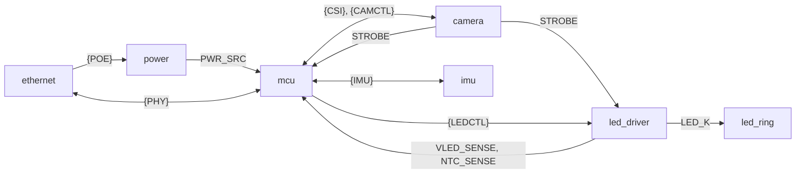

# espion-cam schematic architecture

How the espion-cam schematic is organised: the sheets, the nets that cross them, and each
block's circuit with its component values and where they come from. The system view
(what the board does and why) is in [`../../docs/architecture.md`](../../docs/architecture.md);
the parts list comes from the schematic ([Bill of materials](#bill-of-materials)). This
document is the plan for capturing the schematic in KiCad. Edit the schematic only in KiCad.

Values come from datasheets and reference designs (cited in each section) or from the
derivations shown next to them. `[INFERENCE]` marks a figure that rests on a model or an
assumption rather than a document. Reference designators (U1, R62, …) are the board-wide
ones from KiCad's annotation, in every section.

## Design decisions

| Topic | Decision |
|---|---|
| Sheets | Hierarchical, one sheet per block. Signals cross sheets only through hierarchical pins, so ERC checks every crossing; rails use global power symbols. Multi-signal interfaces cross as buses ([Buses](#buses)) |
| Mechanics | OV9281 module on the back of the board, lens through a cutout. The 12 LEDs sit on the front, close around the cutout. One PCB, no ring connector |
| Mounting | 4 × M3 holes (H1–H4), plated, each pad on GND. They keep ≥ 2 mm from `POE_CABLE` copper (the `PoE isolation` DRC rule) |
| Camera logic levels | XVS and STROBE on the OV9281 module are 1.8 V. STROBE goes up through an SN74LV1T34 (U7) on +3V3; XVS goes down through a 1.5 kΩ / 1.8 kΩ divider (R31/R32) |
| STROBE to the P4 | Yes, on a GPIO with ETM capture: firmware timestamps every exposure (trigger latency L, missed triggers) |
| Camera enable | FPC CAM_IO0 (the module's regulator enable) from a P4 GPIO, pulled down: the sensor stays off until firmware enables it and can be power-cycled |
| Camera FPC connector | Single-contact, so an FFC inserted face-flipped makes no contact (a mirrored cable would put +3V3 on the module's GND). See [Camera FPC connector](#camera-fpc-connector) |
| PPS | EMAC PTP PPS through the GPIO matrix (signal `EMAC_PTP_PPS_PAD_OUT_IDX` = 243) on one GPIO with a test point (TP1), looped back through a 0 Ω resistor (R27) into a second GPIO for ETM capture. Remove R27 if ETM sees the output pad directly |
| PHY crystal | Epson X1E0000210139 (TSX-3225, 25 MHz, ESR ≤ 40 Ω, as the IP101G requires; the earlier C9006 is 50 Ω). See [PHY crystal](#phy-crystal) |
| Power source | TPS2121 (U4) priority mux, PoE first; its ST to a P4 GPIO (`PWR_SRC`, high = PoE). Firmware keeps the LED rail off on USB-only power |
| VBUS sense | `VBUS` through a 47 kΩ / 75 kΩ divider (R62/R63, 100 nF C49) into GPIO20 (`VBUS_SENSE`, ADC1 CH4). Firmware drops the USB D+ pull-up while VBUS is absent ([firmware rule 10](#firmware-rules-from-the-schematic)); `PWR_SRC` cannot tell whether USB is plugged in |
| LED boost input | A TPS22918 load switch (U8) with a ≈ 27 ms ramp, on `LED_PWR_EN`, feeds the boost. Without it, the boost's inductor-diode path charges the 440 µF storage at every power-up (≈ 1.6 A inrush, over the USB limit). The boost (U9) has its own enable, `BST_EN`, which firmware raises only after the switch has ramped |
| RJ45 shield | To GND through 1 nF/2 kV (C12) ∥ 1 MΩ (R15 + R16, 2 × 499 kΩ) |
| Indicators | One addressable RGB status LED (WS2812B-2020-V6, D1, on +3V3) on a P4 GPIO. The MagJack's two LEDs are driven by the PHY in LED mode 2: green = link/activity (LED0), yellow = 100 Mb/s link (LED3). See [Jack LEDs](#jack-leds) |
| Debug and sense | Test points on XVS, STROBE, gate output, LED_EN, PPS, the LED current shunt (`ISNS`), +5V, +3V3, +32V and GND. +32V sense divider and an NTC at the sink MOSFET, both into ADC1 pins. No UART header, no JTAG pads |
| IMU | ST LSM6DS3TR-C 6-axis IMU (U12) on its own I2C bus (GPIO3/4, `IMU_SDA`/`IMU_SCL`), with INT1 on GPIO54 (`IMU_INT1`). Uses: wake-on-motion flags a camera that was bumped (stale extrinsics), the accelerometer gives the gravity vector for rig calibration, the rest is spare. INT2 is not connected. See [IMU](#imu-imukicad_sch) |
| GPIO numbers | Fixed for Ethernet ([Ethernet pin map](../../docs/architecture.md#ethernet-pin-map)). The rest are assigned during PCB placement, within the groups in [GPIO groups](#gpio-groups) |
| BOM | Generated from the schematic with the project's KiCad BOM preset `Order`; the output is not committed. See [Bill of materials](#bill-of-materials) |

## Sheets

| Sheet file | Content |
|---|---|
| `espion-cam.kicad_sch` (root) | Sheet symbols with the buses between them, mounting holes H1–H4. The wired sheet symbols serve as the block diagram |
| `power.kicad_sch` | DP1435-5V PoE PD, LC filter, TPS2121 priority mux, TLV62569 3.3 V buck, VBUS TVS (TSD05DYFR) |
| `mcu.kicad_sch` | ESP32-P4-Core module, EN/RESET, BOOT, USB-C (ESD, CC), VBUS sense divider, RGB status LED, PPS loop-back and test point |
| `ethernet.kicad_sch` | IP101GRI PHY, 25 MHz crystal, HR871150C MagJack, shield RC, jack LED resistors and the LEDMOD strap |
| `camera.kicad_sch` | 15-pin FPC, JST-SH aux (XVS/STROBE), SCCB pull-ups, CAM_EN, XVS divider, STROBE buffer |
| `led_driver.kicad_sch` | TPS22918 load switch, TPS61170 boost, storage caps, '1G97 gate and timeout RC, TLV9061/IRLR024N sink, NTC, +32V sense |
| `led_ring.kicad_sch` | 12 × A-SC880IR3C (D4–D15) in series between +32V and `LED_K` |
| `imu.kicad_sch` | LSM6DS3TR-C IMU, its decoupling and I2C pull-ups |



### Power nets

Global power symbols carry the rails; local nets stay on one sheet.

| Net | Kind | Source | Loads |
|---|---|---|---|
| `GND` | global | — | everything, including the mounting holes H1–H4. Isolated from the cable side by the DP1435 |
| `VBUS` | global | USB-C J1 (mcu) | TPS2121 IN2 (U4), TSD05DYFR TVS (D2), 100 kΩ bleeder (R25), VBUS sense divider (R62/R63) |
| `+5V` | global | TPS2121 U4 OUT (power) | TLV62569 (U5), TPS22918 (U8, led_driver), TLV9061 (U11) |
| `+3V3` | global | TLV62569 U5 (power) | P4 module, PHY (via `PHY_3V3`), camera (via `CAM_3V3`), logic, RGB LED, MagJack green LED, IMU, pull-ups, NTC divider |
| `+32V` | global | TPS61170 U9 via D3 (led_driver) | LED ring, boost feedback divider (R45/R46), sense divider (R60/R61). Stock `power:+36V` symbol with Value `+32V` (stock KiCad has no `+32V`; the net name follows the Value) |
| `+5V_POE`, `+5V_POE_F` | local, power | DP1435 (U3) VOUT; after the LC filter (L1) | LC filter; TPS2121 IN1 and the PR1 divider |
| `+5V_BST` | local, led_driver | TPS22918 (U8) VOUT | TPS61170 VIN, boost inductor (L3) |
| `PHY_3V3` | local, ethernet | 0 Ω R5 from `+3V3` | IP101GRI supplies, straps, MDIO pull-up |
| `CAM_3V3` | local, camera | 0 Ω R37 from `+3V3`, DNP for the first build ([Camera](#camera-camerakicad_sch)) | FPC camera pin 15 (connector pad 1) |
| `POE_VA1`, `POE_VA2`, `POE_VB1`, `POE_VB2` | hierarchical, ethernet → power | MagJack (J2) centre taps and spare pairs | DP1435 inputs. Cable side: ≤ 57 V, isolated, net class `POE_CABLE` |

`PWR_FLAG`: one per net that has no `power_out` driver, placed as listed here (on the sheet
that holds the net's main load or driver, which for `VBUS` and the `POE_*` nets is not the
sheet that creates them). The power sheet carries `GND`, `VBUS`, `+5V_POE_F`, `+3V3` and the
four `POE_*` nets; the led_driver sheet `+32V`; the ethernet sheet `PHY_3V3`. No other sheet
adds flags on those nets.

### Buses

Each multi-signal interface crosses sheets as one bus. The project file
(`espion-cam.kicad_pro`, `schematic.bus_aliases`) defines one KiCad bus alias per interface,
shared by all sheets, with the members below, in this order. The sheet's hierarchical label
and the root sheet pin are named `{ALIAS}` (an unnamed alias group), so the members keep
their bare net names (`/Ethernet/RMII_TXD0`, not `PHY.RMII_TXD0`) and the net classes match
them by name. On the root sheet, buses run directly between the sheet pins.

| Bus | Members | Sheets | Label shape |
|---|---|---|---|
| `{POE}` | `POE_VA1`, `POE_VA2`, `POE_VB1`, `POE_VB2` | ethernet ↔ power | passive |
| `{PHY}` | `RMII_TX_EN`, `RMII_TXD0`, `RMII_TXD1`, `RMII_REF_CLK`, `RMII_CRS_DV`, `RMII_RXD0`, `RMII_RXD1`, `MDC`, `MDIO`, `PHY_RST_N` | ethernet ↔ mcu | bidirectional |
| `{CSI}` | `CSI_CLK_P`, `CSI_CLK_N`, `CSI_D0_P`, `CSI_D0_N`, `CSI_D1_P`, `CSI_D1_N` | mcu ↔ camera | passive |
| `{CAMCTL}` | `SCCB_SDA`, `SCCB_SCL`, `CAM_EN`, `XVS` | mcu ↔ camera | bidirectional |
| `{LEDCTL}` | `LED_PWR_EN`, `BST_EN`, `LED_EN` | mcu ↔ led_driver | bidirectional |
| `{IMU}` | `IMU_SDA`, `IMU_SCL`, `IMU_INT1` | mcu ↔ imu | bidirectional |

`STROBE`, `PWR_SRC`, `VLED_SENSE`, `NTC_SENSE` and `LED_K` stay single hierarchical pins.
Within a sheet, a bus that has to reach members on two sides of a part is split into pieces
joined by a local bus label of the same `{ALIAS}` name (mcu sheet: `{LEDCTL}` reaches
`BST_EN` on GPIO53 and `{IMU}` reaches `IMU_INT1` on GPIO54 this way); each sheet has
exactly one hierarchical label per bus.

### Hierarchical pins

3.3 V logic unless stated. Directions are from the source sheet.

| Signal | Bus | From → to | Level / type | Notes |
|---|---|---|---|---|
| `RMII_REF_CLK` | `{PHY}` | ethernet → mcu | 50 MHz | PHY pin 14 → R11 22 Ω → GPIO50; also looped to PHY pin 10 on the ethernet sheet |
| `RMII_CRS_DV`, `RMII_RXD0`, `RMII_RXD1` | `{PHY}` | ethernet → mcu | | GPIO28, 29, 30. 22 Ω at the PHY (R12–R14) |
| `RMII_TX_EN`, `RMII_TXD0`, `RMII_TXD1` | `{PHY}` | mcu → ethernet | | GPIO49, 34, 35. TXD1 is the BOOT strap |
| `MDC` | `{PHY}` | mcu → ethernet | | GPIO31 |
| `MDIO` | `{PHY}` | bidirectional | open/tri-state | GPIO52. 1.5 kΩ pull-up (R9) on the ethernet sheet |
| `PHY_RST_N` | `{PHY}` | mcu → ethernet | active low | GPIO51. 10 kΩ pull-down (R10) on the ethernet sheet |
| `CSI_D0_P/N`, `CSI_D1_P/N`, `CSI_CLK_P/N` | `{CSI}` | camera ↔ mcu | MIPI D-PHY | Module pins 28–33. 100 Ω differential |
| `SCCB_SDA`, `SCCB_SCL` | `{CAMCTL}` | mcu ↔ camera | open drain | 1.8 kΩ pull-ups (R33, R34) on the camera sheet |
| `CAM_EN` | `{CAMCTL}` | mcu → camera | | 47 kΩ pull-down (R35) on the camera sheet |
| `XVS` | `{CAMCTL}` | mcu → camera | 3.3 V before the divider | RMT output |
| `STROBE` | — | camera → mcu, led_driver | 3.3 V (SN74LV1T34 output) | ETM capture on the P4; gate and timeout on the led_driver sheet |
| `LED_EN` | `{LEDCTL}` | mcu → led_driver | | Gate enable. 100 kΩ pull-down (R49) |
| `LED_PWR_EN` | `{LEDCTL}` | mcu → led_driver | | TPS22918 ON. 100 kΩ pull-down (R44) |
| `BST_EN` | `{LEDCTL}` | mcu → led_driver | | TPS61170 CTRL. 100 kΩ pull-down (R48) |
| `VLED_SENSE` | — | led_driver → mcu | passive (analog), 0–1.51 V | +32V × 10/265 (R60/R61), ADC1 |
| `NTC_SENSE` | — | led_driver → mcu | passive (analog) | NTC divider (TH1/R59), ADC1 |
| `PWR_SRC` | — | power → mcu | open drain | TPS2121 ST; 10 kΩ pull-up (R26) on the mcu sheet. High = PoE |
| `LED_K` | — | led_driver ↔ led_ring | passive, ≈ 2–34 V, 1 A pulsed | String cathode (D15) → MOSFET drain (Q1) |
| `IMU_SDA`, `IMU_SCL` | `{IMU}` | mcu ↔ imu | open drain | GPIO3, GPIO4 (second P4 I2C controller). 10 kΩ pull-ups (R64, R65) on the imu sheet |
| `IMU_INT1` | `{IMU}` | imu → mcu | push-pull | U12 INT1 → GPIO54. No pull: U12 drives it low from power-up |

### GPIO groups

Pins are fixed at placement within these groups (details and reset states:
[MCU](#mcu-mcukicad_sch)). Exposed 3.3 V GPIOs: GPIO2–13, 20–23, 26, 27, 32, 33, 53, 54.
GPIO39–48 are not used (their I/O domain is fed by ESP_LDO_VO4, 0 V until firmware sets
it).

| Group | Signals | Constraints | Suggested |
|---|---|---|---|
| CAM | `SCCB_SDA`, `SCCB_SCL`, `CAM_EN`, `XVS`, `STROBE` | Not GPIO2 (pull-up after reset) | GPIO8–12 |
| LED | `LED_EN`, `LED_PWR_EN`, `BST_EN` | Not GPIO2, not GPIO34–38 (straps) | GPIO7, GPIO6, GPIO53 |
| ADC | `VLED_SENSE`, `NTC_SENSE`, `VBUS_SENSE` | ADC1: GPIO20–23 | GPIO22, GPIO23, GPIO20 (ADC1 CH4) |
| STAT | `PWR_SRC`, `STATUS_LED` | `STATUS_LED` on GPIO6–13 (no reset pull-up) | GPIO2, GPIO13 |
| PPS | `PPS`, `PPS_IN` | Adjacent pins for a short 0 Ω loop | GPIO32, GPIO33 |
| IMU | `IMU_SDA`, `IMU_SCL`, `IMU_INT1` | Inputs or open drain only on GPIO3/4 (JTAG MTDI/MTMS pads, IE after reset) | GPIO3, GPIO4, GPIO54 |
| Spare | — | GPIO26/27 carry USB by default; measure before use | GPIO5, 21, 26, 27 |

### Firmware rules from the schematic

The hardware relies on these; `cam-p4` must follow them.

1. **Camera:** keep `XVS` low whenever `CAM_EN` is low (XVS high would back-feed the
   unpowered sensor through its I/O clamp). Drive XVS low before CAM_EN falls; start XVS
   edges only after the sensor's power-up sequence. XVS high pulses ≥ 10 µs.
2. **MIPI supply:** the module powers the MIPI PHY from ESP_LDO_VO3, which is 0 V by
   default. `esp32p4-csi` sets VO3 to 2.5 V before starting the CSI host. Never program
   VO3 above 2.75 V: the LDO can go up to 3.3 V, but 2.75 V is the VDD_MIPI_DPHY input
   maximum (P4 DS Table 5-1).
3. **PHY reset:** hold `PHY_RST_N` low ≥ 11 ms after power-up, release it, wait ≥ 12.5 ms
   for the 50 MHz REF_CLK, then initialise the EMAC. The first MDIO frame carries
   ≥ 32 preamble bits. Keep GPIO28 (`RMII_CRS_DV`) an input with no pull, or driven low,
   from reset until ≥ 2.63 ms after `PHY_RST_N` rises: it shares the net with the PHY's
   FX_HEN strap, which only the PHY's internal 104 kΩ pull-down holds at 0 (twisted pair).
   A P4 pull-up on it would leave the strap mid-rail (IP101G DS pin 19 p.16–17, PD p.12,
   Tlat_h Table 15 p.59).
4. **LED power:** only on PoE (`PWR_SRC` high). On: `LED_PWR_EN` high, wait ≥ 50 ms,
   then `BST_EN` high (the rail takes 50–120 ms to charge). Off: `BST_EN` low, then
   `LED_PWR_EN` low. Never PWM `BST_EN` (TPS61170 CTRL decodes PWM/EasyScale). +32V
   stays charged for tens of seconds after the boost stops; `LED_EN` low is what turns
   the light off. On a falling edge of `PWR_SRC` (GPIO interrupt: PoE lost, the mux has
   handed `+5V` to USB), drop `BST_EN` and then `LED_PWR_EN` at once, without the usual
   off sequence delays, so the boost's up to 1.44 A leaves the USB port as soon as
   possible ([Power](#power-powerkicad_sch), TPS2121 switchover, PoE lost with USB present).
5. **LED thermal:** cap the exposure at ≈ 0.8 ms (the boost's sustained output, and the
   sink MOSFET's average power). Derate or stop on `NTC_SENSE`; treat an open (≈ 3.3 V)
   or shorted (0 V) NTC as a fault and drop `BST_EN`/`LED_PWR_EN`.
6. **LED rail check:** read `VLED_SENSE` just after an enabled pulse (no droop = open
   string or no current) and before the next XVS (recovered rail).
7. **RMT:** one `Rmt` instance. XVS on TX channel 0, the status LED on channel 2 or 3
   (XVS may take more than one memory block).
8. **eFuses:** never burn `EFUSE_JTAG_SEL_ENABLE`: GPIO34 (RMII TXD0) floats at reset
   and would pick the JTAG source at random.
9. **Outputs at boot:** write each output's level before enabling its driver. Every
   output that reaches an active part outside the P4 has an external default (pull-down
   or divider) for the time the P4 pins float. `RMII_TX_EN`, `RMII_TXD0` and `MDC` have
   none; R10 holds the PHY in reset until firmware releases `PHY_RST_N`, so they are
   ignored. `PPS` reaches only TP1 and, through R27, the P4's own GPIO33.
10. **USB D+ pull-up:** read `VBUS_SENSE` (GPIO20). While VBUS is absent, turn the USB
    Serial/JTAG D+ pull-up off (`USB_SERIAL_JTAG_CONF0_REG`: `PAD_PULL_OVERRIDE` = 1,
    `DP_PULLUP` = 0; P4 TRM Register 54.3); turn it back on when VBUS returns. USB 2.0
    §7.1.5.1 forbids a powered D+ pull-up without VBUS, and the board can run from PoE
    alone with a cable to an unpowered host. `PWR_SRC` cannot stand in: it is high on PoE
    whether or not USB is plugged in. The divider puts the pin above V_IH for VBUS
    ≥ 4.4 V, so a digital read works; ADC1 CH4 at ATTEN3 (0–3.3 V) reads VBUS up to
    ≈ 5.3 V ([MCU](#mcu-mcukicad_sch)).
11. **IMU:** keep U12's INT1 push-pull (`CTRL3_C.PP_OD` = 0, the default): `IMU_INT1`
    has no pull resistor, so open-drain mode would leave GPIO54 floating. U12 answers at
    I2C address 0x6A (SA0 tied low) on the bus at GPIO3/4, at up to 400 kHz. Wait
    ≥ 35 ms after power-up before the first access (turn-on time T_on, 35 ms typical,
    LSM6DS3TR-C DS Table 4 p.24; no maximum is given, so firmware retries a NACK).

### Clocks

- RMII: the IP101GRI's 25 MHz crystal → 50 MHz REF_CLK into GPIO50 (esp-hal
  `ExternalRefClock`).
- PTP: the EMAC PTP clock source is `XTAL` (default) or `PLL_F80M` (ESP-IDF
  `components/soc/esp32p4/include/soc/clk_tree_defs.h`, `soc_periph_emac_ptp_clk_src_t`).
  Both come from the P4's 40 MHz crystal, so the PTP clock and SYSTIMER share it, as
  [`docs/timing.md`](../../docs/timing.md) assumes. The PHY crystal only clocks RMII.

## Net classes and design rules

Net classes live in `espion-cam.kicad_pro` (net settings with pattern assignments; KiCad
Schematic/Board Setup > Net Classes). Spacing that a net class cannot express is in custom
rules in `espion-cam.kicad_dru` (Board Setup > Custom Rules). Both are sized for the JLCPCB
JLC04161H-7628 stack-up below. The per-sheet layout constraints name these classes and
rules.

| Class | Nets (pattern) | Track (mm) | Clearance (mm) | Diff pair W / gap (mm) | Via (mm) |
|---|---|---|---|---|---|
| Default | everything else | 0.2 | 0.2 | — | 0.6 / 0.3 |
| `POE_CABLE` | `/Ethernet/POE_*` | 0.4 | 0.2 | — | 0.6 / 0.3 |
| `ETH_SHIELD` | `/Ethernet/ETH_SHIELD*` | 0.4 | 0.2 | — | 0.6 / 0.3 |
| `LED_PWR` | `+32V`, `/LED driver/LED_K`, `/LED driver/ISNS`, and the ring nodes `/LED ring/RING_*` | 1.0 | 0.2 | — | 0.8 / 0.4 |
| `PWR_5V` | `+5V`, `VBUS`, `/Power/+5V_POE*`, `/LED driver/+5V_BST` | 1.0 | 0.2 | — | 0.8 / 0.4 |
| `PWR_3V3` | `+3V3`, `/Ethernet/PHY_3V3`, `/Camera/CAM_3V3` | 0.5 | 0.2 | — | 0.6 / 0.3 |
| `MIPI_CSI` | `/Camera/CSI_*`, `/Camera/CAM_CLK_?`, `/Camera/CAM_D?_?` | 0.18 | 0.15 | 0.18 / 0.15 | 0.6 / 0.3 |
| `MDI` | `/Ethernet/ETH_TD_?`, `/Ethernet/ETH_RD_?` | 0.18 | 0.15 | 0.18 / 0.15 | 0.6 / 0.3 |
| `USB` | `/MCU/USB_C_D_?`, `/MCU/USB_D_?` | 0.245 | 0.15 | 0.245 / 0.15 | 0.6 / 0.3 |
| `RMII_CLK` | `/Ethernet/RMII_REF_CLK*` | 0.3 | 0.2 | — | 0.6 / 0.3 |
| `RMII` | `/Ethernet/RMII_TX*`, `/Ethernet/RMII_RXD*`, `/Ethernet/RMII_CRS_DV*` | 0.36 | 0.2 | — | 0.6 / 0.3 |

- The diff-pair classes keep a 0.15 mm class clearance so the pair's own 0.15 mm gap
  passes DRC; their wider spacing to other nets comes from the custom rules.
- `RMII` also takes the PHY-side RX nets between U6 and R12–R14 (`RMII_RXD0_PHY`,
  `RMII_RXD1_PHY`, `RMII_CRS_DV_PHY`). Every class pattern matches a labelled net name, so
  re-annotation can't move a net out of its class.
- `RMII_CLK` at 0.30 mm assumes a GND guard 0.20 mm away (coplanar, 50 Ω); `RMII` at
  0.36 mm is plain 50 Ω microstrip.

**Custom rules** (`espion-cam.kicad_dru`):

| Rule | Applies to | Constraint | Why |
|---|---|---|---|
| `PoE isolation` | `POE_CABLE` copper to any other class (the RJ45 shield `ETH_SHIELD` included), all layers | 2 mm | 1500 V rms isolation between the MDI leads and the board and every accessible conductor (802.3, DP1435 1.5 kV). Exempt only pad pairs inside J2, which bridges the barrier by design. Covers the GND mounting holes |
| `MIPI_CSI spacing` | `MIPI_CSI` to everything but the pair partner, except the two pads of each 0 Ω link R38–R43 | 0.36 mm (2W) | Also keeps GND pour ≥ 0.30 mm away, which the 100 Ω geometry assumes. A 0201's own pads are 0.18 mm apart and carry the two halves of one lane |
| `MIPI_CSI intra-pair skew` | each `MIPI_CSI` pair (`within_diff_pairs`) | skew ≤ 0.254 mm | P/N length match per segment |
| — | pair-to-pair match | ≤ 0.762 mm | Not a DRC rule: KiCad takes only the last matching rule per constraint type, so a second `skew` rule on the same nets would replace the intra-pair one. Check pair-to-pair with the length tuner after routing ([Camera](#camera-camerakicad_sch), Length matching) |
| `MDI spacing` | `MDI` to other classes | 0.55 mm | 3× spacing (IP101G DS §6.2) |
| `USB spacing` | `USB` to everything but the pair partner | 0.3 mm | Keeps GND and other nets clear of the 90 Ω pair |

**Stack-up: JLCPCB JLC04161H-7628** (4 layers, 1.6 mm, 1 oz outer / 0.5 oz inner). Top Cu
0.035, prepreg 7628 × 1 0.2104, L2 Cu 0.0152, core 1.065, L3 Cu 0.0152, prepreg 7628 × 1
0.2104, bottom Cu 0.035 (mm). L2 is solid GND; L3 is power/GND and must be solid under any
bottom-layer pair. The stack-up is symmetric, so L4 over L3 uses the same geometry as L1
over L2.

**Impedance geometry** (coated microstrip on L1 over the L2 plane; W = drawn base width,
S = gap inside a pair, D = edge gap to coplanar GND; mm):

| Target | Nets | Structure | W | S | D | JLCPCB calc | Field solver |
|---|---|---|---|---|---|---|---|
| 100 Ω diff | CSI data, MDI | edge-coupled | 0.18 | 0.15 | — | 100.42 Ω | 100.74 Ω |
| 100 Ω diff | CSI CLK with GND around | coplanar diff | 0.18 | 0.15 | ≥ 0.30 | 99.47 Ω (D 0.30) | 99.67 Ω |
| 90 Ω diff | USB | edge-coupled | 0.245 | 0.15 | — | 90.09 Ω | 90.35 Ω |
| 50 Ω SE | RMII | microstrip | 0.36 | — | — | 49.74 Ω | 49.82 Ω |
| 50 Ω SE | REF_CLK, GND-guarded | coplanar | 0.30 | — | 0.20 | 50.03 Ω | 50.08 Ω |

- The CSI CLK pair uses the same `MIPI_CSI` width and gap; keep its GND pour at
  D ≥ 0.30 mm (D ≥ 0.40 mm gives ≥ 100 Ω). Closer GND pulls it down: D 0.20 gives 97.7 Ω.
  A 0.36 mm RMII track with a guard at 0.20 mm drops to 45.8 Ω, so a guarded track needs
  the coplanar row.
- JLCPCB calculator vs field solver: the JLCPCB values are the inputs its calculator sends
  for JLC04161H-7628 (prepreg Dk 4.3, finished outer copper 1.6 mil, mask 1.0 mil over
  substrate and 0.6 mil over copper, mask Dk 3.8), captured 2026-10-29. An independent 2D
  field solver on the same geometry agrees within 0.41 % in every case (it reads slightly
  high) [INFERENCE: both rest on JLCPCB's material parameters].
- JLCPCB's impedance tolerance is ±10 %. The dominant term is the ±10 % etched width
  (≈ ±6–8 % in Z). The published 7628 Dk of 4.4 instead of 4.3 shifts Z by −0.8 %.
- Keep solder mask over impedance tracks: opening it raises Z by 3–8 %.
- Order with impedance control on JLC04161H-7628; the calculator assumes Nan Ya NP-155F
  core. Every width above is ≥ 0.15 mm, over the 0.09 mm multilayer minimum.

## Bill of materials

The BOM comes from the schematic. The project holds a BOM preset named `Order`; run in
`hardware/espion-cam`:

```sh
kicad-cli sch export bom --preset Order -o espion-cam-bom.csv espion-cam.kicad_sch
```

- Columns: Reference, Qty, Value, Footprint, Manufacturer, MPN, LCSC, DNP; one row per
  group of parts with the same Value, Footprint, Manufacturer, MPN, LCSC and DNP.
- DNP parts (R36, R37 for the first build) and parts excluded from the BOM (the mounting
  holes H1–H4, net tie NT1 and the pad test points) are left out. The GND loop test points
  TP3, TP8 and TP9 (RH-5002, C5199802) are bought, so they stay in.
- The CSV is a build output and is never committed.
- Every sourced symbol carries Manufacturer, MPN and LCSC fields; the per-sheet Parts
  tables give the same data with stock and price.

Parts sourced elsewhere or not on the schematic:

| Part | Source | Notes |
|---|---|---|
| Waveshare ESP32-P4-Core, 16 MB flash (SKU 36096) | Waveshare | On the schematic as U1 (Manufacturer Waveshare, MPN `ESP32-P4-Core (SKU 36096)`, no LCSC number). See [`../../docs/architecture.md`](../../docs/architecture.md) |
| OV9281 camera module (SZYTF, 79°/110°/160° lens) | [AliExpress 1005012566040263](https://fr.aliexpress.com/item/1005012566040263.html) | No symbol; it plugs into J3 (FPC) and J4 (aux). See [Camera module and cables](#camera-module-and-cables) |
| Camera aux pigtail, SH 1.0 mm 4-pin, 200 mm, single-ended tinned: DEALON LNN100-157128-200-4P | LCSC C2999003 | Cable assembly, no symbol. Mates with J4; tinned ends soldered to the module's XVS, STROBE and GND pads. See [Camera module and cables](#camera-module-and-cables) |
| 850 nm bandpass filter for the camera lens | — | Not selected yet; not a PCB part |

## Power (`power.kicad_sch`)

Takes PoE from the MagJack's centre taps and spare pairs through the isolated DP1435-5V PD module (U3, 5.15 V), filters it with a damped LC, and ORs it with USB-C VBUS in a TPS2121 priority power mux (U4). PoE (IN1) has priority; USB (IN2) takes over only when PoE falls below the PR1/CP2 threshold. The mux limits its current at every switchover and soft-starts the output at USB attach, and neither source can back-feed the other. The mux output is the global `+5V` rail, which feeds the LED boost (led_driver sheet) and a TLV62569 buck (U5) that makes `+3V3`. The TPS2121 ST output leaves as `PWR_SRC`. The sheet also holds the `+5V`/`+3V3`/`GND` test points and the ERC power flags.

### Hierarchical pins

Sheet labels: `{POE}` (bus, passive) and `PWR_SRC`. The four `POE_*` rows are the `{POE}` members.

| Name | Direction (from this sheet) | Level | Goes to |
|---|---|---|---|
| `POE_VA1` | input (power) | 0–57 V, cable side, isolated from GND | ethernet: J2 pin 7, HR871150C centre tap of pair 1/2 (DP1435 p.2: VA1 = CT of RJ45 1&2) |
| `POE_VA2` | input (power) | same | ethernet: J2 pin 8, centre tap of pair 3/6 |
| `POE_VB1` | input (power) | same | ethernet: J2 pin 9, spare pair 4/5 |
| `POE_VB2` | input (power) | same | ethernet: J2 pin 10, spare pair 7/8 |
| `PWR_SRC` | output, open drain | 3.3 V (R26 pull-up on the mcu sheet) | mcu: U1 pin 4 (GPIO2). **High = IN1 (PoE) powers +5V, or the mux output is off; low = IN2 (USB) powers +5V** (TPS2121 SLVSEA3F Table 9-3, p. 18) |

Global power symbols used: `GND`, `VBUS` (in, from mcu sheet), `+5V` (out), `+3V3` (out). Local nets, each carrying its label: `+5V_POE` (DP1435 VOUT), `+5V_POE_F` (after the LC filter, TPS2121 IN1), `PR1` (IN1 divider node), `CP2` (+3V3 reference divider node), `ILIM` (current-limit resistor), `SS` (soft-start capacitor), `SW_3V3` (buck switch node), `FB_3V3`.

### Parts

| Ref | Function | Value / MPN | LCSC (stock, lowest-break price, date) | KiCad symbol | KiCad footprint |
|---|---|---|---|---|---|
| U3 | PoE PD module, isolated flyback, 5.15 V | DP1435-5V (SDAPO) | C5380097 (365, $3.64, 2026-10-28) | `Converter_DCDC_SDAPO:DP1435-5V` | `Converter_DCDC_SDAPO:Converter_DCDC_SDAPO_DP1435_THT` |
| C13 | Module-side HF cap at DP1435 VOUT (input cap of the datasheet's C-L-C filter) | 10 µF 25 V X5R 0805, CL21A106KAYNNNE | C15850 (1,903,000, $0.0256, 2026-10-28) | `Device:C` | `Capacitor_SMD:C_0805_2012Metric` |
| L1 | PoE LC filter | 2.2 µH, FXL0630-2R2-M (cjiang) | C167218 (70,485, $0.0827, 2026-10-28) | `Device:L` | `Inductor_SMD:L_Changjiang_FXL0630` (stock) |
| C1 | LC filter output, low ESR | 330 µF 16 V polymer, SVZ1CM331E09E00RAXXX (AISHI) | C3291468 (3,055, $0.093, 2026-10-28) | `Device:C_Polarized` | `Capacitor_SMD_AISHI:CP_Elec_6.3x9` |
| C2 | LC filter damping (ESR = damping R) | 330 µF 16 V electrolytic, JVE16V330M8X10 (JIERR) | C48615108 (1,935, $0.057, 2026-10-28) | `Device:C_Polarized` | `Capacitor_SMD_JIERR:CP_Elec_8x10.5` (use the library prefix: the stock part has the same name and a different land) |
| C14 | LC filter output HF cap at TPS2121 IN1 (= IN1 input cap) | 10 µF 25 V X5R 0805, CL21A106KAYNNNE | C15850 | `Device:C` | `Capacitor_SMD:C_0805_2012Metric` |
| R17 | PR1 divider, top (IN1 → PR1) | 100 kΩ 1 % 0402, UNI-ROYAL 0402WGF1003TCE | C25741 | `Device:R` | `Resistor_SMD:R_0402_1005Metric` |
| R18 | PR1 divider, bottom (PR1 → GND) | 47 kΩ 1 % 0402, UNI-ROYAL 0402WGF4702TCE | C25792 (4,985,400, $0.0020, 2026-10-29) | `Device:R` | `Resistor_SMD:R_0402_1005Metric` |
| R66 | CP2 reference divider, top (+3V3 → CP2) | 100 kΩ 1 % 0402, UNI-ROYAL 0402WGF1003TCE | C25741 | `Device:R` | `Resistor_SMD:R_0402_1005Metric` |
| R67 | CP2 reference divider, bottom (CP2 → GND) | 60.4 kΩ 1 % 0402, UNI-ROYAL 0402WGF6042TCE | C25911 (376,000, $0.0011, 2026-10-29) | `Device:R` | `Resistor_SMD:R_0402_1005Metric` |
| R68 | Current limit, ILIM → GND | 36 kΩ 1 % 0402, HWA CHN HRC0402F3602DNTO | C54920666 (54,900, $0.0007, 2026-10-29) | `Device:R` | `Resistor_SMD:R_0402_1005Metric` |
| C52 | Soft-start and settling-time cap, SS → GND | 100 nF 50 V X7R 0402, YAGEO CC0402KRX7R9BB104 | C131394 | `Device:C` | `Capacitor_SMD:C_0402_1005Metric` |
| U4 | 5 V priority power mux, XREF mode (fast switchover) | TPS2121RUXR (TI) | C485916 (24,104, $0.6124, 2026-10-29) | `Power_Management_TI:TPS2121RUX` (project library, drawn from SLVSEA3F) | `Package_DFN_QFN_TI:Texas_RUX0012A_VQFN-HR-12_2x2.5mm_P0.5mm` (project library, the symbol's default: stock pads, which match TI's RUX0012A land pattern p. 39, plus a project 3D model) |
| D2 | VBUS TVS (the USBLC6 on the mcu sheet no longer clamps VBUS) | TSD05DYFR (TI), unidirectional, VRWM 5.5 V, I_LEAK ≤ 50 nA at 5.5 V, VBR ≥ 6.0 V, V_CLAMP 11.5 V max at 24 A, I_PP 60 A 8/20 µs | C22396185 (20,520, $0.1928, 2026-10-29) | `Device:D_Zener` (K = pin 1 = IO, the banded pin; stock KiCad has no generic unidirectional TVS symbol) | `Diode_SMD:D_SOD-323_HandSoldering` (stock) |
| C15 | VBUS input cap at TPS2121 IN2 | 4.7 µF 25 V X5R 0805, CL21A475KAQNNNE (Samsung) | C1779 | `Device:C` | `Capacitor_SMD:C_0805_2012Metric` |
| C16 | `+5V` ceramic bulk at TPS2121 OUT pins 1/8 | 47 µF 10 V X5R 1206, CL31A476MPHNNNE (Samsung) | C96123 (176,750, $0.0853, 2026-10-28) | `Device:C` | `Capacitor_SMD:C_1206_3216Metric` |
| C17 | `+5V` bulk, aluminium polymer (ESR 30 mΩ, 2.65 A rms) | 100 µF 25 V, MA25V100M6x6 (JIERR) | C46550465 (51,910, $0.1626, 2026-10-29) | `Device:C_Polarized` (+ = pad 1) | `Capacitor_SMD:CP_Elec_6.3x5.8` (stock) |
| C18 | `+5V` HF decoupling at OUT | 100 nF 50 V X7R 0402, YAGEO CC0402KRX7R9BB104 | C131394 | `Device:C` | `Capacitor_SMD:C_0402_1005Metric` |
| U5 | 3.3 V buck, 2 A | TLV62569DBVR (TI) | C141836 (16,700, $0.038, 2026-10-28) | `Regulator_Switching:TLV62569DBV` (stock; extends TLV62568DBV) | `Package_TO_SOT_SMD:SOT-23-5` (stock) |
| L2 | Buck inductor (same part as L1) | 2.2 µH, FXL0630-2R2-M (cjiang) | C167218 (70,485, $0.0827, 2026-10-28) | `Device:L` | `Inductor_SMD:L_Changjiang_FXL0630` (stock) |
| C21, C22 | Buck input | 10 µF 25 V X5R 0805 (CL21A106KAYNNNE) + 100 nF 50 V X7R 0402 (YAGEO CC0402KRX7R9BB104) | C15850 / C131394 | `Device:C` | `C_0805_2012Metric` / `C_0402_1005Metric` |
| C19, C20 | Buck output | 10 µF 25 V X5R 0805 (CL21A106KAYNNNE) + 100 nF 50 V X7R 0402 (YAGEO CC0402KRX7R9BB104) | C15850 / C131394 | `Device:C` | `C_0805_2012Metric` / `C_0402_1005Metric` |
| R19 | FB divider, top (+3V3 → FB) | 453 kΩ 1 % 0402, GiantOhm GR0402F453KTAG00 | C49653416 | `Device:R` | `Resistor_SMD:R_0402_1005Metric` |
| R20 | FB divider, bottom (FB → GND) | 100 kΩ 1 % 0402, UNI-ROYAL 0402WGF1003TCE | C25741 | `Device:R` | `Resistor_SMD:R_0402_1005Metric` |
| C23 | Feed-forward across R19 | 6.8 pF C0G 0402, 0402CG6R8C500NT | C1576 | `Device:C` | `Capacitor_SMD:C_0402_1005Metric` |
| TP4, TP2, TP3, TP8 | Test points `+5V` (TP4), `+3V3` (TP2) (bare pads); `GND` (TP3, TP8: ronghe RH-5002 loop, Keystone 5002 clone, 1.0 mm hole) | — / RH-5002 | — / C5199802 | `Connector:TestPoint` | `TestPoint:TestPoint_Pad_D1.5mm` (rails), `TestPoint:TestPoint_Loop_D2.50mm_Drill1.0mm` (GND) |
| #FLG02–#FLG09 | ERC power flags | — | — | `power:PWR_FLAG` | — |

Stock libraries checked: KiCad 10.0.7 dev shell (`kicad-symbols-1b2b42d49b`, `kicad-footprints-25a0b01dd7`). Every symbol and footprint above exists there or in `hardware/lib`; none is missing. KiCad ships no 3D model for its VQFN-HR-12 footprint, so U4 uses a project copy with a model built from the RUX0012A outline (`hardware/lib/README.md`).

### Connections

**DP1435-5V (U3, SIP-6)**: pins from the project symbol, which matches the datasheet p.2 pin table.
| Pin | Name | Net | Note |
|---|---|---|---|
| 1 | VA1 | `POE_VA1` | Not polarity sensitive (DS p.2). Bridge rectifiers are inside, so no external diode or input cap. The DS p.4 typical application has nothing on VA/VB except the Bob-Smith network, which is inside the HR871150C (J2, [Ethernet](#ethernet-ethernetkicad_sch)) |
| 2 | VA2 | `POE_VA2` | " |
| 3 | VB1 | `POE_VB1` | " |
| 4 | VB2 | `POE_VB2` | " |
| 5 | GND | `GND` | Output return = board GND (isolated from the cable side by the module's flyback) |
| 6 | VOUT | `+5V_POE` | C13 (10 µF X5R) right at pins 6/5 |

**LC filter**: `+5V_POE` → L1 (FXL0630-2R2-M) → `+5V_POE_F`. On `+5V_POE_F`, to GND: C1 330 µF polymer (+ = pad 1), C2 330 µF electrolytic (+ = pad 1), and C14 10 µF X5R placed at U4 pin 7.

**TPS2121RUX (U4, VQFN-HR-12)**: project symbol, pins from SLVSEA3F Fig. 6-2 and the pin table (pp. 4–5). No exposed pad.
| Pin | Name | Net | Note |
|---|---|---|---|
| 1, 8 | OUT | `+5V` | One stacked symbol pin. C16 (47 µF) and C18 (100 nF) right at the pins; C17 (100 µF polymer) within a few mm |
| 2 | IN2 | `VBUS` | C15 4.7 µF at the pin. D2 (TSD05DYFR) is on the same net but sits at J1 (Layout) |
| 3 | CP2 | `CP2` | R66 100 kΩ from `+3V3`, R67 60.4 kΩ to `GND`: an external reference ≥ V_REF, which selects XREF mode and fast switchover (§10.4, p. 27; t_FSW, p. 7) |
| 4 | OV2 | `GND` | No IN2 overvoltage cut-off ("Connect to GND if not required", p. 4) |
| 5 | OV1 | `GND` | No IN1 overvoltage cut-off (p. 4) |
| 6 | PR1 | `PR1` | R17 100 kΩ from `+5V_POE_F`, R18 47 kΩ to `GND` |
| 7 | IN1 | `+5V_POE_F` | Priority input. C14 (10 µF) at the pin |
| 9 | ST | `PWR_SRC` | Open drain. The pull-up, R26 10 kΩ to `+3V3`, is on the mcu sheet; don't add one here. Pulled up to +3V3 so no 5 V reaches the P4 GPIO; ST is rated ≤ 5.5 V with a 6–20 kΩ pull-up (p. 6) |
| 10 | ILIM | `ILIM` | R68 36 kΩ to `GND` |
| 11 | SS | `SS` | C52 100 nF to `GND` |
| 12 | GND | `GND` | |

**TLV62569DBV (U5, SOT-23-5)**: stock symbol pins, checked against SLVSDG1C §5 (DBV column).
| Pin | Name | Net | Note |
|---|---|---|---|
| 1 | EN | `+5V` | Tied to VIN as in TI's Fig. 5. It must not float (§7.4.1). Abs max 6 V (§6.1), and `+5V` is ≤ 5.67 V worst case (DP1435 bands stacked, see DP1435 output), so it stays below abs max. No RC needed: the chip soft-starts (t_SS 0.8 ms, DBV) and the P4 has its own EN RC (R1/C24) on the mcu sheet |
| 2 | GND | `GND` | |
| 3 | SW | `SW_3V3` → L2 (FXL0630-2R2-M) → `+3V3` | |
| 4 | VIN | `+5V` | C21 10 µF + C22 100 nF between pins 4 and 2, as close as possible |
| 5 | FB | `FB_3V3` | R19 453 kΩ to `+3V3` (C23 6.8 pF across it), R20 100 kΩ to `GND` |
| — | PG | — | There is no PG on the DBV package (PG only on TLV62569P DDC/DRL, SLVSDG1C §5). No power-good signal reaches the P4 |

`+3V3` output: C19 10 µF + C20 100 nF at the inductor/IC side; the loads' local decoupling is on their own sheets (Values and derivations, +3V3 output capacitance).

**Test points**: TP4 on `+5V` (at U4 OUT), TP2 on `+3V3` (at the buck's C19), and TP3, TP8 on `GND` (one near the buck, one near the PD output).

**PWR_FLAG placement** (all on this sheet, one per net, nowhere else):
- `GND` (#FLG09): every GND pin here is `power_in`, including DP1435 pin 5 (lib README: "GND is power_in, so the output GND net needs a PWR_FLAG").
- `+5V_POE_F` (#FLG06): driven only through the passive inductor.
- `+3V3` (#FLG08): the buck's output node sits after the passive inductor; SW is the only `power_out`.
- `VBUS` (#FLG07): the USB-C symbol's VBUS pins are passive.
- `POE_VA1` (#FLG02), `POE_VA2` (#FLG03), `POE_VB1` (#FLG05), `POE_VB2` (#FLG04): the DP1435 inputs are `power_in` and the HR871150C pins are all `passive` (checked in `Connector_HanRun.kicad_sym`).
- `+5V_POE` (DP1435 VOUT) and `+5V` (TPS2121 OUT) have `power_out` drivers and need no flag.
- Other sheets must not add PWR_FLAGs on `GND`, `VBUS`, `+3V3` or the `POE_*` nets. Today the only other flags are #FLG01 on `/Ethernet/PHY_3V3` and #FLG10 on `+32V`.

### Values and derivations

**Sources**
- DP1435: SDAPO DP1435 datasheet (LCSC PDF 7fde6577…): p.1 features, p.2 pins, p.4 typical application, p.5 LC filter and electrical specifications, p.6 module photo.
- TPS2121: TI SLVSEA3F (Aug 2020). Page numbers below are the PDF's.
- TLV62569: TI SLVSDG1C (Oct 2017).
- FXL0630: cjiang catalog (LCSC PDF 40dfb6cb…), FXL0630 table. Used for both L1 and L2.
- FNR3015S: cjiang FNR catalog (LCSC PDF a0b12ba9…), p.5 FNR3015S table (the buck's earlier inductor, quoted below for comparison).
- AISHI VZ ratings table (LCSC PDF aabe05a1…), JIERR JVE table (LCSC PDF 3ad662ff…).
- JIERR MA series (LCSC PDF 3f7d3c65…): p.1 ratings, p.2 dimensions, p.3 ESR/ripple table.
- Samsung component library DC-bias graphs (weblib.samsungsem.com, 25 °C) for CL31A476MPHNNN, CL21A106KAYNNN and CL21A475KAQNNN.
- TSD05: TI SLVSH43C (May 2025).
- ESP32-P4 datasheet v0.7: Tables 5-2 and 5-7.
- IP101G datasheet IP101G-DS-R01: Table 1, Table 11.
- OV9281 product brief v1.4.
- TPS61170: SLVS789D, Electrical Characteristics.
- IEEE 802.3 §33.4.1, IEC 60664-1, USB 2.0 §7.2.4.1 and the Middlebrook/Erickson damping results are used from summaries and standard texts, as marked where they appear.

**DP1435 output**
- 5.15 V typ, 2 A typ / 2.6 A max (DS p.5 items 2–3).
- Line and load regulation 5 % each (items 4–5), so 4.64–5.67 V if both stack worst case, 4.89–5.41 V with one 5 % band.
- Ripple 200 mVpp max at 250 kHz (items 6, 8). Isolation 1.5 kV (item 9; p.1: "1.5KVrms").
- The datasheet gives no maximum capacitive load. The module drives C13, C1, C2 and C14 (≈ 680 µF) directly and the ≈ 124 µF on `+5V` through U4's soft start (≈ 0.1 A, see Mux caps); accepted.

**LC filter**
- DS p.5 "optional external LC filter": 0.33–3.3 µH, with 330 µF/16 V at the module side and 10 µF/16 V at the output.
- This design uses L1 = 2.2 µH, then C1 330 µF polymer ∥ C2 330 µF electrolytic ∥ C14 10 µF on the output, plus C13 10 µF ceramic at the module side (the datasheet's input-cap position). The module carries its own ≈ 220 µF output can (DS p.6 photo, marking "220 16H") [INFERENCE from the photo].
- Why the electrolytic: the polymer alone barely damps the 2.2 µH / 330 µF filter (≈ 5.9 kHz), and the 120 Hz strobe current steps could make it ring. C2's ESR damps it.
- **Inductor**: FXL0630-2R2-M has DCR 15 mΩ max, I_sat 10.5 A, I_rms 8.5 A (catalog table). Peak load is ≈ 2.0 A (budget below): about 5× margin to saturation, 30 mV / 60 mW of DCR loss.
- **Model**: ideal source at DP1435 VOUT (so C13 drops out); L1 2.2 µH + 15 mΩ; C1 330 µF + 25 mΩ; C14 ≈ 7 µF; C2 330 µF + ESR; then, behind the mux's ≈ 60 mΩ R_ON (TPS2121: 56 mΩ typ at 25 °C, SLVSEA3F p. 7), the `+5V` caps: C17 100 µF + 30 mΩ, C16 18.3 µF, C21 5 µF and ≈ 0.5 µF of small caps (≈ 124 µF, see Mux caps). Impedance seen at `+5V_POE_F`.
- **Resonance**:
  - 2.2 µH with 330 µF alone: f₀ = 1/(2π√(LC)) = 5.91 kHz and Z₀ = √(L/C) = 81.6 mΩ.
  - Polymer alone: ESR 25 mΩ max (VZ table, 100 kHz) plus 15 mΩ DCR gives Q ≈ 2.
  - Modelled output-impedance peak **without the electrolytic: 151 mΩ at 5.0 kHz** (175 mΩ with the earlier ≈ 60 µF on `+5V`). The polymer alone barely damps the filter.
- **Electrolytic**: JVE16V330M8X10 has impedance 0.3 Ω max at 100 kHz/20 °C (JVE table), which is ≈ ESR there because X_C = 4.8 mΩ. At 120 Hz, ESR = tan δ/(2πfC) = 0.16/(2π·120·330 µF) = 0.64 Ω.
- With the electrolytic, modelled across ESR 0.1–0.64 Ω: **peak 91–123 mΩ at 4.1–5.0 kHz**. With −20 % on C17 and the MLCCs at 5.67 V it is ≤ 129 mΩ. A Middlebrook parallel R-C damper with n = C_d/C ≈ 1 has its optimum at R_d ≈ 1.45 Z₀ ≈ 0.12 Ω, with peak ≈ √6 Z₀. C2's ESR is near that optimum, so the choice is sound. Larger C_d would be needed for more damping.
- **Stability against the negative input resistance of the downstream converters**: worst-case load power is ≈ 10 W (buck 2.8 W + boost 1.44 A × 5 V). R_in = −V²/P ≈ −2.5 Ω, ≈ 20× above the 123 mΩ peak (19× at the 129 mΩ tolerance corner), which meets Middlebrook's ‖Z_out‖ ≪ ‖Z_in‖ (Erickson & Maksimović, *Fundamentals of Power Electronics*, input-filter chapter).
- **Load step**: the boost starting at I_LIM max of 1.44 A (SLVS789D EC table) × 0.12 Ω gives ≈ 0.2 V of dip on `+5V_POE_F`. The DP1435's own load-step response is not specified; the priority threshold below keeps 0.10 V of margin on top of this 0.2 V, which is accepted.
- **250 kHz ripple**: modelled attenuation 46 dB (ideal C, no ESL), so 200 mVpp falls to ≈ 1 mVpp. With real ESL, assume ≥ 30 dB (≤ 6 mVpp) [INFERENCE].
- **Topology alternative**: putting the polymer before L1 as DS p.5 draws it gives a 100–172 mΩ peak in the same model (less output C). That is worse for load steps, so this order is kept.

**TPS2121 priority threshold (PR1 vs CP2, XREF mode)**
- With CP2 ≥ V_REF, the mux compares PR1 with CP2: IN1 while PR1 > CP2, IN2 when PR1 ≤ CP2 (Table 9-3, p. 18). V_REF is 1.01–1.10 V rising, 0.99–1.09 V falling; the comparator offset V_OFST is 5–40 mV; control-pin leakage is ≤ ±0.1 µA (EC, p. 8). The datasheet doesn't say which input V_OFST adds to, so the window below takes ±40 mV.
- **CP2** = `+3V3` × R67/(R66 + R67) = 3.318 V × 60.4/160.4 = **1.249 V** nominal; **1.190–1.312 V** worst case with +3V3 at 3.20–3.44 V (below) and 1 % parts. The minimum is above the 1.10 V V_REF maximum, so fast switchover (t_FSW 5 µs with CP2 ≥ V_REF, p. 7) is always on. With CP2 grounded the mux would use the 100 µs t_SW, and 100 µs × 2 A / 124 µF ≈ 1.6 V of dip (Eq. 3–4, p. 15) would drop +3V3 out.
- **PR1** ratio k = R18/(R17 + R18) = 47/147 = 0.320 (0.315–0.324 with 1 % parts).
- **Threshold** V_th = V_CP2 / k: **3.91 V** nominal. Worst case, the CP2 window ± 40 mV V_OFST: **3.55–4.29 V**; adding ±0.1 µA of leakage into 32 kΩ (PR1 node) and 38 kΩ (CP2 node): **3.53–4.31 V**.
- **Upper bound** (PoE must never be rejected while USB is present): worst DP1435 output 4.64 V (both 5 % bands), minus 0.2 V step dip and 0.03 V DCR, leaves 4.41 V: **0.10 V** above 4.31 V.
- **Lower bound**: the buck must still regulate when IN1 sags to the threshold. V_IN(min) = V_OUT + I·(R_DS(on),HS + DCR) = 3.3 + 0.78 × (0.100 + 0.015) = 3.39 V (SLVSDG1C §7.3.2 Eq. 1; R_DS(on) EC table; DCR 15 mΩ from the FXL0630 table), plus 0.78 A × 90 mΩ across U4 = **3.46 V** at IN1: **0.07 V** below 3.53 V. The 5 µs fast switchover adds a 5 µs × 2 A / 124 µF ≈ 0.08 V dip (Eq. 3–4, p. 15), so at the lowest corner the buck input touches ≈ 3.38 V for ≈ 5 µs, 0.01 V under its regulation bound; accepted.
- 62 kΩ instead of 60.4 kΩ would give 3.61–4.35 V and only 0.06 V at the upper bound; 60.4 kΩ balances the two margins.
- Divider currents: PR1 5.15 V / 147 kΩ = 35 µA; CP2 3.32 V / 160.4 kΩ = 21 µA. PR1 stays ≤ 5.67 V × 0.324 = 1.84 V and CP2 ≤ 1.31 V, inside the 5.5 V control-pin rating (p. 6).
- **No hysteresis resistor.** TI's XREF example puts a 1 MΩ "Hyst" resistor from PR1 to ST (SLVSEA3F Fig. 10-12, p. 27); this design omits it, and SLVSEA3F specifies no hysteresis of its own for the PR1/CP2 comparator. Any hysteresis widens the threshold window, and the window above has only 0.10 V (upper) and 0.07 V (lower) of margin left, so there is no room for it. Accepted consequence: with USB present and PoE overloaded or in hiccup, the mux can cycle between IN1 and IN2 (handing the load to USB unloads the DP1435, IN1 recovers above the threshold and the mux hands back). Every handover is current-limited (below), so this stresses nothing. It needs a PoE fault: the normal `+5V` load, ≤ 2 A, is within the DP1435's 2 A typ / 2.6 A max rating.
- **USB absent**: IN2 is not a valid input, so IN1 powers OUT whatever PR1 reads (Table 9-3, "Invalid Input" rows, p. 18). PR1 no longer acts as a PoE UVLO: +5V follows IN1 from the mux's own IN1 UVLO, 2.5–2.8 V rising (p. 7), at the soft-start slew (Mux caps). The buck's UVLO and the P4's EN RC handle that slow rise; accepted.

**TPS2121 switchover and current limit**
- **I_LM** = 65.2 / R_ILM^0.861 (Eq. 2, p. 13) = **2.98 A** typ with R68 = 36 kΩ (2.95–3.01 A over its 1 %). The EC rows (29.8 kΩ → 3.0/3.5/4.0 A, 44.2 kΩ → 2.0/2.5/3.0 A, p. 8) put min and max ≈ 0.5 A either side of typ, so **≈ 2.5–3.5 A** [INFERENCE: interpolated between the two rows]. The minimum is above the 2.0 A worst-case peak load (`+5V` budget below); 36 kΩ is inside the 18–100 kΩ range (p. 6).
- **PoE lost with USB present** (lower-to-higher switchover): 2 A drains ≈ 790 µF (C1 + C2 + C13 + C14 ≈ 670 µF, plus ≈ 124 µF on `+5V`) at 2.5 V/ms, so IN1 reaches the threshold ≈ 0.3–0.7 ms after PoE stops. IN2 then "shall turn on immediately using the current monitor to limit the output current to a safe level" (§9.3.7, p. 16; Fig. 9-8). The step is VBUS − V_th ≈ 0.4–2.0 V.
  - The device current is capped at I_LM, so the `+5V` caps charge with at most I_LM − I_load: ≤ 3.5 A at no load, ≈ 0.5–1.5 A at the 2 A peak load, within the 4.5 A continuous rating (p. 6). The earlier mux had no limit here and would have pulled ≈ 5.5 A against its 4 A pulse rating.
  - +5V doesn't fall during the ramp, since the mux always delivers at least the load current; at the worst corner the ramp takes 2.0 V × 124 µF / 0.5 A ≈ 0.5 ms.
  - TI's own lower-to-higher waveform (Fig. 10-8, p. 24: 3.3 V → 5 V, 100 µF, 0.5 A load, I_LM 1.95 A per Table 10-2 and Eq. 9) ramps 3.30 → 4.98 V in 304 µs: ≈ 5.5 V/ms, i.e. ≈ 0.55 A into the caps plus the 0.5 A load, about half the limit. The turn-on is slew-limited before it reaches I_LM: ≈ 0.7 A into 124 µF here [INFERENCE from the waveform].
  - **Backstop**: a fast-trip comparator at I_OCP ≈ 2.4 × I_LM (≈ 6.0–8.4 A) turns the FET off within 1 µs and holds it off for ≈ 25 ms (§9.3.3, p. 14); +5V would drop and the board reset. The current- and slew-limited turn-on stays far below I_OCP; accepted.
- **PoE returns while on USB**: once PR1 > CP2 the mux selects IN1. While IN1 is still below OUT it "will continue to block reverse current by waiting to fast turn on until the output drops below the V_RCB threshold" (§9.3.7, p. 16; Fig. 9-9), and the bulk holds +5V meanwhile. +5V dips at most to about the threshold (≥ 3.53 V) [INFERENCE from Fig. 9-9].
- **USB plugged in while on PoE**: IN2 becomes valid, the mux waits out a settling time t_SET on C52, keeps IN1 and skips the second soft start (§9.3.1, pp. 12–13). Only C15 charges from VBUS.
- **Reverse current**: the unselected input leaks ≤ ±1 µA at 25 °C and ≤ ±35 µA at −40–85 °C (I_LK, |VINx − VOUT| ≤ 22 V row, p. 7; an absent input sits more than 5 V below OUT at 5.15–5.67 V, so the ≤ 5 V row doesn't apply). Neither source back-feeds the other beyond that leakage:
  - **VBUS absent, on PoE**: the open VBUS sees R25 ∥ (R62 + R63) = 100 kΩ ∥ 122 kΩ ≈ 55 kΩ, so it floats to ≤ 55 mV at 25 °C and ≤ 1.9 V at 85 °C. `VBUS_SENSE` is then ≤ 1.9 V × 75/122 ≈ 1.2 V, below V_IH (2.4 V at +3V3 min), so firmware still reads "no USB". At the 85 °C corner that is above Type-C vSafe0V (0.8 V); accepted, since it is a maximum-leakage, maximum-temperature case [INFERENCE: board temperature well below 85 °C in use].
  - **PoE absent, on USB**: the open `+5V_POE_F` sees R17 + R18 = 147 kΩ in parallel with the DP1435's unpowered output (its output can, feedback divider and opto path; not specified). With R17/R18 alone, 35 µA would float IN1 to 5.1 V; at 25 °C, 1 µA gives only 0.15 V. IN1 cannot take the output while PR1 < CP2, i.e. below the 3.53 V threshold minimum (Table 9-3, p. 18), which holds as long as the DP1435's output path is below ≈ 320 kΩ (≈ 130 kΩ keeps IN1 below its 2.4 V UVLO as well) [INFERENCE: a flyback secondary with its feedback divider and opto loads its output far more than that].
- The selected channel turns off within t_RCB = 10 µs once OUT is forced above its input (I_RCB 0.2–2 A) and back on when OUT falls to within V_RCB 0–50 mV (§9.3.6, p. 14; EC p. 8); C16/C18 at OUT carry that current.
- **Dissipation**: R_ON ≤ 90 mΩ at T_J ≤ 105 °C (p. 7). At the 2 A peak 0.36 W × R_θJA 72.2 °C/W (p. 6) = +26 °C; at the 1 A average +6.5 °C. Quiescent current 300 µA typ / 400 µA max from the active input (p. 7).

**TPS2121 and TLV62569 ratings vs the budget**
- TPS2121: IN1, IN2 and OUT 2.8–22 V recommended and 24 V abs max; the PR1, OV1, OV2 and ST pins ≤ 5.5 V recommended and 6 V abs max (§7.1, §7.3, p. 6). VBUS (USB 2.0 4.75–5.25 V; Type-C vSafe5V ≤ 5.5 V [INFERENCE, USB Type-C spec not read here]) and the DP1435's stacked-band 5.67 V are far inside.
- TLV62569 on `+5V`: recommended VIN 2.5–5.5 V (SLVSDG1C §6.3), abs max VIN/EN 6 V (§6.1). The DP1435's 5.67 V stacked-band case, which the mux passes at light load, is above the recommended maximum at VIN and at EN (tied to VIN) and 0.33 V below the abs max; accepted. It is the only part on this sheet left above its recommended input range.

**Mux caps**
- SLVSEA3F sets no minimum input or output capacitance: it asks for low-ESR X5R/X7R bypass caps as close to IN1, IN2 and OUT as possible, and more output capacitance where the switchover dip matters (§11, p. 33; Eq. 3–4, p. 15).
- **Input**: IN1 gets the filter's C14 (10 µF); IN2 gets C15 (4.7 µF), keeping VBUS ≤ 10 µF (USB 2.0 §7.2.4.1, 10 µF ∥ 44 Ω at attach [clause from memory, not re-read]). C15 is the only cap that sees VBUS without soft start: 3.2 µF at 5 V (Samsung curve, −31.8 %), ≈ 16 µC.
- **Output**: the `+5V` bulk sets the fast-switchover dip (≈ 0.08 V at 2 A, above) and holds +5V while a channel waits out reverse-current blocking: at every USB → PoE handover and when IN1 dips below OUT during LC ringing.
- **`+5V` effective capacitance** (Samsung DC-bias graphs for the MLCCs; the polymer has no bias loss):

| Part | Nominal | At 5.0 V | At 5.67 V |
|---|---|---|---|
| C17 MA25V100M6x6 polymer | 100 µF | 100 µF | 100 µF |
| C16 CL31A476MPHNNNE (−61.0 % / −65.9 %) | 47 µF | 18.3 µF | 16.0 µF |
| C21 CL21A106KAYNNNE, buck C_IN (−50.3 % / −56.2 %) | 10 µF | 5.0 µF | 4.4 µF |
| C18, C22, C45 (100 nF) and the led_driver's C32 (1 µF, TPS22918 VIN) | — | ≈ 0.5 µF [INFERENCE] | ≈ 0.5 µF |
| **Total** | | **≈ 124 µF** | **≈ 121 µF** |

- With −20 % tolerance on C17 and on the MLCCs, the 5.67 V total is still ≥ 97 µF.
- The earlier 2 × 47 µF/10 V 1206 gave only ≈ 42 µF on the rail by the same curves (18.3 µF each), not the ≈ 45–50 µF estimated before.
- **C17 ripple and rating**: the worst-case ripple into the `+5V` bulk is the buck's input ripple, I_out·√(D(1−D)) = 0.78 A × 0.47 ≈ 0.37 A rms at 1.5 MHz, most of it taken by C21 [INFERENCE]. That is < 15 % of the 2.65 A rating (MA p.3; ripple multiplier 1.0 from 100 kHz up, p.2). C17 is rated 25 V, 4.4× the 5.67 V worst case.
- **Soft start at USB attach** (USB alone): the mux waits t_SET on C52, then ramps OUT at the C_SS slew rate, 780 V/s typ at 5 V for 100 nF (Table 9-1, p. 13; TI's own 100 µF example stays under 100 mA, Eq. 10–11, p. 24). The ≈ 124 µF on `+5V` draws 124 µF × 780 V/s ≈ **0.10 A** for 5 V / 780 V/s ≈ **6.4 ms**; the earlier mux's fixed 1.7 ms ramp drew ≈ 0.36 A. The buck's start-up load adds to it once `+5V` passes its UVLO [INFERENCE, unquantified]. SLVSEA3F shows t_SET only as a timing diagram (Fig. 9-3), with no value for C_SS.
  - The same soft start applies at PoE power-up without USB (IN1 is then the first valid input), so the DP1435 also sees only ≈ 0.1 A into the `+5V` caps.
  - Soft start lowers the peak current, not the charge: Q = C·V ≈ 0.62 mC, ≈ 12× the 50 µC that 10 µF at 5 V would take at USB attach. Accepted: the peak is ≈ 0.1 A and ramped, and USB is the bench supply.
  - The LED boost's DC path (`+5V` → L3 10 µH → D3 SS16 → C36, C37 2 × 220 µF) would add ≈ 440 µF (another ≈ 0.34 A and ≈ 2.2 mC at attach). The TPS22918 load switch U8 on the led_driver sheet keeps that path open until firmware sets `LED_PWR_EN` (R44 pull-down), so it adds nothing at plug-in.

**TLV62569 output voltage**
- V_OUT = V_FB (1 + R19/R20) with V_FB = 0.588 / 0.600 / 0.612 V (EC) and R20 ≤ 200 kΩ (§8.2.2.2).
- R19 = 453 k, R20 = 100 k gives 3.318 V typ. Worst case with V_FB ±2 % and R ±1 %: **3.20–3.44 V**.
  - V_FB ±2 % is specified at T_J = 25 °C and VIN = 5 V only (SLVSDG1C §6.5). Fig. 3 (typical) moves V_FB by −0.21 % to +0.11 % over 2.5–5.5 V and −40–125 °C, inside ±0.3 %, which widens the range to ≈ 3.19–3.45 V. In power-save mode at light load "the output voltage rises slightly above the nominal output voltage" (§7.3.1); TI gives no figure.
  - Inside IP101G VDDIO/AVDD33 3.135–3.465 V (Table 11), with **≈ 25 mV** of margin at the top (≈ 15 mV with Fig. 3's drift, less any power-save lift). This margin is accepted; no part change.
  - Inside ESP32-P4 VDD 3.0–3.6 V (Table 5-2) ✓.
- C23 = 6.8 pF, as recommended for a 100 kΩ bottom resistor (R20; the datasheet's R2) (§8.2.2.2).

**TLV62569 L / C_OUT**
- Table 4: for V_OUT ≥ 1.8 V with L = 2.2 µH, C_OUT = 10 µF is the standard ("++") combination; 22 µF and 2 × 22 µF are also checked. The table's note (2) anticipates +20 %/−50 % for tolerance and bias derating, and §8.2.2.5 gives 10–47 µF.
  - C19, 10 µF/25 V X5R 0805 (CL21A106KAYNNNE), is ≈ 7–8 µF at 3.3 V [INFERENCE, interpolated from ≈ 5 µF at 5 V below], above the 5 µF the −50 % note allows.
  - Ripple: ΔI_L/(8·f_SW·C) = 0.36 A/(8 × 1.5 MHz × 7.5 µF) ≈ **4 mV**, before the rest of the rail's capacitance below.
- C_IN: 4.7 µF "sufficient" (§8.2.2.5); C21, 10 µF/25 V, is used, ≈ 5 µF at 5 V (Samsung curve, −50.3 %).

**+3V3 output capacitance**

Everything on `+3V3` that the TLV62569 sees, against TI's 10–47 µF (SLVSDG1C §8.2.2.5, Table 4):

| Part | Where | Nominal | Effective at 3.3 V |
|---|---|---|---|
| C19 CL21A106KAYNNNE | power, at the buck | 10 µF | ≈ 7.5 µF [INFERENCE, see above] |
| C26 CL21A475KAQNNNE | mcu, ESP_3V3 entrance | 4.7 µF | ≈ 3.8 µF [INFERENCE: between 0 V and the −31.8 % read at 5 V] |
| C9 CL21A475KAQNNNE | ethernet, `PHY_3V3` behind R5 (0 Ω) | 4.7 µF | ≈ 3.8 µF [INFERENCE, same] |
| C30 CL21A106KAYNNNE | camera, `CAM_3V3`, only with R37 fitted | 10 µF | ≈ 7.5 µF [INFERENCE] |
| Waveshare module ESP_3V3: C30 4.7, C39 10, C43 10, C58 4.7 µF ([WS-SCH] netlist, [MCU](#mcu-mcukicad_sch)) | on the module | ≈ 30 µF | ≈ 18 µF [INFERENCE: parts unknown, ≈ 60 % assumed] |
| 100 nF parts, board and module | everywhere | ≈ 2 µF | ≈ 2 µF |
| **Total** | | **≈ 61 µF** (≈ 51 µF with R37 unfitted) | **≈ 43 µF** (≈ 35 µF) |

- Nominally the total is above TI's 47 µF; with DC bias it sits in the upper half of the 10–47 µF range. Accepted: only C19 and C20 sit at the inductor, and most of the rest is behind the module's and the board's trace inductance (the module's caps are several cm away, `PHY_3V3` is behind R5), which separates it from the control loop [INFERENCE]. This is why C10 is gone and C9 and C26 are 4.7 µF ([MCU](#mcu-mcukicad_sch), [Ethernet](#ethernet-ethernetkicad_sch)).

**Inductor current**
- ΔI_L = V_OUT(1 − V_OUT/V_IN)/(L f_SW) = 3.3 × (1 − 3.3/5.15)/(2.2 µH × 1.5 MHz) = 0.36 A (0.45 A at L − 20 %).
- At the 0.78 A budget, I_L,max = 0.78 + 0.22 = 1.00 A (§8.2.2.4 Eq. 3).
- L2 FXL0630-2R2-M: DCR 15 mΩ max, I_sat 10.5 A, I_rms 8.5 A (catalog table; LCSC lists 9.5 A). 10.5/1.00 ≈ 10×, far above TI's recommended 1.2–1.3×.
- The inductor no longer limits the buck: the usable output is the IC's 2 A. (The earlier FNR3015S, I_sat 1.60 A, capped it at ≈ 1.05 A.)
- I_LIM (DBV) = 3 A min (EC), well below I_sat: under a +3V3 short the current limit trips before the inductor saturates.
- DCR loss at 0.78 A: 0.78² × 0.015 Ω ≈ 9 mW. The catalog gives no core loss at the buck's 1.5 MHz; with ≈ 1 A peak in a part rated 8.5 A rms it is taken as small and accepted [INFERENCE].

**`+3V3` load budget** (design allowances):
| Load | Allowance | Source |
|---|---|---|
| ESP32-P4-Core module (U1) | 500 mA | ESP32-P4 DS v0.7 Table 5-2: I_VDD "Current supplied to core", **min 0.5 A** (supply capability Espressif requires). Measured active typ: 150 mA max at 400 MHz, dual core, all peripheral clocks on (Table 5-7, 3.3 V supply), "might be higher when accessing flash/PSRAM". **Waveshare publishes no current figure** (docs.waveshare.com/ESP32-P4-Core: "Operating voltage is 3.3 V" only) |
| IP101GRI (U6) | 45 mA | "~150 mW" (IP101G DS Table 1) / 3.3 V |
| OV9281 module (on J3) | 150 mA | Sensor 156 mW active (OV9281 PB v1.4). From 3.3 V through the module's LDOs: worst case all at the 1.2 V rail is 130 mA; 150 mA allowance [INFERENCE] |
| RGB status LED (D1, WS2812B-2020-V6) | 60 mA | Allowance; 37 mA at full white ([RGB status LED](#rgb-status-led)) |
| SN74LV1T34 (U7), '1G97 (U10), pull-ups, dividers, ADC dividers | 10 mA | [INFERENCE] |
| MagJack LEDs (J2, through R69/R70) | 14 mA | ≤ 2 × 6.8 mA at the strongest LED_DRIVE setting, ≈ 2 × 1.6 mA at the default ([Jack LEDs](#jack-leds)). The yellow LED's current comes through the PHY pad, so it is drawn from `PHY_3V3` |
| **Total** | **≈ 0.78 A** | 39 % of the TLV62569's 2 A (the FXL0630 does not limit it) |

Buck loss at ≈ 90 % efficiency [INFERENCE, not on a TI curve for 3.3 V out] is ≈ 0.29 W × R_θJA 188.2 °C/W (DBV, §6.4) = +54 °C worst case. Give it copper (Layout).

**`+5V` budget**
- Buck: 3.3 × 0.78 / 0.9 / 5.0 = 0.57 A.
- LED boost: 2.3 W average = 0.46 A (architecture.md "Power"); peak input = TPS61170 (U9) I_LIM max 1.44 A (SLVS789D) while recharging the +32V caps for 70–120 ms.
- **Average ≈ 1.0 A (5.3 W), peak ≈ 2.0 A (10.3 W).** Within the DP1435's 2 A typ / 2.6 A max, the TPS2121's 4.5 A continuous and ≥ 2.5 A current limit, and 802.3af's ≈ 10.9 W usable (architecture.md).
- USB-only: firmware keeps LED_PWR_EN low, so only the buck draws: ≤ 0.57 A budget, ≈ 0.25 A realistic (Table 5-7 + PHY + camera + LED). The budget is above the 500 mA of a USB 2.0 default port and the realistic draw below it; accepted for a bench port. The P4 allowance is Espressif's supply-capability figure, not a measurement, and the OV9281 module's draw is an estimate (budget table).

**VBUS TVS**
- D2 TSD05DYFR (SLVSH43C §5.7 EC table, p.6): VRWM 5.5 V, defined as leakage < 50 nA across the operating temperature range; I_LEAK 5 nA typ / 50 nA max at 5.5 V; VBR ≥ 6.0 V at 1 mA; C_L 19 pF.
- At 4.75–5.5 V VBUS it sits at or below VRWM, so it draws ≤ 50 nA from VBUS.
- Clamp: 8 V typ / 11.5 V max at 24 A and 9 V typ / 15 V max at 60 A (8/20 µs). I_PP 60 A, P_PP 529 W (8/20 µs, IEC 61000-4-5, §5.1); IEC 61000-4-2 ±30 kV contact and air (§5.3). It is rated for 8/20 µs, not 10/1000 µs surges; a 5 V bench port has no lightning-class exposure [INFERENCE].
- Snapback: the TLP curve (Fig. 5-2, typical) snaps back to ≈ 6.6 V at low current. No holding-voltage minimum is specified; ≈ 1 V above the 5.5 V rail, it should not latch on VBUS [INFERENCE from the typical curve].
- Its clamp (≤ 15 V at 60 A) is below the TPS2121's 24 V abs max on IN2 (SLVSEA3F §7.1, p. 6), the protection TI's hot-plug section asks of a TVS (§10.7, pp. 31–32). TPS2121 HBM is ±2 kV (§7.2, p. 6).
- Pinout: pin 1 = IO (band, cathode), pin 2 = GND (p.3 Table 4-1), so `Device:D_Zener` K = pin 1 → VBUS. Land: `D_SOD-323_HandSoldering` (1.0 × 1.0 mm pads at ±1.25 mm) encloses TI's DYF0002A example land (0.9 × 0.5 mm pads, 2.6 mm centres, p.19) along the part and keeps its toe fillet.

**PWR_SRC**
- ST is open drain, rated ≤ 5.5 V with a 6–20 kΩ pull-up (SLVSEA3F p. 6). R26 (10 kΩ to +3V3, mcu sheet) is inside that range and sinks 0.33 mA when ST is low. SLVSEA3F gives no V_OL; ST leakage is ≤ ±0.1 µA and its L → H delay 1 µs (EC, p. 8).
- Polarity: **high = PoE** (IN1 powers OUT), **low = USB** (IN2 powers OUT). ST is also high when both inputs are invalid and OUT is Hi-Z (Table 9-3, p. 18), but the P4 is unpowered then. Firmware is unchanged: low means "not PoE" and LED_PWR_EN stays low.

**Isolation**
- IEEE 802.3 Clause 33.4.1: the PD must isolate all MDI/PI leads from accessible conductors, frame ground included. It must withstand one of:
  - 1500 V rms, 50–60 Hz, 60 s
  - 2250 V dc, 60 s
  - 10 × 2400 V impulses
- [Clause content via IEEE 802.3 interpretation/summary documents; the standard itself not read here.]
- The DP1435 rates 1.5 kV rms input-to-output (p.1, p.5 item 9).
- Board spacing → Layout.

### Layout constraints the schematic must carry

The net classes are in `espion-cam.kicad_pro` (pattern assignments); spacing that a net class cannot express is a custom rule in `espion-cam.kicad_dru`.

- **Net class `POE_CABLE`** (pattern `/Ethernet/POE_*`):
  - Members: `POE_VA1`, `POE_VA2`, `POE_VB1`, `POE_VB2` (J2 pins 7–10 ↔ U3 pins 1–4).
  - Track width 0.4 mm (802.3af ≤ 350 mA).
  - **Custom rule "PoE isolation": clearance ≥ 2.0 mm** from `POE_CABLE` copper to every net of any other class, on all layers. That includes the RJ45 shield nets `ETH_SHIELD` and `ETH_SHIELD_R`, which are their own net class `ETH_SHIELD` (pattern `/Ethernet/ETH_SHIELD*`, [Ethernet](#ethernet-ethernetkicad_sch)). Only J2's own pad pairs (inside the MagJack), which bridge the barrier by design, are exempt. ≥ 1.5 mm is the IEC 60664-1/62368-1 basic-insulation clearance for a 2.4–2.5 kV impulse [via TI SLUP421 summary, not read]; 2.0 mm adds margin and covers creepage on uncoated FR-4.
  - Spacing is bare copper to bare copper (solder mask doesn't count).
  - No pour, plane or via of GND/+5V inside the zone under DP1435 pins 1–4. The module's own pin 4 → 5 gap is 22.86 mm (DS p.2).
  - The grounded M3 mounting holes H1–H4 (plated pads on GND) keep ≥ 2 mm from `POE_CABLE` copper; the same rule enforces it.
- **Net class `PWR_5V`** (`+5V`, `VBUS`, `/Power/+5V_POE*`, `/LED driver/+5V_BST`): track 1.0 mm, vias 0.8/0.4 mm. Use ≥ 1.0 mm or pours for 2 A peak [INFERENCE, IPC-2152 1 oz external ≈ 10 °C rise].
- **Net class `PWR_3V3`** (`+3V3`, `/Ethernet/PHY_3V3`, `/Camera/CAM_3V3`): track 0.5 mm, vias 0.6/0.3 mm.
- **TLV62569 U5** (SLVSDG1C §10):
  - C21/C22 at pins 4/2 on the same layer, then L2; the `SW_3V3` node as small as possible. The FXL0630 (7.0 × 6.6 × 3.0 mm) has larger pads than a 3 × 3 mm part, so keep the `SW_3V3` copper to the pad itself.
  - R19, R20 and C23 next to pin 5, away from `SW_3V3`.
  - C19/C20 ground returns to the C21/C22 ground.
  - Copper on GND/pin 2 for heat.
- **TPS2121 U4** (SLVSEA3F §11–12, p. 33):
  - C14 right at pin 7 (IN1), C15 right at pin 2 (IN2), C16 and C18 right at pins 1/8 (OUT); C17 within a few mm.
  - Short, wide IN1/IN2/OUT/GND copper, with vias under the IN and OUT pads for current and heat (§12.1).
  - R68 (ILIM) and C52 (SS) next to pins 10 and 11, their ground straight to pin 12.
  - R17/R18 next to pin 6 and R66/R67 next to pin 3, away from L1, L2 and `SW_3V3`.
- **D2 (VBUS TVS)** at J1's VBUS pins (≤ 5 mm), before the VBUS trace branches to U2, R25 and R62, with a short via to GND; not at U4. C15 stays at U4 IN2.
- **LC filter**:
  - C13 sits at DP1435 pins 6/5.
  - C14 sits at TPS2121 pin 7.
  - C1 and C2 between them, low-impedance GND return to the DP1435 pin 5.
- Keep the DP1435's 14 mm-tall body, the 8 × 10.5 mm C2 electrolytic and the 6.3 × 6.0 mm C17 polymer clear of the front-side LED ring and the lens cutout (mechanical decision: module on the back) [INFERENCE].

## MCU (`mcu.kicad_sch`)

This sheet holds the Waveshare ESP32-P4-Core module (U1) and everything local to it: the ESP_EN reset RC with its RESET button, the BOOT button on the GPIO35 strap (which is shared with RMII TXD1), the USB-C bench port (CC pull-downs, USBLC6-2SC6 ESD, 22 Ω series resistors to the P4's USB Serial/JTAG on GPIO24/25), the VBUS sense divider into GPIO20, the PWR_SRC pull-up, the PPS output with its 0 Ω loop-back to a second GPIO for ETM capture, the PPS and GND test points, and the RGB status LED ([RGB status LED](#rgb-status-led)). All other blocks connect through the hierarchical pins below. Every module pin is listed in the Connections section.

Sources cited:
- [WS-PIN]: Waveshare ESP32-P4-Core pin description, <https://docs.waveshare.com/ESP32-P4-Core>.
- [WS-SCH]: ESP32-P4-Core schematic (16 MB version), the "ESP32-P4" block on page 1.
- [DS]: ESP32-P4 datasheet v0.7.
- [TRM]: ESP32-P4 Technical Reference Manual. Chip Boot Control is §12 in the document body; its own table of contents calls it chapter 13.
- [USBLC6]: ST USBLC6-2 datasheet, Doc ID 11265 Rev 5 (October 2011).
- [HDG]: Espressif hardware design guidelines for the ESP32-P4: schematic checklist ([HDG-SC]) and PCB layout design ([HDG-PCB]), docs.espressif.com, "latest" as read on 2026-10-28.

### Hierarchical pins

Directions are as seen from the mcu sheet. All signals are 3.3 V logic unless the table says otherwise. Sheet labels: the buses `{PHY}` (RMII, `MDC`, `MDIO`, `PHY_RST_N`), `{CSI}`, `{CAMCTL}` (`SCCB_*`, `CAM_EN`, `XVS`), `{LEDCTL}` (`LED_EN`, `LED_PWR_EN`, `BST_EN`) and `{IMU}` (`IMU_SDA`, `IMU_SCL`, `IMU_INT1`), and the single pins `STROBE`, `VLED_SENSE`, `NTC_SENSE` and `PWR_SRC`. `{LEDCTL}` and `{IMU}` are each drawn in two pieces joined by a local bus label of the same name, because `BST_EN` (GPIO53) and `IMU_INT1` (GPIO54) are on the other pin column.

| Name | Dir | Level | Goes to | Module pin / GPIO |
|---|---|---|---|---|
| `RMII_REF_CLK` | in | 3.3 V, 50 MHz | ethernet | 68 / GPIO50 |
| `RMII_CRS_DV` | in | 3.3 V | ethernet | 40 / GPIO28 |
| `RMII_RXD0` | in | 3.3 V | ethernet | 41 / GPIO29 |
| `RMII_RXD1` | in | 3.3 V | ethernet | 42 / GPIO30 |
| `RMII_TX_EN` | out | 3.3 V | ethernet | 67 / GPIO49 |
| `RMII_TXD0` | out | 3.3 V | ethernet | 46 / GPIO34 (strap) |
| `RMII_TXD1` | out | 3.3 V | ethernet | 47 / GPIO35 (BOOT strap) |
| `MDC` | out | 3.3 V | ethernet | 43 / GPIO31 |
| `MDIO` | bidir | 3.3 V | ethernet (1.5 kΩ pull-up there) | 70 / GPIO52 |
| `PHY_RST_N` | out | 3.3 V | ethernet (10 kΩ pull-down there) | 69 / GPIO51 |
| `CSI_D0_P` / `CSI_D0_N` | bidir (passive) | MIPI D-PHY | camera | 29 / 28 |
| `CSI_D1_P` / `CSI_D1_N` | bidir (passive) | MIPI D-PHY | camera | 33 / 32 |
| `CSI_CLK_P` / `CSI_CLK_N` | bidir (passive) | MIPI D-PHY | camera | 30 / 31 |
| `SCCB_SDA` | bidir (open-drain) | 3.3 V side | camera (1.8 kΩ pull-ups there) | group CAM |
| `SCCB_SCL` | out (open-drain) | 3.3 V side | camera | group CAM |
| `CAM_EN` | out | 3.3 V | camera (pull-down there) | group CAM |
| `XVS` | out | 3.3 V (camera divider makes 1.8 V) | camera | group CAM |
| `STROBE` | in | 3.3 V (from SN74LV1T34) | camera, led_driver | group CAM |
| `LED_EN` | out | 3.3 V | led_driver (100 kΩ pull-down there) | group LED |
| `LED_PWR_EN` | out | 3.3 V | led_driver: boost-input load switch ON (100 kΩ pull-down there) | group LED |
| `BST_EN` | out | 3.3 V | led_driver: TPS61170 CTRL (100 kΩ pull-down there) | group LED |
| `VLED_SENSE` | in | analog, 0–3.3 V | led_driver (100 nF there) | group ADC (ADC1) |
| `NTC_SENSE` | in | analog, 0–3.3 V | led_driver (100 nF there) | group ADC (ADC1) |
| `PWR_SRC` | in | open-drain, pulled up here | power (TPS2121 ST) | group STAT |
| `IMU_SDA` | bidir (open-drain) | 3.3 V | imu (10 kΩ pull-up there) | 5 / GPIO3 (group IMU) |
| `IMU_SCL` | out (open-drain) | 3.3 V | imu (10 kΩ pull-up there) | 6 / GPIO4 (group IMU) |
| `IMU_INT1` | in | 3.3 V, push-pull from U12 | imu | 72 / GPIO54 (group IMU) |

Global power symbols used: `+3V3`, `VBUS`, `GND`. Local nets: `ESP_EN`, `BOOT_SW`, `USB_C_D_P`/`USB_C_D_N` (connector side), `USB_D_P`/`USB_D_N` (module side), `CC1`, `CC2`, `VBUS_SENSE` (VBUS divider node into GPIO20), `PPS`, `PPS_IN`, `STATUS_LED`, `STATUS_LED_DIN`. `VBUS_SENSE` needs no hierarchical pin: `VBUS` is global, so the divider sits on this sheet.

### Parts

| Ref | Function | Value / MPN | LCSC (checked 2026-10-28) | KiCad symbol | KiCad footprint |
|---|---|---|---|---|---|
| U1 | MCU module | Waveshare ESP32-P4-Core 16 MB (SKU 36096); Manufacturer Waveshare | — (Waveshare) | `MCU_Module_Waveshare:ESP32-P4-Core` | `Module_Waveshare:Waveshare_ESP32-P4-Core` (provisional land pattern) |
| J1 | USB-C receptacle, USB 2.0 | HRO TYPE-C-31-M-12 | C165948: 283,600 in stock, $0.0975 | `Connector:USB_C_Receptacle_USB2.0_16P` | `Connector_USB_HRO:USB_C_Receptacle_HRO_TYPE-C-31-M-12` (hardware/lib) |
| U2 | USB ESD array | ST USBLC6-2SC6 | C7519: 39,365 in stock, $0.0931 | `Power_Protection:USBLC6-2SC6` | `Package_TO_SOT_SMD:SOT-23-6` |
| SW1 | RESET button | XKB TS-1187A-B-A-B | C318884: 887,620 in stock, $0.0112 | `Switch:SW_Push` | `Button_Switch_SMD:SW_Push_1P1T_XKB_TS-1187A` (stock; pads 1,1,2,2) |
| SW2 | BOOT button | XKB TS-1187A-B-A-B | C318884 (same as SW1) | `Switch:SW_Push` | `Button_Switch_SMD:SW_Push_1P1T_XKB_TS-1187A` |
| R1 | ESP_EN pull-up | 10.0 kΩ 1 % 0402, FOJAN FRC0402F1002TS | C2906861 | `Device:R` | `Resistor_SMD:R_0402_1005Metric` |
| C24 | ESP_EN delay | 1 µF 50 V X7R 0805, CL21B105KBFNNNE (Samsung) | C28323 | `Device:C` | `Capacitor_SMD:C_0805_2012Metric` |
| R2 | GPIO35 strap pull-up | 10.0 kΩ 1 % 0402, FOJAN FRC0402F1002TS | C2906861 | `Device:R` | `Resistor_SMD:R_0402_1005Metric` |
| R3 | BOOT button series | 1.00 kΩ 1 % 0402, 0402WGF1001TCE | C11702 | `Device:R` | `Resistor_SMD:R_0402_1005Metric` |
| R21, R22 | CC1/CC2 Rd | 5.1 kΩ 1 % 0402 (UNI-ROYAL 0402WGF5101TCE) | C25905: 1,102,600 in stock, $0.0012 | `Device:R` | `Resistor_SMD:R_0402_1005Metric` |
| R23, R24 | USB D+/D− series | 22 Ω 1 % 0402, 0402WGF220JTCE | C25092 | `Device:R` | `Resistor_SMD:R_0402_1005Metric` |
| R25 | VBUS bleeder | 100 kΩ 1 % 0402, 0402WGF1003TCE | C25741 | `Device:R` | `Resistor_SMD:R_0402_1005Metric` |
| R62 | VBUS sense divider, top (VBUS → `VBUS_SENSE`) | 47 kΩ 1 % 0402, UNI-ROYAL 0402WGF4702TCE | C25792 | `Device:R` | `Resistor_SMD:R_0402_1005Metric` |
| R63 | VBUS sense divider, bottom (`VBUS_SENSE` → GND) | 75 kΩ 1 % 0402, UNI-ROYAL 0402WGF7502TCE | C25798 | `Device:R` | `Resistor_SMD:R_0402_1005Metric` |
| C49 | VBUS sense filter | 100 nF 50 V X7R 0402, YAGEO CC0402KRX7R9BB104 | C131394 | `Device:C` | `Capacitor_SMD:C_0402_1005Metric` |
| R26 | PWR_SRC pull-up | 10.0 kΩ 1 % 0402, FOJAN FRC0402F1002TS | C2906861 | `Device:R` | `Resistor_SMD:R_0402_1005Metric` |
| R27 | PPS → PPS_IN loop-back | 0 Ω 0805 jumper, 0805W8F0000T5E | C17477 | `Device:R` | `Resistor_SMD:R_0805_2012Metric` |
| C26 | ESP_3V3 bulk | 4.7 µF 25 V X5R 0805, CL21A475KAQNNNE (Samsung) | C1779 | `Device:C` | `Capacitor_SMD:C_0805_2012Metric` |
| C27 | ESP_3V3 HF | 100 nF 50 V X7R 0402, YAGEO CC0402KRX7R9BB104 | C131394 | `Device:C` | `Capacitor_SMD:C_0402_1005Metric` |
| C25 | USBLC6 rail cap | 100 nF 50 V X7R 0402, YAGEO CC0402KRX7R9BB104 | C131394 | `Device:C` | `Capacitor_SMD:C_0402_1005Metric` |
| TP1 | PPS test point | — | — | `Connector:TestPoint` | `TestPoint:TestPoint_Pad_D1.0mm` |
| TP9 | GND test point next to TP1 (scope ground clip) | ronghe RH-5002 loop (Keystone 5002 clone, 1.0 mm hole) | C5199802 | `Connector:TestPoint` | `TestPoint:TestPoint_Loop_D2.50mm_Drill1.0mm` |
| D1, C28, R28, R29 | RGB status LED with its decoupling, series resistor and DIN pull-down | see [RGB status LED](#rgb-status-led) | — | — | — |

U1 is the only purchased part on this sheet that does not come from LCSC: order the Waveshare ESP32-P4-Core with 16 MB flash (SKU 36096) from Waveshare. The module choice is in [`../../docs/architecture.md`](../../docs/architecture.md). Its symbol carries Manufacturer Waveshare and MPN `ESP32-P4-Core (SKU 36096)` with an empty LCSC field, so it shows up that way in the KiCad BOM.

Stock symbol and footprint names were checked in the nix-store KiCad libraries (`kicad-symbols-1b2b42d49b`, `kicad-footprints-098da23b91`). Stock `USBLC6-2SC6` extends `USBLC6-2P6` and pins 1–6 are I/O1, GND, I/O2, I/O2, VBUS, I/O1.

### Connections

**U1 ESP32-P4-Core.** All 76 pins are listed. "NC" means a KiCad no-connect flag; "NC (spare)" marks a usable GPIO left unconnected. The group signals are drawn on the pins below; placement may still swap pins within a group ([GPIO groups](#gpio-groups-and-constraints-final-numbers-set-at-placement)).

| Pin | Name | Net / part | Reason |
|---|---|---|---|
| 1 | ESP_EN | `ESP_EN`: R1 to +3V3, C24 to GND, SW1 to GND | CHIP_PU has no RC on the module [WS-SCH] and must not float [WS-PIN] |
| 2 | GPIO0/XTAL_32K_N | NC | Module's 32.768 kHz crystal [WS-PIN] |
| 3 | GPIO1/XTAL_32K_P | NC | Module's 32.768 kHz crystal |
| 4 | GPIO2 | hier `PWR_SRC` (group STAT), R26 pull-up | WPU after reset (DS Table 2-1): use only for inputs or pulled-up lines |
| 5 | GPIO3 | hier `IMU_SDA` (group IMU) | IE after reset; JTAG MTDI pad, an input |
| 6 | GPIO4 | hier `IMU_SCL` (group IMU) | IE after reset; JTAG MTMS pad, an input |
| 7 | GPIO5 | NC (spare) | |
| 8 | GPIO6 | hier `LED_PWR_EN` (group LED) | |
| 9 | GPIO7 | hier `LED_EN` (group LED) | |
| 10 | GPIO8 | hier `SCCB_SDA` (group CAM) | |
| 11 | GPIO9 | hier `SCCB_SCL` (group CAM) | |
| 12 | GPIO10 | hier `CAM_EN` (group CAM) | |
| 13 | GPIO11 | hier `XVS` (group CAM, RMT out) | |
| 14 | GPIO12 | hier `STROBE` (group CAM, in, ETM) | |
| 15 | GPIO13 | `STATUS_LED` (group STAT, RMT out): R28 220 Ω to D1 DIN | |
| 16 | GPIO20 | `VBUS_SENSE` (group ADC, ADC1_CH4): R62 47 kΩ from `VBUS`, R63 75 kΩ and C49 100 nF to GND | VBUS presence, so firmware can gate the USB D+ pull-up ([VBUS sense divider](#vbus-sense-divider)) |
| 17 | GPIO21 | NC (spare, ADC1_CH5) | |
| 18 | GPIO22 | hier `VLED_SENSE` (group ADC, ADC1_CH6) | |
| 19 | GPIO23 | hier `NTC_SENSE` (group ADC, ADC1_CH7) | |
| 20 | GND | GND | |
| 21 | DSI_D1_P | NC | DSI unused; may float [HDG-SC MIPI] |
| 22 | DSI_D1_N | NC | same |
| 23 | DSI_CLK_N | NC | same |
| 24 | DSI_CLK_P | NC | same |
| 25 | DSI_D0_P | NC | same |
| 26 | DSI_D0_N | NC | same |
| 27 | GND | GND | |
| 28 | CSI_D0_N | hier `CSI_D0_N` | |
| 29 | CSI_D0_P | hier `CSI_D0_P` | |
| 30 | CSI_CLK_P | hier `CSI_CLK_P` | |
| 31 | CSI_CLK_N | hier `CSI_CLK_N` | |
| 32 | CSI_D1_N | hier `CSI_D1_N` | |
| 33 | CSI_D1_P | hier `CSI_D1_P` | |
| 34 | GND | GND | |
| 35 | USBD_N | NC | HS OTG unused. The 1 MΩ DP pull-down is needed only on rev v1.x [HDG-SC USB]; this module carries rev v3.x |
| 36 | USBD_P | NC | same |
| 37 | USB1P1_N | `USB_D_N`: R24 22 Ω to `USB_C_D_N` | = GPIO24, USB1P1_N0 ([WS-PIN]; DS Table 2-1, chip pin 52) |
| 38 | USB1P1_P | `USB_D_P`: R23 22 Ω to `USB_C_D_P` | = GPIO25, USB1P1_P0 (chip pin 53; net `USB1P1_P` in [WS-SCH]) |
| 39 | GPIO27 | NC (spare) | Default USB FS OTG D+ [HDG-SC USB]. Its reset state is not documented consistently ([DS] Table 2-1 note 4 vs the table): measure it before using the pin |
| 40 | GPIO28 | hier `RMII_CRS_DV` | |
| 41 | GPIO29 | hier `RMII_RXD0` | |
| 42 | GPIO30 | hier `RMII_RXD1` | |
| 43 | GPIO31 | hier `MDC` | |
| 44 | GPIO32 | `PPS`: TP1, R27 | Adjacent to pin 45, so the loop-back is short |
| 45 | GPIO33 | `PPS_IN`: R27 | |
| 46 | GPIO34/STRAP | hier `RMII_TXD0` | JTAG-source strap, ignored with default eFuses (strap table below) |
| 47 | GPIO35/BOOT | hier `RMII_TXD1`, R2 10 kΩ to +3V3, R3 1 kΩ to `BOOT_SW`; SW2 from `BOOT_SW` to GND | Boot-mode strap |
| 48 | GPIO36/BOOT_EN | NC | 10 kΩ pull-up (module R46) on the module [WS-PIN] |
| 49 | GPIO37/STRAP | NC | UART0_TXD by default: carries the ROM log at boot [HDG-SC UART]. Strap only in SPI Download mode |
| 50 | GPIO38/STRAP | NC | UART0_RXD by default; same strap note |
| 51 | ESP_LDO_VO1 | NC | Feeds the module's flash (VDD_FLASH) [WS-SCH] |
| 52 | ESP_LDO_VO2 | NC | Feeds VDD_PSRAM_0/1 on the module [WS-SCH] |
| 53 | ESP_LDO_VO3 | NC | Feeds VDD_MIPI_DPHY on the module (module C47, C61–C63) [WS-SCH]: firmware must set it, see [Firmware rules](#firmware-rules-from-the-schematic) |
| 54 | ESP_LDO_VO4 | NC | Feeds VDD_IO_5 (GPIO39–48) [WS-SCH] |
| 55 | GND | GND | |
| 56 | GPIO26 | NC (spare) | Default USB FS OTG D− [HDG-SC USB] |
| 57–66 | GPIO39–GPIO48 | NC (all 10) | VDD_IO_5 domain on VO4, which is 0 V until firmware sets it ([HDG-SC] "default output is 0"). Not used on this board |
| 67 | GPIO49 | hier `RMII_TX_EN` | |
| 68 | GPIO50 | hier `RMII_REF_CLK` | |
| 69 | GPIO51 | hier `PHY_RST_N` | |
| 70 | GPIO52 | hier `MDIO` | |
| 71 | GPIO53 | hier `BST_EN` (group LED) | ADC2_CH4 not needed |
| 72 | GPIO54 | hier `IMU_INT1` (group IMU) | No reset pull; ADC2_CH5 not needed |
| 73 | GND | GND | |
| 74 | VBAT | +3V3 | VDD_BAT must not float [HDG-SC Analog]. The 10 µF + 100 nF it needs are on the module (module C37/C38) [WS-SCH] |
| 75, 76 | ESP_3V3 | +3V3, C26 4.7 µF + C27 100 nF at the pins | |

The symbol's GND pin carries `[20,27,34,55,73]` and ESP_3V3 carries `[75,76]`: both are stacked pins.

**J1 USB-C** (pin names from the stock symbol):
- A4, A9, B4, B9 VBUS → `VBUS` (global; goes to TPS2121 IN2 on the power sheet). R25 100 kΩ to GND sits at the connector, and R62 taps `VBUS` for the sense divider. No capacitor on VBUS on this sheet: the power sheet carries the TSD05DYFR TVS (D2, placed at J1's VBUS pins, [Power](#power-powerkicad_sch) layout) plus C15 4.7 µF (≤ 10 µF in total on VBUS) and the PWR_FLAGs for VBUS and GND. Don't add a second PWR_FLAG here.
- A5 CC1 → `CC1` → R21 5.1 kΩ → GND. B5 CC2 → `CC2` → R22 5.1 kΩ → GND (UFP Rd: a sink only).
- A6, B6 D+ → `USB_C_D_P`. A7, B7 D− → `USB_C_D_N` (both rows tied, so the plug works either way up).
- A8 SBU1 and B8 SBU2 → NC.
- A1, A12, B1, B12 GND → GND.
- SH (shell/shield) → GND directly. The reason is under "Values and derivations".

**U2 USBLC6-2SC6:**
- 1 I/O1 and 6 I/O1 → `USB_C_D_P`, routed flow-through (in at pin 1, out at pin 6).
- 3 I/O2 and 4 I/O2 → `USB_C_D_N`, flow-through.
- 2 GND → GND.
- 5 VBUS → **+3V3**, with C25 100 nF to GND at the pin. Reason under "Values and derivations".

**R23/R24:** `USB_C_D_P` → R23 → `USB_D_P` (U1 pin 38). `USB_C_D_N` → R24 → `USB_D_N` (U1 pin 37). Place both close to U1.

**R62, R63, C49 (VBUS sense):** `VBUS` → R62 47 kΩ → `VBUS_SENSE` → R63 75 kΩ → GND, with C49 100 nF from `VBUS_SENSE` to GND. `VBUS_SENSE` → U1 pin 16 (GPIO20). Derivation in [VBUS sense divider](#vbus-sense-divider).

**SW1:** pin 1 → `ESP_EN`, pin 2 → GND.

**SW2:** pin 1 → `BOOT_SW`, pin 2 → GND. No capacitor on `BOOT_SW` or GPIO35 [HDG-SC Strapping].

**R26:** `PWR_SRC` → +3V3. TPS2121 ST is open drain (SLVSEA3F pin table p. 4, 6–20 kΩ pull-up p. 6). The power sheet adds no second pull-up.

**R27, TP1, TP9:** U1 pin 44 (GPIO32) → `PPS` → TP1 and R27 → `PPS_IN` → U1 pin 45 (GPIO33). TP9 is GND, within about 5 mm of TP1.

**Status LED:** the `STATUS_LED` net comes from GPIO13 (U1 pin 15, an RMT output). The circuit is in [RGB status LED](#rgb-status-led).

### GPIO groups and constraints (final numbers set at placement)

Exposed GPIOs available in the 3.3 V domains (module schematic: VDD_LP pin 9, VDD_IO_0 pin 21 and VDD_IO_6 pin 96 on ESP_3V3; VDD_IO_4 pin 62 on ESP_3V3 [WS-SCH]): GPIO2–13, 20–23, 26, 27, 32, 33, 53, 54. That is 22 pins for 18 signals, which leaves 4 spare.

| Group | Signals | Constraint | Schematic |
|---|---|---|---|
| CAM | SCCB_SDA, SCCB_SCL, CAM_EN (out, pull-down on camera sheet), XVS (out, RMT), STROBE (in, ETM capture) | Any 3.3 V GPIO; I2C, RMT and the GPIO ETM event all route through the GPIO matrix (the ETM event selects any GPIO 0–54, TRM §10.17). CAM_EN and XVS must not be on GPIO2 (WPU) | GPIO8, 9, 10, 11, 12 (pins 10–14, left edge, toward the CSI corner) |
| LED | LED_EN, LED_PWR_EN, BST_EN (100 kΩ pull-downs on the LED sheet) | Not GPIO2: its 45 kΩ WPU against a 100 kΩ pull-down gives 3.3 × 100/145 = 2.3 V. Not GPIO34–38 (straps) | GPIO7, GPIO6, GPIO53 |
| ADC | VLED_SENSE, NTC_SENSE, VBUS_SENSE (also read as a digital input) | ADC1 = GPIO20–23 (CH4–7) [WS-PIN], [HDG-SC ADC], DS Table 2-7. ADC2 is GPIO49–54 (CH0–5): CH0–3 (GPIO49–52) carry Ethernet, CH4 (GPIO53) carries BST_EN and CH5 (GPIO54) carries IMU_INT1, so the only spare analog input is GPIO21 (ADC1_CH5). The P4 has no Wi-Fi, so the classic ESP32 ADC2/Wi-Fi conflict does not apply [INFERENCE]. esp-hal 1.2.2 has a P4 one-shot driver for both units (`src/analog/adc/p4.rs`, `unstable`). ATTEN3 covers 0–3300 mV ±15 mV after calibration (DS Table 5-6) | GPIO22, GPIO23, GPIO20 (pins 18/19/16) |
| STAT | PWR_SRC (in), STATUS_LED (out) | PWR_SRC may use GPIO2, since its WPU only adds to R26 | GPIO2, GPIO13 |
| PPS | PPS (out: GPIO matrix signal 243 `emac_ptp_pps_pad_out`, TRM Table 10.12-1), PPS_IN (in) | Two pins next to each other for a short 0 Ω loop | GPIO32/33 (module pins 44/45, near the RMII pins) |
| IMU | IMU_SDA, IMU_SCL (open drain, 10 kΩ pull-ups on the imu sheet), IMU_INT1 (in, push-pull from U12) | GPIO3/4 are the JTAG MTDI/MTMS pads: inputs with IE after reset, so an open-drain bus held high by its pull-ups is safe on them. Not GPIO5 (MTDO, a JTAG output). INT1 needs no pull at reset: U12 drives it low from power-up (LSM6DS3TR-C DS Table 18). I2C goes through the GPIO matrix | GPIO3, GPIO4 (pins 5/6), GPIO54 (pin 72) |
| Spare | — | — | GPIO5, 21, 26, 27 |

**P4 GPIO reset state** (DS Table 2-1 and [HDG-SC GPIO], "IO MUX Pin Functions"):
- **During reset:** every exposed GPIO is high-Z with no pull, except GPIO32–34 and 36–38 (input enabled, no pull) and GPIO35 (input enabled plus WPU).
- **After reset, until firmware configures the pin:** GPIO2 has IE + WPU (with EFUSE_DIS_PAD_JTAG = 0), GPIO3/4 have IE, and GPIO25 has IE + USB_PU (the D+ pull-up of USB Serial/JTAG). The rest stay high-Z.
- Pull resistance is 45 kΩ typ (DS Table 5-4).

**Glitch risk at power-up and reset.** Every board output floats through ROM, the 2nd-stage bootloader, and every RESET press, so each one has an external default on its own sheet:

| Signal | Default and where it comes from |
|---|---|
| LED_EN, LED_PWR_EN, BST_EN | 100 kΩ pull-downs R49, R44, R48 (led_driver) |
| CAM_EN | R35 47 kΩ pull-down (camera) |
| XVS | Held low by R32, the bottom resistor of the divider (camera) |
| PHY_RST_N | R10 10 kΩ pull-down (ethernet) |
| STATUS_LED | R29 10 kΩ pull-down on the LED's DIN (RGB status LED): a floating data line could latch noise |
| IMU_SDA, IMU_SCL | R64, R65 10 kΩ pull-ups (imu): the bus idles high, so U12 sees no START while the pins float |

- With LED_PWR_EN and BST_EN low the boost is off. +32V can still hold its charge after a reset (τ ≈ 58 s), but the gate also needs STROBE, which R30 (10 kΩ, on the 1.8 V `STROBE_1V8` side of the camera sheet's level shifter) holds low until firmware configures the sensor. A glitch on LED_EN alone cannot light the ring.
- Firmware should write each output's level before enabling its driver.
- No 3.3 V pull-ups are added to RMII inputs, so nothing back-powers the PHY.

### Strapping pins

Sources: TRM §12.2, Tables 12.2-1, 12.2-2 and 12.2-4; DS §3.

| Strap | On this board | Default at reset | Needed for normal boot | Can anything pull it the wrong way? |
|---|---|---|---|---|
| GPIO34 | RMII_TXD0 → IP101GRI TXD0 | Floating (no internal pull) | Don't care: with EFUSE_JTAG_SEL_ENABLE = 0 (default) GPIO34 is ignored and JTAG comes from USB Serial/JTAG (TRM Table 12.2-4) | No. IP101G TXD[1:0] are Hi-Z inputs with no pull (IP101G DS §3.2, p. 16). Never burn EFUSE_JTAG_SEL_ENABLE, or this floating pin would pick the JTAG source at random |
| GPIO35 | RMII_TXD1, R2 10 kΩ pull-up, BOOT via R3 1 kΩ | WPU → 1 | 1 = SPI Boot. 0 with GPIO36 = 1 → Joint Download (USB-Serial-JTAG, UART0, SPI slave) | No. PHY TXD1 is Hi-Z with no pull, and the Ethernet sheet adds no pulls on TXD0/TXD1. R2 makes the level robust, per [HDG-SC]'s advice to reserve a pull-up |
| GPIO36 | NC; module R46 10 kΩ pull-up | 1 | 1 (any value in SPI Boot) | No. Also selects UART0 ROM printing only when EFUSE_UART_PRINT_CONTROL ≠ 0 (TRM Table 12.2-3) |
| GPIO37, GPIO38 | NC | Floating, high-Z | Any value. They matter only when GPIO35 = 0 and GPIO36 = 0 (SPI Download; 0/0/0/0 is invalid), which the module's R46 prevents | No. Kept NC because GPIO37 drives the UART0 ROM log after reset |

Hold time: GPIO35 must stay valid for t_H ≥ 3 ms after CHIP_PU rises (DS Table 3-2). R2 holds it, and the PHY never drives TXD1.

Flashing normally needs neither button: the USB Serial/JTAG can force Joint Download from SPI Boot (TRM §12.2.2; espflash does this). BOOT + RESET is the fallback.

### Values and derivations

**ESP_EN (R1 10 kΩ, C24 1 µF 50 V X7R 0805).**
- These are the values [HDG-SC] recommends ("Chip Power-up and Reset Timing").
- τ = 10 ms. A 50 V X7R 0805 keeps nearly its full capacitance at ≤ 3.3 V [INFERENCE: typical DC-bias curves], so C24 ±10 % and R1 ±1 % give τ = 8.9–11.1 ms. The chip leaves reset at V_IH_nRST = 0.75 × VDD_BAT (DS Table 5-4), at t = τ·ln 4 = 12.3–15.4 ms (13.9 ms nominal) after +3V3 settles. That is far above t_STBL ≥ 50 µs (DS Table 2-14).
- SW1 discharges C24 below V_IL_nRST = 0.25 × VDD_BAT. A press lasts far longer than t_RST ≥ 1 ms.
- The +3V3 rise comes from the TLV62569's soft start (power sheet). If a slow ramp ever causes failed boots, [HDG-SC] suggests a supervisor at about 3.0 V instead.

**BOOT (R2 10 kΩ, R3 1 kΩ).**
- Pressed during reset: the pull-up is R2 10 kΩ ∥ the internal 45 kΩ WPU = 8.18 kΩ, so V = 3.3 V × 1 k / (1 k + 8.18 k) = 0.36 V. That is below V_IL = 0.25 × 3.3 = 0.825 V (DS Table 5-4), so the chip enters download mode.
- Pressed while Ethernet runs: the TXD1 driver sources 3.3 V/1 kΩ + 0.33 mA ≈ 3.6 mA. GPIO35 runs at the default 20 mA drive strength (DS Table 2-1 note 3); DS Table 5-4 states I_OH = 40 mA typ at V_OH ≥ 2.64 V only for PAD_DRIVER = 3. Scaled to the default drive (2.64 V at about 20 mA, ≈ 33 Ω), the pad loses about 0.12 V at 3.6 mA, so TXD1 stays near 3.2 V; even a 0.2 V drop leaves ≈ 3.1 V [INFERENCE: resistive output model]. The PHY needs V_IH ≥ 0.8 × VDDIO = 2.64 V (IP101G DS Table 12, p. 57). TXD1 frames stay intact, and with R3 in place there is no driver-to-GND short.

**CC (R21/R22 5.1 kΩ).** USB Type-C Rd for a UFP (sink): UNI-ROYAL 0402WGF5101TCE (C25905).

**USB series (R23/R24 22 Ω).** [HDG-SC USB] recommends 22/33 Ω close to the chip on the FS D+/D− lines. GPIO24/25 use the same FS PHY pads as USB Serial/JTAG.

**USBLC6 pin 5 → +3V3, with C25 100 nF.**
- After reset the P4 enables the D+ pull-up on GPIO25 (DS Table 2-1, USB_PU) whenever the board is powered, including on PoE alone. Firmware now turns it off while `VBUS_SENSE` shows no VBUS ([VBUS sense divider](#vbus-sense-divider)), but it is on from every reset until firmware runs.
- If pin 5 went to the connector's VBUS, that pull-up would feed VBUS through the I/O → VBUS steering diode (rail-to-rail topology, [USBLC6] Fig. 1 and §2.1) and hold an unplugged VBUS at about 2.7 V [INFERENCE: 3.3 V − V_F].
- A Type-C source enables VBUS only after it sees vSafe0V, so plugging in USB while on PoE could fail [INFERENCE from the USB Type-C spec source state machine].
- [USBLC6] connects the VBUS pin to the supply rail "VCC" (§2.2, Fig. 6), asks for a short track "from VCC to VBUS pin" (§2.3), and shows CBUS = 100 nF at that pin in its PCB layout (Fig. 18). Its T1/E1/Ethernet example (Fig. 15, p.8) ties pin 5 to a local +VCC with 100 nF, so a non-USB rail is an intended use. V_BR (VBUS–GND) ≥ 6 V and I_RM ≤ 150 nA at 5.25 V (Table 2, p.2) leave +3V3 well inside the ratings.
- Cost: VBUS gets no clamp from U2. The power sheet adds the TSD05DYFR TVS (D2) on `VBUS`, placed at J1.
- R25 100 kΩ guarantees vSafe0V on an unplugged VBUS. It draws 50 µA at 5 V. The R62 + R63 divider (122 kΩ) discharges VBUS in parallel with it.

**Shield to GND directly.**
- USB's GND wires already bond board GND to the host whenever USB is connected, so an RC on the shell would add no isolation. A direct bond is the shortest ESD return at J1.
- The PoE isolation is the DP1435's 1.5 kV barrier between the cable pairs and board GND, plus the RJ45 shield's 1 nF/2 kV ∥ 1 MΩ. The USB shell touches neither.

**ESP_3V3 (C26 4.7 µF, C27 100 nF).** [HDG-SC Power Supply] asks for a 10 µF capacitor at each power entrance. The module already carries ≈ 30 µF on ESP_3V3 itself ([WS-SCH] netlist: C30 4.7 µF at the 1.2 V buck input, C39/C40 10 µF + 100 nF at VDDPST_DCDC, C43/C44 10 µF + 100 nF at VDDPST_1, C58/C56/C57 4.7 µF + 100 nF + 10 nF at VCCA, and 100 nF each at VDDPST_6, VDDA, VDDPST_LDO, VDDPST_2, VDDPST_4), so the board's entrance cap is 4.7 µF: together ≈ 35 µF at the module pins, and it keeps the TLV62569's total output capacitance down ([Power](#power-powerkicad_sch), +3V3 output capacitance).

**PWR_SRC (R26 10 kΩ).**
- TPS2121 ST asks for a 6–20 kΩ pull-up to ≤ 5.5 V (SLVSEA3F p. 6); 10 kΩ to +3V3 is inside that and sinks 0.33 mA when low. The datasheet gives no V_OL.
- High = IN1 (PoE) powers +5V (or the mux output is off, when the P4 is unpowered anyway). Low = IN2 (USB) powers +5V (SLVSEA3F Table 9-3, p. 18).
- ST stays high whenever IN1 is selected, whether VBUS is present or not, so `PWR_SRC` cannot tell whether a USB host is attached. `VBUS_SENSE` does that.

**PPS (R27 0 Ω, TP1, TP9).**
- The user chose the loop-back. The open question is whether the GPIO ETM event fires on a pad the EMAC drives as an output.
- TRM §10.17 takes the event from the output of the pad's GPIO glitch filter, i.e. the input path (Fig. 10.3-1). So it probably works on the output pad itself when IE is set [INFERENCE].
- The 0 Ω lets bring-up test both cases: populated, PPS_IN captures; removed, firmware captures on the PPS pad. Firmware must keep PPS_IN an input.

**Logic levels.** P4 V_IH = 0.75 × VDD = 2.48 V at 3.3 V (DS Table 5-4). So every input to the P4 (STROBE, RMII RX, PPS_IN, PWR_SRC) must be a 3.3 V push-pull or a pulled-up open-drain. A 1.8 V signal fed directly would not be read high.

#### VBUS sense divider

R62 47 kΩ (top) and R63 75 kΩ (bottom) divide `VBUS` onto `VBUS_SENSE`, with C49 100 nF X7R to GND. The node goes to GPIO20 (U1 pin 16, ADC1_CH4), which has no pull at or after reset (DS Table 2-1).

- **Purpose:** USB 2.0 §7.1.5.1 requires that "when VBUS is removed, the pull-up resistor does not supply current on the data line". The P4 turns on the USB Serial/JTAG D+ pull-up after every reset (DS Table 2-1, USB_PU), and the board can run from PoE alone. Firmware reads `VBUS_SENSE` and clears the pull-up (USB_SERIAL_JTAG_DP_PULLUP, DS Table 2-1 note 4) while VBUS is absent. `PWR_SRC` cannot stand in for it (see PWR_SRC above).
- **Limits** (DS v0.7 Table 5-4, p. 89, specified at 25 °C): V_IH min = 0.75 × VDD, V_IH max = VDD + 0.3 V, I_IH and I_IL ≤ 50 nA. `+3V3` is 3.20–3.44 V worst case ([Power](#power-powerkicad_sch)). VBUS spans 4.4 V (USB 2.0 Table 7-7, low-power port minimum) to 5.5 V (Type-C vSafe5V maximum).
  - Low end: the node must reach 0.75 × 3.44 = 2.580 V at VBUS = 4.4 V.
  - High end: the node must stay ≤ 3.20 + 0.3 = 3.500 V at VBUS = 5.5 V.
  - So the ratio k = R63 / (R62 + R63) must lie between 2.580/4.4 = 0.586 and 3.500/5.5 = 0.636. The window centre is about 0.611.
- **47 kΩ / 75 kΩ:** k = 75/122 = 0.615 nominal. Worst case with ±1 % parts:
  - VBUS 4.4 V, R62 +1 %, R63 −1 %: node 2.684 V, **+104 mV** above 2.580 V.
  - VBUS 5.5 V, R62 −1 %, R63 +1 %: node 3.407 V, **+93 mV** below 3.500 V.
  - 50 nA of input current into the Thevenin resistance (47 kΩ ∥ 75 kΩ = 28.9 kΩ) moves the node by ≤ 2 mV.
  - 68 kΩ / 100 kΩ would leave only +18 mV at the low end; 47 kΩ / 75 kΩ sits closest to the window centre with parts in stock.
- **ADC reading:** at ATTEN3 (0–3300 mV, DS Table 5-6) GPIO20 reads VBUS up to about 5.3 V before it saturates (3.3 V / 0.615 = 5.37 V nominal; 5.33 V at the highest worst-case ratio). That is enough for a present/absent decision and a rough VBUS reading.
- **C49 100 nF:** the value Espressif asks for on every ADC input ("place a 0.1 μF capacitor to ground near the pin", ESP32-P4 HDG §1.3.10), and the one the DS ADC accuracy figures are measured with (DS v0.7 §5.5, p.90). τ = 28.9 kΩ × 100 nF ≈ 2.9 ms: it filters ESD, hot-plug ringing and coupled noise and gives the ADC a low-impedance source, and a plug-in still shows up within ≈ 15 ms (5τ). X7R at ≤ 3.4 V keeps nearly all its capacitance; the value only sets τ, so its DC-bias and tolerance change no DC margin.
- **Load:** R62 + R63 = 122 kΩ draw 45 µA at 5.5 V (41 µA at 5 V).
- **P4 unpowered with VBUS present** (while `+3V3` is still ramping): R62 limits the current into the GPIO20 ESD diode to about (5.5 − 0.6) V / 47 kΩ ≈ 0.1 mA, too little to back-power `+3V3` [INFERENCE].

### Layout constraints (carry as net classes and rules)

- **MIPI_CSI**: `CSI_D0_P/N`, `CSI_D1_P/N`, `CSI_CLK_P/N` as KiCad differential pairs.
  - 100 Ω ±10 % differential impedance.
  - Skew: ≤ 10 mil within a pair, ≤ 30 mil between pairs.
  - Spacing: GND copper around the pairs (always around CLK), or ≥ 2W between pairs. Keep ≥ 3W from other fast signals, and never route them parallel to RMII.
  - Continuous GND reference underneath. Keep them away from the TPS61170 and TLV62569 switch nodes. Add GND return vias at every layer change [HDG-PCB MIPI].
  - In the project: net class `MIPI_CSI` (0.18 mm track, 0.15 mm gap: 100 Ω on JLC04161H-7628) and the custom rule "MIPI_CSI spacing" (≥ 0.36 mm = 2W to everything but the pair partner). Skew, the 3W distance to other fast signals and the RMII rule stay manual.
- **USB**: `USB_C_D_P/N` and `USB_D_P/N` as differential pairs, 90 Ω ±10 %, routed in parallel with equal lengths, with GND around and underneath and as few vias as possible [HDG-PCB USB]. In the project: net class `USB` (0.245 mm track, 0.15 mm gap: 90 Ω) and the custom rule "USB spacing" (≥ 0.30 mm to other nets). Place U2 at J1 with flow-through routing and short GND and pin 5 connections ([USBLC6] §2.3). Place R23/R24 at U1.
- **Power**: `+3V3` is in net class `PWR_3V3` (0.5 mm) and `VBUS` in `PWR_5V` (1.0 mm).
- **ESP_EN**: R1, C24 and SW1 close to pin 1, with a short trace ([HDG-SC]: avoids reboots from interference).
- **RMII_TXD1 stub**: put R3 (and R2) directly on the TXD1 trace, keeping the stub to a few mm. TXD1 is synchronous to the 50 MHz REF_CLK. SW2 can sit anywhere after R3.
- **VBUS sense**: R63 and C49 at U1 pin 16, C49 closest to the pin. `VBUS_SENSE` is a 29 kΩ node: keep it short and away from the USB pair and the switch nodes. R62 sits at the pin too, fed by its own tap from `VBUS` (45 µA, so the tap needs no width).
- **PPS loop**: put R27 between pins 44 and 45. Put TP1 on the PPS side, with TP9 (GND) within about 5 mm so a probe ground spring reaches it.
- **Decoupling**: C26 and C27 at pins 75/76. Connect pin 74 to the same +3V3 copper.
- **Pin 53 (ESP_LDO_VO3)** supplies the MIPI PHY on the module. Leave it untouched: no test pad, no load.

### RGB status LED

One addressable RGB LED shows the board's status (power source, link, PTP lock, errors). A P4 RMT TX channel drives it with the one-wire NRZ protocol. The part is **Worldsemi WS2812B-2020-V6** (D1, LCSC C52917434) on **`+3V3`**. Its DIN threshold is 0.55·VDD = 1.82 V, so the P4 drives it directly: no level shifter and no `+5V` dependency. The circuit is D1, C28 100 nF, R28 220 Ω in series and R29 10 kΩ pull-down. Second source: **WS2812C-2020-V6** (LCSC C55109522). It is pin- and footprint-identical and has the same 3.3–5.3 V range, at 5 mA/colour instead of 12 mA. No schematic change is needed to swap it.

Data checked 2026-10-28. LCSC stock and prices come from the `__NEXT_DATA__` JSON of each LCSC product page. Datasheets are the LCSC PDFs linked from those pages.

#### Hierarchical pins

None. The block is local to `mcu.kicad_sch`. It uses the global power symbols `+3V3` and `GND` and the mcu-local nets `STATUS_LED` and `STATUS_LED_DIN`.

| Net | Direction | Level | Goes to |
|---|---|---|---|
| `STATUS_LED` | U1 pin 15 (GPIO13) → R28 | 3.3 V CMOS, NRZ 800 kbit/s | sheet-local |
| `STATUS_LED_DIN` | R28 → D1 DIN, R29 to GND | 3.3 V | sheet-local |
| `+3V3`, `GND` | power | — | global |

#### Candidate comparison

Rules for this table:
- P4 output level: V_OH ≥ 0.8·VDD = **2.64 V** (ESP32-P4 datasheet v0.7, Table 5-4, p.89).
- "Extra" means the parts needed to drive the LED from the 3.3 V GPIO.
- LCSC price is the first break / the reel break, in USD.
- All parts are JLC **extended** parts (JLC parts API `componentLibraryType: expand`).

| # | MPN | Maker | LCSC | LCSC stock | Price (first / reel) | Package | VDD range (source) | DIN V_IH at intended VDD vs 2.64 V | I per colour | Assembly | KiCad 10 stock symbol / footprint | Extra |
|---|---|---|---|---|---|---|---|---|---|---|---|---|
| 1 | **WS2812B-2020-V6** | Worldsemi | **C52917434** | **731,000** | $0.0923 @5 / $0.0529 @4500 | 2.0×2.0×0.84 mm, 4 side castellations | 3.3–5.3 V (DS p.3 "Maximum Rated Values"; "supports a 3.3 V power supply", p.1) | On `+3V3`: 0.55·3.3 = **1.82 V ✓** (0.82 V margin). V_IL ≤ 0.7 V vs V_OL ≤ 0.33 V ✓ (DS p.3) | 12 mA (DS p.1, p.4) | Reflow or hot air; MSL 5a (DS p.8) | `LED:WS2812B-2020` / `LED_SMD:LED_WS2812B-2020_PLCC4_2.0x2.0mm`: pins and pads match (see Values) | none |
| 2 | **WS2812C-2020-V6** | Worldsemi | **C55109522** | 20,030 | $0.1001 @5 / $0.0523 @4500 | 2020, same drawing as #1 (DS p.2) | 3.3–5.3 V (DS p.2) | On `+3V3`: 0.55·VDD = 1.82 V ✓ (DS p.3) | 5 mA (DS p.1, p.3) | as #1 | same as #1 (pin table identical, DS p.2) | none |
| 3 | XL-2020RGBC-2812B | XINGLIGHT | C5349955 | 71,705 | $0.1121 @5 / $0.0662 @4000 | 2020; pins 1 DO, 2 GND, 3 DI, 4 VDD (DS "Pin function") | 3.5–5.5 V (DS Absolute Max table); "100 % functional at 4.5–5.5 V" (DS feature 7) | Needs `+5V`: 0.5·VDD = 2.5–2.75 V at 5.0–5.5 V. **Not guaranteed** (2.64 V is less than 2.75 V) | 5 mA | as #1 | symbol `LED:WS2812B-2020` (same pin map); footprint pads not checked against the XL drawing | SN74LV1T34 + 100 nF (≈ $0.12) |
| 4 | XL-2121RGBC-2812B | XINGLIGHT | C5349957 | 51,315 | $0.1032 @5 / $0.056 @9000 | 2.1×2.1 mm; pins 1 DI, 2 VDD, 3 DOUT, 4 GND | 3.0–5.5 V abs-max, but "100 % functional at 4.5–5.5 V" (DS feature 7) | On `+3V3`: 0.65·3.3 = 2.15 V ✓, but VDD is below the functional range. On `+5V`: 3.25 V ✗ | 12 mA | as #1 | symbol: pin map ≠ any stock symbol; footprint **missing** | none, or buffer on +5V |
| 5 | SK6812MINI-E | OPSCO | C5149201 | 105,855 | $0.081 @5 / $0.0454 @4000 | 3.2×2.8×1.78 mm, **reverse mount** (needs a PCB hole) | 3.7–5.5 V (DS §7) | Needs `+5V`: 0.65·5 = **3.25 V ✗** | 12 mA | J-lead, easy to hand-solder; needs a board cut-out | `LED:SK6812MINI-E` / `LED_SMD:LED_SK6812MINI-E_3.2x2.8mm_P1.5mm_ReverseMount` (pin map 1 GND, 2 DIN, 3 VDD, 4 DOUT matches DS §5) | SN74LV1T34 + 100 nF |
| 6 | XL-1615RGBC-2812B | XINGLIGHT | C5349954 | 153,100 | $0.0636 @10 / $0.0382 @8000 | 1.6×1.5 mm | 3.5–5.5 V (DS Electrical) | Needs `+5V`: 0.55·5 = 2.75 V ✗ (−0.11 V) | 5 mA | reflow only | **missing** | SN74LV1T34 + 100 nF |
| 7 | SK6805-EC15 | OPSCO | C2890035 | 112,035 | $0.0961 @5 / $0.0521 @4500 | 1.5×1.5 mm; pins 1 DIN, 2 VDD, 3 DOUT, 4 GND | 3.7–5.5 V (DS) | Needs `+5V`: **0.78**·5 = 3.9 V ✗ | 5 mA | reflow only | footprint `LED_SK6812_EC15_1.5x1.5mm` (pin map not checked); no matching symbol | SN74LV1T34 + 100 nF |
| 8 | SK6812-EC20 | OPSCO | C2909058 | 14,270 | $0.1112 @5 / $0.0552 @4500 | 2.0×2.0 mm; 1 VDD … 4 DIN | 3.7–5.5 V (DS) | Needs `+5V`: 0.6·5 = 3.0 V ✗ | 12 mA | reflow | pin map ≠ `WS2812B-2020`; **missing** | SN74LV1T34 + 100 nF |
| 9 | TX1812MWCA5-F01 | TCWIN | C27637010 | 323,830 | $0.0451 @10 / $0.0233 @10000 | 1.6×1.5 mm | 3.5–5.5 V (LCSC parametric only) | unknown: LCSC has no datasheet | — | reflow | **missing** | unknown |
| — | WS2812B-2020 (pre-V6) | Worldsemi | C965555 | **0** (out of stock) | $0.1175 @5 | 2020 | rated 5 V (LCSC page) | — | 12 mA | — | `LED:WS2812B-2020` | superseded by #1 |

Level-shifter cost (rows 3 and 5–8): SN74LV1T34DCKR, LCSC **C78541**, 24,495 in stock, $0.1198 @5. On `VCC` = 4.5–5.0 V its V_IH is ≤ 2.03 V, and ≤ 2.11 V at 5.5 V (TI SCLS743E, §6.5, −40…125 °C). The P4's 2.64 V output clears that by ≥ 0.53 V. So every `+5V` option needs one more IC and one more capacitor, and the LED goes dark on any fault of the `+5V` path. On `+3V3`, rows 1–2 need neither.

#### Recommendation

**WS2812B-2020-V6 (C52917434) on `+3V3`**:
1. It is the only part in stock at volume that Worldsemi specifies for 3.3 V. At 3.3 V its V_IH is 1.82 V, so the P4's 2.64 V V_OH has 0.82 V of margin with no shifter. Every 5 V-only part either fails V_IH at 5 V (rows 5–8) or is marginal (row 3).
2. It has the largest stock: 731,000, against ≥ 2,000 required.
3. It costs $0.09 per unit at 5 pcs.
4. The KiCad 10 stock symbol and footprint fit it unchanged. The pin map and the 0.7×0.7 mm pads at ±0.915/±0.55 mm match the V6 drawing.
5. It runs from a rail that exists on USB-only power, PoE and both together.

**Second source: WS2812C-2020-V6 (C55109522).** It is a drop-in with the same footprint, pins and rail. At 5 mA/colour it is about 2.5× dimmer, which is still plenty for a status LED. Its stock (20,030) is lower. It is the same maker, though. A different-maker fallback in the same footprint is XL-2020RGBC-2812B (C5349955), but it needs `+5V` plus the SN74LV1T34, so it is not a drop-in.

#### Parts

| Ref | Function | Value / MPN | LCSC | KiCad symbol | KiCad footprint |
|---|---|---|---|---|---|
| D1 | Addressable RGB status LED | WS2812B-2020-V6 (alt. WS2812C-2020-V6) | C52917434 (alt. C55109522) | `LED:WS2812B-2020`. The `Datasheet` field is overridden with the V6 PDF: the stock field points to Adafruit's V1.3 | `LED_SMD:LED_WS2812B-2020_PLCC4_2.0x2.0mm` |
| C28 | LED VDD decoupling | 100 nF 50 V X7R 0402, YAGEO CC0402KRX7R9BB104 | C131394 | `Device:C` | `Capacitor_SMD:C_0402_1005Metric` |
| R28 | DIN series resistor (source end) | 220 Ω 1 % 0402, 0402WGF2200TCE | C25091 | `Device:R` | `Resistor_SMD:R_0402_1005Metric` |
| R29 | DIN pull-down (holds LED in reset while the GPIO is high-Z) | 10.0 kΩ 1 % 0402, FOJAN FRC0402F1002TS | C2906861 | `Device:R` | `Resistor_SMD:R_0402_1005Metric` |

Ordering: D1 is the only in-stock addressable LED rated for 3.3 V, which is why the P4 drives it without a level shifter. If it runs short, fit the WS2812C-2020-V6 (C55109522): same footprint, 5 mA per colour instead of 12 mA. Both are MSL 5a: bake before reflow if the bag was opened (see Assembly below).

#### Connections

**D1, WS2812B-2020-V6.** Pin numbers are from DS p.2 "Pin Function" and match the `LED:WS2812B-2020` symbol (1 DOUT, 2 VSS, 3 DIN, 4 VDD).

| Pin | Name | Net |
|---|---|---|
| 1 | DO | **NC**, with a no-connect flag. Single pixel, no chaining; the output is driven, not floating, so it needs no termination |
| 2 | GND | `GND` |
| 3 | DI | `STATUS_LED_DIN` (R28 220 Ω to `STATUS_LED`, R29 10 kΩ to `GND`) |
| 4 | VDD | `+3V3`, C28 100 nF to `GND` at the pin |

**P4 GPIO (`STATUS_LED`).** The schematic uses GPIO13 (U1 pin 15), driven as an RMT TX output through the GPIO matrix. On [WS-SCH] GPIO13 runs straight to module pin 15 with no on-module load. The rules behind the choice, which still apply if placement swaps pins:
- Use **GPIO6–13**. Their reset state is "–", meaning no pull-up (P4 DS v0.7 Table 2-1, p.14), so R29 holds DIN low during reset and boot.
- Avoid GPIO2–5. They default to the JTAG pads MTCK/MTDI/MTMS/MTDO (Table 2-3), GPIO2 has a reset pull-up (Table 2-1), and GPIO5 is MTDO, a JTAG output.
- Avoid GPIO20–23. They are the ADC1 pins: `VBUS_SENSE`, `VLED_SENSE` and `NTC_SENSE` use three of them, and GPIO21 is the last spare ADC1 input.
- Avoid GPIO24–27. They are the USB1P1 pins, and USB is enabled at reset (Table 2-1 note 4).
- GPIO32/33 (PPS), GPIO53 (BST_EN) and GPIO54 (IMU_INT1) are taken, so a swap has to stay within GPIO6–13.

#### Values and derivations

- **Supply `+3V3`:** VDD range 3.3–5.3 V (V6 DS p.3). The DS labels that row "Maximum Rated Values", so 5.3 V is a hard limit: never put the LED on `+5V_POE` (5.15 V nominal, inside the limit but with no margin). On `+3V3` the LED input range V_I = −0.3…VDD + 0.7 V (DS p.3) always holds, because the LED and the P4 share one rail. No back-powering through DIN is possible.
- **Low corner, accepted:** `+3V3` is 3.20–3.44 V worst case (Power, TLV62569 output voltage), so at the bottom of that range D1 runs up to 0.10 V below its 3.3 V rated minimum. For a status indicator this is accepted: at worst blue and green dim and the colour shifts (their dies need ≈ 2.8–3.2 V at 12 mA [INFERENCE]); the logic thresholds scale with VDD and keep their margin below.
- **Logic margins at VDD = 3.3 V:**
  - V_IH = 0.55·VDD = 1.82 V (DS p.3); P4 V_OH ≥ 2.64 V (P4 DS Table 5-4), so the margin is 0.82 V.
  - V_IL ≤ 0.7 V (DS p.3); P4 V_OL ≤ 0.1·VDD = 0.33 V, so the margin is 0.37 V.
  - The DS characterises these at VDD = 5 V only.
- **Decoupling C28 100 nF:** "Cn … typically set to 100 nF" (DS p.6, Typical Application Circuit). Place it next to pin 4.
- **Series resistor R28 220 Ω** (the value the led_driver sheet already uses for R_ISO, R54): source termination and EMI damping, placed at the GPIO. The edge time constant is τ = 220 Ω × (C_I 15 pF (DS p.4) + ~5 pF trace) ≈ 4.4 ns (10–90 % ≈ 10 ns). That is ≈ 2 % of T0H min 220 ns (DS p.5), and the threshold asymmetry skews the pulse width by < 1 ns, so it costs no timing margin. With R29, DIN high is 3.3 × 10/10.22 = 3.23 V (2.58 V at the P4's V_OH min of 2.64 V), above V_IH 1.82 V. It also limits fault current into DIN: a shorted DIN draws ≈ 3.3 V/(220 + ≈ 30 Ω) ≈ 13 mA [INFERENCE: ≈ 30 Ω P4 output resistance].
- **Pull-down R29 10 kΩ:** the LED's reset code is low ≥ 280 µs (DS p.5), so a held-low DIN cannot clock in data while the P4 pin is high-Z (GPIO6–13 have no reset pull). Steady-state load on a high GPIO is 3.3 V / 10 kΩ = 0.33 mA, negligible against I_OH. DIN input current is ≤ ±1 µA (DS p.3).
- **Current budget, full white:** 3 × 12 mA = **36 mA**; the DS colour-mix test runs at 36 mA (DS p.4). Add the IC's own current, which the V6 DS does not give (XINGLIGHT equivalents state 0.5–0.7 mA) [INFERENCE]: about 37 mA, or **≈ 0.12 W from `+3V3`**. Quiescent current ≤ 1 µA with channels off (DS p.3). The WS2812C-2020-V6 draws 3 × 5 mA = 15 mA. Firmware should cap brightness (e.g. ≤ 25 %) for a status indicator; worst-case design load is still 37 mA on the TLV62569 (2 A part).
- **Protocol / RMT timing:**
  - DS requirements (p.5): T0H 220–380 ns, T1H 580 ns–1 µs, T0L and T1L 580 ns–1 µs, cycle ≥ 1.25 µs, RES ≥ 280 µs low, GRB order, MSB first.
  - RMT setting: rmt_sclk = 80 MHz (PLL_F80M_CLK, TRM v0.7 §60.3.3), channel divider RMT_DIV_CNT = 4, giving a 50 ns tick.
  - Bit encoding: 0 = 7 ticks high / 19 low (350 / 950 ns); 1 = 13 high / 13 low (650 / 650 ns). Both cycles are 1.30 µs. T0H sits 30 ns under its 380 ns maximum, T0L 50 ns under 1 µs, and T1H and T1L 70 ns above 580 ns, so every parameter keeps ≥ 30 ns of margin.
  - A 100 ns tick has no encoding with margin: 0 = 3 high / 10 low puts T0L exactly on the 1 µs maximum, 4 high ticks (400 ns) exceed T0H max, and 9 low ticks with 3 high give a 1.2 µs cycle, under the 1.25 µs minimum.
  - Idle level is low (RMT_IDLE_OUT_LV = 0), and the frame ends with ≥ 280 µs low before the next frame.
- **RMT channel sharing with XVS:**
  - The P4 RMT has TX channels 0–3. They share one 384 × 32-bit RAM split into eight 48-word blocks, one block per channel by default (P4 DS §4.2.2.17; TRM §60.3.2.2).
  - A one-pixel frame is 24 bit symbols plus an end marker, 25 words ≤ 48, so the LED needs one channel with its default single block and no wrap.
  - **Rule:** XVS and the LED use different TX channels. If XVS takes RMT_MEM_SIZE > 1, it occupies the following channels' blocks (TRM §60.3.2.2), so put XVS on TX ch0 and the LED on TX ch2 or ch3.
  - Only TX ch3 has GDMA (P4 DS §4.2.2.17). If the XVS schedule ever needs DMA, XVS moves to ch3 and the LED goes to ch1 or ch2.
  - rmt_sclk and its fractional divider are global to the RMT peripheral; only RMT_DIV_CNT_CHn is per-channel (TRM §60.3.3). So the XVS resolution decides rmt_sclk, and the LED channel adapts with its own divider: if rmt_sclk moves off 80 MHz, pick RMT_DIV_CNT for a 50 ns tick again or recompute the encoding. Firmware creates **one** `Rmt` instance and splits its channels.
  - `esp-hal-smartled` 0.18.0 (crates.io, 2026-09-05) targets esp-hal ~1.2 and has an `esp32p4` feature.
  - Fallback if RMT channels run short: the same NRZ waveform from SPI MOSI or PARLIO [INFERENCE]. That changes no hardware, because any GPIO-matrix-routable pin works.
- **Footprint check:** the V6 recommended pads are 0.7 × 0.7 mm with a 1.13 mm inner gap in x and 0.40 mm in y (DS p.2), so pad centres sit at ±(0.565 + 0.35) = ±0.915 mm and ±(0.20 + 0.35) = ±0.55 mm. The KiCad footprint has exactly 0.7 × 0.7 pads at (±0.915, ±0.55). Its pad numbering (1 top-left, 2 bottom-left, 3 bottom-right, 4 top-right) is the DS top view rotated 180°. WS2812C-2020-V6 has the same drawing (its DS p.2).
- **ESD:** the LED sits on the board with no cable or connector, so it needs no TVS. If the enclosure has an opening over the LED, use a closed light pipe or window so the LED cannot be touched [INFERENCE].
- **Assembly:** MSL 5a, 24 h floor life. Bake 70–75 °C ≥ 24 h (reel) before reflow if the bag has been open (DS p.8). Use JLC SMT or hand assembly with hot air or a stencil and hot plate; the side castellations allow iron touch-up [INFERENCE].

#### Layout constraints

- Front side (the IR LED side) so the LED is visible. Keep it **outside the lens field of view** and away from the lens cut-out edge. The OV9281 is mono and sensitive across the visible band; if the lens has no IR-pass filter, a lit status LED can add a blob. Firmware may blank the LED while tracking [INFERENCE].
- C28 within 1 mm of pin 4. GND pin via straight to the ground plane.
- R28 at the P4 GPIO pin (U1 pin 15); R29 at the LED. `STATUS_LED` is a Default-class 3.3 V signal, kept away from the RMII and MIPI pairs and from the LED-gate switching node.
- Keep `STATUS_LED` clear of `XVS` routing. They come from the same peripheral but must not couple, since XVS edges carry timing.

## Ethernet (`ethernet.kicad_sch`)

The IC Plus IP101GRI PHY (U6) on a 25 MHz crystal (Y1), strapped for RMII. The PHY makes the 50 MHz RMII reference clock and drives it into the P4 (GPIO50) and back into its own 50M_CLKI pin. Behind it sits the HanRun HR871150C MagJack (J2), which contains the 1CT:1CT magnetics, the common-mode chokes, the Bob-Smith termination and a 1 nF/2 kV shield capacitor. The four line-side centre-tap and spare-pair nets of the jack leave this sheet for the PoE PD. The PHY drives the jack's two LEDs directly (green = link/activity, yellow = 100 Mb/s; [Jack LEDs](#jack-leds)). The shield goes to GND through C12 (1 nF/2 kV) ∥ R15 + R16 (2 × 499 kΩ). All PHY logic is on `+3V3`, through a local `PHY_3V3` net.

Sources used below:
- **[DS]** IP101G datasheet IP101G-DS-R01 (LCSC PDF in `hardware/lib/README.md`).
- **[HR]** HanRun HR871150C datasheet (LCSC PDF in `hardware/lib/README.md`), Rev 00, pp.1–4.
- **[EV]** Espressif ESP32-P4-Function-EV-Board schematic v1.5.2 (`dl.espressif.com/dl/schematics/esp32-p4-function-ev-board-schematics_v1.52.pdf`). Sheet 5 is "Ethernet / SDMMC / WiFi"; sheet 2 is the MCU. Refs such as R139 or C115 below are [EV]'s own.
- **[WS]** Waveshare ESP32-P4-ETH schematic (`files.waveshare.com/wiki/ESP32-P4-ETH/ESP32-P4-ETH-datasheet.pdf`, p.1, ETHERNET block and IP101GRI block). Refs such as R64 below are [WS]'s own.
- **[P4DS]** ESP32-P4 datasheet (espressif.com, esp32-p4_datasheet_en.pdf), IO MUX pin table.
- **[HDG]** ESP32-P4 Hardware Design Guidelines (latest), §1.3.14 "Ethernet MAC".
- **[Epson]** Epson TSX-3225 X1E0000210139 part sheet ([PDF](https://download.epsondevice.com/td/pdf/td_xtal_mhz/TSX-3225_X1E0000210139_en.pdf)), p.1 §1–§4.

### Hierarchical pins

Sheet labels: `{PHY}` (bus, bidirectional) and `{POE}` (bus, passive). The rows are their members.

| Name | Direction (this sheet) | Level | Goes to | Notes |
|---|---|---|---|---|
| `RMII_REF_CLK` | output | 3.3 V CMOS, 50 MHz | mcu, GPIO50 (U1 pin 68) | From U6 pin 14 through R11 (22 Ω). Also looped to U6 pin 10 on this sheet |
| `RMII_CRS_DV` | output | 3.3 V | mcu, GPIO28 (U1 pin 40) | U6 pin 19 through R12 (also the FX_HEN strap) |
| `RMII_RXD0` | output | 3.3 V | mcu, GPIO29 (U1 pin 41) | U6 pin 18 through R13 |
| `RMII_RXD1` | output | 3.3 V | mcu, GPIO30 (U1 pin 42) | U6 pin 17 through R14 |
| `RMII_TX_EN` | input | 3.3 V | mcu, GPIO49 (U1 pin 67) | U6 pin 5 |
| `RMII_TXD0` | input | 3.3 V | mcu, GPIO34 (U1 pin 46) | U6 pin 9. No pull resistor on this sheet |
| `RMII_TXD1` | input | 3.3 V | mcu, GPIO35 (U1 pin 47, BOOT strap) | U6 pin 8. No pull-down allowed: the mcu sheet has R2 (10 kΩ pull-up) and the BOOT button through R3 |
| `MDC` | input | 3.3 V | mcu, GPIO31 (U1 pin 43) | U6 pin 22 |
| `MDIO` | bidirectional | 3.3 V, open/tri-state | mcu, GPIO52 (U1 pin 70) | U6 pin 23. The 1.5 kΩ pull-up (R9) is on this sheet only |
| `PHY_RST_N` | input | 3.3 V, active low | mcu, GPIO51 (U1 pin 69) | U6 pin 32. The 10 kΩ pull-down (R10) is on this sheet |
| `POE_VA1` | passive | cable side, ≤ 57 V, isolated | power, U3 (DP1435) VA1 | J2 VC1+ (P7) = centre tap of pair 1/2 |
| `POE_VA2` | passive | cable side, isolated | power, U3 (DP1435) VA2 | J2 VC1− (P8) = centre tap of pair 3/6 |
| `POE_VB1` | passive | cable side, isolated | power, U3 (DP1435) VB1 | J2 VC2+ (P9) = pins 4/5 |
| `POE_VB2` | passive | cable side, isolated | power, U3 (DP1435) VB2 | J2 VC2− (P10) = pins 7/8 |

Power symbols: `+3V3`, `GND`. Labelled local nets: `PHY_3V3`, `PHY_REGOUT`, `XTAL_X1`, `XTAL_X2`, `ETH_CT`, `ETH_TD_P/N`, `ETH_RD_P/N`, `ETH_SHIELD`, `ETH_SHIELD_R` (mid-point of R15/R16), `RMII_REF_CLK_SRC` (U6 pin 14 → R11), the PHY-side ends of the RX series resistors `RMII_CRS_DV_PHY` (U6 pin 19 → R12), `RMII_RXD0_PHY` (pin 18 → R13) and `RMII_RXD1_PHY` (pin 17 → R14), the PHY LED pins `PHY_LED0` (U6 pin 11, R6, R69) and `PHY_LED3` (pin 12, R7, R70), and the jack sides of the LED resistors `ETH_LED_G` (R69 → J2 pin 14) and `ETH_LED_Y` (R70 → J2 pin 11). Unnamed nets: the COL/RMII and CRS/LEDMOD strap nets and ISET.

### Parts

LCSC stock and lowest-break unit price were read from the product pages on 2026-10-28.

| Ref | Function | Value / MPN | LCSC (stock, price) | KiCad symbol | KiCad footprint |
|---|---|---|---|---|---|
| U6 | Ethernet PHY | IP101GRI (IC Plus) | C703537 (13,509, $0.4942) | `Interface_Ethernet_ICPlus:IP101GRI` (project) | `Package_DFN_QFN:QFN-32-1EP_4x4mm_P0.4mm_EP2.65x2.65mm_ThermalVias` (stock; README names the non-via variant, both exist) |
| J2 | RJ45 MagJack | HR871150C (HanRun) | C19724786 (306, $1.1594) | `Connector_HanRun:HR871150C` (project) | `Connector_RJ_HanRun:RJ45_HanRun_HR871150C_Horizontal` (project) |
| Y1 | 25 MHz crystal | Epson X1E0000210139 (TSX-3225, CL 12 pF, ESR ≤ 40 Ω). Second source SCTF SX3B25.000F1210F30 | C91750 (18,690, $0.1274); alt. C2901685 (8,455, $0.0457) | `Device:Crystal_GND24` | `Crystal:Crystal_SMD_3225-4Pin_3.2x2.5mm` |
| C3, C4 | Crystal load (`XTAL_X1`, `XTAL_X2`) | 18 pF C0G 50 V, 0402 (0402CG180J500NT) | C1549 (876,100, $0.0012) | `Device:C` | `Capacitor_SMD:C_0402_1005Metric` |
| R4 | ISET | 6.19 kΩ 1 % 0402, FH RC-02K6191FT | C324848 | `Device:R` | `Resistor_SMD:R_0402_1005Metric` |
| C5, C6, C7 | HF decoupling: C5, C7 on `PHY_3V3` (AVDD33, VDDIO); C6 on `PHY_REGOUT` | 100 nF 50 V X7R 0402, YAGEO CC0402KRX7R9BB104 | C131394 | `Device:C` | `Capacitor_SMD:C_0402_1005Metric` |
| C8 | Bulk on `PHY_REGOUT` | 10 µF 25 V X5R 0805, CL21A106KAYNNNE (Samsung) | C15850 | `Device:C` | `Capacitor_SMD:C_0805_2012Metric` |
| C9 | Bulk on `PHY_3V3` (AVDD33 and VDDIO together) | 4.7 µF 25 V X5R 0805, CL21A475KAQNNNE (Samsung) | C1779 | `Device:C` | `Capacitor_SMD:C_0805_2012Metric` |
| R5 | `+3V3` → `PHY_3V3` link (ferrite option) | 0 Ω 0805 jumper, 0805W8F0000T5E | C17477 | `Device:R` | `Resistor_SMD:R_0805_2012Metric` |
| R8, R6, R71 | Straps: COL/RMII pull-up (R8), LED0/PHY_AD0 pull-up (R6), CRS/LEDMOD pull-up → LED mode 2 (R71) | 5.1 kΩ 1 % 0402, 0402WGF5101TCE | C25905 | `Device:R` | `Resistor_SMD:R_0402_1005Metric` |
| R7 | Strap: LED3/PHY_AD3 pull-down | 5.1 kΩ 1 % 0402, 0402WGF5101TCE | C25905 | `Device:R` | `Resistor_SMD:R_0402_1005Metric` |
| R69, R70 | Jack LED series resistors: LED0 → green (R69), LED3 → yellow (R70) | 220 Ω 1 % 0402, 0402WGF2200TCE (the R28 part) | C25091 | `Device:R` | `Resistor_SMD:R_0402_1005Metric` |
| R9 | MDIO pull-up | 1.5 kΩ 1 % 0402, 0402WGF1501TCE | C25867 | `Device:R` | `Resistor_SMD:R_0402_1005Metric` |
| R10 | PHY_RST_N pull-down | 10.0 kΩ 1 % 0402, FOJAN FRC0402F1002TS | C2906861 | `Device:R` | `Resistor_SMD:R_0402_1005Metric` |
| R11, R12, R13, R14 | Source series termination: REF_CLK (R11), CRS_DV (R12), RXD0 (R13), RXD1 (R14) | 22 Ω 1 % 0402, 0402WGF220JTCE | C25092 | `Device:R` | `Resistor_SMD:R_0402_1005Metric` |
| C11 | Chip-side centre tap (`ETH_CT`, J2 P3) to GND | 100 nF 50 V X7R 0402, YAGEO CC0402KRX7R9BB104 | C131394 | `Device:C` | `Capacitor_SMD:C_0402_1005Metric` |
| C12 | Shield → GND | 1 nF 2 kV X7R 1206, FH 1206B102K202NT | C9196 (545,280, $0.0124) | `Device:C` | `Capacitor_SMD:C_1206_3216Metric` |
| R15, R16 (series) | Shield → GND bleeder, 998 kΩ total | 499 kΩ 1 % 1206 high-voltage, YAGEO RV1206FR-07499KL | C309667 (9,200, $0.0086) | `Device:R` | `Resistor_SMD:R_1206_3216Metric` |

Alternative for the bleeder: one YAGEO RV1206FR-071ML (1 MΩ, 500 V working / 1 kV overload), LCSC C706459 (31,850, $0.0088), if board space is short. See "Values and derivations".

**MagJack sourcing.** LCSC stock of J2 is low. It is the only in-stock LCSC jack that brings out both line-side centre taps (P7/P8 → U3 VA1/VA2) and the spare pairs (P9/P10 → U3 VB1/VB2), with the Bob-Smith termination inside, so the board needs no termination parts. Buy spares.

### Connections

#### U6: IP101GRI (all 33 pins; numbers from [DS] §3.2 pp.16–18, Fig. 3, matching the project symbol)

| Pin | Name | Net / connection | Reason |
|---|---|---|---|
| 1 | TXER/FXSD | GND (direct) | [DS] p.16: in RMII it "must be either floating or connecting to GND". TP mode is selected, so the pin works as TXER |
| 2 | X1 | `XTAL_X1` → Y1 pin 1, C3 (18 pF) to GND | 25 MHz crystal input ([DS] p.18, Table 3) |
| 3 | X2 | `XTAL_X2` → Y1 pin 3, C4 (18 pF) to GND | Crystal output |
| 4 | COL/RMII | R8 (5.1 kΩ) to `PHY_3V3` | Strap = 1 → RMII. With a crystal on X1/X2, this also makes the PHY output 50 MHz on pin 14 ([DS] §5.1.4, Table 3). Internal PD 104 kΩ would select MII |
| 5 | TXEN | `RMII_TX_EN` (hier) | Internal PD keeps it idle while the P4 boots (GPIO49 has no pull at reset, [P4DS]) |
| 6 | TXD3 | GND | Unused in RMII ([DS] p.16: RMII uses TXD[1:0]). The input has no internal pull, so it is tied rather than left floating ([EV] and [WS] leave it NC) |
| 7 | TXD2 | GND | Same as pin 6 |
| 8 | TXD1 | `RMII_TXD1` (hier) | P4 GPIO35. No pull on this sheet (BOOT strap; R2 pull-up on the mcu sheet) |
| 9 | TXD0 | `RMII_TXD0` (hier) | P4 GPIO34 |
| 10 | TXCLK/50M_CLKI | `RMII_REF_CLK` (the same net as GPIO50, on the far side of R11) | In RMII the PHY needs 50 MHz on this input even when it makes the clock itself: [DS] p.16 pin 10 text; [DS] Fig. 8 (p.44) ties 50M_CLKO to 50M_CLKI and to the MAC REFCLK with no buffer. [EV] (R139/R142) and [WS] tie pins 10 and 14 together to GPIO50 |
| 11 | LED0/PHY_AD0 | `PHY_LED0`: R6 (5.1 kΩ) to `PHY_3V3`; R69 (220 Ω) → `ETH_LED_G` → J2 pin 14 (green cathode) | PHY_AD0 = 1 → address 1. LED0 = link/activity in mode 2; sinks the green LED, whose anode is on `+3V3` ([Jack LEDs](#jack-leds)) |
| 12 | LED3/PHY_AD3 | `PHY_LED3`: R7 (5.1 kΩ) to GND; R70 (220 Ω) → `ETH_LED_Y` → J2 pin 11 (yellow anode) | PHY_AD3 = 0. [DS] Table 4 note: "Do not let these PHY address pins floating". LED3 = 100 Mb/s link in mode 2; sources the yellow LED, whose cathode is on GND |
| 13 | VDDIO | `PHY_3V3`; with pin 31, decoupled by C5, C7 (100 nF) and C9 (4.7 µF) to GND | 3.3 V I/O, the same level as the P4 ([DS] Table 11) |
| 14 | RXCLK/50M_CLKO | `RMII_REF_CLK_SRC` → R11 (22 Ω) → `RMII_REF_CLK` | 50 MHz RMII reference clock output ([DS] p.17 pin 14; §5.1.4) |
| 15 | RXD3 | NC | MII-only output |
| 16 | RXD2 | NC | MII-only output |
| 17 | RXD1 | R14 (22 Ω) → `RMII_RXD1` | Source termination |
| 18 | RXD0 | R13 (22 Ω) → `RMII_RXD0` | Source termination |
| 19 | RXDV/CRS_DV/FX_HEN | R12 (22 Ω) → `RMII_CRS_DV` | Strap FX_HEN = 0 (TP) comes from the internal 104 kΩ PD. The P4's GPIO28 has no pull at reset ([P4DS] IO MUX table: "–"), and PHY reset is held by R10 until firmware runs. Firmware must not turn on a GPIO28 pull-up before the strap latches ([firmware rule 3](#firmware-rules-from-the-schematic)). No external part, as on [EV] and [WS] |
| 20 | CRS/LEDMOD | R71 (5.1 kΩ) to `PHY_3V3` | LEDMOD strap = 1 → LED mode 2 ([DS] §5.4). The CRS output is not used in RMII (CRS_DV carries it) |
| 21 | RXER/INTR_32 | NC | Default function is RXER, a push-pull output (P16R29[2] SEL_INTR32 = 0, R/W, not latched: [DS] p.28). The P4's RMII_RXER input (GPIO31) is MDC here, so RXER is not routed. The pin is not a strap: [DS] p.17 lists it as type O/OD with no latched-input flag, although [EV] sheet 5 annotates it like one. A PHY interrupt would need one more GPIO |
| 22 | MDC | `MDC` (hier) | |
| 23 | MDIO | `MDIO` (hier), R9 (1.5 kΩ) to `PHY_3V3` | Internal PU is only 222 kΩ ([DS] p.12, p.16) |
| 24 | TEST_ON | NC | Internal PD. [DS] p.18: "For normal operation, this pin doesn't need to be connected" |
| 25 | ISET | R4 (6.19 kΩ 1 %) to GND | [DS] p.18 pin 25; §5.8 |
| 26 | MDI_RN | `ETH_RD_N` → J2 pin 5 (RD−) | |
| 27 | MDI_RP | `ETH_RD_P` → J2 pin 4 (RD+) | |
| 28 | REGOUT | `PHY_REGOUT`: C8 (10 µF) + C6 (100 nF) to GND, no load | [DS] p.18 pin 28. [DS] Table 1 note 1: "for internal use only. Do not supply to any other device" |
| 29 | MDI_TN | `ETH_TD_N` → J2 pin 2 (TD−) | |
| 30 | MDI_TP | `ETH_TD_P` → J2 pin 1 (TD+) | |
| 31 | AVDD33 | `PHY_3V3`; decoupled with pin 13 (C5, C7, C9) | [DS] p.18: "should be decoupled carefully" |
| 32 | RESET_N | `PHY_RST_N` (hier), R10 (10 kΩ) to GND | See "Values and derivations" |
| 33 | EP (GND) | GND | The only ground pin ([DS] p.18 "Bottom GND PAD"; README). Thermal vias to the GND plane |

The MDI pairs have no external termination resistors and no bias network. The 49.9 Ω terminations are inside the IC ([DS] p.1 "Built-in 49.9ohm resistors"; [DS] Table 1 p.7).

#### Y1: 25 MHz crystal (Epson X1E0000210139, TSX-3225)

| Pin | Net |
|---|---|
| 1 (crystal) | `XTAL_X1` (U6 pin 2, C3) |
| 2 (GND) | GND |
| 3 (crystal) | `XTAL_X2` (U6 pin 3, C4) |
| 4 (GND) | GND |

The pinout matches `Device:Crystal_GND24` (pins 1/3 crystal, 2/4 G). [Epson] p.1 §3 "Internal connection" puts the crystal between #1 and #3, and says "#2 and #4 are connected to the cover (Please connect to ground)". The SCTF second source uses the same pin usage (see [PHY crystal](#phy-crystal)).

#### J2: HR871150C (project symbol pin numbers; internal schematic [HR] p.1)

| Pin | Symbol name | Inside the jack ([HR] p.1) | Net |
|---|---|---|---|
| 1 | TD+ | Chip side of the pair 1/2 transformer, bottom end → RJ45 contact 1 | `ETH_TD_P` (U6 pin 30) |
| 2 | TD− | Same transformer, top end → contact 2 | `ETH_TD_N` (U6 pin 29) |
| 3 | CT | Shared chip-side centre tap of both transformers (P3) | `ETH_CT` → C11 (100 nF) to GND. **Not to any supply** (see below) |
| 4 | RD+ | Chip side of the pair 3/6 transformer → contact 3 | `ETH_RD_P` (U6 pin 27) |
| 5 | RD− | Same transformer → contact 6 | `ETH_RD_N` (U6 pin 26) |
| 6 | — | There is no pin 6 ([HR] p.2 remark "Remove Pin#6") | — |
| 7 | VC1+ | Line-side centre tap of pair 1/2 | `POE_VA1` (hier) |
| 8 | VC1− | Line-side centre tap of pair 3/6 | `POE_VA2` (hier) |
| 9 | VC2+ | Contacts 4 + 5 (spare pair 4/5) | `POE_VB1` (hier) |
| 10 | VC2− | Contacts 7 + 8 (spare pair 7/8) | `POE_VB2` (hier) |
| 11 | LEDY+ | Yellow LED anode (left LED, front view, [HR] p.2) | `ETH_LED_Y` → R70 (220 Ω) → U6 pin 12 (`PHY_LED3`) |
| 12 | LEDY− | Yellow LED cathode | GND |
| 13 | LEDG+ | Green LED anode (right LED) | `+3V3` |
| 14 | LEDG− | Green LED cathode | `ETH_LED_G` → R69 (220 Ω) → U6 pin 11 (`PHY_LED0`) |
| SH (2 pads) | SH | Shell. Inside, the Bob-Smith common node couples to it through 1000 pF/2 kV | `ETH_SHIELD` → C12 (1 nF/2 kV) ∥ (R15 + R16, 2 × 499 kΩ in series via `ETH_SHIELD_R`) → GND |

[HR] p.1 names the RJ45 contacts J1–J8; this table calls them contacts 1–8 so they don't read as board refs. The TD/RD mapping follows the MDI convention (PHY transmits on 1/2, receives on 3/6). Auto-MDIX ([DS] §5.1.6) also handles swapped pairs. The DP1435 (U3) mapping VA1/VA2 = centre taps of 1/2 and 3/6 and VB1/VB2 = 4/5 and 7/8 matches `docs/architecture.md` (Hardware tasks, PoE PD and MagJack bullets).

#### Passive network summary

- `+3V3` → R5 (0 Ω, 0805) → `PHY_3V3`. `PHY_3V3` feeds U6 pins 13 and 31, the COL, AD0 and LEDMOD straps (R8, R6, R71) and the MDIO pull-up (R9).
- Green jack LED: `+3V3` → J2 pin 13 → LED → J2 pin 14 → R69 (220 Ω) → U6 pin 11, which sinks it. Yellow jack LED: U6 pin 12 → R70 (220 Ω) → J2 pin 11 → LED → J2 pin 12 → GND.
- `RMII_REF_CLK` net: U6 pin 14 → `RMII_REF_CLK_SRC` → R11 (22 Ω) → star point at R11 pin 2. From the star point, one branch goes to the hier pin (GPIO50, U1 pin 68) and one to U6 pin 10. The two branches must have equal length (see layout).
- The net has exactly two loads, U1 pin 68 and U6 pin 10. [DS] Fig. 10 (p.45, "IP101GR need add a buffer if RXCLK/50M_CLK push over two device") limits the unbuffered loop to that: any further load on `RMII_REF_CLK` (another PHY or clock consumer) needs a buffer.
- `PHY_RST_N`: hier pin → U6 pin 32, plus R10 (10 kΩ) to GND.

### Values and derivations

- **RMII clocking.** COL/RMII = 1 with a 25 MHz crystal on X1/X2 selects RMII with the PHY as the clock source. The 50 MHz comes out on RXCLK/50M_CLKO, pin 14 ([DS] §5.1.4, Table 3 p.45). TXCLK/50M_CLKI, pin 10, must receive the same 50 MHz ([DS] p.16; Fig. 8 p.44, the unbuffered loop used here). No other strap is involved. On the P4 side, GPIO50 = `GMAC_RMII_CLK_PAD` ([P4DS] IO MUX; [HDG] Table 9). esp-hal's `ExternalRefClock` takes REF_CLK from the PHY on GPIO50 (esp-hal 1.2.2 `src/ethernet/clock/esp32p4.rs`; `src/ethernet/mod.rs` doc example uses `ExternalRefClock::new(GPIO50)`).
- **Crystal load caps: 18 pF (C3, C4).** C_L = C3·C4/(C3+C4) + C_stray, with C3 = C4 = C, so C = 2·(C_L − C_stray). With the crystal's C_L = 12 pF and C_stray ≈ 3 pF [INFERENCE: pin + trace capacitance, not given in [DS]], C = 2·(12 − 3) = 18 pF. A stray of 2 pF gives 20 pF; 5 pF gives 14 pF. [EV] uses 20 pF and [WS] 20 pF, with crystals of unstated C_L. Tune on the first boards by measuring the 50 MHz error.
  - The crystal has to meet [DS] Table 14: ±50 ppm tolerance, ±50 ppm over temperature, 7 pF max shunt capacitance, 100 µW typical drive and 40 Ω max ESR. Its load is 20 pF "or specify", so a 12 pF crystal is allowed. See [PHY crystal](#phy-crystal).
  - The RMII clock tolerance is 20 ns ± 50 ppm ([DS] Tables 18/19), so ±30 ppm from the crystal is inside it.
- **ISET: 6.19 kΩ 1 % (R4)** to GND ([DS] p.18 pin 25; §5.8 p.53). It sets the transmit DAC current. [EV] R165 is 6.19 kΩ (1 %); [WS] R64 is 6.2 kΩ ±1 %.
- **Supplies.** [DS] Table 11:
  - AVDD33: 3.135–3.465 V.
  - VDDIO: 3.135–3.465 V for a 3.3 V MAC. It must match the MAC I/O voltage, and the P4's RMII pins are on 3.3 V VDD_IO_4 and VDD_IO_6 per `docs/architecture.md` (Ethernet pin map).
  - REGOUT: 1.07–1.18 V, internal.
  - AVDD33 and VDDIO must be up within 30 ms of each other (Tdiff, [DS] Table 15). Both come from the same `PHY_3V3`.
  - Decoupling: REGOUT gets 10 µF + 100 nF (C8, C6) per [DS] p.18. AVDD33 and VDDIO share one `PHY_3V3` node with a 100 nF at each pin (C7, C5) and one 4.7 µF bulk (C9). [WS] (C71/C72, C114/C115) and [EV] (C112/C114, C109/C108) fit 10 µF per pin; [DS] asks only for careful decoupling (p.18). The board trades that for a smaller total on the TLV62569's output ([Power](#power-powerkicad_sch), +3V3 output capacitance): `PHY_3V3` sits 0 Ω from `+3V3`, whose bulk (C19 10 µF at the buck, C26 4.7 µF and ≈ 30 µF on the module) is a few cm away. The 10 µF at REGOUT keeps nearly its full value at 1.1 V [INFERENCE: typical X5R DC-bias curves].
  - Power is about 150 mW ([DS] Table 1), roughly 45 mA at 3.3 V.
- **Ferrite on AVDD33: none.** [DS] asks only that AVDD33 be "decoupled carefully" (p.18). Neither reference design has a ferrite: [EV] R213 and [WS] R71 are 0 Ω links ESP_3V3 → PHY_3V3. This sheet keeps one 0805 0 Ω link (R5) in the same place (the same jumper part as the camera supply link R37; 0805 is easy to lift for rework). R5 is fitted. It allows a current measurement, and an 0805 ferrite can be fitted if EMI testing calls for one.
- **Straps.** All straps latch at the rising edge of RESET_N. Setup is 10 µs and hold is 2.63 ms ([DS] Table 15). [DS] Table 13 gives 5.1 kΩ as the latch resistor.
  - COL/RMII with R8 (5.1 kΩ) up against the internal 104 kΩ PD gives 3.3 · 104/109.1 = 3.15 V. That is above V_IH min = 0.8·VDDIO = 2.64 V ([DS] Table 12). CRS/LEDMOD with R71 has the same internal PD and reads the same 3.15 V.
  - The COL and address straps match [EV] ("PHY MODE CONFIG": R149 COL pull-up, R141 AD0 pull-up, R140 AD3 pull-down, all 5.1 kΩ) and [WS] (R49, R65, R63). The LEDMOD strap (R71) is this board's own, for the jack LEDs.
- **PHY address = 1.** [DS] Table 4 (32-pin): AD0 = 1 (R6) → address 1, with AD3 as don't-care but held low (R7) so it never floats. The other options:
  - AD3 = 0 / AD0 = 0 → address 0.
  - AD3 = 1 / AD0 = 0 → "respond to any address 2–31", which this design avoids.
  - Firmware can move the address via P16R29[12:8] ([DS] p.28, Table 5).
  - Why address 1:
    - esp-hal's `GenericPhy::new_auto()` scans addresses 0–31 and takes the first one that answers (esp-hal 1.2.2 `src/ethernet/phy/generic.rs` `discover`), so any fixed address works.
    - ESP-IDF's `ethernet_init` component defaults `ETHERNET_PHY_ADDR` to −1 = auto-detect (esp-eth-drivers `ethernet_init/Kconfig.projbuild`).
    - Address 1 is what both reference boards strap: [EV] note "PHY Address 0b(0xx1)"; [WS] has AD0 pulled up and AD3 pulled down. Their example configurations therefore work unchanged.
    - Avoiding address 0 sidesteps PHYs that treat 0 as a broadcast address [INFERENCE: [DS] does not say whether the IP101G does].
- **PHY_RST_N: R10 10 kΩ pull-down, no RC.** The P4 drives GPIO51 push-pull; the pin is Hi-Z with no pull from power-up until firmware runs (mcu sheet, [P4DS] IO MUX table: GPIO51 "–").
  - With 10 kΩ against the internal 222 kΩ PU, the pin sits at 3.3 · 10/232 = 0.14 V while undriven. That is below V_RST min = 0.4·VDDIO = 1.32 V ([DS] Table 12), so the PHY stays in reset until firmware releases it.
  - Holding reset this way means:
    - the straps latch only after power and the crystal are stable;
    - the PHY doesn't drive 50 MHz into GPIO50 or RXD/CRS_DV into the P4 during P4 boot;
    - the [DS] Table 15 minimums are met as long as firmware respects them (Tpwr_lead ≥ 11 ms, Tclk_lead ≥ 10 ms, Trst ≥ 10 ms).
  - Firmware sequence:
    1. Hold GPIO51 low for ≥ 11 ms after power-up.
    2. Drive it high.
    3. Wait ≥ 10 ms (Tclk_MII_rdy) plus 2.5 ms ([DS] p.18 pin 32), then initialise the EMAC, which needs REF_CLK present.
    4. Make the first MDIO frame carry ≥ 32 preamble bits ([DS] Reg 1 bit 6).
  - An RC alone would also meet Tpwr_lead. The P4 GPIO already gives a controlled reset, so an RC would add parts without a benefit. [EV] fits neither pull (R166 and R167 are NC) and relies on the internal PU, so its PHY leaves reset during the power ramp.
  - R10 draws 0.33 mA while the line is held high.
- **MDIO pull-up: R9 1.5 kΩ to `PHY_3V3`.**
  - IEEE 802.3u-1995 Clause 22 asks a PHY attached to the MII through the mechanical interface of 22.6 (the MII connector) to provide a resistive pull-up on MDIO (22.2.2.12), and the 22.4.4.2 NOTE gives it as 1.5 kΩ ± 5 %. An on-board PHY such as U6 is not bound by that requirement. The board uses the same value because MDIO is three-state and idles high through the turnaround, and the IP101G's own pull-up is only 222 kΩ ([DS] p.12).
  - [EV] R163 and [WS] R59 are both 1.5 kΩ.
  - Rise time: τ ≈ 1.5 kΩ × ~15 pF [INFERENCE: two pins + a short trace] ≈ 23 ns, so 10–90 % ≈ 50 ns. That is well under the 400 ns minimum MDC period (802.3 Clause 22, 2.5 MHz) and under [DS]'s 300 ns ([DS] p.16 MDC).
  - Sink current when MDIO is driven low: 2.2 mA.
  - MDC gets no pull-up. [EV] R160 is marked NC.
- **RMII series termination (source side, 22 Ω: R11–R14).**
  - [HDG] §1.3.14: "It is recommended to populate a series resistor on the RMII CLK line."
  - [EV] has 0 Ω (1 %) footprints on the PHY side: R139 at pin 14, R142 at pin 10, R144/R143 on RXD0/RXD1 and R150 on RXDV (sheet 5). On the MCU side it has R91 on GPIO50, R92 on TXEN, R135 on TXD1 and R87 on MDIO (sheet 2). Every one of them is fitted with 0 Ω.
  - [WS] wires the RMII signals directly to the P4 pins.
  - The value: R_s ≈ Z0 − R_out ≈ 50 − (25–30) ≈ 22 Ω [INFERENCE: [DS] gives no output impedance; a 3.3 V CMOS pad with default drive is typically 20–30 Ω]. The IP101G's output drive is also adjustable by register (P16R26/27 "Digital IO Pin Driving Control", [DS] Table 2).
  - Placement: the resistors go on the PHY-driven lines (R11 REF_CLK, R12 CRS_DV, R13 RXD0, R14 RXD1), within ≈ 3 mm of the PHY pins.
  - The P4-driven lines (TX_EN, TXD0, TXD1, MDC, MDIO) get no series R, which is what the reference boards effectively do (0 Ω). [INFERENCE: P4 pad drive strength can be lowered in firmware if overshoot shows up.]
  - 0 Ω also works for short traces, as [EV] fitted it. Keep the 22 Ω footprints either way.
- **RMII timing check.**
  - RX: the PHY drives RXD/CRS_DV 6–13 ns after its own 50M_CLKI edge at VDDIO = 3.3 V ([DS] Table 19). With equal clock branch lengths, the P4 sees the same edge, so the setup margin is 20 − 13 − t_flight ≈ 6 ns. The P4's EMAC setup requirement is not given in the documents read here. RMII 1.2 asks for 4 ns setup and 2 ns hold at the receiver [INFERENCE: from the RMII spec, not re-read]. Hold is ≥ 6 ns.
  - TX: the PHY needs Ts ≥ 4 ns and Th ≥ 2 ns ([DS] Table 18).
- **Centre tap (J2 pin 3 / P3, `ETH_CT`): to C11 (100 nF) to GND only, never to +3V3 or any other supply.**
  - [DS] Table 1 (p.7, "Features comparison"), row "Center-tap of transformer": IP101G/GR = "**Do not connect to any power**". The older IP101A, by contrast, takes a "2.5 V input power".
  - [DS] §6.2 (p.56): "Center tap of primary winding of these transformers must be connected to decoupling capacitors respectively."
  - [DS] p.1 and Table 1: "Built-in 49.9ohm resistors".
  - So the IP101G has a voltage-mode line driver with internal series termination. [INFERENCE: [DS] never uses the words "voltage-mode"; the classification follows from the no-bias centre tap plus internal 49.9 Ω.] A current-mode PHY (centre tap biased to AVDD, external 49.9 Ω to the supply) would be wired differently.
  - The reference boards agree: [EV] sheet 5 J17 (HR913550A) has TXCT and RXCT each through 100 nF (C115, C116) to GND; [WS] J4 has its single CT through 22 nF (C1) to GND.
  - The HR871150C ties both chip-side centre taps to one pin (P3, [HR] p.1), so this sheet uses one 100 nF 50 V X7R (C11) at pin 3.
- **Shield: C12 1 nF/2 kV ∥ R15 + R16 ≈ 1 MΩ to GND.**
  - Capacitor C12: FH 1206B102K202NT, 1 nF ±10 % X7R 2 kV 1206 (LCSC C9196, attributes "Voltage Rating 2kV").
  - A 1 MΩ bleeder sees the same voltage as the capacitor. One standard 1206 chip resistor is rated only 200 V [INFERENCE: typical RC-series rating]. One YAGEO RV1206 is rated 500 V working, 1000 V overload, 1000 V dielectric withstanding ([YAGEO RV datasheet V.12, Table 2]).
  - R15 + R16, two RV1206FR-07499KL in series (joined at `ETH_SHIELD_R`), give 998 kΩ ≈ 1 MΩ, rated 1 kV working and **2 kV short-time overload**. That matches C12's 2 kV and spreads the voltage over two 3.2 mm bodies.
  - In normal operation the shell sits at ≈ 0 V relative to GND. The rating matters only for surge and ESD events on the shell and during the hipot test.
  - The single RV1206FR-071ML (1 kV overload) is acceptable if board space is short.
- **Bob-Smith termination and what it means for `ETH_SHIELD`.**
  - Inside the jack, each of the four line-side centre-tap and spare-pair nodes (pair 1/2 CT, pair 3/6 CT, contacts 4/5, contacts 7/8) goes through 75 Ω + 22 nF/100 V to a common node. That node is AC-coupled to the SHIELD pin through an internal 1000 pF/2 kV capacitor ([HR] p.1 schematic, "4X22nF 100Vdc, 4X75 ohms, 1000pF 2KV").
  - Consequences for the board:
    1. The board needs no termination parts.
    2. The common-mode return of the Bob-Smith network flows through the shell. `ETH_SHIELD` must not be left floating, or the termination floats with it.
    3. At high frequency, the common-mode path from the cable to board GND is the internal 1 nF in series with C12, about 500 pF.
    4. The Bob-Smith capacitors are rated 100 V, above the 57 V PoE maximum ([HR] p.1 "Designed to support 57VDC, 350mA per centre taps").
  - Isolation, cable side to chip side: 2250 V DC for 60 s ([HR] p.1); 1500 V rms per IEEE 802.3 ([HR] p.2).

### Layout constraints the schematic must carry

- **Net classes** (in `espion-cam.kicad_pro`) and **custom rules** (in `espion-cam.kicad_dru`) exist for this sheet, sized for the JLCPCB JLC04161H-7628 stack-up (coated microstrip on L1 over the L2 GND plane):
  - `MDI` (`ETH_TD_P/N`, `ETH_RD_P/N`): 0.18 mm tracks with a 0.15 mm gap, 100 Ω differential. The rule "MDI spacing" keeps 0.55 mm from every non-MDI net, the 3× spacing of [DS] §6.2. Keep the pairs as short as possible, with no vias except at the device.
  - `RMII` (`RMII_TX_EN`, `RMII_TXD0/1`, `RMII_RXD0/1`, `RMII_CRS_DV`, and the PHY-side RX nets `RMII_RXD0_PHY`, `RMII_RXD1_PHY`, `RMII_CRS_DV_PHY` between U6 and R12–R14): 0.36 mm, 50 Ω single-ended microstrip. Keep them short, and do not run them parallel to the REF_CLK, MDC or `XTAL_X1` traces ([DS] §6.1). `MDC`, `MDIO` and `PHY_RST_N` stay in the Default class.
  - `RMII_CLK` (`RMII_REF_CLK`, `RMII_REF_CLK_SRC`): 0.30 mm, which is 50 Ω coplanar with a GND guard at 0.20 mm ([DS] §6.1 "Use guard traces to protect clock traces"). The guard spacing is a layout choice, not a rule; a guard closer than 0.20 mm lowers the impedance. The star point sits at R11 pin 2. The branch from the star point to U6 pin 10 must match the branch to GPIO50 ([DS] §6.1: "The clock trace length to IP101G must be equal the clock trace length to MAC").
  - `POE_CABLE` (`POE_VA1/2`, `POE_VB1/2`): 0.4 mm tracks for up to 57 V and 350 mA per centre tap ([HR] p.1) [INFERENCE: ample on 1 oz outer copper]. The rule "PoE isolation" keeps every `POE_CABLE` copper item 2 mm from every other net on all layers, for the 1500 V rms isolation (802.3 via [HR] p.2; DP1435 isolation 1.5 kV). Only the pad pairs inside J2, which bridges the barrier by design, are exempt. The GND-tied mounting holes H1–H4 fall under the same rule.
  - `ETH_SHIELD` (`ETH_SHIELD`, `ETH_SHIELD_R`): 0.4 mm. The shell is an accessible conductor, so 802.3 isolation runs between it and the MDI leads too: the shield is on the board side of the barrier, and "PoE isolation" keeps `POE_CABLE` 2 mm from it as from GND. There are three domains: cable (`POE_*`), shield (`ETH_SHIELD*`), board (GND and the rest). C12 and R15/R16 join shield and board, which needs no isolation clearance.
  - `PWR_3V3` includes `PHY_3V3` (0.5 mm).
- **Planes:** no GND or power plane under the jack's cable-side pins (7–10) or between them and the shell pads. `ETH_SHIELD` is its own small pour around the SH pads, ≥ 2 mm from the `POE_*` pins and tracks. C12 and the R15/R16 pair bridge from that pour to GND at the edge of the GND plane.
- **Crystal:** Y1 right next to U6 pins 2/3, with C3 and C4 close to the crystal pins and a GND guard around it. No signals under the crystal or the `XTAL_X1`/`XTAL_X2` traces.
- **Decoupling:** each 100 nF (C5, C6, C7) goes at its pin (13, 28, 31) with a short via to GND; C8 (10 µF) sits next to C6 at pin 28 and C9 (4.7 µF) between pins 13 and 31.
- **QFN EP:** the only GND connection. The footprint is the `_ThermalVias` variant; otherwise stitch at least 4–5 vias to the GND plane.
- **RX series resistors** R12–R14 (and R11 on the clock) within ≈ 3 mm of the PHY pins.
- **Jack LEDs:** R69 and R70 next to U6 pins 11 and 12, so the long trace to the jack sits behind the 220 Ω; R71 next to pin 20. The LED nets are Default class. J2 pads 11–14 are on the board side, ≈ 8.6 mm edge to edge from the nearest `POE_*` pad (pad 10), and the "PoE isolation" rule keeps their traces ≥ 2 mm from `POE_*` copper. Keep them clear of the MDI pairs ("MDI spacing") and the `RMII_CLK` traces.

`PHY_3V3` (R5, 0 Ω from `+3V3`, as on both reference boards) is fed through a passive part, so it carries its own `PWR_FLAG` on this sheet.

### Jack LEDs

LED mode 2: green = LED0 link/activity, yellow = LED3 100 Mb/s link.

- Only LED0 (pin 11) and LED3 (pin 12) exist on the 32-pin package ([DS] p.18). R71 pulls CRS/LEDMOD up, which selects mode 2: LED0 = Link/ACT (on with link, blinking on TX/RX at 10 and 100 Mb/s), LED3 = 100BT ([DS] §5.4 Table 8). Mode 1, the default with the internal PD, would show activity only at 100 Mb/s, on LED3. The blink is 26 ms on, 78 ms off ([DS] Table 9).
- R71 is 5.1 kΩ, the [DS] Table 13 latch resistor that the other straps use, instead of the 4.7 kΩ named in [DS] §5.4. Both are far stronger than the 104 kΩ PD (3.15 V, see Straps under Values and derivations). When the CRS output drives low, R71 draws 0.65 mA.
- **Polarity follows the address straps** ([DS] Fig. 12, p.47): a pin strapped 1 sinks its LED (anode to 3.3 V), a pin strapped 0 sources it (cathode to GND). Pin 11 (AD0 = 1, R6 up) sinks the green LED; pin 12 (AD3 = 0, R7 down) sources the yellow one. The PHY sets each pin's active level opposite to its latched strap [INFERENCE: Fig. 12 implies it, the text does not say it]. Check on the first boards that the LEDs light with link rather than without.
- **The straps still latch correctly.** The LED pins are Hi-Z during reset ([DS] p.18). The green LED path pulls pin 11 the same way R6 does (toward 3.3 V) and the yellow path pulls pin 12 the same way R7 does (toward GND). Neither LED conducts, because each has ≈ 0 V across it.
- **Green anode on `+3V3`, not `PHY_3V3`.** The LED's switching current stays off the PHY supply, which R5 may one day turn into a ferrite. The two rails are the same voltage, so the green LED stays dark while pin 11 is high (VDDIO).
- **Current.** P16R28[11:9] LED_DRIVE sets the pad drive: 1.62 mA by default, up to 22.68 mA, specified with 0.4 V on the pad ([DS] §4.6, p.35). The jack LEDs are rated 20 mA, Vf 1.8–2.8 V ([HR] p.2).
  - Default setting: the pad limits the current to ≈ 1.6 mA [INFERENCE: the pad's current beyond the 0.4 V test point is not specified].
  - Upper bound, set by R69/R70 alone: (3.3 − 1.8)/220 = 6.8 mA, inside the LED and pad ratings at every LED_DRIVE setting.
  - At the Vf corner of 2.8 V: (3.3 − 2.8 − 0.4)/220 = 0.45 mA. The datasheet's 510 Ω would give 0.2 mA there.
  - Firmware may brighten the LEDs by writing LED_DRIVE (page 16, register 28) after every PHY reset; 3'b010–3'b011 (4.86–6.48 mA) is the useful range with 220 Ω. Default operation needs no register write.
- **The PHY cannot turn the LEDs off.** They are green (568 nm) and yellow (585 nm), and the OV9281 sees visible light. If they show up in another camera's image, leave R69/R70 unfitted. The straps (R6, R7) keep working without them.

### PHY crystal

Replaces YXC X322525MOB4SI (C9006): its datasheet gives 50 Ω max ESR for 16–31 MHz
(YSX321SL, p.1 ESR table), over the IP101G's 40 Ω ([DS] Table 14), so it is out of spec.
Every YXC 3225 25 MHz part on LCSC has the same rating, and no JLC basic or preferred 25 MHz
crystal meets it. Of 15 parts surveyed (Epson, SCTF, KYX, Yajingxin, SJK, YXC, TKD, HCI, NDK,
Abracon, Hosonic, TXC; LCSC stock and datasheets read 2026-10-28), all the name brands except
Epson fail on ESR. 2016-size parts are no better: the stocked 25 MHz ones are 60–150 Ω, and
the two 40 Ω ones have about 3,000 in stock.

| | Selected (Y1) | Second source |
|---|---|---|
| Part | Epson X1E0000210139 (TSX-3225) | SCTF SX3B25.000F1210F30 |
| LCSC (stock, lowest-break price) | C91750 (18,690, $0.1274) | C2901685 (8,455, $0.0457) |
| CL | 12 pF | 12 pF |
| ESR max | 40 Ω | 30 Ω |
| Tolerance (+25 °C) / stability over temperature | ±10 / ±20 ppm | ±10 / ±30 ppm |
| C0 | 1.39 pF typ | 3 pF max |
| Drive level | 100 µW typ, 200 µW max | 10 µW typ, 100 µW max |
| Datasheet | [Epson] p.1 §2–§4 (also motional capacitance 3.78 fF, motional inductance 10.72 mH, ±1 ppm first-year aging) | [SCTF 3X series](https://datasheet.lcsc.com/datasheet/pdf/9802af6491091959f3a89a5c53d8ec5c.pdf), p.1–2 (image-only PDF) |

- Both fit `Device:Crystal_GND24` (crystal on pins 1/3, GND on 2/4) and the stock
  `Crystal:Crystal_SMD_3225-4Pin_3.2x2.5mm` land (1.4 × 1.2 mm pads on 2.2 × 1.7 mm
  centres; Epson terminals 1.0 × 0.8 mm, SCTF land 1.3 × 1.3 mm on 2.1 × 1.7 mm).
- Same CL, so the 18 pF load caps C3/C4 stay for either part. With 18 pF caps the crystal
  pulls about 10.5 ppm per pF of load error: a stray of 3 ± 1.5 pF gives a worst-case budget
  near ±50 ppm (≈ ±28 ppm RSS), so measure the 25 MHz on the first boards and tune the caps.
- The SCTF part gives no motional values and its 100 µW maximum drive equals the IP101G's
  typical drive: use it only if the Epson part is short.
- LCSC listing data is unreliable for crystals (the KYX part is listed at 30 Ω; its
  datasheet says 40 Ω). Check the datasheet, not the listing.

## Camera (`camera.kicad_sch`)

This sheet connects the OV9281 module (mounted on the back of the PCB, lens through the cutout) to the board through two connectors:
- J3, a 15-pin 1.0 mm FPC with the Raspberry Pi camera pinout, carrying 2-lane MIPI CSI-2, SCCB, the module enable and 3.3 V;
- J4, a JST-SH 4-pin pigtail header carrying the module's 1.8 V XVS (frame trigger in) and STROBE (exposure out).

The sheet also holds the parts the module needs on the host side:
- the SCCB pull-ups to +3V3 (R33, R34);
- the `CAM_EN` pull-down (R35);
- 0 Ω series options on the CSI lanes (R38–R43);
- the 3.3 V → 1.8 V XVS divider (R31, R32);
- the SN74LV1T34 1.8 V → 3.3 V STROBE buffer (U7);
- test points (TP5–TP7);
- a 0 Ω link on the camera's 3.3 V feed (R37, DNP for the first build), so the module can be checked before it is powered (pinout mitigation).

### Hierarchical pins

Sheet labels: `{CSI}` (bus, passive), `{CAMCTL}` (bus, bidirectional: `SCCB_*`, `CAM_EN`, `XVS`) and `STROBE`. `XVS` reaches its bus entry through a pair of local `XVS` labels, since its divider sits below the `{CSI}` bus.

| Name | Direction (this sheet) | Level | Goes to |
|---|---|---|---|
| `CSI_D0_P`, `CSI_D0_N` | bidirectional | MIPI D-PHY | mcu: U1 pins 29 / 28 |
| `CSI_D1_P`, `CSI_D1_N` | bidirectional | MIPI D-PHY | mcu: U1 pins 33 / 32 |
| `CSI_CLK_P`, `CSI_CLK_N` | bidirectional | MIPI D-PHY | mcu: U1 pins 30 / 31 |
| `SCCB_SDA` | bidirectional | 3.3 V open drain | mcu: U1 pin 10, GPIO8 (P4 I2C SDA, GPIO matrix) |
| `SCCB_SCL` | input | 3.3 V open drain | mcu: U1 pin 11, GPIO9 (P4 I2C SCL, GPIO matrix) |
| `CAM_EN` | input | 3.3 V | mcu: U1 pin 12, GPIO10 (no reset pull-up, see Values) |
| `XVS` | input | 3.3 V (before divider) | mcu: U1 pin 13, GPIO11 (RMT output) |
| `STROBE` | output | 3.3 V (buffered) | led_driver (C43, '1G97 timeout RC) and mcu: U1 pin 14, GPIO12 (ETM capture) |

Power: `+3V3` and `GND` (global). Local nets: `CAM_3V3` (after the R37 link), `CAM_D0_P/N`, `CAM_D1_P/N`, `CAM_CLK_P/N` (FPC side of R38–R43), `CAM_IO1`, `XVS_1V8`, `STROBE_1V8`.

### Parts

| Ref | Function | Value / MPN | LCSC | KiCad symbol | KiCad footprint |
|---|---|---|---|---|---|
| J3 | Camera FPC, 15-pin 1.0 mm, slide lock, **single contact** (top; bottom variant per the check in [Camera FPC connector](#camera-fpc-connector)) | JUSHUO AFA07-S15ECA-00 (alt. bottom contact: AFA07-S15FCA-00) | C262742 (14,990 in stock, $0.0644); alt. C262721 (5,105, $0.0594); 2026-10-28 | `Connector_Generic_MountingPin:Conn_01x15_MountingPin` | `Connector_FFC-FPC:JUSHUO_AFA07-S15FCA-00_1x15-1MP_P1.0mm_Horizontal` (stock; fits both variants) |
| J4 | XVS/STROBE pigtail header, JST-SH 4-pin | SM04B-SRSS-TB(LF)(SN) | C160404 (60,695 in stock, $0.1255; 2026-10-28) | `Connector_Generic_MountingPin:Conn_01x04_MountingPin` | `Connector_JST:JST_SH_SM04B-SRSS-TB_1x04-1MP_P1.00mm_Horizontal` (stock) |
| — | Pigtail for J4, SH 1.0 mm 4-pin, 200 mm, single-ended tinned. Orderable item with no schematic symbol: order it separately (see [Camera module and cables](#camera-module-and-cables)) | DEALON LNN100-157128-200-4P | C2999003 (1,740 in stock, $0.057; 2026-10-28) | — | — |
| U7 | STROBE level shifter, 1.8 V → 3.3 V | TI SN74LV1T34DBVR | **C100024** (30,240 in stock, from $0.2029; 2026-10-28) | `Logic_LevelTranslator:SN74LV1T34DBV` (stock, exact part) | `Package_TO_SOT_SMD:SOT-23-5` (symbol default) |
| C29 | U7 VCC decoupling | 100 nF 50 V X7R 0402, YAGEO CC0402KRX7R9BB104 | C131394 | `Device:C` | `Capacitor_SMD:C_0402_1005Metric` |
| R30 | STROBE_1V8 pull-down | 10.0 kΩ 1 % 0402, FOJAN FRC0402F1002TS | C2906861 | `Device:R` | `Resistor_SMD:R_0402_1005Metric` |
| R31, R32 | XVS divider top / bottom | 1.5 kΩ 1 % (0402WGF1501TCE) / 1.8 kΩ 1 % (0402WGF1801TCE), 0402 | C25867 / C25871 | `Device:R` | `Resistor_SMD:R_0402_1005Metric` |
| R33, R34 | SCCB pull-ups to +3V3 (SDA, SCL) | 1.8 kΩ 1 % 0402, 0402WGF1801TCE | C25871 | `Device:R` | `Resistor_SMD:R_0402_1005Metric` |
| R35 | CAM_EN pull-down | 47 kΩ 1 % 0402, 0402WGF4702TCE | C25792 | `Device:R` | `Resistor_SMD:R_0402_1005Metric` |
| R36 | CAM_IO1 → CAM_EN option, **DNP** | 0 Ω 0805 jumper, 0805W8F0000T5E | C17477 | `Device:R` | `Resistor_SMD:R_0805_2012Metric` |
| R37 | Camera 3.3 V link (pinout mitigation), **DNP** for the first build: fit R37 only after ohm-checking the module's FPC pinout on an unpowered module (pins 1/4/7/10 to GND, pin 15 to its 3V3 pad, lanes high-impedance to GND) and a bench-supply test on TP7 | 0 Ω 0805 (≥ 2 A jumper), 0805W8F0000T5E | C17477 | `Device:R` | `Resistor_SMD:R_0805_2012Metric` |
| C30 | CAM_3V3 bulk | 10 µF 25 V X5R 0805, CL21A106KAYNNNE | C15850 | `Device:C` | `Capacitor_SMD:C_0805_2012Metric` |
| C31 | CAM_3V3 HF | 100 nF 50 V X7R 0402, YAGEO CC0402KRX7R9BB104 | C131394 | `Device:C` | `Capacitor_SMD:C_0402_1005Metric` |
| R38–R43 | CSI series options (Espressif HDG), fitted: R38/R39 CLK P/N, R40/R41 D1 P/N, R42/R43 D0 P/N | 0 Ω 0201 jumper (0.5 A), FOJAN FRC0201P000 TS | C7467269 | `Device:R` | `Resistor_SMD:R_0201_0603Metric` |
| TP5, TP6, TP7 | Test points: `XVS_1V8`, `STROBE` (3.3 V), `CAM_3V3` | — | — | `Connector:TestPoint` | `TestPoint:TestPoint_Pad_D1.0mm` |

All symbols and footprints on this sheet come from the stock KiCad 10 libraries (checked in the dev shell's `KICAD10_SYMBOL_DIR` / `KICAD10_FOOTPRINT_DIR`); none comes from `hardware/lib`. The FPC footprint's two mounting pads are numbered `MP`, the same number as the symbol's `MountPin`.

R36 and R37 are DNP, so the KiCad BOM (preset `Order`) leaves them out; the parts that sit off the schematic (camera module, FFC, pigtail) are not in it either and are ordered separately.

### Camera module and cables

**OV9281 module.** SZYTF OV9281 module, bought from [AliExpress 1005012566040263](https://fr.aliexpress.com/item/1005012566040263.html), not from LCSC. Lens options in the listing: 79°, 110° or 160°.
- Interface: 15-pin 1.0 mm Raspberry Pi camera FPC (to J3).
- XVS, STROBE, IL_PWM, GPIO2, 3V3 and GND on 2.54 mm pads on the back. Only XVS, STROBE and GND are used (through the pigtail to J4).
- It ships with a 15→15 FFC and a 15→22 FPC. This board uses the 15→15 FFC.

**FFC.** J3 is single contact, so a face-flipped FFC makes no contact (the earlier dual-contact XFCN F1004 would mirror it and put +3V3 on the camera's GND). The top-contact AFA07-S15ECA-00 assumes a Pi Camera Module 2-style module (bottom-contact connector) and the Pi-standard cable with contacts on opposite faces at the two ends ("type B"); see [Camera FPC connector](#camera-fpc-connector).
- Check the real module and cable before ordering parts (see [Camera FPC connector](#camera-fpc-connector)). If the check says bottom contact, fit AFA07-S15FCA-00 (C262721, same footprint).
- Record the cable type found by that check here. **Cable type: not yet checked.**
- Buy spare cables of that same type: a cable of the other type only connects when twisted, and is then mirrored.

**Pigtail (DEALON LNN100-157128-200-4P, C2999003).** It has no schematic symbol, so it is not in the KiCad BOM: order it with the LCSC parts.
- DEALON's housing is an SH 1.0 mm clone. Check that it mates with J4 on the first order.
- Solder the tinned ends to the module's XVS, STROBE and GND pads. The fourth wire is a second GND: J4 order is XVS, GND, STROBE, GND.

### Connections

**J3 (FPC), Raspberry Pi 15-pin camera pinout.**

Sources, which all agree:
- Raspberry Pi 4 Model B reduced schematic, connector J3 "CAMERA";
- Raspberry Pi 3 B+ reduced schematic, J3;
- Raspberry Pi Camera V2.1 schematic (RPI-CAM-V2_1 rev 2.1), connector J1 on the module side.

The connector sits on B.Cu facing the module, so **footprint pad n carries camera pin
16 − n** ([Camera FPC connector](#camera-fpc-connector)). Assign the nets per pad as below;
keep the stock symbol's pin numbers equal to the footprint's pad numbers.

| Pad | Camera pin | Pi signal (Pi 4 J3) | Camera V2.1 J1 | Net here | Notes |
|---|---|---|---|---|---|
| 15 | 1 | GND | GND | `GND` | |
| 14 | 2 | CAM1_DN0 | CON_CSI_D0N | `CAM_D0_N` → R43 → `CSI_D0_N` | |
| 13 | 3 | CAM1_DP0 | CON_CSI_D0P | `CAM_D0_P` → R42 → `CSI_D0_P` | |
| 12 | 4 | GND | GND | `GND` | |
| 11 | 5 | CAM1_DN1 | CON_CSI_D1N | `CAM_D1_N` → R41 → `CSI_D1_N` | |
| 10 | 6 | CAM1_DP1 | CON_CSI_D1P | `CAM_D1_P` → R40 → `CSI_D1_P` | |
| 9 | 7 | GND | GND | `GND` | |
| 8 | 8 | CAM1_CN | CON_CSI_CLKN | `CAM_CLK_N` → R39 → `CSI_CLK_N` | |
| 7 | 9 | CAM1_CP | CON_CSI_CLKP | `CAM_CLK_P` → R38 → `CSI_CLK_P` | |
| 6 | 10 | GND | GND | `GND` | |
| 5 | 11 | CAM_GPIO (Pi 3 B+: CAM_GPIO0) | ENABLE (drives the module's regulator EN pins) | `CAM_EN`, R35 47 kΩ to GND at the pad | Module power enable |
| 4 | 12 | NC on Pi 4 (Pi 3 B+: CAM_GPIO1) | NC on V2.1 | `CAM_IO1`: DNP 0 Ω (R36) to `CAM_EN`. No no-connect flag: R36 keeps the pad on a net | See the mitigation below |
| 3 | 13 | SCL0 | SCL (3.3 V side of the DMG1024UV shifter) | `SCCB_SCL`, R34 1.8 kΩ to +3V3 | |
| 2 | 14 | SDA0 | SDA | `SCCB_SDA`, R33 1.8 kΩ to +3V3 | |
| 1 | 15 | 3V3 | 3V3 (C1 1 µF on the module) | `CAM_3V3` (R37 link from `+3V3`, DNP for the first build), C30 10 µF + C31 100 nF | |
| MP | — | — | — | `GND` | Mechanical; tied to GND so ERC sees no floating pin |

**J4 (AUX), JST-SH 4-pin.** The DEALON pigtail's tinned ends are soldered to the module's back pads.

| Pin | Net | Module pad |
|---|---|---|
| 1 | `XVS_1V8` | XVS |
| 2 | `GND` | GND |
| 3 | `STROBE_1V8` | STROBE |
| 4 | `GND` | GND (the "spare" wire becomes a second return; cut it back if unused) |
| MP | `GND` | — |

**U7, SN74LV1T34DBV.** Pin numbers from SCLS743E Figure 5-1 / Table 5-1, which match the stock symbol.

| Pin | Name | Net |
|---|---|---|
| 1 | NC | No-connect flag ("not internally connected", Table 5-1) |
| 2 | A | `STROBE_1V8` (J4 pin 3), R30 10 kΩ to GND |
| 3 | GND | `GND` |
| 4 | Y | `STROBE` (hierarchical pin), TP6 |
| 5 | VCC | `+3V3`, C29 100 nF to GND at the pin |

**XVS divider:** `XVS` (hierarchical pin, 3.3 V) → R31 1.5 kΩ → `XVS_1V8` → R32 1.8 kΩ → GND. `XVS_1V8` goes to J4 pin 1 and TP5.

**Camera power:** `+3V3` → R37 0 Ω 0805 (DNP for the first build) → `CAM_3V3` → J3 pad 1 (camera pin 15), with C30 10 µF and C31 100 nF at that pad and TP7.

**Pinout mitigation.** architecture.md: the listing's reviews report a non-Pi interface. Measures, cheapest first:

1. **R37 link on `CAM_3V3` plus TP7.** R37 is DNP in the schematic for the first build, so assembled boards come without it. Ohm-check the module and the cable, then power the camera from a current-limited bench supply on TP7 before fitting R37. Fit R37 after the ohm check. If the pinout is wrong, no current flows from the board rail into the wrong pins.
2. **SDA/SCL swap needs no part.** The P4's I2C goes through the GPIO matrix, so firmware can swap the two pins.
3. **Enable on pin 12 instead of 11:** fit R36 (DNP 0 Ω, `CAM_IO1` → `CAM_EN`).
4. **No 0 Ω jumper matrix on the lanes or power pins.** A module whose MIPI pairs or power pins sit elsewhere cannot be fixed with jumpers on differential pairs without breaking their impedance. The fix is an adapter FPC or a respin.

### Values and derivations

**XVS divider (R31 1.5 kΩ / R32 1.8 kΩ, 1 %)**
- The values reuse the MDIO pull-up (1.5 kΩ) and the SCCB pull-ups (1.8 kΩ). Their ratio, 1.8/3.3 = 0.545, sets every level below.
- **High level, nominal:** V = 3.3 × 1.8 / 3.3 = **1.80 V**.
- **Drive:** the P4 GPIO default drive strength is 20 mA (ESP32-P4 datasheet v0.7, Table 2-1 note 3). The divider draws 3.3 V / 3.3 kΩ = 1.0 mA, so the output drop is negligible. [INFERENCE] output resistance is ≈ 30 Ω at the default drive, derived from I_OH = 40 mA at V_OH ≥ 2.64 V at PAD_DRIVER = 3, Table 5-4.
- **Rail:** +3V3 is 3.32 V nominal and **3.20–3.44 V** worst case (TLV62569 V_FB ±2 % with R19/R20 1 %; see the Power section). The P4 VDD and U7 VCC both sit on it, so the worst cases below use that range.
- **High level, worst case low:** at VDD 3.20 V, P4 V_OH ≥ 0.8 × VDD = 2.56 V (Table 5-4, at a high-impedance load); the 1 mA divider current drops ≈ 30 mV more [INFERENCE], leaving ≈ 2.53 V. With R tolerance this gives XVS_1V8 ≥ 2.53 × 1.782 / 3.297 ≈ **1.37 V**. That is above the OV9281 V_IH of **1.26 V min** (OV9281 datasheet v1.01 PRELIMINARY, Table 8-3, DOVDD = 1.8 V), by ≈ 0.11 V.
- **High level, worst case high:** 3.44 V × 1.818 / 3.303 ≈ **1.89 V**.
  - Far under the absolute maximum of VDD-IO + 1 V = 2.8 V (Table 8-1).
  - Only ≈ 90 mV above a 1.8 V DOVDD, so the input clamp does not conduct.
- **Low level:** P4 V_OL ≤ 0.1 × VDD = 0.34 V at 3.44 V gives ≤ 0.19 V, under V_IL of **0.54 V max** (Table 8-3).
- **Edge time:**
  - Thevenin resistance is 1.5 k ∥ 1.8 k = 818 Ω.
  - Load ≈ 25 pF [INFERENCE]: FSIN C_IN 10 pF (Table 8-3), plus about 10 pF for the 200 mm pigtail wire against its neighbouring GND wire (≈ 50 pF/m), plus about 5 pF of pads, traces and the test point.
  - τ ≈ 20 ns, so the 10–90 % edge is ≈ 45 ns.
  - The cable's one-way delay is ≈ 1 ns, far shorter than the edge, so the line is lumped. The 818 Ω source is above the wire's Z₀ (≈ 100–200 Ω), so the line cannot ring.
  - The edge is constant and repeatable, and ≈ 22× shorter than the 1 µs board-to-board sync target (timing.md, goal line at the top).
- **Pulse width:** the sensor needs t_FSIN_High ≥ 5 XVCLK cycles (datasheet §4.8.3). XVCLK can be as low as 6 MHz (Table 8-4), which needs ≥ 0.83 µs. Firmware: make the RMT high pulse ≥ 10 µs.
- **In reset:** the P4 pin (GPIO11, no pull at or after reset, P4 Table 2-1) floats. R32 holds `XVS_1V8` at 0 V, so there is no spurious trigger. A pin with a reset weak pull-up (45 kΩ, Table 5-4) would still give only 3.3 × 1.8 / 48.3 ≈ 0.12 V.
- **If FSIN is misconfigured as an output** (VSYNC, register 0x3006 bit 1, §2 pin table): the sensor and the divider fight through 818 Ω, ≤ 2.2 mA. That is harmless.
- **Back-powering:** with CAM_EN low, DOVDD is ≈ 0 V and the input limit becomes 0 V + 1 V (Table 8-1). XVS high then injects up to (1.89 − 0.6) / 818 ≈ 1.6 mA into the sensor's I/O clamp. That is under the ±200 mA I/O current limit (Table 8-1) but outside the voltage rating, and it back-feeds DOVDD.
  - **Firmware rule:** XVS stays low whenever CAM_EN is low. Drive XVS low before CAM_EN falls. Start XVS edges only after CAM_EN is high and the sensor's power-up sequence has finished (datasheet §2.5.1).

**STROBE buffer (U7, SN74LV1T34, SCLS743E)**
- **Input thresholds (§6.5):** at VCC 3.0–3.3 V, V_IH ≥ 1.37 V at 25 °C and **1.39 V over −40…125 °C**; at VCC 3.6 V, **1.48 V**. Interpolated to the 3.44 V worst-case rail, V_IH ≈ **1.43 V**. V_IL ≤ 0.8 V at 25 °C, **0.65 V over temperature** (VCC 3–3.6 V).
- **Margins:** the OV9281 STROBE gives V_OH ≥ 1.62 V and V_OL ≤ 0.18 V at a 25 pF load (Table 8-3). That leaves ≈ **0.19 V** high-side margin at a 3.44 V rail (0.23 V at 3.3 V) and 0.47 V low-side margin.
- **Output:** V_OH ≥ 2.8 V at −5.5 mA over temperature, VCC 3.3 V (§6.5). The P4 needs V_IH ≥ 0.75 × VDD, 2.58 V at the 3.44 V rail (P4 datasheet Table 5-4), and the '1G97 needs V_T+ ≤ ≈ 2 V. Both are met.
- **Load current:** 7 mA max I_OH/I_OL (§6.3) is plenty for the P4 input (50 nA) and the gate's RC input on the led_driver sheet. For that sheet: keep the HPF resistor ≥ 470 Ω; C43 into R50 91 kΩ / R51 10 kΩ meets it.
- **Input edge rate:** the input transition must be ≤ 20 ns/V at VCC 3.3 V (§6.3), i.e. a 0–1.8 V edge within ≈ 36 ns. The OV9281's STROBE edge at ~25 pF is far faster [INFERENCE].
- **Pull-down, R30 10 kΩ:** TI recommends 10 kΩ to hold an input that is not always driven (§8.3.3). STROBE is high-z until firmware configures it (OV9281 §2 pin states: "STROBE high-z by default"), and the pigtail can be unplugged.
  - Load on the sensor while STROBE is high: 1.8 V / 10 kΩ = 180 µA.
  - Leakage error: ±1 µA × 10 kΩ = 10 mV.
  - On a floating 200 mm wire the 10 kΩ keeps glitches small: τ = 10 kΩ × ~15 pF ≈ 150 ns.
- **Decoupling:** C29 100 nF at VCC (§9.1).
- The buffer has no hysteresis. That is acceptable because the '1G97 downstream has Schmitt inputs and the P4 timestamps the first edge. If the 200 mm pigtail makes the edge ring, the SN74LV1T17 Schmitt buffer of the same family is the fallback (SCLS743E §4 Related Products; its pinout is not checked).

**SCCB pull-ups (R33, R34: 1.8 kΩ to +3V3)**
- The Raspberry Pi host provides them: "Internal 1.8 kΩ pull up to CM4_3.3V" on SCL0/SDA0 (CM4 datasheet, Release 4, pinout table, pins 80 and 82).
- Pi camera modules carry none on the 3.3 V side. Camera V2.1 schematic: SCL/SDA go from J1 through DMG1024UV FETs (Q1) to 2.2 kΩ pull-ups on the 1.8 V side (R1, R2) only.
- So this board must supply them. It uses the Pi value, which the modules are designed against.
- **Sink current:** the pin that pulls low sinks the 3.3 V-side pull-up, 3.44 V / 1.8 kΩ = 1.91 mA at the worst-case rail. On a Pi-style module the DMG1024UV shifter also connects the 1.8 V-side 2.2 kΩ whenever either side is low: 1.8 V / 2.2 kΩ = 0.82 mA. Total 2.73 mA, within the 3 mA at V_OL 0.4 V of the I2C spec (NXP UM10204); R_min = (3.44 − 0.4) V / (3 − 0.82) mA = 1.39 kΩ. A module with its own 3.3 V-side pull-ups would push the total over 3 mA: then remove R33/R34 or raise them so the total stays ≤ 3 mA.
- **Rise time:** [INFERENCE] bus ≈ 40 pF (FFC, FET C_oss, P4 2 pF, traces) gives t_r ≈ 0.8473 × 1.8 k × 40 p ≈ 61 ns, well under 300 ns (Fast-mode).
- **No second pair:** the mcu sheet adds none.
- **With the module unpowered:** the DMG1024UV gate is at 0 V and its body diode is reverse-biased from the 3.3 V side, so the pull-ups do not back-power a Pi-style module.

**CAM_EN pull-down (R35, 47 kΩ)**
- The module side is regulator EN pins with no pull of their own. On Camera V2.1, ENABLE drives 2 × AP7331 EN and 1 × PAM2301 EN.
- AP7331: I_EN ±1 µA, V_IL ≤ 0.4 V, V_IH ≥ 1.4 V (Diodes DS31914 Rev. 3-2, Electrical Characteristics). Three such inputs leak ≤ 3 µA, giving ≤ 0.14 V across 47 kΩ, under 0.4 V. A 100 kΩ resistor would give 0.3 V, too close.
- With the GPIO high the resistor draws 70 µA.
- The current into the AliExpress module's enable is not published.
- **GPIO constraint:** use a pin with no weak pull-up at or after reset. A 45 kΩ WPU (P4 Table 5-4) against 47 kΩ gives ≈ 1.6 V, which would switch the module on during reset. P4 datasheet Table 2-1: **GPIO2 has WPU after reset → not for CAM_EN** (nor for XVS). GPIO35 has WPU at reset, but it is the BOOT strap and is used by Ethernet anyway. GPIO3–13, 20–23, 26, 27, 32, 33, 53 and 54 have no pull. CAM_EN is on GPIO10 (U1 pin 12) and XVS on GPIO11 (U1 pin 13), both without a pull.

**Camera 3.3 V**
- The module takes 3.3 V on pin 15 permanently, as on the Pi, where 3V3 is always on (Pi 4 J3). CAM_EN gates the module's own regulators.
- The Camera V2.1 module has ≈ 7.7 µF on its 3V3 (C1, C11, C12 1 µF and C8 4.7 µF), which charges with the board rail during the buck soft-start.
- C30 (10 µF local bulk) supplies the LDO-enable step when CAM_EN rises, so the P4's +3V3 does not dip. C31 (100 nF) covers HF.
- Module current is not published: OV9281 IDD is "TBD" in Table 8-3. [INFERENCE] ≤ 250 mA, Pi-module class. R37 (0805 0 Ω, ≥ 2 A) and a 0.5 mm `PWR_3V3` trace cover it. The OV9281 product brief gives "active: 156 mW", which is ≤ 130 mA from the 3.3 V pin even if all of it were drawn at 1.2 V through linear regulators, so the estimate is conservative.
- Firmware/assembly rule: never plug the FFC with the board powered.

**CSI series 0 Ω (R38–R43, 0201)**
- Espressif HDG §1.3.15: "reserve series resistors on the MIPI communication lines (initially 0 Ω)".
- They sit at the FPC (device) end. 0201 keeps the pad close to the trace width (minimal discontinuity).
- Lane rate ≤ 1.5 Gbps per lane (P4 datasheet §4.2.1.6).

### Layout constraints

**MIPI CSI net classes**
- **Net class `MIPI_CSI`** (in `espion-cam.kicad_pro`) covers the twelve lane nets through the patterns `/Camera/CSI_*`, `/Camera/CAM_CLK_?` and `/Camera/CAM_D?_?`; the `_P`/`_N` suffixes make KiCad pair them. Track 0.18 mm, diff pair 0.18 / 0.15 mm (W / gap), class clearance 0.15 mm (so the pair's own gap passes DRC), vias 0.6 / 0.3 mm.
- **Custom rule "MIPI_CSI spacing"** (`espion-cam.kicad_dru`): ≥ 0.36 mm (2W) from every copper item except the pair's own partner. It also keeps GND pour ≥ 0.30 mm away, which the 100 Ω geometry assumes.
- **Impedance:** 100 Ω differential ±10 % (JLCPCB tolerance). On the JLC04161H-7628 stack-up, 0.18 / 0.15 mm coated microstrip over the L2 GND plane gives ≈ 100.4 Ω (JLCPCB calculator); with GND copper beside the pair at ≥ 0.30 mm it stays ≈ 99.5–100 Ω, so the CLK pair uses the same class. Pairs on B.Cu need L3 solid under them. Keep solder mask over the pairs (an opening raises Z by 3–8 %).
- **Length matching** (Espressif HDG §1.4.6, ESP32-P4 Hardware Design Guidelines, master): P/N within a pair ≤ **10 mil (0.254 mm)**; pair to pair ≤ **30 mil (0.762 mm)**. DRC enforces only the intra-pair limit (`MIPI_CSI intra-pair skew`, `within_diff_pairs`): KiCad applies one rule per constraint type to a net (the last matching one in the file), so a pair-to-pair `skew` rule would hide it. Match pairs by hand with the length tuner: R38–R43 split every lane into a P4-side `CSI_*` net and an FPC-side `CAM_*` net, so match the three `CSI_*` pairs (CLK, D0, D1) to each other and the three `CAM_*` pairs to each other, each group within 0.762 mm; matched segments give a matched lane.
- **0 Ω pads:** the two pads of each R38–R43 carry the two halves of one lane, 0.18 mm apart; `MIPI_CSI spacing` exempts them.
- **Isolation and reference:**
  - Surround the pairs with GND copper at ≥ 0.30 mm (the rule's 2W enforces it); always surround CLK.
  - Keep ≥ 3W from other high-speed signals and never run parallel to them.
  - Use a continuous GND reference.
  - Keep away from the TLV62569 and TPS61170 switch nodes and inductors and from RMII REF_CLK.
- **Vias:** every lane gets the same via count, with a pair of GND return vias at each transition.

**Lane and polarity swap**
- The P4 CSI host documents none. TRM v0.7 ch. 42 has no lane-remap or P/N-swap control, and its D-PHY test codes are only 0x00 and 0x44: "Other test codes are reserved" (§42.5.3.2). Route P→P, N→N and D0/D1/CLK straight.
- **Pin order mismatch:**
  - The FPC pads order CLK (7 P, 8 N), D1 (10 P, 11 N), D0 (13 P, 14 N).
  - U1 (the Waveshare module) orders pins 28–33 as D0_N, D0_P, CLK_P, CLK_N, D1_N, D1_P.
  - So some pairs must cross and some P/N orders flip; which ones depends on the relative orientation of the two parts at placement. Do the crossings at the layer-change vias, equally for all three pairs.

**FPC placement and cable orientation**
- **Placement:** put J3 on **B.Cu** beside the camera module, so the FFC runs flat from the module's back-side connector without a twist or fold (any fold or twist flips the contact side this design relies on).
- **Single contact:** a face-flipped cable puts its conductors on the spring-less side and makes no contact. A cable of the *other* type (same-side vs opposite-side contacts) only makes contact when twisted, and is then mirrored: record the cable type in [Camera module and cables](#camera-module-and-cables) and buy spares of that type.
- **Pad order:** with pad n = camera pin 16 − n, the lanes sit on pads CLK 7–8, D1 10–11, D0 13–14.
- **Silkscreen:** mark "contacts → away from board" (top contact; reverse for the bottom variant), the cable's stiffener side and camera pin 1 (pad 15). Check the pin-1 edge in the 3D view against the module's connector.
- **Height:** 2.5 mm on B.Cu; the slide latch needs room on the cable side to open.

**Pigtail side**
- Put J4, the XVS divider (R31, R32), U7 and its pull-down R30 within a few mm of each other.
- Route `XVS_1V8` and `STROBE_1V8` short on board. Keep the pigtail run and J4 away from `LED_K`, the +32 V storage caps and the boost switch node.
- Test points TP5–TP7 must be reachable with the camera module fitted on the back.

**Camera 3.3 V**
- `CAM_3V3` is in net class `PWR_3V3` (0.5 mm track, 0.6 / 0.3 mm vias), with `+3V3`.
- C30 and C31 at J3 pad 1; GND pads 15/12/9/6 via straight to the plane.

**Keep-outs:** no copper or parts in the lens cutout and its clearance ring, or under the camera module's outline on B.Cu except its standoffs (mechanical, to fix at placement).

### Camera FPC connector

The earlier XFCN F1004-H-15-20G-R is dual contact: a face-flipped FFC mirrors the pins
(n → 16 − n) and puts the board's +3V3 on the module's GND. A single-contact connector
makes that insertion non-contacting.

**Cable.** The standard Raspberry Pi 15-pin camera FFC has its contacts on opposite faces
at the two ends ("type B"): Raspberry Pi drawing RP-008146-DS-1 (plan views top and bottom,
Detail C). Contact header 0.309 ± 0.05 mm, 16.0 mm wide, 0.70 mm conductors, 5.0 mm
exposed contacts, 6.3 mm stiffener opposite the contacts. The cable shipped with the
OV9281 is undocumented; a kit that works on a Pi must ship this type `[INFERENCE]`.

**Contact side.** The module's connector (on its rear face) and ours (on B.Cu) both mount
on surfaces facing the back of the board, so: same-side cable → our connector has the same
contact type as the module's; opposite-side cable → the opposite type. Raspberry Pi Camera
Module 2 uses a bottom-contact Amphenol SFW15R-1STE1LF (Pi schematic; Amphenol drawing
10172241, "-1" = bottom contact). A module like it with a type B cable needs a **top-contact**
connector here. The SZYTF module's own connector is unknown, so check the module and its cable before ordering J3.

| Module connector | Cable | Our B.Cu connector |
|---|---|---|
| Bottom contact (Camera Module 2 style) | B (Pi standard) | **Top contact: AFA07-S15ECA-00** |
| Bottom contact | A | Bottom contact: AFA07-S15FCA-00 |
| Top contact | B | Bottom contact: AFA07-S15FCA-00 |
| Top contact | A | Top contact: AFA07-S15ECA-00 |

**Pin 1.** A flat, untwisted cable keeps each conductor on the same edge. Per the Pi
documentation ("lens facing down and the connector facing to your right, pin 1 is the pin
closest to you"), our connector's pin 1 must be on the right with its slot facing down. On
JUSHUO's drawing and the stock footprint, circuit 1 is on the left (pad 1 at x = −7 mm), so
pad n carries camera pin 16 − n. If the module's pin 1 is on the other edge, the footprint stays
but the net-to-pad map changes, and with it the routing of all three CSI pairs, SCCB, `CAM_EN`
and `CAM_3V3`. So check the pin-1 edge before J3 is routed: ohm the module's GND pad to the
cable's edge conductors; that edge must meet J3 pad 15. The contact side (E or F part) only
changes J3's MPN and can wait until parts are ordered.

**Part choice.** 15 pins, 1.0 mm, right angle SMD, 0.3 mm FFC, surveyed on LCSC on
2026-10-28. Every top-contact part is a slide lock; there is no top-contact flip lock.

| Part | Contact | LCSC (stock, price) | Footprint |
|---|---|---|---|
| **JUSHUO AFA07-S15ECA-00** (selected) | Top | C262742 (14,990, $0.0644) | Stock `Connector_FFC-FPC:JUSHUO_AFA07-S15FCA-00_1x15-1MP_P1.0mm_Horizontal` |
| JUSHUO AFA07-S15FCA-00 (if the check says bottom) | Bottom | C262721 (5,105, $0.0594) | Same footprint and numbering |
| Yuandi FPC-1.0LS-15PH25 / FPC-1.0LX-15PH25 (second source) | Top / bottom | C19626471 (1,435) / C19626496 (1,400), $0.0653 | "H2.5" clone land shared by Yuandi, BXCONN, Hong Cheng, XUNPU, XYECONN: needs a project footprint, and pin 1 is at the other end (pad n = camera pin n) |
| TE 1-84953-5, Amphenol SFW15R-2STE1LF | Top | C5164008 (31), C3167933 (37) | Stock too low |

- JUSHUO's E (upper) and F (lower) drawings (rev A, 2011-03-23) have the same outline,
  land pattern (0.60 × 1.80 mm pads, 1.00 mm pitch) and circuit-1 position; only section
  A-A differs. The stock 3D model shows the F body (same outline).
- JUSHUO wants 0.30 ± 0.03 mm FFC; the Pi cable's nominal 0.309 mm fits, its ±0.05 mm
  tolerance is wider, as usual for these cables.
- The XFCN footprint library (`hardware/lib/Connector_FFC-FPC_XFCN.*`, its `3d-src`
  script, `fp-lib-table` entry and lib README section) is no longer used by this design.

## LED driver (`led_driver.kicad_sch`)

Drives the 850 nm ring at a fixed ≈ 1 A while `STROBE ∧ LED_EN`. Each pulse lasts at most ≈ 1 ms. A TPS22918 load switch (U8, `LED_PWR_EN`) feeds the boost input with a ≈ 27 ms ramp; a TPS61170 boost (U9, `BST_EN`) takes it to +32V (32.6 V nominal) and charges 2 × 220 µF. A SN74LVC1G97 (U10) wired as a Schmitt AND gates STROBE with `LED_EN`; an RC high-pass on its STROBE input sets the ≈ 1 ms timeout. The gate output, divided down to ≈ 102 mV, is the set point of a TLV9061 (U11) + IRLR024N (Q1) low-side sink with a 0.1 Ω shunt (R58). An NTC (TH1) near the DPAK and a +32V divider go to two P4 ADC pins. Topology: `docs/architecture.md` (LED ring, driver bullets). Parts and part choices: the Parts subsection below. Datasheets used:

| Short name | Document |
|---|---|
| SLVS789D | TI TPS61170 datasheet, rev D (Dec 2014) |
| SCES416N | TI SN74LVC1G97 datasheet, rev N (Jan 2017) |
| SBOS839N | TI TLV906x datasheet, rev N (Jul 2026) |
| SBOA327A | TI Analog Engineer's Circuit "V-I converter circuit with MOSFET" (Aug 2021) |
| IRLR024N DS | Infineon/IR IRLR024NPbF, PD-95081A |
| P4 DS | Espressif ESP32-P4 Series Datasheet v0.7 |
| RVT DS | ROQANG RVT series (LCSC C72499 datasheet) |
| Amicc DS | Amicc A-SC880IR3C ADE-880-017 v1 |
| SLVSEA3F | TI TPS2120/TPS2121 datasheet |
| SLVSDG1C | TI TLV62569 datasheet |
| SLVSD76C | TI TPS22918 datasheet |
| Murata NTC | Murata NTC thermistor catalogue, NCP15 series (LCSC C77131 PDF) |

### Hierarchical pins

Sheet labels: `{LEDCTL}` (bus, bidirectional: `LED_EN`, `LED_PWR_EN`, `BST_EN`) and the single pins `STROBE`, `VLED_SENSE`, `NTC_SENSE` and `LED_K`.

| Name | Direction | Level | Goes to |
|---|---|---|---|
| `STROBE` | input | 3.3 V CMOS (U7 SN74LV1T34 output, camera sheet) | camera sheet (source); also U1 GPIO12 (pin 14) |
| `LED_EN` | input | 3.3 V | U1 GPIO7 (pin 9) |
| `LED_PWR_EN` | input | 3.3 V | U1 GPIO6 (pin 8): U8 load switch ON |
| `BST_EN` | input | 3.3 V | U1 GPIO53 (pin 71): U9 CTRL |
| `VLED_SENSE` | output | analog 0–1.51 V (0–40 V rail) | U1 GPIO22 (pin 18), ADC1 CH6 |
| `NTC_SENSE` | output | analog 0.17–2.44 V (125…0 °C) | U1 GPIO23 (pin 19), ADC1 CH7 |
| `LED_K` | passive | ≈ 2–34 V, 1 A pulsed | led_ring (cathode end of the string, D15) |

`LED_K` level: in a pulse it is V_DS(Q1) + I·R58, ≈ 9.1 V typical (32.57 − 23.4 − 0.1 V) and up to ≈ 13.5 V with min-V_F LEDs (33.88 − 12 × 1.7 V, Amicc DS p. 3). At the low rail corner, after the storage caps droop through a 500 µs pulse, it falls to ≈ 2 V (see the headroom item under Values and derivations). Between pulses the drain floats up toward +32V (≤ 33.9 V).

Rails (global power symbols): `+5V`, `+3V3`, `GND`, and `+32V` (this sheet drives it, so it carries a `PWR_FLAG` here). Local nets, each with a label on the sheet: `+5V_BST` (load-switch output, boost input), `BST_SW`, `BST_FB`, `BST_COMP`, `STROBE_HP` (high-pass node), `STROBE_TO` (gate input after the 10 kΩ), `LED_ON` (gate output), `ISET` (set point), `SINK_DRV` (op-amp out), `SINK_G` (MOSFET gate), `ISNS` (shunt top, power side), `ISNS_K` (shunt top, Kelvin sense). The only unnamed nets are U8 CT (C33), the R47–C40 node and U11 IN− (R55, R56, C46).

### Parts

Prices and stock come from the LCSC product pages, checked **2026-10-28** (lowest price break). R/C values not marked otherwise: 1 % thick film and X7R, 0402, ≥ 16 V.

| Ref | Function | Value / MPN | LCSC (stock, price) | KiCad symbol | KiCad footprint |
|---|---|---|---|---|---|
| U9 | Boost 5 V → 32 V | TPS61170DRVR | C15163 (45,173, $0.4235) | `Regulator_Switching_TI:TPS61170DRV` | `Package_SON_TI:Texas_DRV0006A_WSON-6-1EP_2x2mm_P0.65mm_EP1x1.6mm_ThermalVias` |
| L3 | Boost inductor | 10 µH, FNR4030S100MT (rated 1.50 A, I_sat 1.95 A, DCR 0.130 Ω max) | C167879 (146,690, $0.0386) | `Device:L` | `Inductor_SMD:L_Changjiang_FNR4030S` (stock) |
| D3 | Boost rectifier | SS16 (60 V, 1 A, V_F 0.70 V @ 1 A) | C2481 (256,200, $0.0097) | `Device:D_Schottky` | `Diode_SMD:D_SMA` |
| U8 | Boost-input load switch, slew-controlled | TPS22918DBVR | C131941 (46,210, $0.1297) | `Power_Management:TPS22917DBV` (same DBV pinout; set Value `TPS22918DBV`) | `Package_TO_SOT_SMD:SOT-23-6` |
| C32 | U8 VIN | 1 µF/50 V X7R 0805, CL21B105KBFNNNE | C28323 | `Device:C` | `Capacitor_SMD:C_0805_2012Metric` |
| C33 | U8 CT (slew) | 10 nF C0G ±5 % 50 V 0603, 0603CG103J500NT (same part as C40, C43) | C82282 | `Device:C` | `Capacitor_SMD:C_0603_1608Metric` |
| R44 | U8 ON pull-down | 100 kΩ 1 %, 0402WGF1003TCE | C25741 | `Device:R` | `Resistor_SMD:R_0402_1005Metric` |
| C34 | Boost VIN bulk | 10 µF/25 V X5R 0805, CL21A106KAYNNNE | C15850 (1,903,000, $0.0256) | `Device:C` | `Capacitor_SMD:C_0805_2012Metric` |
| C35 | Boost VIN HF | 100 nF/50 V X7R, YAGEO CC0402KRX7R9BB104 | C131394 | `Device:C` | `Capacitor_SMD:C_0402_1005Metric` |
| C36, C37 | Storage | 220 µF/50 V, RVT1H221M1010 (10 × 10.2) | C72499 (101,025, $0.0606) | `Device:C_Polarized` | `Capacitor_SMD:CP_Elec_10x10` (stock) |
| C38, C39 | Boost output ceramic | 1 µF/100 V X7R 1206, YAGEO CC1206KKX7R0BB105 | C70463 | `Device:C` | `Capacitor_SMD:C_1206_3216Metric` |
| R45 | FB top | 255 kΩ 1 % 0603, 0603WAF2553T5E | C23354 | `Device:R` | `Resistor_SMD:R_0603_1608Metric` |
| R46 | FB bottom | 10.0 kΩ 1 %, FOJAN FRC0402F1002TS | C2906861 | `Device:R` | `Resistor_SMD:R_0402_1005Metric` |
| R47 | COMP series R | 100 kΩ 1 %, 0402WGF1003TCE | C25741 | `Device:R` | `Resistor_SMD:R_0402_1005Metric` |
| C40 | COMP series C | 10 nF C0G ±5 % 50 V 0603, 0603CG103J500NT | C82282 | `Device:C` | `Capacitor_SMD:C_0603_1608Metric` |
| C41 | COMP HF pole | 220 pF C0G, 0402CG221J500NT (same part as C46) | C39122 | `Device:C` | `Capacitor_SMD:C_0402_1005Metric` |
| R48 | CTRL pull-down | 100 kΩ 1 %, 0402WGF1003TCE | C25741 | `Device:R` | `Resistor_SMD:R_0402_1005Metric` |
| R49 | LED_EN pull-down | 100 kΩ 1 %, 0402WGF1003TCE | C25741 | `Device:R` | `Resistor_SMD:R_0402_1005Metric` |
| U10 | Gate, Schmitt AND | SN74LVC1G97DBVR | C128411 (21,555, $0.0639) | `74xGxx_TI:SN74LVC1G97DBV` | `Package_TO_SOT_SMD:SOT-23-6` |
| C42 | U10 decoupling | 100 nF/50 V X7R, YAGEO CC0402KRX7R9BB104 | C131394 | `Device:C` | `Capacitor_SMD:C_0402_1005Metric` |
| C43 | Timeout series C | 10 nF C0G ±5 % 50 V 0603, 0603CG103J500NT | C82282 | `Device:C` | `Capacitor_SMD:C_0603_1608Metric` |
| R50 | Timeout R | 91 kΩ 1 %, HWA CHN HRC0402F9102DNTO | C54920709 | `Device:R` | `Resistor_SMD:R_0402_1005Metric` |
| R51 | Clamp-current limiter | 10.0 kΩ 1 %, FOJAN FRC0402F1002TS | C2906861 | `Device:R` | `Resistor_SMD:R_0402_1005Metric` |
| R52 | Set-point divider top | 47 kΩ 1 %, 0402WGF4702TCE (same part as R35, the camera's `CAM_EN` pull-down, and R62) | C25792 | `Device:R` | `Resistor_SMD:R_0402_1005Metric` |
| R53 | Set-point divider bottom | 1.5 kΩ 1 %, 0402WGF1501TCE (same part as R9, the MDIO pull-up) | C25867 | `Device:R` | `Resistor_SMD:R_0402_1005Metric` |
| C44 | Set-point edge filter | 1 nF C0G, 0402CG102J500NT | C53547 | `Device:C` | `Capacitor_SMD:C_0402_1005Metric` |
| U11 | Sink op-amp | TLV9061IDBVR | C398358 (265,160, $0.0478) | `Amplifier_Operational:TLV9061xDBV` (stock) | `Package_TO_SOT_SMD:SOT-23-5` |
| C45 | U11 decoupling | 100 nF/50 V X7R, YAGEO CC0402KRX7R9BB104 | C131394 | `Device:C` | `Capacitor_SMD:C_0402_1005Metric` |
| R54 | Gate isolation R_ISO | 220 Ω 1 %, 0402WGF2200TCE | C25091 | `Device:R` | `Resistor_SMD:R_0402_1005Metric` |
| R55 | DC feedback R_F | 1.00 kΩ 1 %, 0402WGF1001TCE | C11702 | `Device:R` | `Resistor_SMD:R_0402_1005Metric` |
| C46 | HF feedback C_F | 220 pF C0G, 0402CG221J500NT | C39122 | `Device:C` | `Capacitor_SMD:C_0402_1005Metric` |
| R56 | Off-state offset injection | 1.00 MΩ 1 %, 0402WGF1004TCE | C26083 | `Device:R` | `Resistor_SMD:R_0402_1005Metric` |
| R57 | Gate pull-down | 100 kΩ 1 %, 0402WGF1003TCE | C25741 | `Device:R` | `Resistor_SMD:R_0402_1005Metric` |
| Q1 | Sink MOSFET | IRLR024NTRPBF | C3007 (30,000, $0.1154) | `Transistor_FET_Infineon:IRLR024N` | `Package_TO_SOT_SMD:TO-252-2` |
| R58 | Shunt | 0.1 Ω 1 % ±100 ppm/K 1/3 W 1206, Walsin WW12WR100FTL | C164014 (32,100, $0.0127, 2026-10-29) | `Device:R` | `Resistor_SMD:R_1206_3216Metric` |
| NT1 | Kelvin tap `ISNS`→`ISNS_K` | net tie | — | `Device:NetTie_2` | `NetTie:NetTie-2_SMD_Pad0.5mm` |
| TH1 | DPAK temperature | NCP15XH103F03RC (10 kΩ ±1 %, B25/50 3380 K, B25/85 3434 K, B25/100 3455 K) | C77131 (291,950, $0.011) | `Device:Thermistor_NTC` | `Resistor_SMD:R_0402_1005Metric` |
| R59 | NTC divider top | 10.0 kΩ 1 %, FOJAN FRC0402F1002TS | C2906861 | `Device:R` | `Resistor_SMD:R_0402_1005Metric` |
| C47 | NTC filter | 100 nF/50 V X7R, YAGEO CC0402KRX7R9BB104 | C131394 | `Device:C` | `Capacitor_SMD:C_0402_1005Metric` |
| R60 | VLED divider top | 255 kΩ 1 % 0603, 0603WAF2553T5E (same part as R45) | C23354 | `Device:R` | `Resistor_SMD:R_0603_1608Metric` |
| R61 | VLED divider bottom | 10.0 kΩ 1 %, FOJAN FRC0402F1002TS | C2906861 | `Device:R` | `Resistor_SMD:R_0402_1005Metric` |
| C48 | VLED filter | 100 nF/50 V X7R, YAGEO CC0402KRX7R9BB104 | C131394 | `Device:C` | `Capacitor_SMD:C_0402_1005Metric` |
| TP10, TP11, TP13 | Test points `LED_ON`, `LED_EN`, `ISNS` (LED current, 100 mV/A) | — | — | `Connector:TestPoint` | `TestPoint:TestPoint_Pad_D1.0mm` |
| TP12 | Test point `+32V` | — | — | `Connector:TestPoint` | `TestPoint:TestPoint_Pad_D1.5mm` |
| — | `PWR_FLAG` on `+32V` | — | — | `power:PWR_FLAG` | — |
| — | `+32V` power symbol | — | — | `power:+36V` with Value `+32V` (the net name follows the Value; stock `power` has no `+32V`) | — |

All symbols and footprints exist: in the stock KiCad libraries (the nix store `kicad-symbols-1b2b42d49b`, `kicad-footprints-098da23b91`) or in `hardware/lib`. The `+32V` rail uses the stock `+36V` power symbol with its Value changed, and U8 the stock TPS22917DBV symbol (same pinout).

Part choices:

- **U8 TPS22918 load switch.** Without it, U9's inductor and diode (L3, D3) would charge the 2 × 220 µF from +5V at every power-up (≈ 1.3–1.6 A, over the USB inrush limit). U8 keeps the boost input off until firmware enables it, then ramps it in ≈ 27 ms (C33, 10 nF C0G on CT). Details under Values and derivations.
- **U9 TPS61170.** The WSON-6 has an exposed pad under the body: solder it with paste and hot air, not with an iron.
- **L3 FNR4030S100MT.** Guaranteed ratings ("Max." column, cjiang FNR catalog p.10; definitions p.19): rated current 1.50 A (the lower of I_sat and I_rms, ΔT 40 °C), I_sat 1.95 A (≈ −30 % inductance), DCR 0.130 Ω max; typical 1.60 A / 2.40 A / 0.100 Ω. U9's switch current limit is ≤ 1.44 A, so L3 stays under both.
- **D3 SS16.** 60 V, 1 A average Schottky; the boost needs > 40 V (SLVS789D §9.2.2.5) and ≤ 0.17 A average.
- **C36, C37 storage caps.** Two in parallel because one RVT 220 µF is rated 230 mA ripple at 120 Hz (LCSC), at the edge of the ≈ 0.24 A RMS that 1 A pulses draw at 6 % duty. See Storage caps below.
- **Q1 IRLR024N.** A planar MOSFET, chosen for its linear-mode SOA: it dissipates 9–13 W for 500 µs in each pulse. The NCE6020AK (LCSC C108639, 60 V trench, TO-252) is a fallback only after its SOA curve is checked: trench parts often derate badly in linear mode.

### Connections

**U9 TPS61170** (pins from the project symbol; they match the SLVS789D Pin Functions table):

| Pin | Name | Net / part |
|---|---|---|
| 1 | FB | `BST_FB`: R45 (255 kΩ) to `+32V`, R46 (10.0 kΩ) to GND. Both close to the pin |
| 2 | COMP | `BST_COMP`: R47 100 kΩ in series with C40 10 nF to GND, and C41 220 pF straight to GND |
| 3 | GND | GND (power ground at C34/C38 returns) |
| 4 | SW | `BST_SW`: L3 pin 2 and D3 anode |
| 5 | CTRL | `BST_EN`, R48 100 kΩ to GND |
| 6 | VIN | `+5V_BST`, C34 10 µF + C35 100 nF to GND at the pin; L3 pin 1 |
| 7 (EP) | GND | GND, with the footprint's thermal vias |

- D3: cathode → `+32V`.
- C36, C37 (+) → `+32V`, (−) → GND.
- C38, C39 → between `+32V` and GND, next to D3's cathode.
- `+32V` also feeds R60, TP12, the `PWR_FLAG` and the led_ring sheet (through the global power symbol).

**U8 TPS22918** (SLVSD76C pin table; same as the stock `TPS22917DBV` symbol):

| Pin | Name | Net / part |
|---|---|---|
| 1 | VIN | `+5V`, C32 1 µF to GND |
| 2 | GND | GND |
| 3 | ON | `LED_PWR_EN`, R44 100 kΩ to GND |
| 4 | CT | C33 10 nF to GND |
| 5 | QOD | NC (no output discharge: +32V holds its charge behind D3 anyway) |
| 6 | VOUT | `+5V_BST` → U9 VIN, L3 pin 1, C34, C35 |

**U10 SN74LVC1G97** (SCES416N §5: DBV pin 1 In1, 2 GND, 3 In0, 4 Y, 5 VCC, 6 In2; the project symbol uses the same numbers):

| Pin | Name | Net / part |
|---|---|---|
| 1 | IN1 | GND. This is the "A tied low" input |
| 2 | GND | GND |
| 3 | IN0 | `LED_EN` (B), R49 100 kΩ to GND, TP11 |
| 4 | Y | `LED_ON`: TP10, R52 → `ISET` |
| 5 | VCC | `+3V3`, C42 100 nF |
| 6 | IN2 | `STROBE_TO` (C): R51 10 kΩ from `STROBE_HP` |

- Timeout network: `STROBE` → C43 10 nF → `STROBE_HP`; R50 91 kΩ from `STROBE_HP` to GND; R51 10 kΩ from `STROBE_HP` to `STROBE_TO`.
- Set point: R52 47 kΩ from `LED_ON` to `ISET`; R53 1.5 kΩ and C44 1 nF from `ISET` to GND.

**U11 TLV9061** (SBOS839N Table 5-1, SOT-23-5: 1 OUT, 2 V−, 3 IN+, 4 IN−, 5 V+; the stock `TLV9061xDBV` extends `MCP6L91T-EOT` and has the same pin numbers):

| Pin | Name | Net / part |
|---|---|---|
| 1 | OUT | `SINK_DRV`: R54 220 Ω → `SINK_G`; C46 220 pF → IN− |
| 2 | V− | GND (return at R58's GND pad, see layout) |
| 3 | IN+ | `ISET` |
| 4 | IN− | R55 1.00 kΩ → `ISNS_K`; C46 → OUT; R56 1.00 MΩ → `+5V` |
| 5 | V+ | `+5V`, C45 100 nF |

**Q1 IRLR024N** (project symbol and `TO-252-2`: G 1, D 2 = tab, S 3):

| Pin | Name | Net / part |
|---|---|---|
| 1 | G | `SINK_G`: R54, R57 100 kΩ to GND |
| 2 / tab | D | `LED_K` (hierarchical pin to led_ring) |
| 3 | S | `ISNS`: R58 pin 1; NT1 pin 1 |

- R58 pin 2 → GND. NT1 pin 2 → `ISNS_K` → R55.
- TH1: between `NTC_SENSE` and GND. R59 10.0 kΩ from `+3V3` to `NTC_SENSE`; C47 100 nF from `NTC_SENSE` to GND.
- R60 255 kΩ from `+32V` to `VLED_SENSE`; R61 10.0 kΩ and C48 100 nF from `VLED_SENSE` to GND.

No pin is left unconnected on U9, U10, U11 or Q1.

### Values and derivations

**Boost output voltage (R45, R46).**
- SLVS789D Eq. 2: V_OUT = V_REF·(1 + R45/R46), with the bottom resistor "around 10 k" (§9.2.2.1; the datasheet's R1/R2 are R45/R46 here).
- R46 = 10.0 kΩ and R45 = 255 kΩ give 1.229 × 26.5 = **32.57 V**.
- V_REF is 1.204–1.254 V (§7.5); with 1 % resistors V_OUT spans **31.30–33.88 V**.
- I_FB is 200 nA max; × 255 kΩ = 51 mV (0.16 %). The divider draws 123 µA.
- SW is rated 40 V abs max (§7.1): 33.9 V plus the 0.7 V diode drop leaves margin. The 50 V electrolytics C36/C37 run at ≤ 68 %. The ceramics C38/C39 are 100 V parts: TI asks for a ceramic rated ≥ 1.5× its DC bias (SLVS789D §9.2.2.7 p.19), which 50 V parts miss at 33.9 V (1.48×). The 1206 100 V X7R should keep ≈ 0.6 µF each at 34 V [INFERENCE: typical X7R DC-bias loss of 30–50 % at a third of rated voltage; the YAGEO spec sheet has no DC-bias curve].
- Headroom at the low corner (31.3 V):
  - string 27.6 V max (architecture.md) + shunt 0.1 V
  - droop: 0.5 mC on 352 µF (−20 %) = 1.42 V
  - ESR drop: 1 A × 0.15 Ω (2 × 0.30 Ω max at 100 kHz, RVT DS table) = 0.15 V
  - That leaves **≈ 2.0 V** for Q1. Q1 needs < 1 V at 1 A (IRLR024N DS Fig. 1: at V_GS = 3 V it is in saturation above ≈ 0.6 V for ≥ 3 A).

**Duty cycle and maximum current** (SLVS789D Eq. 3–5):
- D = (32.57 + 0.7 − 5)/(32.57 + 0.7) = 0.850; with +5V at 4.75 V, D = 0.857. Both are under D_max min 90 % (§7.5).
- Ripple I_P = 1/[L·f_S·(1/(V_OUT + V_F − V_IN) + 1/V_IN)] = 0.354 A (10 µH, 1.2 MHz). At f_S min 1.0 MHz and L −20 % it is 0.53 A.
- I_OUT,max = V_IN·(I_LIM − I_P/2)·η/V_OUT: **0.102 A** (I_LIM min 0.96 A, η = 0.85); 0.091 A worst case (f_S min, L −20 %); 0.165 A at I_LIM max 1.44 A.
- 500 µs pulses at 120 fps average 60 mA, so the boost recovers 0.5 mC in ≈ 5 ms < 8.33 ms (architecture.md, Boost limits).
- L3: peak current ≤ I_LIM max 1.44 A, below its guaranteed 1.95 A I_sat (1.35× margin) and 1.50 A rated current (FNR catalog p.10). The rating is thermal (I_rms for ΔT 40 °C, p.19): the inductor carries the boost's input current, ≈ 0.8–1.3 A average only while it recharges 440 µF at current limit (50–120 ms, see the start-up sequence), and ≈ 0.46 A in steady tracking (2.3 W at the boost input / 5 V, architecture.md). Both stay under 1.50 A. The catalog gives no L-vs-I curve for FNR4030S, so the inductance lost at 1.44 A is not specified.
- D3: average ≤ 0.17 A, peak 1.44 A, V_R 60 V. That meets the "> 40 V switch rating" rule (§9.2.2.5).

**Compensation (R47, C40, C41).**
- SLVS789D Eq. 7–11 is the small-signal model of the current-mode boost: G_EA 240–400 µS, R_EA 6 MΩ, R_SENSE 100 mΩ.
- Added to it here:
  - the electrolytics' ESR zero: 2 × 0.30 Ω ∥ 440 µF → 2.4 kHz (RVT DS impedance table; Z(−25 °C)/Z(20 °C) ≤ 2)
  - C38/C39
  - the RHPZ: f_RHPZ = R_OUT/(2πL)·(V_IN/V_OUT)² = 108 kHz at 100 mA
  - a current-loop sampling double pole at f_S/2 `[INFERENCE: standard Ridley model, not in SLVS789D]`
- The datasheet default (10 kΩ, 680 pF, §9.2.2.6) assumes 1–10 µF ceramics (§7.3: C_O 1–10 µF; "other values … should be fully tested"). With 440 µF it gives a modelled worst-case phase margin of only **15°**.
- The chosen values set three corners:
  - f_Z = 1/(2π·100 k·10 n) = 159 Hz
  - f_P(C41) = 1/(2π·100 k·220 p) = 7.2 kHz (above the 2.4 kHz ESR zero; it rolls the loop gain off again before the RHPZ region)
  - f_P1 = 1/(2π·6 MΩ·10 n) = 2.7 Hz
- C40 and C41 share their parts with C43/C33 (10 nF C0G) and C46 (220 pF C0G). The first version used 22 nF X7R and 470 pF C0G (f_Z 72 Hz, f_P 3.4 kHz); the same model gives PM ≥ 79°, GM ≥ 32 dB and crossover ≈ 390–1320 Hz for those.
- Modelled result over G_EA 240–400 µS, ESR 0.075–0.3 Ω, C 352–528 µF, load 1–100 mA, V_IN 4.75–5.25 V:
  - crossover 410–1450 Hz (680 Hz nominal)
  - phase margin ≥ 72° (88° nominal)
  - gain margin ≥ 26 dB (39 dB nominal)
  - one 0 dB crossing at every corner
- Without C41 the loop gain sits flat near 0 dB above the ESR zero, and some corners cross 0 dB more than once.
- COMP slews at 100 µA (I_source/sink, §7.5) / 10.2 nF = 9.8 V/ms, so after each pulse the loop reaches current limit within ≈ 0.13 ms.
- C41's higher pole lets ≈ 2× more switching ripple onto COMP than 470 pF did (|Z| 603 Ω vs 282 Ω at 1.2 MHz). TI's default network has no HF cap at all, so this is not expected to matter `[INFERENCE]`.

**CTRL / `BST_EN`.**
- Static high = enable at full reference: "When the CTRL pin is constantly high, the FB voltage is regulated to 1.229 V" (§8.4.2). High ≥ 1.2 V, low ≤ 0.4 V (§7.5). The P4 drives 3.3 V.
- Shutdown happens after CTRL has been low > 2.5 ms (t_off, §8.3.5).
- CTRL has an internal 400–1600 kΩ pull-down (§7.5). R48 = 100 kΩ makes the off state firm while the P4 pin floats: P4 GPIOs have no pull at reset except GPIO2 (WPU after reset) and GPIO35 (P4 DS Table 2-1), so `BST_EN`, `LED_PWR_EN` and `LED_EN` must avoid those pins. They sit on GPIO53, GPIO6 and GPIO7. R48 draws 33 µA when high.
- PWM/EasyScale: a boot glitch (high, then low > 260 µs inside the 1 ms window, §8.4.1) could select EasyScale mode. The register then defaults to full scale, V_FB = 1.229 V (§8.5), so V_OUT is unchanged. A clean low ≥ 2.5 ms resets the mode. Firmware must never PWM this pin.

**Load switch (U8) and start-up sequence.**
- Why: without U8 the L3/D3 path pre-charges 440 µF whenever +5V rises. Through the TPS2121 (U4, power sheet) soft start (780 V/s, SLVSEA3F Table 9-1) that adds ≈ 0.34 A for ≈ 6.4 ms and ≈ 2.2 mC to every USB attach, ≈ 3.5× the charge the +5V caps already take, and a large start-up load on the DP1435.
- U8 is off while `LED_PWR_EN` is low (R44), so `+5V_BST` and +32V stay at 0 V at power-up.
- Rise time: SLVSD76C Table 2 (typical, 25 V X7R on CT) gives t_R (10–90 %) = **26.55 ms** at VIN = 5 V for CT = 10 nF. Eq. 3, SR = 0.55·CT + 30 µs/V with CT in pF, gives 5.53 ms/V and t_R = VIN·SR = 27.7 ms (Eq. 3 already gives the 10–90 % time). The full 0–100 % ramp is ≈ 33 ms. C33 is C0G, which keeps its full capacitance where the table's X7R loses some, so expect up to ≈ 30 ms `[INFERENCE]`.
  - The earlier 4.7 nF X7R gave 12.05 ms (Table 2). The 10.5 ms first written here applied 0.8·VIN to Eq. 3, which already gives the 10–90 % time.
  - Turn-on delay t_D is 690 µs at CT = 1 nF (§6.6); ≈ 7 ms at 10 nF if it scales with CT `[INFERENCE]`.
- CT rating: Table 3 asks ≥ 20 V for VIN 4–5.5 V. C33 is 50 V C0G.
- Inrush through U8 (Eq. 9, I = C·ΔV/Δt over the 4 V from 10 % to 90 %): ≈ 447 µF (440 µF + C34 ≈ 6 µF + C38/C39 ≈ 1 µF effective) × 4 V/26.55 ms ≈ **0.067 A** (the caps follow through L3/D3). Peak U8 dissipation at the start of the ramp is ≈ 0.067 A × 5 V = 0.34 W. The charging energy, ½CV² ≈ 5.6 mJ, does not depend on the ramp time.
- **Supply range, accepted:** `+5V` reaches 5.67 V if the DP1435's line and load bands stack (Power, DP1435 output). That is above the 5.5 V recommended maximum of U8 VIN and ON (SLVSD76C §6.3) and of the U11 supply (SBOS839N §6.3), and below both parts' 6 V abs max (SLVSD76C §6.1, SBOS839N §6.1). It is the same accepted case as the power sheet's U5 (the U4 mux is rated to 22 V).
- The slew is controlled only when VIN is up before ON (§10), which holds: the P4 driving ON runs from the same +5V.
- **Sequence (firmware):**
  1. Only on PoE (`PWR_SRC` high).
  2. `LED_PWR_EN` high; wait ≥ 50 ms so `+5V_BST` is settled (t_D ≈ 7 ms + ramp up to ≈ 33 ms + margin).
  3. `BST_EN` high. V_REF ramps in 32 × 213 µs = 6.8 ms, with the switch current limit halved (≤ 0.7 A typ) for the first 5 ms (§8.3.1). 440 µF cannot follow the ramp (that would take 1.8 A), so the converter runs at cycle-by-cycle current limit (§8.3.2) until V_OUT reaches its set point: 12.5 mC at 0.1–0.25 A out, **≈ 50–120 ms**, drawing **0.8–1.3 A** from +5V through U8: inside its 2 A continuous rating; R_ON 52 mΩ typ, ≤ 71 mΩ at 5 V (SLVSD76C §6.1, §6.5) gives ≤ 0.12 W, +22 °C at R_θJA 183 °C/W.
  4. Off: `BST_EN` low (shutdown after > 2.5 ms, §8.3.5), then `LED_PWR_EN` low.
- Keeping CTRL low until U8 has finished its ramp keeps the boost's current out of U8 while U8 is still in its linear region.
- *After `BST_EN` low.* D3 blocks the discharge path, so +32V stays charged. It decays only through R45+R46 ∥ R60+R61 = 265 kΩ ∥ 265 kΩ = 132.5 kΩ: τ = 132.5 kΩ × 440 µF ≈ **58 s**. Firmware drops `LED_EN` too if it wants the light off.
- *USB-only.* Firmware holds `LED_PWR_EN` and `BST_EN` low (U4 TPS2121 ST → `PWR_SRC`). On a PoE → USB switchover (no soft start: IN2 turns on at once under the mux's current limit, SLVSEA3F §9.3.7) the boost keeps drawing up to 1.44 A until firmware reacts to `PWR_SRC`; with the buck that is ≤ 2.0 A, under the mux's ≥ 2.5 A limit.
- COMP wind-up overshoot at the end of the charge ≈ 0.1 A × 0.13 ms/440 µF ≈ 0.03 V (negligible).

**Gate (U10).**
- SCES416N Table 1: Y = In2·In0 + /In2·In1. With In1 = L this is **Y = In2·In0** (Figure 4, "2-input AND gate").
- Thresholds at V_CC = 3 V: V_T+ 1.5–1.87 V, V_T− 0.84–1.19 V (§6.5). There is no 3.3 V row. Linear interpolation toward the 4.5 V row gives V_T+ ≤ 2.04 V and V_T− 0.95–1.33 V at 3.3 V `[INFERENCE]`.
- STROBE comes from U7 (SN74LV1T34, camera sheet) at ≈ 3.3 V. At its rising edge `STROBE_HP` steps to ≈ 3.3 V (> V_T+ max) and then decays with τ = R50·C43 = 91 kΩ × 10 nF = **0.91 ms**. The 3.5 pF input and R51 add < 40 ns.
- Timeout: t = τ·ln(3.3 V/V_T−).
  - 3 V-row thresholds: 0.93–1.25 ms.
  - Interpolated 3.3 V thresholds: 0.83–1.13 ms.
  - Adding R50 ±1 % and C43 ±5 % (C0G): overall **0.78–1.32 ms**.
  - The LEDs are lit for min(STROBE, timeout).
- *STROBE falls.* `STROBE_HP` steps by −3.3 V.
  - After a 500 µs pulse it lands at −1.40 V; after a long pulse at −3.3 V.
  - In2's clamp diode then conducts through R51: ≤ (3.3 − 0.5)/10 k = **0.28 mA**, against I_IK 50 mA abs max. The input's −0.5 V rating "may be exceeded if the input current ratings are observed" (§6.1, note 2).
  - Y goes low at once.
- *Recovery.* The node relaxes with τ ≤ 0.91 ms (82 µs while clamped: C43·(R50 ∥ R51)). The next edge must reach V_T+ max, so the residual must be > −(3.3 − 2.04) = −1.26 V. That needs STROBE low for ≥ τ·ln(3.3/1.26) = **0.88 ms**. At 120 fps STROBE is low ≥ 7 ms, and the residual is ≤ 3.3 V·e^(−7/0.91) ≈ 2 mV.
- A STROBE stuck high gives one pulse and nothing more.
- In0 (`LED_EN`) has R49 100 kΩ to GND. I_I is ±5 µA max (§6.5), × 100 kΩ = 0.5 V < V_T+ min 1.5 V, so a floating P4 pin reads low.

**Set point (R52, R53, C44) and sink accuracy.**
- `ISET` = 3.3 V × 1.5/(47 + 1.5) = **102.1 mV**.
- R52/R53 reuse values already on the board: 47 kΩ (R35, the camera `CAM_EN` pull-down; also R62 in the VBUS sense divider) and 1.5 kΩ (R9, the MDIO pull-up).
- The divider loads Y with 68 µA. V_OH ≥ V_CC − 0.1 V at I_OH = −100 µA (§6.5); the typical drop is ≈ mV `[INFERENCE]`.
- C44 sets τ = (47 k ∥ 1.5 k) × 1 nF = 1.45 µs: a soft current edge. The op-amp turn-on below is dominated by C_F slewing (≈ 5.7 µs), so the edge filter changes little; the ≤ 8 % overshoot figure was modelled with the earlier 2.0 µs edge.
- R56 injects 5 V × 1.00 k/1.001 M ≈ 4.9 mV into IN− (it is needed for the off state, see the op-amp item below).
- I_LED = (102.1 − 4.9) mV/0.1 Ω = **0.972 A**. That keeps the worst-case top end near the LED's 1 A continuous rating. The earlier 63.4 k / 2.05 k gave 0.985 A; the light is 1.4 % lower.
- Worst-case stack: R52/R53 ratio ±1.94 %, `+3V3` ±3 % (TLV62569 V_FB ±2 %, SLVSDG1C §7.5, plus its divider), V_OH 0…−0.1 V, V_OS ±2 mV over temperature (SBOS839N §6.10), injection ±0.35 mV, shunt ±1 %. Result: **≈ 0.86–1.06 A**; RSS (V_OH at typ) ±4.4 %.

**Op-amp loop (U11, Q1, R54–R57, C46).**
- Circuit: SBOA327A's single-supply V-I converter with dual feedback: R_ISO in series with the gate, C_F from OUT to IN−, R_F from the shunt to IN−. The input must include GND (SBOS839N: V_CM (V−) − 0.1 V…(V+) + 0.1 V; `ISET` sits in the high-CMRR region < (V+) − 1.4 V). R_F × I_B = 1 kΩ × 0.5 pA, negligible (SBOA327A note 4).
- Loop parameters:
  - Q1 gate: C_iss 480 pF, C_rss 61 pF typ at 25 V (IRLR024N DS table and Fig. 5; C_rss ≈ 90–150 pF at the 8–13 V operating V_DS).
  - g_m at 1 A ≈ 3 S (Fig. 3 slope) `[INFERENCE]`.
  - Source degeneration 0.1 Ω, so the source-follower gain is ≈ 0.23.
  - Miller load: the 12-LED dynamic resistance, 3–10 Ω `[INFERENCE]`.
  - Op-amp: 10 MHz GBW, 55° unity phase margin, Z_O 100 Ω at 10 MHz (SBOS839N §6.10).
- Modelled (nodal small-signal) over g_m 1–5 S, C_iss 300–600 pF, C_rss 60–150 pF, LED string 3–10 Ω, Z_O 50–200 Ω:
  - R_ISO 220 Ω, R_F 1.00 kΩ, C_F 220 pF (f_Z = 1/(2π·R_F·C_F) = 723 kHz, below the R_ISO·C_eff pole of 0.4–1.4 MHz) give phase margin **≥ 73°**, crossover 0.15–1.0 MHz.
  - The same model without R_ISO/C_F gives 22°.
  - SBOA327A's own example (500 Ω, 500 kΩ, 100 pF) reaches 70.7°. Its 500 kΩ × 100 pF time constant would delay turn-on by tens of µs here, hence the smaller R_F·C_F.
- Gate drive: 1 A needs V_GS ≈ 2.5 V typ at 25 °C and ≈ 2.3 V at 175 °C (IRLR024N DS Fig. 3, V_DS = 15 V). V_GS(th) spans 1.0–2.0 V (table), so ≈ 3.0 V on a high-threshold part `[INFERENCE]`. The op-amp must output ≤ 3.1 V. Linear swing is within 50 mV of V+ (A_OL conditions, SBOS839N §6.10; SBOA327A note 5), so ≥ 1.5 V of margin even at +5V = 4.75 V. R54 limits charging current to 5 V/220 Ω = 23 mA (I_SC 50 mA).
- Timing (time-domain model, square-law Q1, slew 6.5 V/µs):
  - Turn-on: current reaches 90 % **8–10 µs** after Y rises. Most of that is C_F slewing the output 2.6 V while only V_ISET/R_F flows: 2.6 V × 220 pF × 1 kΩ/0.1 V ≈ 5.7 µs. Overshoot ≤ 8 %.
  - Turn-off: 90 → 10 % in ≈ 5 µs.
  - Against a 500 µs pulse this is a constant ≈ 1.5 % loss of light and a ≈ +3 µs shift of the light centroid. That is negligible next to `exposure/2` in timing.md §3.
- Off state: with `ISET` = 0 and V_OS up to +2 mV, the loop would regulate up to 20 mA continuously (a visible IR glow and 0.2 W in Q1). R56 lifts IN− by 4.9 mV > 2 mV, so the output rails low and Q1 is off.
- R57 holds the gate off when +5V is absent while +32V is still charged.

**Q1 dissipation and SOA.**
- V_DS in a pulse = V_+32V − V_string − 0.1 V ≈ 9.1 V typ (32.6 − 23.4), up to ≈ 13 V with low-V_F bins (architecture.md). That is 9–13 W.
- Z_thJC (IRLR024N DS Fig. 11, p.5, read from the plot) is ≈ 0.8 K/W at 0.5 ms, D = 0.05 (≈ 0.9 K/W at D = 0.1), so ΔT_JC ≈ 10–11 K per 13 W pulse. At the worst-case 1.32 ms timeout and 15.8 % duty it is ≈ 1.3–1.4 K/W, ≈ 17–18 K [INFERENCE: interpolated between the curves].
- SOA (Fig. 8, 1 ms line, T_C = 25 °C) allows several amps at 13 V. 1 A has more than 2× margin even with the 50 % derating at T_C = 100 °C (planar part, see Part choices under Parts).
- Average: 0.78 W at 500 µs/120 fps. If every exposure reaches the timeout (≤ 1.32 ms, 15.8 % duty), the boost's output bounds it: ≤ 0.165 A × (32.6 − 23.4) V ≈ 1.5 W typ-V_F, ≈ 2.1 W with low-V_F parts and a max-I_LIM U9.
- R_θJA is 50 K/W on 1 in² FR-4 (DS thermal table), so 0.8 W gives T_J ≈ T_A + 40 + 9 °C.

**Shunt R58.** P = I²R = 0.1 W during the pulse; average ≤ 0.1 W × 0.158 = 16 mW against the 1/3 W rating (Walsin WW DS p.3). Its TCR is ±100 ppm/K (WW DS p.3, 100–910 mΩ): ±0.4 % over a 40 K swing, on top of the ±1 % tolerance in the current budget, which still rounds to ≈ 0.86–1.06 A. The earlier 1206W4F100LT5E was ±800 ppm/K below 1 Ω (UNI-ROYAL DS p.6), ±3.2 % over the same swing.

**NTC (TH1, R59, C47).**
- Circuit: `NTC_SENSE` = 3.3 V·R_NTC/(R_NTC + 10 k).
- Range: ATTEN3 covers 0–3300 mV with ±15 mV total error after calibration (P4 DS Table 5-6). The P4 DS characterises the ADC with a 100 nF input cap (§5.5), hence C47.
- Values and resolution:

| T | R_NTC | Voltage | Slope | 1 LSB (0.81 mV) | ±15 mV ADC error |
|---|---|---|---|---|---|
| 25 °C | 10.0 k | 1.650 V | 31.3 mV/K | 0.03 K | ±0.5 K |
| 60 °C | 2.98 k | 0.758 V | 17.9 mV/K | — | ±0.8 K |
| 80 °C | 1.66 k | 0.471 V | 11.0 mV/K | — | ±1.4 K |
| 100 °C | 0.97 k | 0.293 V | 6.5 mV/K | 0.12 K | ±2.3 K |

- `+3V3` ±3 % adds ±1.6 K at 25 °C and ±1.4 K at 100 °C. Above 60 °C firmware can switch to ATTEN1 (0–1300 mV, ±12 mV) for better resolution.
- Fail-safe: an open NTC reads ≈ 3.3 V ("very cold"), a short reads 0 V ("very hot"). Treat both as faults and drop `BST_EN` and `LED_PWR_EN`.
- R59 = 10 kΩ matches the NTC's R25, so `NTC_SENSE` sits mid-range at 25 °C. Murata lists 0.31 mA as the NCP15XH103F03RC's "Permissible Operating Current (25 °C)": the current that keeps self-heating ≤ 1 °C. It is a self-heating criterion, not a current limit; the rated power is 100 mW (Murata NTC). The divider draws 301 µA at 100 °C and 313 µA at 125 °C, but the NTC is then ≈ 0.5–1 kΩ and dissipates ≤ 0.1 mW. Self-heating peaks at R_NTC = 10 k: 1.65²/10 k = 0.27 mW, ≈ 0.27 K with Murata's typical 1 mW/°C dissipation constant.
- Filter: τ = 5 kΩ × 100 nF = 0.5 ms.

**`VLED_SENSE` (R60, R61, C48).**
- Ratio 10/265 (R60 is the same 255 kΩ 0603 part as R45):
  - 32.57 V → 1.229 V
  - 33.88 V → 1.279 V
  - **40 V (SW abs max) → 1.51 V**, within ATTEN3's 0–3.3 V
  - 50 V would give 1.89 V, still inside the ADC range
- Resolution: 0.81 mV × 26.5 = 21.5 mV/LSB. Accuracy: ±0.4 V (ADC, ±15 mV × 26.5) and ±0.65 V (1 % resistors). The droop and recovery readings are differences on the same divider and ADC, so the offset and gain errors cancel; the ≈ 1.1 V droop is ≈ 51 LSB.
- Standby: 32.6 V/265 kΩ = 123 µA (4.0 mW); ≈ 16 µA with the boost off. R60 is 0603 for its working-voltage margin `[INFERENCE: 0402 thick film is typically rated 50 V]`.
- Filter τ = (255 k ∥ 10 k = 9.6 kΩ) × 100 nF = 0.96 ms. It averages the ≈ 1.1 V per-pulse droop, which still shows over a frame. Use: sample just after an enabled pulse; no droop means an open string or no current. Sample before the next XVS to read the recovered rail.
- **P4 unpowered, +32V still charged (accepted):** D3 holds +32V for minutes after power is removed (τ ≈ 58 s, see *After `BST_EN` low*). The divider then drives ≈ 1.23–1.28 V through 9.6 kΩ into GPIO22 while `+3V3` is 0 V, over the pin's VDD + 0.3 V limit (P4 DS Table 5-4). The current into the GPIO22 ESD diode is ≤ (1.28 − 0.5) V / 9.6 kΩ ≈ 80 µA and decays with the rail, too little to back-power `+3V3` [INFERENCE], the same case as `VBUS_SENSE` on the mcu sheet.

**Storage caps.**
- Each RVT is rated 500 mA RMS at 100 kHz/105 °C, × 0.80 at 120 Hz = 400 mA (RVT DS ripple table and frequency factor); LCSC lists 230 mA at 120 Hz.
- Pulse ripple = √(D(1 − D)) × 1 A: 0.24 A at 6 % duty, 0.36 A at 15.8 %. Split over two caps that is ≤ 0.18 A each. One cap alone would sit at LCSC's 230 mA figure already at 6 % duty; that is why C36 and C37 are two in parallel.

### Layout constraints

- **Pulse loop (1 A, µs edges):** C36/C37 (+C38/C39) → `+32V` → ring → `LED_K` → Q1 D–S → R58 → GND → C36/C37 (−).
  - Put C36/C37 at the ring's anode end and Q1/R58 at its cathode end.
  - Run the ring trace over a solid GND plane (inner or bottom layer) so the return follows it around the cutout.
  - The project's `LED_PWR` net class holds `+32V`, `LED_K`, `ISNS` and the 11 ring nodes `RING_1`…`RING_11` (pattern `/LED ring/RING_*`): 1.0 mm track, 0.2 mm clearance (> IPC-2221B B2 for 33 V), 0.8/0.4 mm vias.
- **Kelvin sense:**
  - `ISNS_K` leaves R58's source-side pad through NT1, placed at the pad, as a thin trace to R55 only.
  - Return U11's V−, C45, R53, C44 and C47 to GND next to R58's GND pad.
  - Keep `ISNS_K`, `ISET` and `SINK_G` short and away from `BST_SW` and `LED_K`.
  - Place R54 at Q1's gate; place C46 and R55 at U11.
- **DPAK copper:**
  - Q1's tab (`LED_K`) gets ≥ 600 mm² of copper on the component side, plus a matching pour on the opposite side tied with ≥ 12 vias of 0.3 mm. That matches the DS 1 in² rating, R_θJA 50 K/W.
  - `LED_K` is a slow node (µs edges, ≈ 2–34 V), so the area is not an EMI concern.
  - TH1 sits ≤ 1 mm from the tab copper edge, on a GND-connected pad (it cannot sit on the drain copper).
- **Boost:**
  - Smallest possible loops: C34/C35 → VIN/GND; and SW → D3 → C38/C39 → U9 GND.
  - `+5V_BST` is in the `PWR_5V` net class (1.0 mm track, 0.2 mm clearance, 0.8/0.4 mm vias).
  - Keep `BST_SW` short and minimal in area. It is in the Default class (0.2 mm) but carries up to 1.44 A peak: draw it as a short, wide copper area by hand.
  - Put R45/R46 and R47/C40/C41 at the FB/COMP pins, on the side away from SW and L3.
  - EP to GND through the footprint's two 0.2 mm vias (SLVS789D layout example).
- **Timeout RC:** C43, R50 and R51 sit at U10. `STROBE` reaches C43 directly from U7, the camera-sheet buffer.

## LED ring (`led_ring.kicad_sch`)

Twelve Amicc A-SC880IR3C-P03-1T LEDs (850 nm, 90°) in one series string from `+32V` to `LED_K`, placed on the front around the lens cutout (same PCB, no ring connector). It carries 1 A pulses at ≤ 15.8 % duty: the worst-case hardware timeout of 1.32 ms at 120 fps ([LED driver](#led-driver-led_driverkicad_sch), Q1 average power); firmware caps exposure at ≈ 0.8 ms (≈ 10 %). Typical use is 0.12 W average per LED at 6 % (architecture.md).

### Hierarchical pins

| Name | Direction | Level | Goes to |
|---|---|---|---|
| `LED_K` | passive | ≈ 2–34 V, 1 A pulsed | led_driver, Q1 drain |

Rail: `+32V` (global power symbol, string anode end at D4). The sheet has no GND connection; thermal copper, if any, stays on the LED anode nets. The 11 nodes between the LEDs are labelled `RING_1` (D4 K → D5 A) … `RING_11` (D14 K → D15 A).

### Parts

| Ref | Function | Value / MPN | LCSC (stock, price, 2026-10-28) | KiCad symbol | KiCad footprint |
|---|---|---|---|---|---|
| D4–D15 | IR LED | A-SC880IR3C-P03-1T | C5355470 (885, $0.5374) | `Device:LED` (pin 1 K, pin 2 A) | `LED_SMD_Amicc:LED_Amicc_A-SC880IR3C_3.85x3.85mm` (project; pad 1 K, pads 2 A + centre thermal pad) |

Part choices:

- **Stock.** 885 at LCSC is enough for 73 boards (12 per board).
- **Second source:** MEIHUA MHP3838IR138CT (LCSC C409781), with the same ratings and chip size (350 mW/sr typ). Compare its land pattern with the Amicc footprint before treating it as a drop-in.
- **Moisture sensitive:** 168 h floor life after the bag is opened.
- Sizing: `docs/architecture.md` (LED ring).

### Connections

- `+32V` → D4 pin 2 (A).
- D*n* pin 1 (K) → D*n+1* pin 2 (A), for n = 4…14.
- D15 pin 1 (K) → `LED_K`.
- On every LED both pad-2 copper areas (the outer anode pad and the 1.0 mm centre pad) join the anode net for heat (hardware/lib README).

### Values and derivations

- **String voltage:** 12 × 1.95 V typ = 23.4 V; 12 × 2.3 V max = 27.6 V at 1 A (Amicc DS via architecture.md). The driver's 31.3–33.9 V rail covers it (led_driver derivations).
- **No per-LED parts.** In a series string every LED carries the same, regulated sink current, so there is nothing to balance. Parallel bypass parts would only leak current. An open LED stops the whole string; firmware detects it on `VLED_SENSE` (no droop after an enabled pulse). A shorted LED raises Q1's V_DS by ≈ 2 V (+2 W per pulse), which the NTC sees.
- **Reverse voltage:** V_R is 5 V max (Amicc DS absolute-maximum table, which also lists I_R ≤ 5 µA at 10 V). The string is never reverse-biased:
  - The anode end is `+32V`, which is ≥ 0 at all times and held up by 440 µF (C36, C37). D3 in the boost blocks any reverse path.
  - The cathode end connects only to Q1's drain. Q1's body diode clamps it at ≥ −0.7 V, and nothing drives it above `+32V`.
- **ESD:** the LEDs are rated HBM 2 kV (Amicc DS). Both string ends sit on large capacitance (440 µF; Q1 C_oss 130 pF), so only a direct discharge into a mid-string pad matters. No TVS is fitted `[INFERENCE: the front of the ring sits behind the enclosure window]`.
- **Turn-off transient:** the edges are ≥ 1 µs (sink model), so even 200 nH of ring loop gives L·di/dt ≤ 0.2 V. No snubber is needed.

### Layout constraints

- The string is part of the `LED_PWR` pulse loop: ≥ 1.0 mm track, solid GND under the ring trace, C36/C37 at the D4 anode end, Q1/R58 at the D15 cathode end. `+32V`, `LED_K` and the ring nodes `RING_1`…`RING_11` all get 1.0 mm from the `LED_PWR` net class.
- Evenly spaced, close around the lens holder (architecture.md, Placement).
- Each LED's anode/centre-pad copper is enlarged for heat (≈ 0.12 W average each).
- LEDs are moisture sensitive (168 h floor life after the bag is opened, see Part choices under Parts).

## IMU (`imu.kicad_sch`)

An ST LSM6DS3TR-C 6-axis IMU (U12: 3D accelerometer and 3D gyroscope) on its own I2C bus to the P4, with INT1 on a GPIO. It does two jobs: its wake-on-motion interrupt tells firmware that a camera was bumped, so the host knows the rig extrinsics are stale, and its accelerometer gives the gravity vector (camera tilt, floor plane) for rig calibration. The gyroscope and the rest of the part are spare. INT2 is not connected.

Sources cited:
- [DS]: ST LSM6DS3TR-C datasheet, DocID030071 Rev 3 (May 2017), LCSC PDF for C967633.
- [UM10204]: NXP I2C-bus specification and user manual (Fast-mode rise time).

### Hierarchical pins

Sheet label: `{IMU}` (bus, bidirectional). The rows are its members.

| Name | Direction (this sheet) | Level | Goes to |
|---|---|---|---|
| `IMU_SDA` | bidirectional | 3.3 V open drain | mcu: U1 pin 5, GPIO3 (P4 I2C SDA, GPIO matrix) |
| `IMU_SCL` | input | 3.3 V open drain | mcu: U1 pin 6, GPIO4 (P4 I2C SCL, GPIO matrix) |
| `IMU_INT1` | output | 3.3 V push-pull | mcu: U1 pin 72, GPIO54 |

Rails: `+3V3` and `GND` (global power symbols). The pull-ups join the bus through a second pair of `IMU_SDA`/`IMU_SCL` labels, and `IMU_INT1` reaches its bus entry through a pair of local labels.

### Parts

| Ref | Function | Value / MPN | LCSC (stock, lowest-break price, 2026-10-29) | KiCad symbol | KiCad footprint |
|---|---|---|---|---|---|
| U12 | 6-axis IMU | ST LSM6DS3TR-C, LGA-14 2.5 × 3 × 0.83 mm | C967633 (22,416, $1.4689) | `Sensor_Motion:LSM6DS3` (same pinout as the TR-C) | `Package_LGA:LGA-14_3x2.5mm_P0.5mm_LayoutBorder3x4y` (stock; drawn from the LSM6DS3TR-C datasheet) |
| R64, R65 | I2C pull-ups to +3V3 (SDA, SCL) | 10.0 kΩ 1 % 0402, FOJAN FRC0402F1002TS (same part as R26) | C2906861 (0 in stock, $0.0024 @ 100) | `Device:R` | `Resistor_SMD:R_0402_1005Metric` |
| C50, C51 | Decoupling at Vdd_IO (pin 5) and Vdd (pin 8) | 100 nF 50 V X7R 0402, YAGEO CC0402KRX7R9BB104 | C131394 (518,300, $0.0090 @ 100) | `Device:C` | `Capacitor_SMD:C_0402_1005Metric` |

Part choice (LCSC, 2026-10-29, price at 1 / 100 pieces):

| Part | LCSC | Stock | Price | Why not |
|---|---|---|---|---|
| **LSM6DS3TR-C** (chosen) | C967633 | 22,416 | $1.47 / $0.99 | — Cheapest, in stock, stock KiCad symbol and footprint |
| TDK ICM-42670-P | C3288646 | 3,067 | $1.87 / $1.36 | Lower stock, needs a project symbol |
| QST QMI8658A | C3021082 | 10,364 | $2.00 / $1.40 | Dearer, needs a project symbol |
| Bosch BMI270 | C2836813 | 26,770 | $2.62 / $1.35 | Dearer, needs an 8 KB config upload at every boot |
| QMI8658C, BMI160 | C2842151, C94021 | 0 | — | Out of stock |
| LSM6DSOTR, ICM-42605, ICM-42688-P | C2655100, C2655099, C1850418 | — | $4.02, $9.07, $22.89 | Price |

### Connections

**U12 LSM6DS3TR-C** (all 14 pins; [DS] Table 2 and Table 18, pin numbers match the stock symbol):

| Pin | Name | Net | Note |
|---|---|---|---|
| 1 | SDO/SA0 | `GND` | I2C address 0x6A ([DS] §6.3.1). Input without pull-up, so it must be tied |
| 2 | SDx | `GND` | Sensor hub (Mode 2) not used: "Connect to VDDIO or GND" ([DS] Table 2) |
| 3 | SCx | `GND` | As SDx |
| 4 | INT1 | `IMU_INT1` | Push-pull, "output forced to ground" by default ([DS] Table 18) |
| 5 | Vdd_IO | `+3V3`, C50 100 nF | |
| 6, 7 | GND | `GND` | Pin 7 is a hidden pin of the stock symbol, stacked on pin 6 |
| 8 | Vdd | `+3V3`, C51 100 nF | |
| 9 | INT2 | NC (no-connect flag) | Output forced to ground by default ([DS] Table 18) |
| 10, 11 | NC | NC | "Leave unconnected and soldered to PCB" ([DS] Table 2). Hidden `no_connect` pins in the stock symbol |
| 12 | CS | `+3V3` | High selects I2C ([DS] §6.1) |
| 13 | SCL | `IMU_SCL`, R65 10 kΩ to `+3V3` | |
| 14 | SDA | `IMU_SDA`, R64 10 kΩ to `+3V3` | |

**ERC exclusions.** The stock symbol types SDO/SA0 and SDx as bidirectional (their SPI SDO and sensor-hub MSDA roles), so tying them to GND raises two `pin_to_pin` warnings (bidirectional vs. power output). Both are excluded in `espion-cam.kicad_pro` with a comment; `kicad-cli sch erc` reports 0 violations, `--severity-exclusions` lists the two.

### Values and derivations

- **Supply:** Vdd 1.71–3.6 V and Vdd_IO 1.62 V – Vdd + 0.1 V ([DS] Table 4). Both pins sit on `+3V3` (3.20–3.44 V worst case, see Camera), so Vdd_IO = Vdd and both limits hold. Current ≤ 0.9 mA (gyro + accelerometer, high-performance mode, [DS] Table 4).
- **Decoupling (C50, C51):** 100 nF ceramic on each supply pin, as near the pin as possible ([DS] §7.1, Figure 15). Same part as the board's other 100 nF capacitors.
- **Pull-ups (R64, R65: 10 kΩ):** [DS] Figure 15 shows R_pu = 10 kΩ to Vdd_IO. The board's 10.0 kΩ part is reused.
  - **Rise time:** [INFERENCE] bus ≈ 15 pF (U12 and P4 pins, a few cm of track) gives t_r ≈ 0.8473 × 10 k × 15 p ≈ 127 ns. Even 30 pF gives 254 ns, under the 300 ns Fast-mode limit ([UM10204]), so 400 kHz works.
  - **Sink current:** 3.3 V / 10 kΩ = 0.33 mA, well inside U12's V_OL ≤ 0.2 V at 4 mA ([DS] Table 4).
- **Own bus, not SCCB:** the IMU stays reachable while the camera is unpowered or unplugged (the module's load on SCCB with `CAM_EN` low is unknown), and IMU reads never wait behind sensor register writes.
- **INT1 without a pull:** U12 drives INT1 low from power-up ([DS] Table 18), and GPIO54 has no reset pull, so the line is defined before firmware runs. Firmware keeps it push-pull ([firmware rule 11](#firmware-rules-from-the-schematic)).
- **Gravity accuracy:** the zero-g offset is ±40 mg typ ([DS] Table 3, LA_TyOff), ≈ 2.3° of tilt, plus ±0.5 mg/°C. A per-board 6-orientation calibration removes most of it if the rig calibration needs better.

### Layout constraints

- U12 measures the camera's motion, so place it on the board region that holds the lens mount, with its package edges parallel to the image axes. Record its orientation (pin 1 corner relative to the image axes) for the firmware's axis mapping.
- Keep it away from heat, since offset drifts with temperature: the sink MOSFET Q1 and its DPAK copper, the boost (U9, L3, D3) and the PoE PD module U3.
- Keep it away from the mounting holes H1–H4 and the board edges, where screw torque bends the board [INFERENCE: MEMS offset is stress sensitive].
- C50 at pin 5 and C51 at pin 8, with short vias to the L2 GND plane.
- `IMU_SDA`, `IMU_SCL` and `IMU_INT1` use the Default net class.
